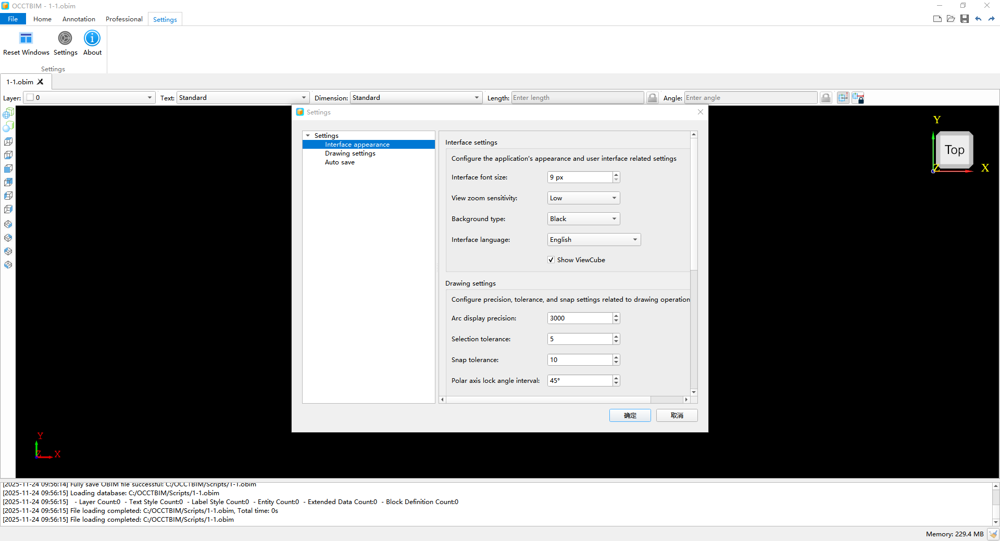

<h1 align="center">OCCTBIM</h1>

<p align="center">OpenCASCADE-based CAD/BIM modeling platform with 2D/3D drafting, professional BIM modules, and a layered extensible architecture.</p>

<p align="center">
  <a href="./README.md">English</a> | <a href="./README.zh-CN.md">简体中文</a>
</p>

<p align="center">
     <a href="./docs/en/README.md"></a> <a href="https://github.com/zly258/OCCTBIM/releases"></a>
</p>

OCCTBIM is a free-to-use desktop CAD/BIM software system built on the OpenCASCADE geometric kernel and Qt. This repository provides the complete bilingual system architecture documentation and links to official Windows and Linux release packages.

## Highlights

| Highlight | Why it matters |
|---|---|
| 2D/3D CAD modeling and block system | Supports 2D primitives (points, lines, circles, arcs, rectangles, polygons), 3D solids (cubes, spheres, cylinders), annotations, and nested block definitions/references. |
| Professional BIM modules | Extends core modeling with dedicated HVAC, piping, structural steel, and PID symbol modules built on a shared BIM component and port foundation. |
| Layered, extensible architecture | Separates presentation, application, business, core, professional extension, and infrastructure layers with registry/factory extension points for entities, tools, actions, and custom data. |
| Modern Ribbon desktop UI | Combines a Qt 5.14.x Ribbon interface, dockable panels, multi-document management, and a property editor with validation. |
| Multi-format storage and exchange | Separates geometric and business data using SQLite and JSON while supporting DXF (`libdxfrw`), STEP, IGES, and glTF interoperability. |

## Architecture

OCCTBIM organizes its modules into a layered dependency structure so upper UI and workflow layers remain decoupled from geometric calculation and storage backends:

```text
┌─────────────────────────────────────────────────────────────────────────┐
│                           Presentation Layer                            │
│  ┌──────────────┐  ┌──────────────┐  ┌──────────────┐  ┌─────────────┐  │
│  │  MainWindow  │  │    Ribbon    │  │   Docking    │  │   Dialogs   │  │
│  │     (UI)     │  │  Interface   │  │    Panels    │  │             │  │
│  └──────────────┘  └──────────────┘  └──────────────┘  └─────────────┘  │
└────────────────────────────────────┬────────────────────────────────────┘
                                     │
                                     ▼
┌─────────────────────────────────────────────────────────────────────────┐
│                           Application Layer                             │
│  ┌──────────────┐  ┌──────────────┐  ┌──────────────┐  ┌─────────────┐  │
│  │    Action    │  │     Tool     │  │ Command Undo │  │    Event    │  │
│  │    System    │  │    System    │  │ Transactions │  │  Handlers   │  │
│  └──────────────┘  └──────────────┘  └──────────────┘  └─────────────┘  │
└────────────────────────────────────┬────────────────────────────────────┘
                                     │
                                     ▼
┌─────────────────────────────────────────────────────────────────────────┐
│                             Business Layer                              │
│  ┌──────────────┐  ┌──────────────┐  ┌──────────────┐  ┌─────────────┐  │
│  │   Document   │  │  Data Model  │  │  Entity /    │  │  Style /    │  │
│  │  Management  │  │              │  │  Layer Mgr   │  │  Block Mgr  │  │
│  └──────────────┘  └──────────────┘  └──────────────┘  └─────────────┘  │
└────────────────────────────────────┬────────────────────────────────────┘
                                     │
                                     ▼
┌─────────────────────────────────────────────────────────────────────────┐
│                               Core Layer                                │
│  ┌──────────────┐  ┌──────────────┐  ┌──────────────┐  ┌─────────────┐  │
│  │    Entity    │  │  ExtendData  │  │   Viewport   │  │  Geometry   │  │
│  │    System    │  │    System    │  │  Rendering   │  │ Calculation │  │
│  └──────────────┘  └──────────────┘  └──────────────┘  └─────────────┘  │
└──────────────────▲───────────────────────────────────┬──────────────────┘
                   │                                   │
                   │                                   ▼
┌───────────────────────────────────┐ ┌───────────────────────────────────┐
│      Professional Extensions      │ │       Infrastructure Layer        │
│  ┌──────────────┐ ┌────────────┐  │ │  ┌──────────────┐ ┌────────────┐  │
│  │     BIM      │ │   HVAC /   │  │ │  │   Data IO    │ │OpenCASCADE │  │
│  │  Foundation  │ │ Pipe / PID │  │ │  │SQLite / JSON │ │   7.9.x    │  │
│  │   (Ports)    │ │ Structure  │  │ │  │   / Utils    │ │  Qt 5.14.x │  │
│  └──────────────┘ └────────────┘  │ │  └──────────────┘ └────────────┘  │
└───────────────────────────────────┘ └───────────────────────────────────┘
```

### Technology Stack

| Layer | Technology |
|---|---|
| Geometric Kernel | OpenCASCADE 7.9.x (AIS 3D visualization) |
| UI Framework | Qt 5.14.x (Ribbon interface, dockable panels, OpenGL viewport) |
| Data Storage | SQLite + JSON |
| Build System | CMake + Unity Build |
| File Formats | JSON, DXF (`libdxfrw`), STEP, IGES, glTF |

## Usage Example

OCCTBIM provides a Ribbon-based desktop workspace combining 2D/3D drafting tools, dockable model/layer panels, a property editor, and an interactive OpenCASCADE viewport:



## Quick Install

OCCTBIM software is free to download and use.

- **Desktop application (Windows and Linux)**: Download the latest Windows installer or Linux package from the [GitHub Releases](https://github.com/zly258/OCCTBIM/releases) page.
- **Offline architecture documentation**: Clone this repository to browse the full English and Chinese architecture docs locally:

```bash
git clone https://github.com/zly258/OCCTBIM.git
```

## Quick Start

### Using the Desktop Application

1. Download the package matching your operating system (Windows installer or Linux package) from [GitHub Releases](https://github.com/zly258/OCCTBIM/releases).
2. Install and launch OCCTBIM.
3. Create a new document from the Ribbon toolbar to start 2D/3D modeling or work with BIM modules, and inspect or edit selected objects in the dockable property panel.

### Reading the Architecture Documentation

1. Start with the [System Architecture Overview](./docs/en/system-overview.md) to understand the layer boundaries and core module responsibilities.
2. Review the [Feature List](./docs/en/feature-list.md) for a module-by-module capability breakdown.
3. Consult the [Extension Mechanism Design](./docs/en/extension-mechanism.md) when planning custom entities, tools, actions, or property editors.

## Documentation

| Topic | What it covers | Link |
|---|---|---|
| Documentation Index | Overview, learning path, and module guide | [docs/en/README.md](./docs/en/README.md) |
| System Architecture Overview | Layered architecture, core modules, and design patterns | [docs/en/system-overview.md](./docs/en/system-overview.md) |
| Feature List | Complete 2D/3D modeling, BIM, and platform capabilities | [docs/en/feature-list.md](./docs/en/feature-list.md) |
| Document System | Multi-document lifecycle and application context | [docs/en/document-system.md](./docs/en/document-system.md) |
| Entity System | Entity hierarchy, property system, and editor extensions | [docs/en/entity-system.md](./docs/en/entity-system.md) |
| Extended Data System | Custom entity attributes and metadata extension | [docs/en/extend-data-system.md](./docs/en/extend-data-system.md) |
| Tool System | Interactive drawing, editing, and measurement tools | [docs/en/tool-system.md](./docs/en/tool-system.md) |
| Action System | Menu, toolbar, shortcut, and command action management | [docs/en/action-system.md](./docs/en/action-system.md) |
| UI System | Ribbon interface, dockable panels, and viewport widgets | [docs/en/ui-system.md](./docs/en/ui-system.md) |
| BIM Modules | BIM foundation, HVAC, piping, structural, and PID modules | [docs/en/bim-system.md](./docs/en/bim-system.md) |
| Data Storage System | SQLite database, JSON serialization, and file I/O | [docs/en/data-storage-system.md](./docs/en/data-storage-system.md) |
| Extension Mechanism | Plugin architecture and multi-dimensional extension points | [docs/en/extension-mechanism.md](./docs/en/extension-mechanism.md) |
