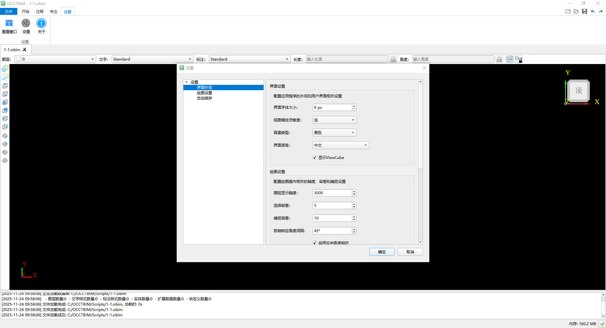

<h1 align="center">OCCTBIM</h1>

<p align="center">基于 OpenCASCADE 几何内核的 CAD/BIM 建模平台，提供 2D/3D 绘图建模、专业 BIM 模块与分层可扩展架构。</p>

<p align="center">
  <a href="./README.md">English</a> | <a href="./README.zh-CN.md">简体中文</a>
</p>

<p align="center">
     <a href="./docs/zh/README.md"></a> <a href="https://github.com/zly258/OCCTBIM/releases"></a>
</p>

OCCTBIM 是一款基于 OpenCASCADE 几何内核与 Qt 打造的免费桌面端 CAD/BIM 软件系统。本仓库提供完整的中英文系统架构文档，并指向官方 Windows 与 Linux 安装包发布页。

## 核心亮点

| 亮点 | 核心价值 |
|---|---|
| 2D/3D 建模与块系统 | 支持点、线、圆、弧、矩形、多边形等二维图元，立方体、球体、圆柱体等三维实体，以及标注和嵌套块定义与引用。 |
| BIM 专业模块 | 基于统一的 BIM 构件与连接端口基础框架，提供 HVAC 暖通、管道、钢结构及 PID 符号等专业建模模块。 |
| 分层与多维度扩展架构 | 清晰划分表现层、应用层、业务层、核心层、专业扩展层与基础设施层，通过注册表与工厂模式支持实体、工具、动作和自定义数据扩展。 |
| 现代 Qt 桌面界面 | 采用 Qt 5.14.x 构建 Ribbon 界面与可停靠面板系统，支持多文档管理与带校验机制的属性编辑器。 |
| 多格式存储与数据交换 | 采用 SQLite 与 JSON 分离存储业务和配置数据，支持 JSON、DXF（`libdxfrw`）、STEP、IGES 与 glTF 等格式。 |

## 系统架构

OCCTBIM 采用单向依赖的分层架构设计，将界面交互、业务管理与底层几何计算、数据持久化清晰解耦：

```text
┌─────────────────────────────────────────────────────────────────────────┐
│                           Presentation Layer                            │
│  ┌──────────────┐  ┌──────────────┐  ┌──────────────┐  ┌─────────────┐  │
│  │  MainWindow  │  │    Ribbon    │  │   Docking    │  │   Dialogs   │  │
│  │     (UI)     │  │  Interface   │  │    Panels    │  │             │  │
│  └──────────────┘  └──────────────┘  └──────────────┘  └─────────────┘  │
└────────────────────────────────────┬────────────────────────────────────┘
                                     │
                                     ▼
┌─────────────────────────────────────────────────────────────────────────┐
│                           Application Layer                             │
│  ┌──────────────┐  ┌──────────────┐  ┌──────────────┐  ┌─────────────┐  │
│  │    Action    │  │     Tool     │  │ Command Undo │  │    Event    │  │
│  │    System    │  │    System    │  │ Transactions │  │  Handlers   │  │
│  └──────────────┘  └──────────────┘  └──────────────┘  └─────────────┘  │
└────────────────────────────────────┬────────────────────────────────────┘
                                     │
                                     ▼
┌─────────────────────────────────────────────────────────────────────────┐
│                             Business Layer                              │
│  ┌──────────────┐  ┌──────────────┐  ┌──────────────┐  ┌─────────────┐  │
│  │   Document   │  │  Data Model  │  │  Entity /    │  │  Style /    │  │
│  │  Management  │  │              │  │  Layer Mgr   │  │  Block Mgr  │  │
│  └──────────────┘  └──────────────┘  └──────────────┘  └─────────────┘  │
└────────────────────────────────────┬────────────────────────────────────┘
                                     │
                                     ▼
┌─────────────────────────────────────────────────────────────────────────┐
│                               Core Layer                                │
│  ┌──────────────┐  ┌──────────────┐  ┌──────────────┐  ┌─────────────┐  │
│  │    Entity    │  │  ExtendData  │  │   Viewport   │  │  Geometry   │  │
│  │    System    │  │    System    │  │  Rendering   │  │ Calculation │  │
│  └──────────────┘  └──────────────┘  └──────────────┘  └─────────────┘  │
└──────────────────▲───────────────────────────────────┬──────────────────┘
                   │                                   │
                   │                                   ▼
┌───────────────────────────────────┐ ┌───────────────────────────────────┐
│      Professional Extensions      │ │       Infrastructure Layer        │
│  ┌──────────────┐ ┌────────────┐  │ │  ┌──────────────┐ ┌────────────┐  │
│  │     BIM      │ │   HVAC /   │  │ │  │   Data IO    │ │OpenCASCADE │  │
│  │  Foundation  │ │ Pipe / PID │  │ │  │SQLite / JSON │ │   7.9.x    │  │
│  │   (Ports)    │ │ Structure  │  │ │  │   / Utils    │ │  Qt 5.14.x │  │
│  └──────────────┘ └────────────┘  │ │  └──────────────┘ └────────────┘  │
└───────────────────────────────────┘ └───────────────────────────────────┘
```

### 技术栈

| 层级 | 技术选型 |
|---|---|
| 几何内核 | OpenCASCADE 7.9.x（AIS 三维可视化） |
| UI 框架 | Qt 5.14.x（Ribbon 界面、停靠面板、OpenGL 视口） |
| 数据存储 | SQLite + JSON |
| 构建系统 | CMake + Unity Build |
| 文件格式 | JSON、DXF（`libdxfrw`）、STEP、IGES、glTF |

## 使用示例

OCCTBIM 提供基于 Ribbon 工具栏的桌面工作区，集成 2D/3D 建模工具、可停靠模型与图层面板、属性编辑器以及 OpenCASCADE 三维交互视口：



## 快速安装

OCCTBIM 软件可免费下载和使用。

- **桌面应用程序（Windows / Linux）**：前往 [GitHub Releases](https://github.com/zly258/OCCTBIM/releases) 页面下载最新的 Windows 安装包或 Linux 安装包。
- **离线查阅架构文档**：克隆本仓库到本地，即可离线阅读完整的中英文架构文档：

```bash
git clone https://github.com/zly258/OCCTBIM.git
```

## 快速开始

### 运行桌面软件

1. 前往 [GitHub Releases](https://github.com/zly258/OCCTBIM/releases) 下载对应平台的 Windows 安装包或 Linux 安装包。
2. 完成安装并启动 OCCTBIM。
3. 通过顶部 Ribbon 工具栏新建文档，即可开始 2D/3D 绘图或 BIM 专业建模，并在停靠属性面板中查看与编辑实体参数。

### 查阅架构文档

1. 先阅读 [系统整体架构](./docs/zh/系统整体架构.md)，了解各层职责边界与核心模块关系。
2. 参考 [功能列表](./docs/zh/功能列表.md) 掌握 2D/3D 建模与 BIM 模块的完整功能范围。
3. 如需进行自定义实体、工具、动作或属性编辑器开发，可重点阅读 [扩展机制设计](./docs/zh/扩展机制.md)。

## 文档导航

| 主题 | 内容说明 | 链接 |
|---|---|---|
| 文档总览 | 架构文档索引、学习路径与模块说明 | [docs/zh/README.md](./docs/zh/README.md) |
| 系统整体架构 | 分层架构、核心模块与设计模式 | [docs/zh/系统整体架构.md](./docs/zh/系统整体架构.md) |
| 功能列表 | 2D/3D 建模、BIM 模块与平台功能清单 | [docs/zh/功能列表.md](./docs/zh/功能列表.md) |
| 文档系统 | 多文档生命周期与应用上下文管理 | [docs/zh/文档系统.md](./docs/zh/文档系统.md) |
| 实体系统 | 实体层级、属性系统与编辑器扩展机制 | [docs/zh/实体系统.md](./docs/zh/实体系统.md) |
| 扩展数据系统 | 实体自定义属性与业务数据管理 | [docs/zh/扩展数据系统.md](./docs/zh/扩展数据系统.md) |
| 工具系统 | 交互式绘图、编辑与测量工具逻辑 | [docs/zh/工具系统.md](./docs/zh/工具系统.md) |
| 动作系统 | 菜单、工具栏、快捷键与命令动作配置 | [docs/zh/动作系统.md](./docs/zh/动作系统.md) |
| 用户界面系统 | Ribbon 界面、停靠面板与视口组件 | [docs/zh/用户界面系统.md](./docs/zh/用户界面系统.md) |
| BIM 专业模块 | BIM 基础框架与 HVAC、管道、结构、PID 模块 | [docs/zh/BIM系统.md](./docs/zh/BIM系统.md) |
| 数据存储系统 | SQLite 数据库、JSON 序列化与文件 I/O | [docs/zh/数据存储系统.md](./docs/zh/数据存储系统.md) |
| 扩展机制设计 | 插件架构与多维度扩展点实现指南 | [docs/zh/扩展机制.md](./docs/zh/扩展机制.md) |
