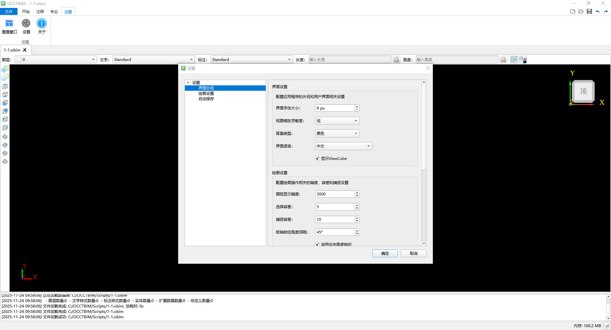

# OCCTBIM 文档

## 🏗️ OCCTBIM 系统架构文档

OCCTBIM 是基于 OpenCASCADE 几何内核的专业 CAD/BIM 软件系统，提供全面的 2D/3D 建模、BIM 专业模块和可扩展的架构设计。

## 📖 文档说明

### 🚀 快速开始
- **[English Documentation](docs/en/)** - 完整的英文系统架构文档
- **[中文文档](docs/zh/)** - 完整的中文系统架构文档

### 📚 架构文档
- **系统整体架构** - 完整的系统架构和模块关系
- **文档系统** - 文档管理和生命周期
- **实体系统** - 实体架构、属性系统和编辑器扩展
- **扩展数据系统** - 自定义数据管理和扩展机制
- **工具系统** - 交互工具和用户交互逻辑
- **动作系统** - 动作配置和管理
- **UI 用户界面系统** - 用户界面组件和停靠面板系统
- **BIM 专业模块** - HVAC、管道、结构、PID 等专业建模系统
- **数据存储系统** - 数据库和文件 I/O 系统
- **扩展机制设计** - 插件和扩展架构设计

## 🎯 核心特性

- **2D/3D 建模**: 点、线、圆、弧、矩形、多边形、立方体、球体、圆柱体
- **BIM 专业模块**: HVAC 系统、管道系统、结构建模、PID 符号
- **块系统**: 块定义、引用和嵌套块
- **分层架构**: 表现层、应用层、业务层、核心层清晰分离
- **扩展机制**: 实体、工具、动作、数据多维度扩展
- **属性系统**: 完整的属性定义、编辑器和验证机制
- **现代界面**: Ribbon 界面和停靠面板系统
- **多格式支持**: JSON、DXF、STEP、IGES、glTF 等

## 🏗️ 技术栈

- **几何内核**: OpenCASCADE 7.9.x
- **UI 框架**: Qt 5.14.x
- **数据存储**: SQLite + JSON
- **构建系统**: CMake + Unity Build
- **文件格式**: DXF (libdxfrw)、STEP、IGES、glTF

## 📦 软件发布

### 🆓 软件免费使用

**OCCTBIM 软件免费使用** - 您可以免费下载和使用本软件。

### 📥 下载链接

**请前往官方发布页面下载最新的软件安装包。**

- **Windows 安装包**: 在发布页面提供
- **Linux 安装包**: 在发布页面提供

### 🖼️ 软件界面

