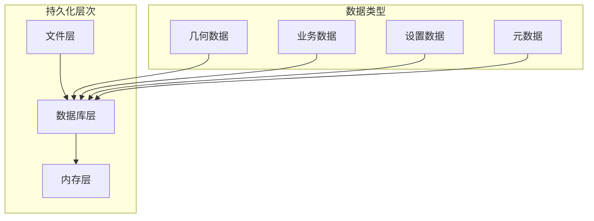
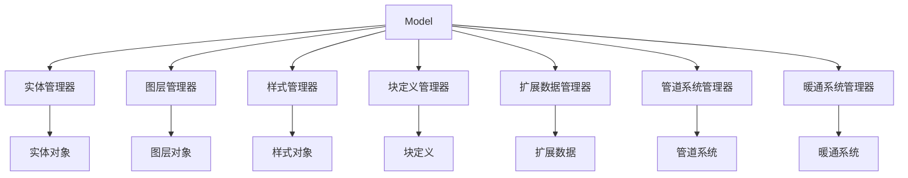
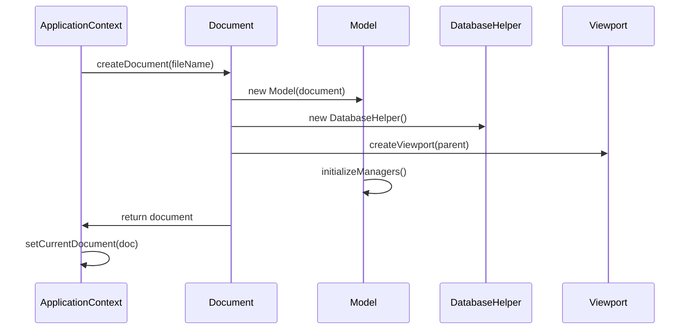
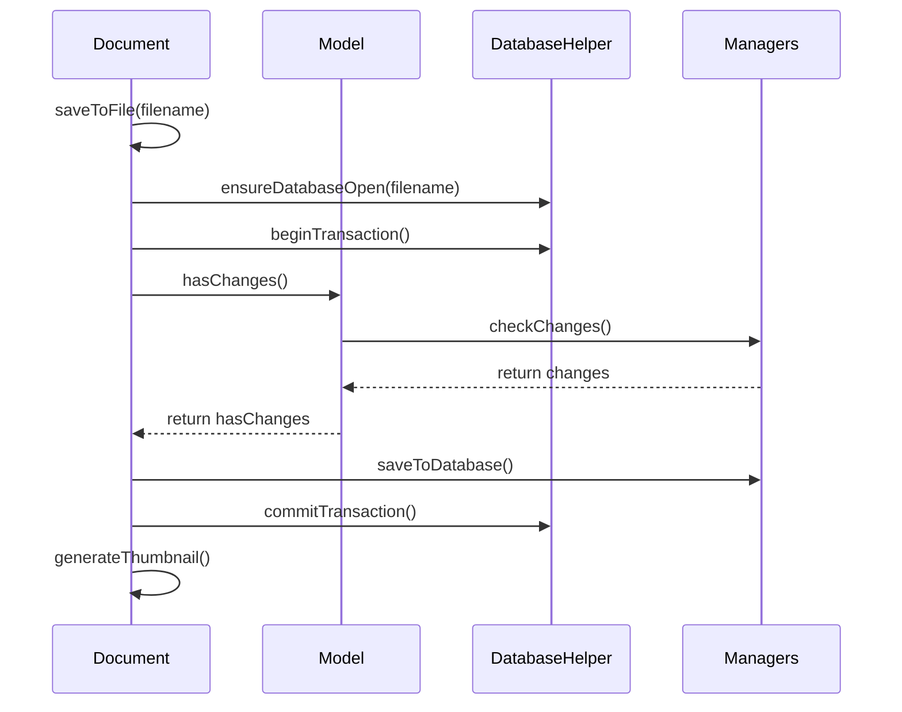
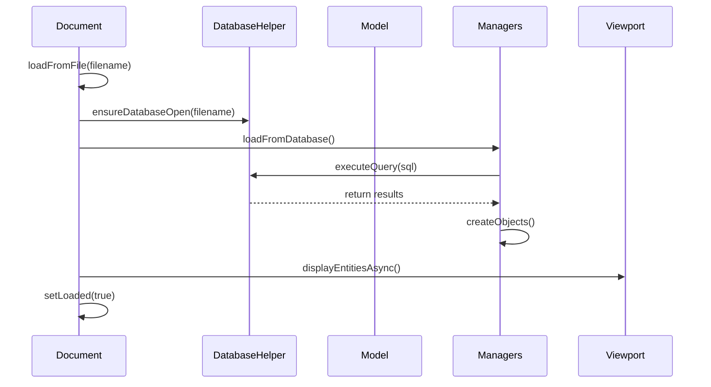

# Document 文档系统架构

## 概述

Document 系统是 OCCTBIM 的核心模块，负责文档的生命周期管理、数据持久化、多文档支持等功能。该系统采用分层设计，将文档管理、数据模型和应用上下文分离，提供了完整的文档操作能力。

## 核心架构

```mermaid
classDiagram
    class ApplicationContext {
        -QList~Document*~ m_documents
        -Document* m_currentDocument
        -QMainWindow* m_mainWindow
        +createDocument(fileName) Document*
        +openDocument(fileName) bool
        +closeDocument(doc) void
        +setCurrentDocument(doc) void
        +currentDocument() Document*
        +currentViewport() Viewport*
        +log(message) void
        +addRecentFile(filePath) void
    }

    class Document {
        -QString m_id
        -QString m_fileName
        -Model* m_model
        -Viewport* m_viewport
        -CommandStack* m_commandStack
        -TransactionManager* m_transactionManager
        -DatabaseHelper* m_databaseHelper
        -bool m_isModified
        -bool m_isLoaded
        +saveToFile(filename) bool
        +loadFromFile(filename) bool
        +executeCommand(cmd) void
        +beginTransaction(name) void
        +commitTransaction() void
        +rollbackTransaction() void
        +generateThumbnail(filename) bool
    }

    class Model {
        -QString m_id
        -Document* m_document
        -EntityManager* m_entityManager
        -LayerManager* m_layerManager
        -StyleManager* m_styleManager
        -BlockDefinitionManager* m_blockDefinitionManager
        -ExtendDataManager* m_extendDataManager
        -PipeSystemManager* m_pipeSystemManager
        -HvacSystemManager* m_hvacSystemManager
        +hasChanges() bool
        +updateContext() void
        +saveViewport() void
    }

    class DatabaseHelper {
        -QSqlDatabase m_database
        -QString m_connectionName
        +openDatabase(filename) bool
        +closeDatabase() void
        +executeQuery(sql) QSqlQuery
        +beginTransaction() bool
        +commitTransaction() bool
        +rollbackTransaction() bool
    }

    class CommandStack {
        -QList~UndoCommand*~ m_commands
        -int m_currentIndex
        +push(command) void
        +undo() void
        +redo() void
        +clear() void
        +canUndo() bool
        +canRedo() bool
    }

    class TransactionManager {
        -QStack~Transaction*~ m_transactionStack
        -bool m_inTransaction
        +beginTransaction(name) void
        +commitTransaction() void
        +rollbackTransaction() void
        +isInTransaction() bool
    }
```



## 核心组件详解

### 1. ApplicationContext 应用上下文

ApplicationContext 是全局单例，负责整个应用的文档管理和上下文维护。

#### 主要职责
- **文档生命周期管理**: 创建、打开、关闭文档
- **当前文档管理**: 维护当前活动文档状态
- **全局日志管理**: 提供统一的日志记录接口
- **历史记录管理**: 维护最近打开文件列表

#### 关键特性
```cpp
// 单例模式实现
static ApplicationContext *instance();

// 文档管理
Document *createDocument(const QString &fileName);
bool openDocument(const QString &fileName);
void closeDocument(Document *doc);

// 日志系统 - 支持多种语法
LOG("简单日志消息");
LOG_STREAM << "流式日志: " << value << " 更多内容";
```

#### 日志系统设计
提供了两种日志记录方式：
1. **函数调用方式**: `LOG("消息")`
2. **流式方式**: `LOG_STREAM << "消息" << 变量`

### 2. Document 文档核心

Document 是文档系统的核心类，封装了单个文档的所有功能。

#### 主要职责
- **文档数据管理**: 管理文档的所有业务数据
- **持久化操作**: 文档的保存和加载
- **命令管理**: 撤销重做功能支持
- **事务管理**: 数据操作的事务性保证
- **视图管理**: 创建和管理文档视图

#### 数据持久化架构


#### 保存策略
- **增量保存**: 只保存变更的数据，提高性能
- **全量保存**: 完整保存所有数据，确保一致性
- **自动保存**: 定时自动保存，防止数据丢失
- **缩略图生成**: 自动生成文档预览图

#### 事务管理
```cpp
// 事务操作示例
document->beginTransaction("创建实体");
try {
    // 执行多个相关操作
    entity1->create();
    entity2->modify();
    document->commitTransaction();
} catch (...) {
    document->rollbackTransaction();
}
```

### 3. Model 数据模型

Model 是文档的业务数据容器，管理所有业务相关的数据和逻辑。

#### 管理器架构
Model 采用管理器模式，将不同类型的数据分别管理：



#### 设置管理
Model 提供了灵活的设置管理机制：
```cpp
// 设置操作
model->setSetting("grid.visible", true);
model->setSetting("snap.enabled", true);
QVariant value = model->getSetting("grid.size", 10.0);

// 批量设置
QMap<QString, QVariant> settings;
settings["grid.visible"] = true;
settings["snap.enabled"] = true;
model->setSettings(settings);
```

### 4. DatabaseHelper 数据库助手

DatabaseHelper 封装了所有数据库操作，提供了统一的数据访问接口。

#### 主要功能
- **连接管理**: 数据库连接的创建和管理
- **事务支持**: 数据库级别的事务操作
- **查询执行**: SQL查询的执行和结果处理
- **错误处理**: 数据库操作的错误处理和恢复

#### 数据库架构
```sql
-- 主要数据表结构
CREATE TABLE entities (
    id TEXT PRIMARY KEY,
    type TEXT NOT NULL,
    layer_id TEXT,
    data BLOB,
    created_at TIMESTAMP,
    modified_at TIMESTAMP
);

CREATE TABLE layers (
    id TEXT PRIMARY KEY,
    name TEXT NOT NULL,
    color TEXT,
    line_type TEXT,
    visible BOOLEAN
);

CREATE TABLE styles (
    id TEXT PRIMARY KEY,
    name TEXT NOT NULL,
    type TEXT NOT NULL,
    properties TEXT
);

CREATE TABLE extend_data (
    entity_id TEXT,
    key TEXT,
    value TEXT,
    type TEXT,
    PRIMARY KEY (entity_id, key)
);
```

### 5. CommandStack 命令栈

CommandStack 实现了完整的撤销重做功能，支持复杂的命令组合。

#### 命令模式实现
```cpp
class UndoCommand {
public:
    virtual void execute() = 0;
    virtual void undo() = 0;
    virtual void redo() = 0;
    virtual QString description() const = 0;
};

// 使用示例
auto cmd = new CreateEntityCommand(entity);
document->executeCommand(cmd);  // 自动加入命令栈
```

#### 复合命令支持
```cpp
class CompositeCommand : public UndoCommand {
private:
    QList<UndoCommand*> m_commands;
public:
    void addCommand(UndoCommand* cmd);
    void execute() override;
    void undo() override;
};
```

## 文档生命周期

### 1. 文档创建流程


### 2. 文档保存流程


### 3. 文档加载流程


## 性能优化策略

### 1. 分页加载
对于大型文档，采用分页加载策略：
```cpp
template <typename T>
QList<T *> Document::loadDataPaged(
    std::function<QList<T *>(Document *, int, int)> loadFunc,
    const QString &dataTypeName, 
    int pageSize = 1000) {
    
    QList<T *> allData;
    int offset = 0;
    
    while (true) {
        QList<T *> pageData = loadFunc(this, offset, pageSize);
        if (pageData.isEmpty()) break;
        
        allData.append(pageData);
        offset += pageSize;
    }
    
    return allData;
}
```

### 2. 异步显示
实体显示采用异步机制，避免界面阻塞：
```cpp
void Document::displayEntitiesAsync() {
    QTimer::singleShot(0, [this]() {
        // 在事件循环中异步显示实体
        if (m_viewport) {
            m_viewport->displayAllEntities();
        }
    });
}
```

### 3. 数据库优化
- **连接池**: 复用数据库连接
- **索引优化**: 关键字段建立索引
- **批量操作**: 减少数据库交互次数
- **空间清理**: 定期清理未使用的数据库空间

### 4. 内存管理
- **智能指针**: 自动内存管理
- **对象缓存**: 缓存频繁访问的对象
- **延迟加载**: 按需加载大型数据

## 扩展机制

### 1. 自定义管理器
可以通过继承现有管理器或创建新管理器来扩展功能：
```cpp
class CustomManager : public QObject {
public:
    CustomManager(Model* model);
    void saveToDatabase();
    void loadFromDatabase();
};

// 在Model中注册
model->registerManager("custom", customManager);
```

### 2. 自定义设置
通过设置系统添加自定义配置：
```cpp
// 注册自定义设置
model->setSetting("custom.feature.enabled", true);
model->setSetting("custom.feature.value", 42);

// 监听设置变化
connect(model, &Model::settingsChanged, [this]() {
    updateCustomFeature();
});
```

### 3. 事件钩子
在关键操作点提供事件钩子：
```cpp
// 文档保存前后的钩子
connect(document, &Document::beforeSave, [](Document* doc) {
    // 保存前的自定义处理
});

connect(document, &Document::afterSave, [](Document* doc) {
    // 保存后的自定义处理
});
```

## 最佳实践

### 1. 文档操作
- 始终通过 ApplicationContext 管理文档
- 使用事务确保数据一致性
- 及时释放不需要的文档资源

### 2. 数据持久化
- 优先使用增量保存提高性能
- 定期执行全量保存确保数据完整性
- 合理设置自动保存间隔

### 3. 内存管理
- 避免循环引用导致内存泄漏
- 及时清理临时对象
- 使用智能指针管理对象生命周期

### 4. 错误处理
- 所有数据库操作都要有错误处理
- 提供用户友好的错误信息
- 记录详细的错误日志便于调试

Document 系统为整个 OCCTBIM 应用提供了坚实的基础，其模块化设计和完善的扩展机制确保了系统的可维护性和可扩展性。