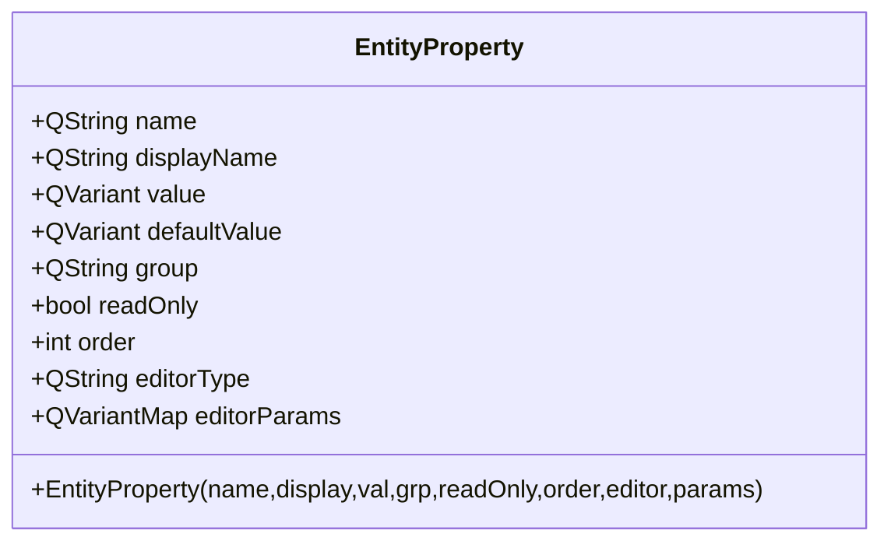
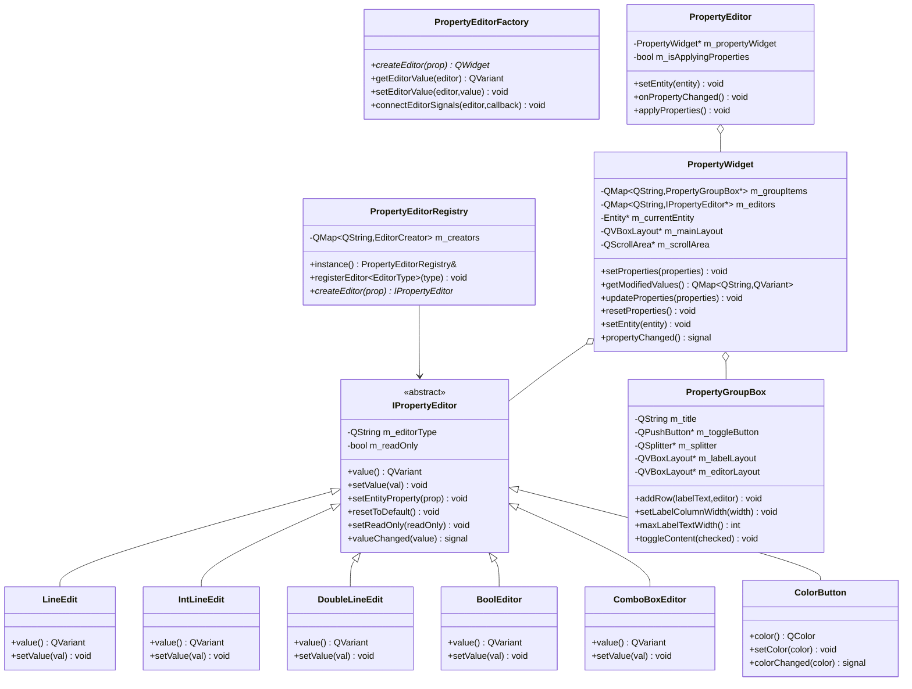
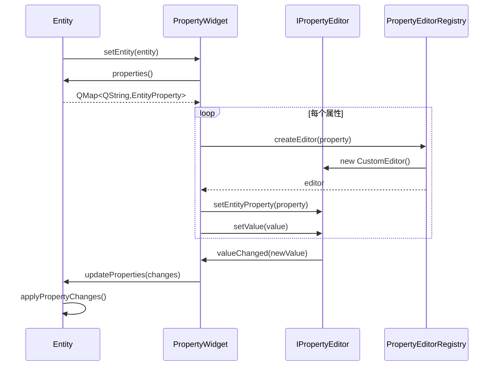
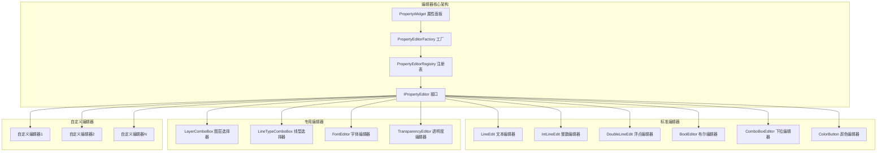
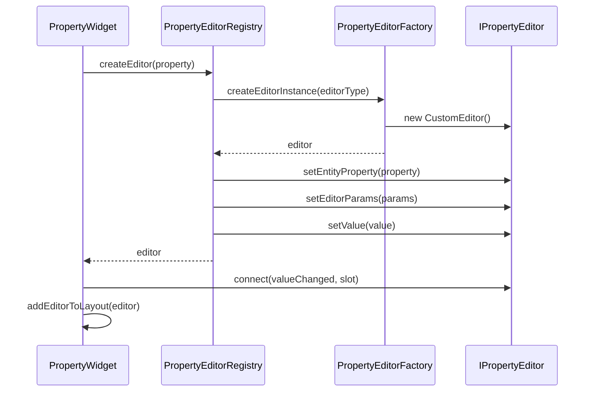

# Entity 实体系统架构

## 概述

Entity 系统是 OCCTBIM 的核心几何对象管理系统，负责所有几何实体的创建、管理、渲染和交互。该系统采用面向对象设计，支持 2D/3D 几何体、注释对象、BREP 实体和特征实体等多种类型，并提供了完整的属性系统、夹点编辑、捕捉系统等功能。

## 系统架构

```mermaid
classDiagram
    class Entity {
        <<abstract>>
        -QString m_id
        -QString m_layerId
        -TopoDS_Shape m_shape
        -Handle~AIS_Shape~ m_aisObject
        -bool m_isShapeModified
        -bool m_isVisualModified
        +serialize(json) void
        +deserialize(json) void
        +properties() QMap~QString,EntityProperty~
        +updateProperties(properties) void
        +gripPoints() QList~GripPoint~
        +snapPoints() QList~SnapPoint~
        +transformBy(transform) void
        #updateShape() void
        #updateAISObject() void
    }

    class EntityManager {
        -QMap~QString,Entity*~ m_entities
        -QSet~QString~ m_addedItems
        -QSet~QString~ m_modifiedItems
        -QSet~QString~ m_deletedItems
        +addEntity(entity) void
        +removeEntity(entity) void
        +updateEntity(entity) void
        +findEntityById(id) Entity*
        +getEntitiesByLayer(layerId) QList~Entity*~
        +createEntity(type) Entity*
        +hasChanges() bool
    }

    class EntityRegistry {
        -QHash~QString,EntityCreator~ creators
        +registerEntity(creator,type) void
        +createEntity(type,document) Entity*
    }

    class TransformEntity {
        -gp_Trsf m_localTransform
        -gp_Pnt m_position
        -gp_Quaternion m_rotation
        -gp_Vec3f m_scale
        +setPosition(position) void
        +setRotation(rotation) void
        +setScale(scale) void
        +localTransform() gp_Trsf
        +worldTransform() gp_Trsf
    }

    %% 2D实体类
    class LineEntity {
        -gp_Pnt m_startPoint
        -gp_Pnt m_endPoint
        -double m_length
        +setStartPoint(point) void
        +setEndPoint(point) void
        +length() double
    }

    class CircleEntity {
        -gp_Pnt m_center
        -double m_radius
        -gp_Dir m_normal
        +setCenter(center) void
        +setRadius(radius) void
        +setNormal(normal) void
    }

    class RectangleEntity {
        -gp_Pnt m_corner1
        -gp_Pnt m_corner2
        -double m_width
        -double m_height
        +setCorners(p1,p2) void
        +setDimensions(w,h) void
    }

    %% 3D实体类
    class BoxEntity {
        -double m_length
        -double m_width
        -double m_height
        +setLength(length) void
        +setWidth(width) void
        +setHeight(height) void
    }

    class SphereEntity {
        -gp_Pnt m_center
        -double m_radius
        +setCenter(center) void
        +setRadius(radius) void
    }

    class CylinderEntity {
        -gp_Pnt m_baseCenter
        -gp_Dir m_axis
        -double m_radius
        -double m_height
        +setBaseCenter(center) void
        +setAxis(axis) void
        +setRadius(radius) void
        +setHeight(height) void
    }

    %% 注释实体类
    class AnnotationEntity {
        <<abstract>>
        -gp_Pnt m_position
        -double m_scale
        -double m_angle
        +setPosition(position) void
        +setScale(scale) void
        +setAngle(angle) void
    }

    class TextEntity {
        -QString m_text
        -QString m_textStyle
        -QString m_fontFamily
        -double m_height
        -TextAlignment m_alignment
        +setText(text) void
        +setTextStyle(style) void
        +setHeight(height) void
        +setAlignment(alignment) void
    }

    class LinearDimEntity {
        -gp_Pnt m_point1
        -gp_Pnt m_point2
        -gp_Pnt m_dimLinePoint
        -QString m_dimStyle
        +setPoints(p1,p2) void
        +setDimLinePoint(point) void
        +setDimStyle(style) void
    }

    %% 特征实体类
    class FeatureEntityBase {
        <<abstract>>
        -bool m_featureEditingEnabled
        +isFeatureEntity() bool
        +featureTypeName() QString
        +supportsParametricEditing() bool
        +buildFeatureNodeData() FeatureNodeData*
    }

    class ExtrudeFeatureEntity {
        -TopoDS_Shape m_profile
        -gp_Vec m_direction
        -double m_distance
        +setProfile(shape) void
        +setDirection(direction) void
        +setDistance(distance) void
    }

    class RevolveFeatureEntity {
        -TopoDS_Shape m_profile
        -gp_Ax1 m_axis
        -double m_angle
        +setProfile(shape) void
        +setAxis(axis) void
        +setAngle(angle) void
    }

    %% BREP实体类
    class BrepEntity {
        -TopoDS_Shape m_brepShape
        +setBrepShape(shape) void
        +brepShape() TopoDS_Shape
    }

    class EdgeEntity {
        -TopoDS_Edge m_edge
        +setEdge(edge) void
        +edge() TopoDS_Edge
    }

    class FaceEntity {
        -TopoDS_Face m_face
        +setFace(face) void
        +face() TopoDS_Face
    }

    %% 继承关系
    Entity <|-- TransformEntity
    TransformEntity <|-- LineEntity
    TransformEntity <|-- CircleEntity
    TransformEntity <|-- RectangleEntity
    TransformEntity <|-- BoxEntity
    TransformEntity <|-- SphereEntity
    TransformEntity <|-- CylinderEntity
    TransformEntity <|-- AnnotationEntity
    TransformEntity <|-- FeatureEntityBase
    TransformEntity <|-- BrepEntity

    AnnotationEntity <|-- TextEntity
    AnnotationEntity <|-- LinearDimEntity

    FeatureEntityBase <|-- ExtrudeFeatureEntity
    FeatureEntityBase <|-- RevolveFeatureEntity

    BrepEntity <|-- EdgeEntity
    BrepEntity <|-- FaceEntity

    %% 关联关系
    EntityManager o-- Entity
    EntityRegistry ..> Entity : creates
    Entity --> EntityManager : managed by
```



## 核心组件详解

### 1. Entity 基类

Entity 是所有几何对象的基类，定义了实体的基本接口和行为。

#### 核心属性
```cpp
class Entity : public ISerializable {
protected:
    QString m_id;                    // 唯一标识符
    QString m_layerId;               // 所属图层ID
    QString m_entityType;            // 实体类型
    TopoDS_Shape m_shape;            // OpenCASCADE几何形状
    Handle(AIS_Shape) m_aisObject;   // 可视化对象
    
    // 视觉属性
    int m_color;                     // 颜色
    double m_transparency;           // 透明度
    double m_lineWidth;              // 线宽
    int m_lineType;                  // 线型
    
    // 状态标志
    bool m_isShapeModified;          // 几何形状是否修改
    bool m_isVisualModified;         // 视觉属性是否修改
    bool m_isPreview;                // 是否为预览状态
};
```

#### 关键接口
```cpp
// 序列化接口
virtual void serialize(QJsonObject &json) const = 0;
virtual void deserialize(const QJsonObject &json) = 0;

// 属性系统
virtual QMap<QString, EntityProperty> properties() const;
virtual void updateProperties(const QMap<QString, QVariant> &properties);

// 交互系统
virtual QList<Handle(GripPoint)> gripPoints() const;
virtual void moveGripPoint(int index, const gp_Vec &offset);
virtual QList<Handle(SnapPoint)> snapPoints() const;

// 变换系统
virtual void transformBy(const gp_Trsf &transform);
virtual gp_Trsf transform() const;

// 几何更新
virtual void updateShape() = 0;
virtual void updateAISObject();
```

### 2. EntityManager 实体管理器

EntityManager 负责实体的生命周期管理、批量操作和变更跟踪。

#### 主要功能

##### 实体管理
```cpp
// 添加实体
void addEntity(Entity *entity, bool recordUndo = true);
void addEntities(const QList<Entity *> &entities, bool recordUndo = true);

// 移除实体
void removeEntity(Entity *entity, bool recordUndo = true);
void removeEntities(const QList<Entity *> &entities, bool recordUndo = true);

// 更新实体
void updateEntity(Entity *entity, bool recordUndo = true);
void updateEntities(const QList<Entity *> &entities, bool recordUndo = true);
```

##### 实体查找
```cpp
// 按ID查找
Entity *findEntityById(const QString &id);

// 按图层查找
QList<Entity *> getEntitiesByLayer(const QString &layerId);
QList<Entity *> getEntitiesByLayers(const QStringList &layerIds);

// 按样式查找
QList<Entity *> findEntitiesByTextStyle(const QString &styleId);
QList<Entity *> findEntitiesByDimStyle(const QString &styleId);
```

##### 变更跟踪
```cpp
// 变更状态查询
bool hasChanges() const;
QStringList getAddedItems() const;
QStringList getModifiedItems() const;
QStringList getDeletedItems() const;

// 清理变更跟踪
void clearChangeTracking();
```

#### 批量操作优化
EntityManager 提供了批量操作优化，减少界面更新频率：
```cpp
// 批量添加实体但不立即显示（用于文件加载）
void addEntitiesWithoutDisplay(const QList<Entity *> &entities, bool recordUndo = false);

// 批量重新显示
void redisplayEntities(const QList<Entity *> &entities);
```

### 3. EntityRegistry 实体注册表

EntityRegistry 实现了实体类型的注册和工厂创建机制。

#### 注册机制
```cpp
// 实体创建函数类型
using EntityCreator = Entity *(*)(Document *);

// 注册实体类型
void registerEntity(EntityCreator creator, QString type);

// 创建实体实例
Entity *createEntity(QString type, Document *document);
```

#### 自动注册宏
```cpp
// 实体类自动注册宏
#define REGISTER_ENTITY(EntityClass, type) \
    class EntityClass##Registrar { \
    public: \
        EntityClass##Registrar() { \
            EntityRegistry::registerEntity(&EntityClass##Registrar::create, type); \
        } \
        static Entity *create(Document *document) { \
            return new EntityClass(document); \
        } \
    }; \
    static EntityClass##Registrar EntityClass##_registrar;

// 使用示例
REGISTER_ENTITY(LineEntity, "Line")
REGISTER_ENTITY(CircleEntity, "Circle")
```

### 4. TransformEntity 变换实体

TransformEntity 为实体提供了完整的3D变换能力。

#### 变换属性
```cpp
class TransformEntity : public Entity {
protected:
    gp_Trsf m_localTransform;        // 局部变换矩阵
    gp_Pnt m_position;               // 位置
    gp_Quaternion m_rotation;        // 旋转四元数
    gp_Vec3f m_scale;                // 缩放因子
    
public:
    // 位置操作
    void setPosition(const gp_Pnt &position);
    gp_Pnt position() const;
    
    // 旋转操作
    void setRotation(const gp_Quaternion &rotation);
    gp_Quaternion rotation() const;
    
    // 缩放操作
    void setScale(const gp_Vec3f &scale);
    gp_Vec3f scale() const;
    
    // 变换矩阵
    gp_Trsf localTransform() const;
    gp_Trsf worldTransform() const;
};
```

## 实体类型体系

### 1. 2D 几何实体

#### 基本图形
- **LineEntity**: 直线实体，支持起点终点定义
- **CircleEntity**: 圆形实体，支持圆心半径定义
- **ArcEntity**: 圆弧实体，支持起始角度和终止角度
- **EllipseEntity**: 椭圆实体，支持长短轴定义
- **RectangleEntity**: 矩形实体，支持对角点定义

#### 复合图形
- **PolylineEntity**: 多段线实体，支持多个连续线段
- **PolygonEntity**: 多边形实体，支持任意多边形
- **RegularPolygonEntity**: 正多边形实体，支持边数和半径定义
- **SplineEntity**: 样条曲线实体，支持控制点定义

#### 特殊图形
- **PointEntity**: 点实体
- **SpiralEntity**: 螺旋线实体
- **CenterLineEntity**: 中心线实体
- **CenterMarkEntity**: 中心标记实体

### 2. 3D 几何实体

#### 基本立体
- **BoxEntity**: 立方体实体，支持长宽高定义
- **SphereEntity**: 球体实体，支持半径定义
- **CylinderEntity**: 圆柱体实体，支持半径和高度定义
- **ConeEntity**: 圆锥体实体，支持底面半径和高度定义
- **TorusEntity**: 圆环体实体，支持主半径和次半径定义
- **EllipsoidEntity**: 椭球体实体，支持三轴半径定义

#### 网格实体
- **MeshEntity**: 网格实体，支持三角网格和四边形网格

### 3. 注释实体

#### 文字注释
- **TextEntity**: 文字实体，支持单行和多行文字
- **TableEntity**: 表格实体，支持行列定义和单元格内容

#### 尺寸标注
- **LinearDimEntity**: 线性尺寸标注
- **AlignDimEntity**: 对齐尺寸标注
- **AngleDimEntity**: 角度尺寸标注
- **RadialDimEntity**: 半径尺寸标注
- **DiameterDimEntity**: 直径尺寸标注
- **LeaderDimEntity**: 引出线标注

### 4. 特征实体

特征实体支持参数化建模和特征历史。

#### 基础特征
- **ExtrudeFeatureEntity**: 拉伸特征，支持轮廓拉伸
- **RevolveFeatureEntity**: 旋转特征，支持轮廓旋转
- **LoftFeatureEntity**: 放样特征，支持多截面放样
- **SweepFeatureEntity**: 扫掠特征，支持路径扫掠

#### 编辑特征
- **ChamferFeatureEntity**: 倒角特征
- **FilletFeatureEntity**: 圆角特征
- **BooleanFeatureEntity**: 布尔运算特征
- **ThickenFeatureEntity**: 加厚特征

### 5. BREP 实体

BREP 实体直接封装 OpenCASCADE 的拓扑对象。

- **EdgeEntity**: 边实体，封装 TopoDS_Edge
- **WireEntity**: 线框实体，封装 TopoDS_Wire
- **FaceEntity**: 面实体，封装 TopoDS_Face
- **ShellEntity**: 壳实体，封装 TopoDS_Shell
- **SolidEntity**: 实体，封装 TopoDS_Solid

## 属性系统架构

### 1. EntityProperty 属性定义

EntityProperty 是属性系统的核心数据结构，定义了实体属性的完整信息：



#### 属性结构说明
- **name**: 属性的内部标识名称
- **displayName**: 用户界面显示的名称  
- **value**: 当前属性值
- **defaultValue**: 默认值，用于重置操作
- **group**: 属性分组，用于界面组织
- **readOnly**: 是否只读属性
- **order**: 显示顺序，控制属性在界面中的排列
- **editorType**: 指定使用的编辑器类型（如"LineEditor"、"IntEditor"等）
- **editorParams**: 编辑器特定参数（如SpinBox的min/max等）

### 2. 属性编辑器架构

基于实际项目代码的属性编辑器系统架构：



### 3. 属性分组系统

属性按功能分组显示，提供清晰的用户界面组织：

#### 标准属性分组
- **General**: 基本属性（名称、描述等）
- **Geometry**: 几何属性（位置、尺寸、角度等）
- **Appearance**: 外观属性（颜色、线型、线宽、透明度等）
- **Layer**: 图层属性（所属图层、图层继承等）
- **Transform**: 变换属性（位置、旋转、缩放等）
- **Custom**: 自定义属性（扩展数据等）

### 4. 编辑器类型系统

系统支持多种属性编辑器类型，每种类型针对特定的数据类型优化：

#### 基础编辑器
- **LineEditor**: 文本输入编辑器
- **IntEditor**: 整数输入编辑器  
- **DoubleEditor**: 浮点数输入编辑器
- **BoolEditor**: 布尔值编辑器（复选框）
- **ComboBoxEditor**: 下拉选择编辑器

#### 专用编辑器
- **ColorEditor**: 颜色选择编辑器
- **FontEditor**: 字体选择编辑器
- **LayerComboBoxEditor**: 图层选择编辑器
- **LineTypeComboBoxEditor**: 线型选择编辑器
- **TransparencyComboBoxEditor**: 透明度编辑器

### 5. 属性编辑器扩展机制

#### 注册机制
系统使用注册表模式支持编辑器扩展：

```cpp
// 注册宏定义
#define REGISTER_PROPERTY_EDITOR(EditorType, PropertyType) \
    namespace { \
        static struct EditorType##Registrar { \
            EditorType##Registrar() { \
                PropertyEditorRegistry::instance().registerEditor<EditorType>(PropertyType); \
            } \
        } s_##EditorType##Registrar; \
    }

// 使用示例
REGISTER_PROPERTY_EDITOR(CustomEditor, "CustomType")
```

#### 自定义编辑器开发
开发者可以通过继承 IPropertyEditor 创建自定义编辑器：

1. **继承基类**: 继承 IPropertyEditor 接口
2. **实现接口**: 实现 value()、setValue() 等必要方法
3. **注册编辑器**: 使用注册宏注册到系统
4. **指定类型**: 在 EntityProperty 中指定 editorType

#### 编辑器参数配置
通过 editorParams 可以为编辑器提供配置参数：

- **数值范围**: min/max 值限制
- **选项列表**: 下拉框的选项内容
- **格式设置**: 数值显示格式、精度等
- **验证规则**: 输入验证规则

### 6. 属性系统工作流程



### 7. 属性验证和约束

属性系统支持多种验证和约束机制：

#### 数值约束
- 最小值/最大值限制
- 精度控制
- 步长设置

#### 字符串约束  
- 长度限制
- 格式验证（正则表达式）
- 字符集限制

#### 自定义验证
- 业务逻辑验证
- 跨属性依赖验证
- 实时验证反馈

## 属性编辑器设计架构

### 1. 编辑器架构概述

属性编辑器系统采用插件化架构，支持动态注册和扩展。系统通过工厂模式和注册表模式实现编辑器的创建和管理，确保了高度的可扩展性和模块化。



### 2. 核心接口设计

#### IPropertyEditor 基础接口

```cpp
class IPropertyEditor : public QObject {
    Q_OBJECT
    
public:
    explicit IPropertyEditor(QWidget *parent = nullptr);
    virtual ~IPropertyEditor() = default;
    
    // 核心接口
    virtual QVariant value() const = 0;
    virtual void setValue(const QVariant &value) = 0;
    virtual void setEntityProperty(const EntityProperty &property);
    virtual void resetToDefault();
    
    // 状态管理
    virtual void setReadOnly(bool readOnly);
    virtual bool isReadOnly() const;
    virtual bool isModified() const;
    
    // 验证接口
    virtual bool validate(const QVariant &value) const;
    virtual QString validationError() const;
    
    // 编辑器配置
    virtual void setEditorParams(const QVariantMap &params);
    virtual QVariantMap editorParams() const;
    
    // UI 接口
    virtual QWidget* widget() = 0;
    virtual void setFocus();
    virtual void selectAll();
    
signals:
    void valueChanged(const QVariant &value);
    void editingFinished();
    void validationFailed(const QString &error);
    
protected:
    EntityProperty m_property;
    QVariantMap m_editorParams;
    bool m_readOnly;
    bool m_modified;
    QString m_validationError;
};
```

#### PropertyEditorRegistry 注册表

```cpp
class PropertyEditorRegistry {
public:
    using EditorCreator = std::function<IPropertyEditor*(QWidget*)>;
    
    static PropertyEditorRegistry& instance();
    
    // 编辑器注册
    void registerEditor(const QString &editorType, EditorCreator creator);
    template<typename EditorType>
    void registerEditor(const QString &editorType);
    
    // 编辑器创建
    IPropertyEditor* createEditor(const EntityProperty &property, QWidget *parent = nullptr);
    IPropertyEditor* createEditor(const QString &editorType, QWidget *parent = nullptr);
    
    // 查询接口
    bool hasEditor(const QString &editorType) const;
    QStringList availableEditors() const;
    QString defaultEditorForType(QVariant::Type type) const;
    
private:
    QMap<QString, EditorCreator> m_creators;
    QMap<QVariant::Type, QString> m_defaultEditors;
};

// 模板实现
template<typename EditorType>
void PropertyEditorRegistry::registerEditor(const QString &editorType) {
    registerEditor(editorType, [](QWidget *parent) -> IPropertyEditor* {
        return new EditorType(parent);
    });
}
```

### 3. 标准编辑器实现

#### 文本编辑器

```cpp
class LineEdit : public IPropertyEditor {
    Q_OBJECT
    
public:
    explicit LineEdit(QWidget *parent = nullptr);
    
    QVariant value() const override;
    void setValue(const QVariant &value) override;
    QWidget* widget() override { return m_lineEdit; }
    
    // 特定配置
    void setPlaceholderText(const QString &text);
    void setMaxLength(int length);
    void setValidator(const QValidator *validator);
    
protected:
    void setEditorParams(const QVariantMap &params) override;
    bool validate(const QVariant &value) const override;
    
private slots:
    void onTextChanged();
    void onEditingFinished();
    
private:
    QLineEdit *m_lineEdit;
    QString m_originalValue;
};
```

#### 数值编辑器

```cpp
class DoubleLineEdit : public IPropertyEditor {
    Q_OBJECT
    
public:
    explicit DoubleLineEdit(QWidget *parent = nullptr);
    
    QVariant value() const override;
    void setValue(const QVariant &value) override;
    QWidget* widget() override { return m_spinBox; }
    
    // 数值配置
    void setRange(double min, double max);
    void setDecimals(int decimals);
    void setSingleStep(double step);
    void setSuffix(const QString &suffix);
    
protected:
    void setEditorParams(const QVariantMap &params) override;
    bool validate(const QVariant &value) const override;
    
private slots:
    void onValueChanged(double value);
    
private:
    QDoubleSpinBox *m_spinBox;
    double m_originalValue;
};
```

#### 颜色编辑器

```cpp
class ColorButton : public IPropertyEditor {
    Q_OBJECT
    
public:
    explicit ColorButton(QWidget *parent = nullptr);
    
    QVariant value() const override;
    void setValue(const QVariant &value) override;
    QWidget* widget() override { return m_button; }
    
    // 颜色配置
    void setShowAlpha(bool show);
    void setColorDialogOptions(QColorDialog::ColorDialogOptions options);
    
protected:
    void setEditorParams(const QVariantMap &params) override;
    
private slots:
    void onButtonClicked();
    void onColorChanged(const QColor &color);
    
private:
    QPushButton *m_button;
    QColor m_color;
    bool m_showAlpha;
    QColorDialog::ColorDialogOptions m_dialogOptions;
    
    void updateButtonAppearance();
};
```

### 4. 专用编辑器实现

#### 图层选择编辑器

```cpp
class LayerComboBoxEditor : public IPropertyEditor {
    Q_OBJECT
    
public:
    explicit LayerComboBoxEditor(QWidget *parent = nullptr);
    
    QVariant value() const override;
    void setValue(const QVariant &value) override;
    QWidget* widget() override { return m_comboBox; }
    
    // 图层管理
    void setDocument(Document *document);
    void refreshLayers();
    
protected:
    void setEditorParams(const QVariantMap &params) override;
    
private slots:
    void onCurrentLayerChanged(int index);
    void onLayerAdded(const QString &layerId);
    void onLayerRemoved(const QString &layerId);
    void onLayerRenamed(const QString &layerId, const QString &newName);
    
private:
    QComboBox *m_comboBox;
    Document *m_document;
    QString m_currentLayerId;
    
    void populateComboBox();
    void updateLayerItem(const QString &layerId);
};
```

#### 线型选择编辑器

```cpp
class LineTypeComboBoxEditor : public IPropertyEditor {
    Q_OBJECT
    
public:
    explicit LineTypeComboBoxEditor(QWidget *parent = nullptr);
    
    QVariant value() const override;
    void setValue(const QVariant &value) override;
    QWidget* widget() override { return m_comboBox; }
    
    // 线型管理
    void setLineTypeManager(LineTypeManager *manager);
    void refreshLineTypes();
    
protected:
    void setEditorParams(const QVariantMap &params) override;
    
private slots:
    void onCurrentLineTypeChanged(int index);
    
private:
    QComboBox *m_comboBox;
    LineTypeManager *m_lineTypeManager;
    int m_currentLineType;
    
    void populateComboBox();
    QIcon createLineTypeIcon(int lineType);
};
```

### 5. 编辑器扩展机制

#### 自动注册宏

```cpp
// 编辑器注册宏
#define REGISTER_PROPERTY_EDITOR(EditorClass, EditorType) \
    namespace { \
        class EditorClass##Registrar { \
        public: \
            EditorClass##Registrar() { \
                PropertyEditorRegistry::instance().registerEditor<EditorClass>(EditorType); \
            } \
        }; \
        static EditorClass##Registrar s_##EditorClass##_registrar; \
    }

// 使用示例
REGISTER_PROPERTY_EDITOR(LineEdit, "LineEditor")
REGISTER_PROPERTY_EDITOR(IntLineEdit, "IntEditor")
REGISTER_PROPERTY_EDITOR(DoubleLineEdit, "DoubleEditor")
REGISTER_PROPERTY_EDITOR(BoolEditor, "BoolEditor")
REGISTER_PROPERTY_EDITOR(ComboBoxEditor, "ComboBoxEditor")
REGISTER_PROPERTY_EDITOR(ColorButton, "ColorEditor")
REGISTER_PROPERTY_EDITOR(LayerComboBoxEditor, "LayerEditor")
REGISTER_PROPERTY_EDITOR(LineTypeComboBoxEditor, "LineTypeEditor")
```

#### 自定义编辑器开发指南

##### 步骤1：继承基类
```cpp
class CustomPropertyEditor : public IPropertyEditor {
    Q_OBJECT
    
public:
    explicit CustomPropertyEditor(QWidget *parent = nullptr);
    
    // 必须实现的接口
    QVariant value() const override;
    void setValue(const QVariant &value) override;
    QWidget* widget() override;
    
protected:
    // 可选重写的接口
    void setEditorParams(const QVariantMap &params) override;
    bool validate(const QVariant &value) const override;
    
private:
    // 自定义UI组件
    QWidget *m_customWidget;
};
```

##### 步骤2：实现核心接口
```cpp
QVariant CustomPropertyEditor::value() const {
    // 返回当前编辑器的值
    return m_customWidget->getCurrentValue();
}

void CustomPropertyEditor::setValue(const QVariant &value) {
    // 设置编辑器的值
    m_customWidget->setCurrentValue(value);
    m_modified = false;
}

QWidget* CustomPropertyEditor::widget() {
    // 返回UI组件
    return m_customWidget;
}
```

##### 步骤3：处理参数配置
```cpp
void CustomPropertyEditor::setEditorParams(const QVariantMap &params) {
    IPropertyEditor::setEditorParams(params);
    
    // 处理自定义参数
    if (params.contains("customParam1")) {
        m_customWidget->setCustomParam1(params["customParam1"].toString());
    }
    
    if (params.contains("customParam2")) {
        m_customWidget->setCustomParam2(params["customParam2"].toInt());
    }
}
```

##### 步骤4：注册编辑器
```cpp
// 在适当的地方注册编辑器
REGISTER_PROPERTY_EDITOR(CustomPropertyEditor, "CustomEditor")
```

##### 步骤5：在实体中使用
```cpp
QMap<QString, EntityProperty> CustomEntity::properties() const {
    auto props = TransformEntity::properties();
    
    EntityProperty customProp;
    customProp.name = "customProperty";
    customProp.displayName = "自定义属性";
    customProp.value = m_customValue;
    customProp.group = "自定义";
    customProp.editorType = "CustomEditor";  // 指定使用自定义编辑器
    customProp.editorParams["customParam1"] = "paramValue1";
    customProp.editorParams["customParam2"] = 42;
    
    props[customProp.name] = customProp;
    return props;
}
```

### 6. 编辑器参数系统

#### 标准参数

所有编辑器都支持的通用参数：

```cpp
// 通用参数
QVariantMap commonParams;
commonParams["readOnly"] = true;           // 只读状态
commonParams["tooltip"] = "提示信息";      // 工具提示
commonParams["placeholder"] = "占位文本";  // 占位符文本
```

#### 数值编辑器参数

```cpp
// 数值编辑器特定参数
QVariantMap numericParams;
numericParams["minimum"] = 0.0;            // 最小值
numericParams["maximum"] = 100.0;          // 最大值
numericParams["decimals"] = 2;             // 小数位数
numericParams["singleStep"] = 0.1;         // 步长
numericParams["suffix"] = "mm";            // 后缀
numericParams["prefix"] = "$";             // 前缀
```

#### 下拉框编辑器参数

```cpp
// 下拉框编辑器特定参数
QVariantMap comboParams;
comboParams["items"] = QStringList{"选项1", "选项2", "选项3"};  // 选项列表
comboParams["editable"] = true;            // 是否可编辑
comboParams["insertPolicy"] = QComboBox::InsertAtTop;  // 插入策略
```

#### 颜色编辑器参数

```cpp
// 颜色编辑器特定参数
QVariantMap colorParams;
colorParams["showAlpha"] = true;           // 显示透明度
colorParams["showColorNames"] = false;     // 显示颜色名称
colorParams["colorDialogOptions"] = QColorDialog::ShowAlphaChannel;  // 对话框选项
```

### 7. 编辑器生命周期管理

#### 创建流程



#### 销毁流程

```cpp
class PropertyWidget {
private:
    void clearEditors() {
        // 断开信号连接
        for (auto editor : m_editors) {
            disconnect(editor, nullptr, this, nullptr);
        }
        
        // 删除编辑器
        qDeleteAll(m_editors);
        m_editors.clear();
        
        // 清理布局
        clearLayout(m_mainLayout);
    }
    
    void clearLayout(QLayout *layout) {
        while (QLayoutItem *item = layout->takeAt(0)) {
            if (QWidget *widget = item->widget()) {
                widget->deleteLater();
            }
            if (QLayout *childLayout = item->layout()) {
                clearLayout(childLayout);
            }
            delete item;
        }
    }
};
```

### 8. 编辑器性能优化

#### 延迟创建

```cpp
class PropertyWidget {
private:
    struct EditorInfo {
        EntityProperty property;
        IPropertyEditor *editor;
        bool created;
        
        EditorInfo() : editor(nullptr), created(false) {}
    };
    
    QMap<QString, EditorInfo> m_editorInfos;
    
    IPropertyEditor* getOrCreateEditor(const QString &propertyName) {
        EditorInfo &info = m_editorInfos[propertyName];
        if (!info.created) {
            info.editor = PropertyEditorRegistry::instance().createEditor(info.property, this);
            info.created = true;
        }
        return info.editor;
    }
};
```

#### 值缓存

```cpp
class IPropertyEditor {
protected:
    mutable QVariant m_cachedValue;
    mutable bool m_valueCached;
    
public:
    QVariant value() const {
        if (!m_valueCached) {
            m_cachedValue = getValueFromWidget();
            m_valueCached = true;
        }
        return m_cachedValue;
    }
    
    void setValue(const QVariant &value) {
        setValueToWidget(value);
        m_cachedValue = value;
        m_valueCached = true;
        m_modified = false;
    }
    
protected:
    virtual QVariant getValueFromWidget() const = 0;
    virtual void setValueToWidget(const QVariant &value) = 0;
    
    void invalidateCache() {
        m_valueCached = false;
    }
};
```

### 9. 编辑器国际化支持

#### 多语言文本

```cpp
class IPropertyEditor {
protected:
    QString tr(const char *text) const {
        return QCoreApplication::translate("PropertyEditor", text);
    }
    
    void setupLocalizedUI() {
        // 设置本地化的UI文本
        if (m_widget) {
            m_widget->setToolTip(tr(m_property.displayName.toUtf8().constData()));
        }
    }
};
```

#### 数值格式化

```cpp
class DoubleLineEdit : public IPropertyEditor {
private:
    QString formatValue(double value) const {
        QLocale locale;
        return locale.toString(value, 'f', m_decimals);
    }
    
    double parseValue(const QString &text) const {
        QLocale locale;
        bool ok;
        double value = locale.toDouble(text, &ok);
        return ok ? value : 0.0;
    }
};
```

### 10. 编辑器测试框架

#### 单元测试基类

```cpp
class PropertyEditorTestBase : public QObject {
    Q_OBJECT
    
protected:
    virtual IPropertyEditor* createEditor() = 0;
    virtual QVariant testValue() const = 0;
    virtual QVariant invalidValue() const { return QVariant(); }
    
private slots:
    void testValueSetGet();
    void testValueChanged();
    void testValidation();
    void testReadOnly();
    void testParameters();
    
protected:
    IPropertyEditor *m_editor;
};
```

#### 具体编辑器测试

```cpp
class LineEditTest : public PropertyEditorTestBase {
    Q_OBJECT
    
protected:
    IPropertyEditor* createEditor() override {
        return new LineEdit();
    }
    
    QVariant testValue() const override {
        return QString("测试文本");
    }
    
    QVariant invalidValue() const override {
        return QString(""); // 假设空字符串无效
    }
    
private slots:
    void testMaxLength();
    void testValidator();
    void testPlaceholder();
};
```

通过这套完整的属性编辑器架构，OCCTBIM 实现了高度可扩展和可定制的属性编辑系统，支持各种类型的属性编辑需求，并为开发者提供了简单易用的扩展机制。

## 交互系统

### 1. 夹点系统

夹点（Grip Point）提供了直观的几何编辑能力。

```cpp
class GripPoint : public Standard_Transient {
public:
    enum Type {
        Corner,     // 角点
        Midpoint,   // 中点
        Center,     // 中心点
        Endpoint,   // 端点
        Custom      // 自定义
    };
    
    gp_Pnt position() const;
    Type type() const;
    QString tooltip() const;
};

// 实体夹点定义
virtual QList<Handle(GripPoint)> Entity::gripPoints() const;
virtual void Entity::moveGripPoint(int index, const gp_Vec &offset);
```

#### 夹点类型示例
- **LineEntity**: 起点、终点、中点夹点
- **CircleEntity**: 中心点、四个象限点夹点
- **RectangleEntity**: 四个角点、四个边中点夹点
- **BoxEntity**: 八个角点、十二个边中点、六个面中心点夹点

### 2. 捕捉系统

捕捉点（Snap Point）提供了精确的几何定位能力。

```cpp
class SnapPoint : public Standard_Transient {
public:
    enum Type {
        Endpoint,       // 端点
        Midpoint,       // 中点
        Center,         // 中心点
        Intersection,   // 交点
        Perpendicular,  // 垂足
        Tangent,        // 切点
        Quadrant,       // 象限点
        Nearest         // 最近点
    };
    
    gp_Pnt position() const;
    Type type() const;
    QString tooltip() const;
};

// 实体捕捉点定义
virtual QList<Handle(SnapPoint)> Entity::snapPoints() const;
```

### 3. 反应器系统

反应器（Reactor）提供了实体事件响应机制。

```cpp
class EntityReactor {
public:
    virtual void onEntityModified(Entity* entity) {}
    virtual void onEntityDeleted(Entity* entity) {}
    virtual void onEntitySelected(Entity* entity) {}
    virtual void onEntityDeselected(Entity* entity) {}
};

// 反应器管理
entity->addReactor(reactor);
entity->removeReactor(reactorId);
```

## 序列化系统

### 1. JSON 序列化

所有实体都支持 JSON 格式的序列化和反序列化。

```cpp
// 序列化示例
QJsonObject json;
entity->serialize(json);

// 反序列化示例
entity->deserialize(json);
```

### 2. 序列化格式

```json
{
    "id": "entity-uuid",
    "type": "Line",
    "layerId": "layer-uuid",
    "properties": {
        "startPoint": [0, 0, 0],
        "endPoint": [100, 0, 0],
        "color": 255,
        "lineWidth": 1.0,
        "lineType": 0
    },
    "transform": {
        "position": [0, 0, 0],
        "rotation": [0, 0, 0, 1],
        "scale": [1, 1, 1]
    },
    "extendData": {
        "customProperty1": "value1",
        "customProperty2": 42
    }
}
```

## 渲染系统

### 1. AIS 对象管理

每个实体都对应一个 AIS_InteractiveObject，负责在 3D 视图中的显示。

```cpp
// AIS 对象创建和更新
virtual Handle(AIS_Shape) createAISObject();
virtual void updateAISObject();
virtual void updateAISVisual();

// 显示状态管理
void setVisible(bool visible);
void setSelected(bool selected);
void setHighlighted(bool highlighted);
```

### 2. 渲染优化

#### 延迟更新
```cpp
// 标记需要更新，延迟到下一帧执行
entity->setShapeModified();
entity->setVisualModified();

// 批量应用更新
entity->applyModifications();
```

#### LOD 支持
```cpp
// 根据视图距离调整显示精度
virtual double getLODDistance() const;
virtual void updateLOD(double viewDistance);
```

## 扩展机制

### 1. 自定义实体类型

```cpp
// 定义自定义实体
class CustomEntity : public TransformEntity {
    Q_OBJECT
public:
    CustomEntity(Document *doc) : TransformEntity(doc) {
        m_entityType = "Custom";
        m_displayName = "自定义实体";
    }
    
    // 实现必要的虚函数
    void updateShape() override;
    void serialize(QJsonObject &json) const override;
    void deserialize(const QJsonObject &json) override;
};

// 注册自定义实体
REGISTER_ENTITY(CustomEntity, "Custom")
```

### 2. 扩展数据系统

```cpp
// 添加扩展数据
ExtendDictData *extData = entity->extendDictData();
extData->setValue("customProperty", QVariant("customValue"));

// 读取扩展数据
QVariant value = extData->getValue("customProperty");
```

### 3. 自定义属性编辑器

```cpp
// 自定义属性定义
QMap<QString, EntityProperty> CustomEntity::properties() const {
    auto props = TransformEntity::properties();
    
    EntityProperty customProp;
    customProp.name = "customValue";
    customProp.displayName = "自定义值";
    customProp.type = QVariant::Double;
    customProp.category = "自定义";
    customProp.value = m_customValue;
    props[customProp.name] = customProp;
    
    return props;
}
```

## 性能优化

### 1. 内存管理

- **智能指针**: 使用 Handle 管理 OpenCASCADE 对象
- **对象池**: 重用频繁创建的临时对象
- **延迟加载**: 按需创建 AIS 对象

### 2. 渲染优化

- **批量更新**: 减少单个实体的频繁更新
- **视锥裁剪**: 只渲染可见区域的实体
- **LOD 机制**: 根据距离调整显示精度

### 3. 数据结构优化

- **空间索引**: 使用包围盒加速空间查询
- **哈希表**: 快速的 ID 查找
- **变更跟踪**: 只保存修改的实体

## 最佳实践

### 1. 实体设计

- 保持实体类的单一职责
- 合理设计属性系统，避免过度复杂
- 提供完整的序列化支持

### 2. 性能考虑

- 避免在 updateShape() 中进行复杂计算
- 合理使用修改标志，避免不必要的更新
- 批量操作优于单个操作

### 3. 扩展开发

- 继承合适的基类（Entity、TransformEntity、FeatureEntityBase）
- 使用注册宏简化实体注册
- 提供完整的交互支持（夹点、捕捉点）

Entity 系统为 OCCTBIM 提供了强大而灵活的几何对象管理能力，其面向对象的设计和完善的扩展机制确保了系统的可维护性和可扩展性。