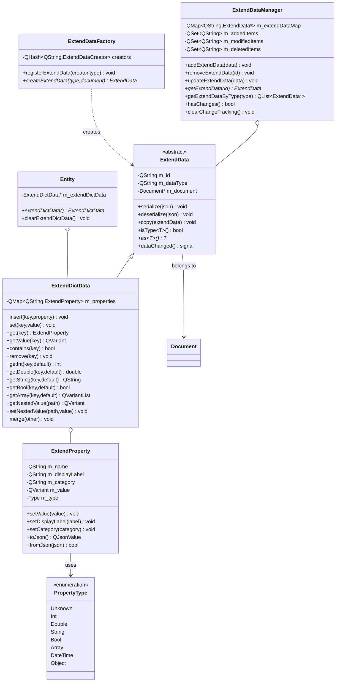

# ExtendData 扩展数据系统架构

## 概述

ExtendData 扩展数据系统是 OCCTBIM 的核心扩展机制，为实体和其他对象提供了灵活的自定义属性和数据存储能力。该系统采用类型安全的设计，支持多种数据类型、嵌套结构、序列化和反序列化等功能，为系统的可扩展性提供了强有力的支持。

## 系统架构



## 核心组件详解

### 1. ExtendData 基类

ExtendData 是所有扩展数据的基类，定义了扩展数据的基本接口和行为。

#### 核心属性
```cpp
class ExtendData : public ISerializable {
protected:
    QString m_id;           // 唯一标识符
    QString m_dataType;     // 数据类型标识
    Document* m_document;   // 所属文档
    
public:
    // 基本属性访问
    QString id() const;
    QString dataType() const;
    Document* document() const;
    
    // 序列化接口
    virtual void serialize(QJsonObject &json) const;
    virtual void deserialize(const QJsonObject &json);
    
    // 类型安全转换
    template<typename T>
    bool isType() const;
    
    template<typename T>
    T* as();
};
```

#### 类型安全机制
ExtendData 提供了类型安全的转换机制：
```cpp
// 类型检查
if (extendData->isType<ExtendDictData>()) {
    // 安全转换
    ExtendDictData* dictData = extendData->as<ExtendDictData>();
    // 使用 dictData
}
```

### 2. ExtendDataManager 管理器

ExtendDataManager 负责所有扩展数据的生命周期管理和变更跟踪。

#### 主要功能

##### 基本操作
```cpp
// 添加扩展数据
void addExtendData(ExtendData *data, bool recordUndo = true);

// 移除扩展数据
void removeExtendData(const QString &id, bool recordUndo = true);

// 更新扩展数据
void updateExtendData(ExtendData *data, bool recordUndo = true);

// 获取扩展数据
ExtendData *getExtendData(const QString &id) const;
```

##### 查询操作
```cpp
// 按类型查询
QList<ExtendData *> getExtendDataByType(const QString &dataType) const;

// 检查存在性
bool hasExtendData(const QString &id) const;

// 获取所有数据
QList<ExtendData *> getAllExtendData() const;
QStringList getAllIds() const;

// 数量统计
int count() const;
int countByType(const QString &dataType) const;
```

##### 批量操作
```cpp
// 批量添加
void addExtendDatas(const QList<ExtendData *> &dataList, bool recordUndo = true);

// 批量移除
void removeExtendDatas(const QStringList &ids, bool recordUndo = true);

// 批量更新
void updateExtendDatas(const QList<ExtendData *> &dataList, bool recordUndo = true);
```

##### 变更跟踪
```cpp
// 变更状态查询
bool hasChanges() const;
QStringList getAddedItems() const;
QStringList getModifiedItems() const;
QStringList getDeletedItems() const;

// 清理变更跟踪
void clearChangeTracking();
```

### 3. ExtendProperty 属性类

ExtendProperty 封装了单个属性的所有信息，包括名称、值、类型、显示标签等。

#### 属性定义
```cpp
class ExtendProperty {
public:
    enum Type { 
        Unknown = -1, 
        Int = 0, 
        Double = 1, 
        String = 2, 
        Bool = 3, 
        Array = 4, 
        DateTime = 5, 
        Object = 6 
    };
    
private:
    QString m_name;         // 属性名称
    QString m_displayLabel; // 显示标签
    QString m_category;     // 属性分类
    QVariant m_value;       // 属性值
    Type m_type;            // 属性类型
};
```

#### 构造和访问
```cpp
// 构造函数
ExtendProperty(const QString &name, 
               const QVariant &value = QVariant(),
               const QString &displayLabel = "", 
               const QString &category = "");

// 属性访问
QString name() const;
QString displayLabel() const;
QString category() const;
Type type() const;
QVariant value() const;

// 属性设置
void setValue(const QVariant &value);
void setDisplayLabel(const QString &label);
void setCategory(const QString &category);
```

#### 序列化支持
```cpp
// JSON 序列化
QJsonValue toJson() const;
bool fromJson(const QJsonValue &json);
```

### 4. ExtendDictData 字典数据

ExtendDictData 是最常用的扩展数据类型，提供了类似 JSON 的键值对存储能力。

#### 基本操作
```cpp
// 插入属性
void insert(const QString &key, const ExtendProperty &property);
void insert(const QString &key, const QVariant &value, 
           const QString &displayLabel = "", const QString &category = "");

// 设置属性
void set(const QString &key, const ExtendProperty &property);
void set(const QString &key, const QVariant &value, 
        const QString &displayLabel = "", const QString &category = "");

// 获取属性
ExtendProperty get(const QString &key) const;
QVariant getValue(const QString &key) const;

// 检查和删除
bool contains(const QString &key) const;
void remove(const QString &key);
void clear();
```

#### 类型安全访问
ExtendDictData 提供了类型安全的访问方法：
```cpp
// 类型安全的获取方法
int getInt(const QString &key, int defaultValue = 0) const;
double getDouble(const QString &key, double defaultValue = 0.0) const;
QString getString(const QString &key, const QString &defaultValue = "") const;
bool getBool(const QString &key, bool defaultValue = false) const;
QVariantList getArray(const QString &key, const QVariantList &defaultValue = QVariantList()) const;
QDateTime getDateTime(const QString &key, const QDateTime &defaultValue = QDateTime()) const;
QVariantMap getObject(const QString &key, const QVariantMap &defaultValue = QVariantMap()) const;

// 类型安全的设置方法
void setInt(const QString &key, int value, const QString &displayLabel = "", const QString &category = "");
void setDouble(const QString &key, double value, const QString &displayLabel = "", const QString &category = "");
void setString(const QString &key, const QString &value, const QString &displayLabel = "", const QString &category = "");
void setBool(const QString &key, bool value, const QString &displayLabel = "", const QString &category = "");
void setArray(const QString &key, const QVariantList &value, const QString &displayLabel = "", const QString &category = "");
void setDateTime(const QString &key, const QDateTime &value, const QString &displayLabel = "", const QString &category = "");
void setObject(const QString &key, const QVariantMap &value, const QString &displayLabel = "", const QString &category = "");
```

#### 嵌套访问支持
ExtendDictData 支持类似 JSON 路径的嵌套访问：
```cpp
// 嵌套访问（支持点分隔符路径）
QVariant getNestedValue(const QString &path, const QString &separator = ".") const;
void setNestedValue(const QString &path, const QVariant &value, const QString &separator = ".");
bool hasNestedValue(const QString &path, const QString &separator = ".") const;

// 使用示例
dictData->setNestedValue("user.profile.name", "张三");
dictData->setNestedValue("user.profile.age", 30);
QString name = dictData->getNestedValue("user.profile.name").toString();
```

#### 批量操作
```cpp
// 合并操作
void merge(const ExtendDictData &other, bool overwrite = true);

// 复制操作
void copyFrom(const ExtendDictData &other);
```

#### 迭代器支持
```cpp
// 迭代器访问
QMap<QString, ExtendProperty>::const_iterator begin() const;
QMap<QString, ExtendProperty>::const_iterator end() const;

// 使用示例
for (auto it = dictData->begin(); it != dictData->end(); ++it) {
    QString key = it.key();
    ExtendProperty property = it.value();
    // 处理属性
}
```

## 数据类型系统

### 1. 支持的数据类型

ExtendProperty 支持以下数据类型：

#### 基本类型
- **Int**: 整数类型
- **Double**: 浮点数类型
- **String**: 字符串类型
- **Bool**: 布尔类型
- **DateTime**: 日期时间类型

#### 复合类型
- **Array**: 数组类型（QVariantList）
- **Object**: 对象类型（QVariantMap）

#### 类型转换
```cpp
// 自动类型推断
ExtendProperty prop("count", 42);           // 自动推断为 Int
ExtendProperty prop("price", 99.99);        // 自动推断为 Double
ExtendProperty prop("name", "产品名称");     // 自动推断为 String
ExtendProperty prop("enabled", true);       // 自动推断为 Bool

// 复合类型
QVariantList items = {"item1", "item2", "item3"};
ExtendProperty prop("items", items);        // Array 类型

QVariantMap config;
config["width"] = 100;
config["height"] = 200;
ExtendProperty prop("config", config);      // Object 类型
```

### 2. 类型验证和转换

```cpp
// 类型检查
ExtendProperty prop = dictData->get("someKey");
if (prop.type() == ExtendProperty::Int) {
    int value = prop.value().toInt();
}

// 安全转换
int intValue = dictData->getInt("count", 0);        // 如果不存在或类型不匹配，返回默认值
double doubleValue = dictData->getDouble("price", 0.0);
QString stringValue = dictData->getString("name", "");
```

## 序列化系统

### 1. JSON 序列化格式

ExtendData 系统完全支持 JSON 序列化，格式如下：

```json
{
    "id": "extend-data-uuid",
    "dataType": "ExtendDictData",
    "properties": {
        "basicProperty": {
            "name": "basicProperty",
            "displayLabel": "基本属性",
            "category": "基本",
            "type": 2,
            "value": "属性值"
        },
        "numericProperty": {
            "name": "numericProperty",
            "displayLabel": "数值属性",
            "category": "数值",
            "type": 1,
            "value": 42.5
        },
        "arrayProperty": {
            "name": "arrayProperty",
            "displayLabel": "数组属性",
            "category": "集合",
            "type": 4,
            "value": ["item1", "item2", "item3"]
        },
        "objectProperty": {
            "name": "objectProperty",
            "displayLabel": "对象属性",
            "category": "复合",
            "type": 6,
            "value": {
                "width": 100,
                "height": 200,
                "color": "red"
            }
        }
    }
}
```

### 2. 序列化实现

```cpp
// 序列化到 JSON
QJsonObject json;
extendData->serialize(json);

// 从 JSON 反序列化
extendData->deserialize(json);

// ExtendProperty 的序列化
QJsonValue propertyJson = property.toJson();
property.fromJson(propertyJson);
```

## 与实体系统的集成

### 1. 实体扩展数据

每个 Entity 都可以关联一个 ExtendDictData 对象：

```cpp
class Entity : public ISerializable {
private:
    mutable ExtendDictData *m_extendDictData = nullptr;
    
public:
    // 获取扩展数据（延迟创建）
    ExtendDictData *extendDictData() const;
    
    // 清理扩展数据
    void clearExtendDictData();
};
```

### 2. 使用示例

```cpp
// 获取实体的扩展数据
ExtendDictData *extData = entity->extendDictData();

// 添加自定义属性
extData->setString("material", "钢材", "材质", "物理属性");
extData->setDouble("density", 7850.0, "密度(kg/m³)", "物理属性");
extData->setBool("fireproof", true, "防火", "安全属性");

// 添加复合属性
QVariantMap dimensions;
dimensions["length"] = 1000.0;
dimensions["width"] = 200.0;
dimensions["height"] = 300.0;
extData->setObject("dimensions", dimensions, "尺寸", "几何属性");

// 读取属性
QString material = extData->getString("material");
double density = extData->getDouble("density");
bool fireproof = extData->getBool("fireproof");

// 嵌套访问
double length = extData->getNestedValue("dimensions.length").toDouble();
```

## 扩展机制

### 1. 自定义扩展数据类型

可以通过继承 ExtendData 创建自定义的扩展数据类型：

```cpp
class CustomExtendData : public ExtendData {
    Q_OBJECT
    
public:
    CustomExtendData(Document *document) : ExtendData(document) {
        setDataType("CustomExtendData");
    }
    
    // 自定义属性
    void setCustomProperty(const QString &value) { m_customProperty = value; }
    QString customProperty() const { return m_customProperty; }
    
    // 重写序列化方法
    void serialize(QJsonObject &json) const override {
        ExtendData::serialize(json);
        json["customProperty"] = m_customProperty;
    }
    
    void deserialize(const QJsonObject &json) override {
        ExtendData::deserialize(json);
        m_customProperty = json["customProperty"].toString();
    }
    
private:
    QString m_customProperty;
};
```

### 2. 扩展数据工厂

类似实体注册机制，可以注册自定义扩展数据类型：

```cpp
class ExtendDataFactory {
public:
    using ExtendDataCreator = ExtendData *(*)(Document *);
    
    static ExtendData *createExtendData(QString type, Document *document);
    static void registerExtendData(ExtendDataCreator creator, QString type);
};

// 注册宏
#define REGISTER_EXTEND_DATA(ExtendDataClass, type) \
    class ExtendDataClass##Registrar { \
    public: \
        ExtendDataClass##Registrar() { \
            ExtendDataFactory::registerExtendData(&ExtendDataClass##Registrar::create, type); \
        } \
        static ExtendData *create(Document *document) { \
            return new ExtendDataClass(document); \
        } \
    }; \
    static ExtendDataClass##Registrar ExtendDataClass##_registrar;

// 使用示例
REGISTER_EXTEND_DATA(CustomExtendData, "CustomExtendData")
```

## BIM 应用场景

### 1. 构件属性扩展

```cpp
// 为 BIM 构件添加专业属性
ExtendDictData *bimData = component->extendDictData();

// 基本信息
bimData->setString("component.type", "梁", "构件类型", "基本信息");
bimData->setString("component.mark", "KL-1", "构件编号", "基本信息");
bimData->setString("component.material", "C30混凝土", "材料", "基本信息");

// 几何信息
bimData->setDouble("geometry.length", 6000.0, "长度(mm)", "几何信息");
bimData->setDouble("geometry.width", 300.0, "宽度(mm)", "几何信息");
bimData->setDouble("geometry.height", 600.0, "高度(mm)", "几何信息");

// 结构信息
bimData->setString("structure.grade", "C30", "混凝土强度等级", "结构信息");
bimData->setString("structure.rebar", "HRB400", "钢筋等级", "结构信息");
bimData->setDouble("structure.cover", 25.0, "保护层厚度(mm)", "结构信息");

// 成本信息
bimData->setDouble("cost.material", 1200.0, "材料费(元)", "成本信息");
bimData->setDouble("cost.labor", 800.0, "人工费(元)", "成本信息");
bimData->setDouble("cost.total", 2000.0, "总造价(元)", "成本信息");
```

### 2. 系统属性管理

```cpp
// 管道系统属性
ExtendDictData *pipeData = pipe->extendDictData();

// 系统信息
pipeData->setString("system.name", "给水系统", "系统名称", "系统信息");
pipeData->setString("system.code", "GS-01", "系统编码", "系统信息");
pipeData->setString("system.type", "给水", "系统类型", "系统信息");

// 管道参数
pipeData->setString("pipe.material", "PPR", "管材", "管道参数");
pipeData->setDouble("pipe.diameter", 110.0, "公称直径(mm)", "管道参数");
pipeData->setDouble("pipe.pressure", 1.0, "工作压力(MPa)", "管道参数");
pipeData->setDouble("pipe.temperature", 60.0, "工作温度(℃)", "管道参数");

// 连接信息
QVariantList connections;
QVariantMap conn1;
conn1["type"] = "弯头";
conn1["angle"] = 90.0;
conn1["position"] = QVariantList{1000.0, 2000.0, 3000.0};
connections.append(conn1);
pipeData->setArray("connections", connections, "连接件", "连接信息");
```

### 3. 项目级别属性

```cpp
// 项目信息扩展数据
ExtendDictData *projectData = document->model()->extendDataManager()->getExtendData("project-info");

// 项目基本信息
projectData->setString("project.name", "某办公楼项目", "项目名称", "项目信息");
projectData->setString("project.code", "PRJ-2024-001", "项目编码", "项目信息");
projectData->setString("project.location", "北京市朝阳区", "项目地址", "项目信息");
projectData->setDateTime("project.startDate", QDateTime::currentDateTime(), "开工日期", "项目信息");

// 设计信息
projectData->setString("design.company", "某设计院", "设计单位", "设计信息");
projectData->setString("design.engineer", "张工", "设计工程师", "设计信息");
projectData->setString("design.phase", "施工图设计", "设计阶段", "设计信息");

// 标准和规范
QVariantList standards;
standards << "GB 50010-2010" << "GB 50011-2010" << "GB 50016-2014";
projectData->setArray("standards", standards, "执行标准", "标准规范");
```

## 性能优化

### 1. 延迟创建

ExtendDictData 采用延迟创建策略，只有在实际使用时才创建：

```cpp
ExtendDictData *Entity::extendDictData() const {
    if (!m_extendDictData) {
        m_extendDictData = new ExtendDictData(m_document);
        // 设置实体ID作为扩展数据的关联
        m_extendDictData->setId(m_id + "_extend");
    }
    return m_extendDictData;
}
```

### 2. 内存管理

- **智能指针**: 使用智能指针管理扩展数据对象
- **引用计数**: 避免不必要的数据复制
- **缓存机制**: 缓存频繁访问的属性值

### 3. 序列化优化

- **增量序列化**: 只序列化变更的属性
- **压缩存储**: 对大型数据进行压缩存储
- **批量操作**: 批量序列化多个扩展数据对象

## 最佳实践

### 1. 属性设计

- **合理分类**: 使用 category 对属性进行分类
- **清晰命名**: 使用有意义的属性名称和显示标签
- **类型安全**: 优先使用类型安全的访问方法
- **默认值**: 为所有属性提供合理的默认值

### 2. 性能考虑

- **按需创建**: 只在需要时创建扩展数据
- **批量操作**: 使用批量操作减少信号发射
- **缓存策略**: 缓存频繁访问的计算结果
- **内存清理**: 及时清理不需要的扩展数据

### 3. 扩展开发

- **继承设计**: 合理选择继承 ExtendData 或使用 ExtendDictData
- **序列化支持**: 确保自定义类型支持完整的序列化
- **类型注册**: 使用注册机制支持动态创建
- **版本兼容**: 考虑数据格式的向后兼容性

ExtendData 系统为 OCCTBIM 提供了强大而灵活的数据扩展能力，其类型安全的设计和完善的序列化机制确保了系统的可靠性和可维护性。