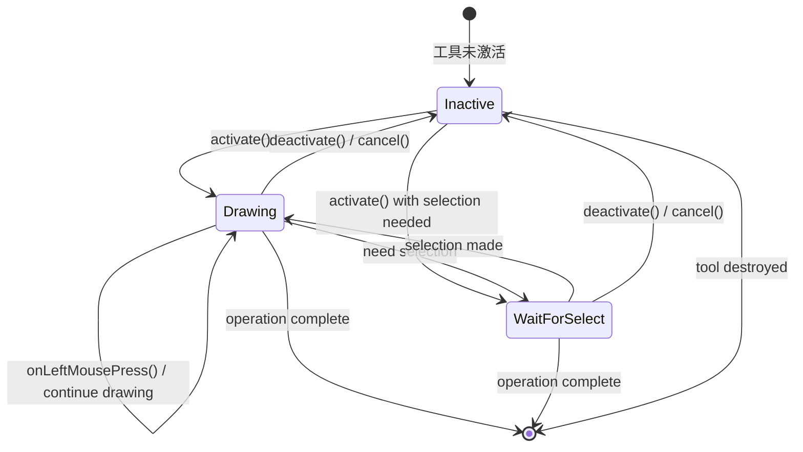
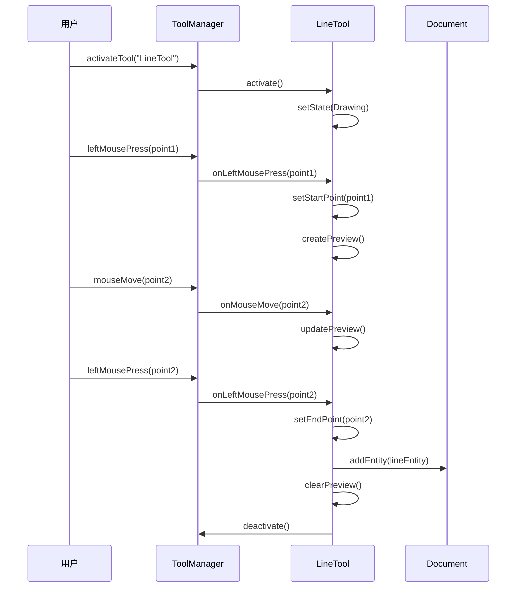
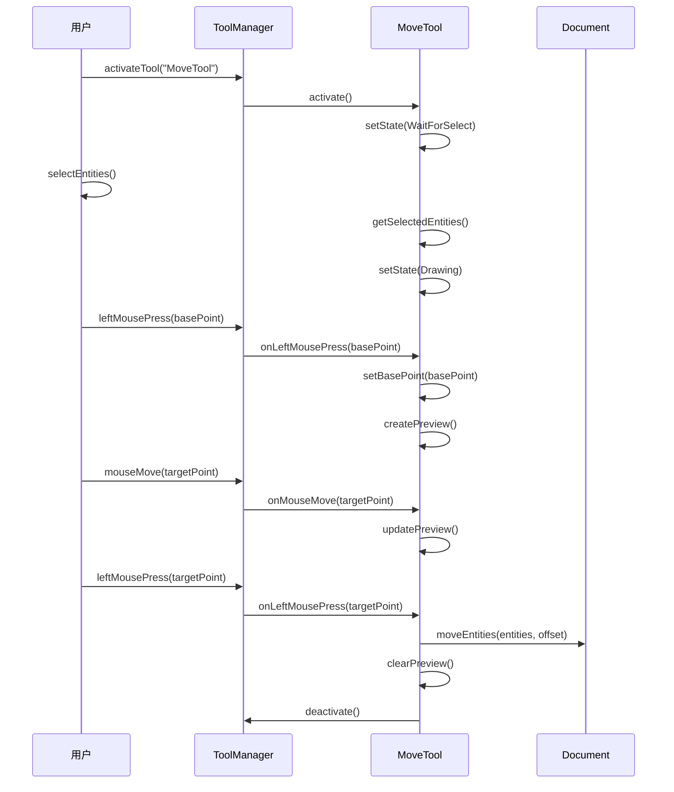
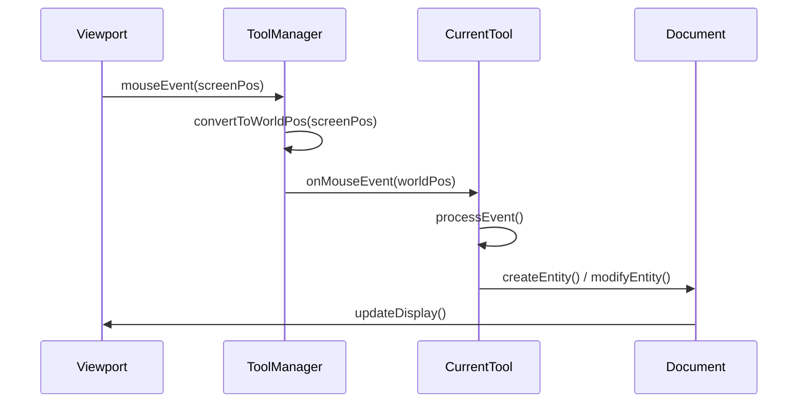

# Tool 工具系统架构

## 概述

Tool 工具系统是 OCCTBIM 的用户交互核心，负责处理所有的绘图、编辑、测量等交互操作。该系统采用状态机模式和工厂模式设计，提供了完整的工具生命周期管理、事件处理、预览机制等功能，支持 2D 绘图、3D 建模、实体编辑、注释标注等多种类型的工具。

## 系统架构

```mermaid
classDiagram
    class Tool {
        <<abstract>>
        -QString m_toolId
        -bool m_isActive
        -ToolState m_toolState
        -bool m_needOffset
        -gp_Pnt m_originPoint
        -gp_Pnt m_offsetPoint
        +activate(params) bool
        +deactivate() void
        +onLeftMousePress(worldPos) void
        +onRightMousePress(worldPos) void
        +onMouseMove(worldPos) void
        +onKeyPress(event) void
        +cancel() void
        +isSupport2D() bool
        #currentDocument() Document*
        #currentViewport() Viewport*
        #setTooltip(tooltip) void
    }

    class ToolManager {
        -QMap~QString,Tool*~ m_tools
        -Tool* m_currentTool
        -GripTool* m_gripTool
        -bool m_isFirstClick
        +instance() ToolManager*
        +registerAllTools() void
        +activateTool(toolId,params) bool
        +cancelCurrentTool() void
        +startGripEdit(entity,gripIndex) void
        +handleLeftMousePress(worldPos) void
        +handleRightMousePress(worldPos) void
        +handleMouseMove(worldPos) void
        +handleKeyPress(event) void
    }

    class ToolFactory {
        -QMap~QString,ToolCreator~ m_creators
        +instance() ToolFactory*
        +registerCreator(toolId,creator) void
        +createTool(toolId) Tool*
        +registeredTools() QStringList
    }

    class GripTool {
        -Entity* m_editEntity
        -Entity* m_previewEntity
        -int m_gripIndex
        +setEditEntity(entity,gripIndex) void
        +onMouseMove(worldPos) void
        +onLeftMousePress(worldPos) void
    }

    %% 2D绘图工具
    class LineTool {
        -gp_Pnt m_startPoint
        -gp_Pnt m_endPoint
        -int m_pointCount
        -LineEntity* m_previewLine
        +createPreview() void
        +updatePreview() void
        +createLine() void
    }

    class CircleTool {
        -gp_Pnt m_centerPoint
        -double m_radius
        -int m_pointCount
        -CircleEntity* m_previewCircle
        +createPreview() void
        +updatePreview() void
        +createCircle() void
    }

    class RectangleTool {
        -gp_Pnt m_startPoint
        -gp_Pnt m_endPoint
        -int m_pointCount
        -RectangleEntity* m_previewRect
        +createPreview() void
        +updatePreview() void
        +createRectangle() void
    }

    %% 3D建模工具
    class BoxTool {
        -gp_Pnt m_startPoint
        -gp_Pnt m_secondPoint
        -gp_Pnt m_currentPoint
        -int m_pointCount
        -BoxEntity* m_previewBox
        +createPreview() void
        +updatePreview() void
        +createBox() void
    }

    class SphereTool {
        -gp_Pnt m_centerPoint
        -double m_radius
        -int m_pointCount
        -SphereEntity* m_previewSphere
        +createPreview() void
        +updatePreview() void
        +createSphere() void
    }

    class CylinderTool {
        -gp_Pnt m_baseCenter
        -gp_Dir m_axis
        -double m_radius
        -double m_height
        -int m_pointCount
        -CylinderEntity* m_previewCylinder
        +createPreview() void
        +updatePreview() void
        +createCylinder() void
    }

    %% 编辑工具
    class MoveTool {
        -gp_Pnt m_startPoint
        -gp_Pnt m_currentPoint
        -int m_pointCount
        -GroupEntity* m_previewEntity
        -QList~Entity*~ m_selectedObjects
        +createPreview() void
        +updatePreview() void
        +moveEntities() void
    }

    class CopyTool {
        -gp_Pnt m_startPoint
        -gp_Pnt m_currentPoint
        -int m_pointCount
        -GroupEntity* m_previewEntity
        -QList~Entity*~ m_selectedObjects
        +createPreview() void
        +updatePreview() void
        +copyEntities() void
    }

    class RotateTool {
        -gp_Pnt m_centerPoint
        -gp_Pnt m_startPoint
        -gp_Pnt m_currentPoint
        -double m_angle
        -int m_pointCount
        -GroupEntity* m_previewEntity
        -QList~Entity*~ m_selectedObjects
        +createPreview() void
        +updatePreview() void
        +rotateEntities() void
    }

    %% 注释工具
    class TextTool {
        -TextEntity* m_previewText
        -QString m_textContent
        -double m_rotation
        -gp_Pnt m_startPoint
        +showTextDialog() void
        +updatePreview() void
    }

    class LinearDimTool {
        -gp_Pnt m_point1
        -gp_Pnt m_point2
        -gp_Pnt m_dimLinePoint
        -int m_pointCount
        -LinearDimEntity* m_previewDim
        +createPreview() void
        +updatePreview() void
        +createDimension() void
    }

    %% 特征工具
    class ExtrudeFeatureTool {
        -TopoDS_Shape m_profile
        -gp_Vec m_direction
        -double m_distance
        -int m_pointCount
        -ExtrudeFeatureEntity* m_previewFeature
        +selectProfile() void
        +createPreview() void
        +updatePreview() void
        +createFeature() void
    }

    class RevolveFeatureTool {
        -TopoDS_Shape m_profile
        -gp_Ax1 m_axis
        -double m_angle
        -int m_pointCount
        -RevolveFeatureEntity* m_previewFeature
        +selectProfile() void
        +selectAxis() void
        +createPreview() void
        +updatePreview() void
        +createFeature() void
    }

    %% 测量工具
    class MeasureDistanceTool {
        -gp_Pnt m_startPoint
        -gp_Pnt m_endPoint
        -int m_pointCount
        -LineEntity* m_measureLine
        +updateMeasurement() void
        +showDistance() void
    }

    %% 继承关系
    Tool <|-- LineTool
    Tool <|-- CircleTool
    Tool <|-- RectangleTool
    Tool <|-- BoxTool
    Tool <|-- SphereTool
    Tool <|-- CylinderTool
    Tool <|-- MoveTool
    Tool <|-- CopyTool
    Tool <|-- RotateTool
    Tool <|-- TextTool
    Tool <|-- LinearDimTool
    Tool <|-- ExtrudeFeatureTool
    Tool <|-- RevolveFeatureTool
    Tool <|-- MeasureDistanceTool
    Tool <|-- GripTool

    %% 关联关系
    ToolManager o-- Tool
    ToolManager --> GripTool
    ToolFactory ..> Tool : creates
    Tool --> Document : uses
    Tool --> Viewport : uses

    %% 枚举类型
    class ToolState {
        <<enumeration>>
        Drawing
        WaitForSelect
    }
    
    Tool --> ToolState : uses
```



## 核心组件详解

### 1. Tool 基类

Tool 是所有工具的基类，定义了工具的基本接口和行为模式。

#### 核心属性
```cpp
class Tool : public QObject {
public:
    enum class ToolState {
        Drawing = 0,      // 绘图状态
        WaitForSelect = 1 // 等待选择状态
    };

protected:
    QString m_toolId;           // 工具标识符
    bool m_isActive;            // 是否激活
    ToolState m_toolState;      // 工具状态
    
    // 偏移模式支持
    bool m_needOffset;          // 是否需要偏移
    bool m_offsetMode;          // 偏移模式
    gp_Pnt m_originPoint;       // 原始点
    gp_Pnt m_offsetPoint;       // 偏移点
};
```

#### 生命周期管理
```cpp
// 工具激活
virtual bool activate(const QString &params = "");

// 工具停用
virtual void deactivate();

// 取消操作
virtual void cancel();

// 2D支持检查
virtual bool isSupport2D() const;
```

#### 事件处理接口
```cpp
// 鼠标事件
virtual void onLeftMousePress(gp_Pnt worldPos);
virtual void onRightMousePress(gp_Pnt worldPos);
virtual void onMouseMove(gp_Pnt worldPos);
virtual void onMouseDoubleClick(QMouseEvent *event);

// 键盘事件
virtual void onKeyPress(QKeyEvent *event);
```

#### 辅助方法
```cpp
// 获取当前上下文
Document *currentDocument() const;
Viewport *currentViewport() const;
Handle(AIS_InteractiveContext) context() const;

// 界面交互
void setTooltip(const QString &tooltip);

// 选择辅助
Entity *getEntityFromSelection() const;
TopoDS_Shape getShapeFromSelection() const;

// 偏移计算
gp_Pnt getOffsetPoint(const gp_Pnt &point);
```

### 2. ToolManager 工具管理器

ToolManager 是工具系统的核心管理器，负责工具的注册、激活、事件分发等功能。

#### 单例模式
```cpp
class ToolManager : public QObject {
public:
    static ToolManager *instance();
    
private:
    ToolManager();
    static ToolManager *s_instance;
};
```

#### 工具管理
```cpp
// 工具注册
void registerAllTools();
void registerTool(Tool *tool);

// 工具激活
bool activateTool(const QString &toolId, const QString &params = "");
void cancelCurrentTool();

// 状态查询
bool isActive() const;
Tool *currentTool() const;
bool hasTool(const QString &toolId) const;
```

#### 事件分发
```cpp
// 鼠标事件分发
void handleLeftMousePress(gp_Pnt worldPos);
void handleRightMousePress(gp_Pnt worldPos);
void handleMouseMove(gp_Pnt worldPos);
void handleMouseDoubleClick(QMouseEvent *event);

// 键盘事件分发
void handleKeyPress(QKeyEvent *event);
```

#### 夹点编辑
```cpp
// 启动夹点编辑
void startGripEdit(Entity *entity, int gripIndex);

// 夹点工具
GripTool *m_gripTool;
```

### 3. ToolFactory 工具工厂

ToolFactory 实现了工具的注册和创建机制。

#### 工厂接口
```cpp
class ToolFactory : public QObject {
public:
    using ToolCreator = std::function<Tool *()>;
    
    // 注册工具创建器
    void registerCreator(const QString &toolId, ToolCreator creator);
    
    // 创建工具实例
    Tool *createTool(const QString &toolId);
    
    // 获取已注册工具列表
    QStringList registeredTools() const;
};
```

#### 自动注册宏
```cpp
// 工具自动注册宏
#define REGISTER_TOOL(ToolClass) \
    static bool registered_##ToolClass = []() { \
        ToolFactory::instance()->registerCreator(#ToolClass, []() { \
            return new ToolClass(); \
        }); \
        return true; \
    }();

// 使用示例
REGISTER_TOOL(LineTool)
REGISTER_TOOL(CircleTool)
REGISTER_TOOL(BoxTool)
```

### 4. GripTool 夹点工具

GripTool 是特殊的编辑工具，用于实体的夹点编辑功能。

#### 夹点编辑流程
```cpp
class GripTool : public Tool {
private:
    Entity *m_editEntity;       // 编辑实体
    Entity *m_previewEntity;    // 预览实体
    int m_gripIndex;            // 夹点索引
    
public:
    // 设置编辑实体和夹点
    void setEditEntity(Entity *entity, int gripIndex);
    
    // 鼠标移动时更新预览
    void onMouseMove(gp_Pnt worldPos) override;
    
    // 确认编辑
    void onLeftMousePress(gp_Pnt worldPos) override;
};
```

## 工具类型体系

### 1. 2D 绘图工具

#### 基本图形工具
- **LineTool**: 直线绘制工具
- **CircleTool**: 圆形绘制工具
- **ArcTool**: 圆弧绘制工具（多种变体）
- **RectangleTool**: 矩形绘制工具
- **EllipseTool**: 椭圆绘制工具

#### 复合图形工具
- **PolylineTool**: 多段线绘制工具
- **PolygonTool**: 多边形绘制工具
- **RegularPolygonTool**: 正多边形绘制工具
- **SplineTool**: 样条曲线绘制工具

#### 特殊图形工具
- **CenterLineTool**: 中心线绘制工具
- **CenterMarkTool**: 中心标记绘制工具
- **SpiralTool**: 螺旋线绘制工具

#### 块操作工具
- **BlockTool**: 块定义工具
- **InsertBlockTool**: 块插入工具

### 2. 3D 建模工具

#### 基本立体工具
- **BoxTool**: 立方体创建工具
- **SphereTool**: 球体创建工具
- **CylinderTool**: 圆柱体创建工具
- **ConeTool**: 圆锥体创建工具
- **TorusTool**: 圆环体创建工具
- **EllipsoidTool**: 椭球体创建工具

#### 曲面工具
- **ConeSurfaceTool**: 圆锥面创建工具
- **CylinderSurfaceTool**: 圆柱面创建工具

### 3. 编辑工具

#### 变换工具
- **MoveTool**: 移动工具
- **CopyTool**: 复制工具
- **RotateTool**: 旋转工具
- **ScaleTool**: 缩放工具
- **MirrorTool**: 镜像工具

#### 阵列工具
- **RectArrayTool**: 矩形阵列工具
- **CircleArrayTool**: 环形阵列工具
- **PathArrayTool**: 路径阵列工具

### 4. 注释工具

#### 文字工具
- **TextTool**: 文字放置工具
- **TableTool**: 表格创建工具
- **EditTableTool**: 表格编辑工具

#### 标注工具
- **LinearDimTool**: 线性标注工具
- **AlignDimTool**: 对齐标注工具
- **AngleDimTool**: 角度标注工具
- **RadiusDimTool**: 半径标注工具
- **DiameterDimTool**: 直径标注工具
- **LeaderDimTool**: 引出线标注工具
- **QuickDimensionTool**: 快速标注工具

### 5. 特征工具

#### 创建特征
- **ExtrudeFeatureTool**: 拉伸特征工具
- **RevolveFeatureTool**: 旋转特征工具
- **LoftFeatureTool**: 放样特征工具
- **SweepFeatureTool**: 扫掠特征工具

#### 编辑特征
- **ChamferFeatureTool**: 倒角特征工具
- **FilletFeatureTool**: 圆角特征工具
- **ThickenFeatureTool**: 加厚特征工具

#### 布尔特征
- **UnionFeatureTool**: 并集特征工具
- **SubstractFeatureTool**: 差集特征工具
- **IntersectFeatureTool**: 交集特征工具

### 6. BREP 工具

#### 提取工具
- **ExtractEdgeTool**: 边提取工具
- **ExtractFaceTool**: 面提取工具

#### 分割工具
- **SplitTool**: 分割工具

### 7. 测量工具

#### 测量工具
- **MeasureDistanceTool**: 距离测量工具
- **UnifiedMeasureTool**: 统一测量工具

## 工具状态机

### 1. 工具状态

每个工具都有明确的状态管理：

```cpp
enum class ToolState {
    Drawing = 0,      // 绘图状态 - 正在创建新对象
    WaitForSelect = 1 // 等待选择状态 - 等待用户选择对象
};
```

### 2. 状态转换



### 3. 典型工具流程

#### 绘图工具流程（如 LineTool）


#### 编辑工具流程（如 MoveTool）


## 预览机制

### 1. 预览系统设计

所有绘图和编辑工具都支持实时预览功能：

```cpp
class DrawingTool : public Tool {
protected:
    Entity *m_previewEntity;    // 预览实体
    
    // 预览管理方法
    virtual void createPreview();
    virtual void updatePreview();
    virtual void clearPreview();
};
```

### 2. 预览实现模式

#### 创建预览
```cpp
void LineTool::createPreview() {
    if (!m_previewLine) {
        m_previewLine = new LineEntity(currentDocument());
        m_previewLine->setPreview(true);  // 标记为预览状态
        m_previewLine->setStartPoint(m_startPoint);
        m_previewLine->setEndPoint(m_startPoint);  // 初始时起点终点相同
        
        // 添加到视图但不加入文档
        currentViewport()->displayEntity(m_previewLine);
    }
}
```

#### 更新预览
```cpp
void LineTool::updatePreview() {
    if (m_previewLine) {
        m_previewLine->setEndPoint(m_endPoint);
        m_previewLine->applyModifications();  // 更新几何和显示
    }
}
```

#### 清理预览
```cpp
void LineTool::clearPreview() {
    if (m_previewLine) {
        currentViewport()->removeEntity(m_previewLine);
        delete m_previewLine;
        m_previewLine = nullptr;
    }
}
```

### 3. 预览样式

预览实体通常使用特殊的视觉样式：
- 半透明显示
- 虚线样式
- 特殊颜色（如橙色或黄色）
- 不参与选择

## 事件处理机制

### 1. 事件流程



### 2. 坐标转换

工具系统自动处理屏幕坐标到世界坐标的转换：
```cpp
// 在 ToolManager 中进行坐标转换
gp_Pnt worldPos = viewport->screenToWorld(screenX, screenY);
currentTool->onLeftMousePress(worldPos);
```

### 3. 事件优先级

事件处理的优先级顺序：
1. **夹点编辑**: 如果正在进行夹点编辑，优先处理
2. **当前工具**: 活动工具处理事件
3. **默认行为**: 选择、平移、缩放等默认操作

## 偏移模式

### 1. 偏移机制

工具系统支持偏移模式，用于精确定位：

```cpp
class Tool {
protected:
    bool m_needOffset;      // 是否需要偏移
    bool m_offsetMode;      // 偏移模式状态
    gp_Pnt m_originPoint;   // 原始参考点
    gp_Pnt m_offsetPoint;   // 偏移点
    
    // 计算偏移点
    gp_Pnt getOffsetPoint(const gp_Pnt &point);
};
```

### 2. 偏移使用

```cpp
void SomeTool::onLeftMousePress(gp_Pnt worldPos) {
    if (m_needOffset) {
        if (!m_offsetMode) {
            // 第一次点击，设置原始点
            m_originPoint = worldPos;
            m_offsetMode = true;
            setTooltip("指定偏移点");
        } else {
            // 第二次点击，设置偏移点
            m_offsetPoint = worldPos;
            m_offsetMode = false;
            // 继续正常流程
        }
    } else {
        // 正常处理
        processNormalClick(worldPos);
    }
}
```

## 工具扩展机制

### 1. 自定义工具开发

创建自定义工具的步骤：

```cpp
// 1. 继承 Tool 基类
class CustomTool : public Tool {
    Q_OBJECT
    
public:
    CustomTool() : Tool("CustomTool") {}
    
    // 2. 实现必要的虚函数
    bool activate(const QString &params = "") override {
        // 工具激活逻辑
        return Tool::activate(params);
    }
    
    void deactivate() override {
        // 清理资源
        clearPreview();
        Tool::deactivate();
    }
    
    void onLeftMousePress(gp_Pnt worldPos) override {
        // 处理鼠标点击
    }
    
    void onMouseMove(gp_Pnt worldPos) override {
        // 处理鼠标移动
        updatePreview();
    }
    
private:
    void createPreview();
    void updatePreview();
    void clearPreview();
    
    Entity *m_previewEntity = nullptr;
    int m_pointCount = 0;
};

// 3. 注册工具
REGISTER_TOOL(CustomTool)
```

### 2. 工具参数化

工具可以通过参数进行配置：

```cpp
bool CustomTool::activate(const QString &params) {
    // 解析参数
    QJsonDocument doc = QJsonDocument::fromJson(params.toUtf8());
    QJsonObject obj = doc.object();
    
    m_customParam1 = obj["param1"].toString();
    m_customParam2 = obj["param2"].toDouble();
    
    return Tool::activate(params);
}

// 使用参数激活工具
QString params = R"({"param1": "value1", "param2": 42.5})";
toolManager->activateTool("CustomTool", params);
```

### 3. 工具组合

可以创建复合工具，组合多个基础工具：

```cpp
class CompositeTool : public Tool {
private:
    QList<Tool*> m_subTools;
    int m_currentToolIndex = 0;
    
public:
    void addSubTool(Tool* tool) {
        m_subTools.append(tool);
    }
    
    void onLeftMousePress(gp_Pnt worldPos) override {
        if (m_currentToolIndex < m_subTools.size()) {
            Tool* currentSubTool = m_subTools[m_currentToolIndex];
            currentSubTool->onLeftMousePress(worldPos);
            
            // 检查子工具是否完成
            if (currentSubTool->isCompleted()) {
                m_currentToolIndex++;
            }
        }
    }
};
```

## BIM 工具扩展

### 1. BIM 构件工具

BIM 模块可以扩展专门的构件创建工具：

```cpp
class BeamTool : public Tool {
private:
    gp_Pnt m_startPoint;
    gp_Pnt m_endPoint;
    QString m_beamProfile;      // 梁截面
    QString m_material;         // 材料
    BeamEntity *m_previewBeam;
    
public:
    void setBeamProfile(const QString &profile) {
        m_beamProfile = profile;
    }
    
    void onLeftMousePress(gp_Pnt worldPos) override {
        if (m_pointCount == 0) {
            m_startPoint = worldPos;
            createPreview();
        } else if (m_pointCount == 1) {
            m_endPoint = worldPos;
            createBeam();
            deactivate();
        }
        m_pointCount++;
    }
    
private:
    void createBeam() {
        BeamEntity *beam = new BeamEntity(currentDocument());
        beam->setStartPoint(m_startPoint);
        beam->setEndPoint(m_endPoint);
        beam->setProfile(m_beamProfile);
        beam->setMaterial(m_material);
        
        // 添加 BIM 属性
        ExtendDictData *bimData = beam->extendDictData();
        bimData->setString("component.type", "梁");
        bimData->setString("component.profile", m_beamProfile);
        bimData->setString("component.material", m_material);
        
        currentDocument()->model()->entityManager()->addEntity(beam);
    }
};

REGISTER_TOOL(BeamTool)
```

### 2. 系统工具

BIM 系统工具用于创建和管理系统级对象：

```cpp
class PipeSystemTool : public Tool {
private:
    QList<gp_Pnt> m_points;
    QString m_systemName;
    double m_diameter;
    PipeSystemEntity *m_previewSystem;
    
public:
    void onLeftMousePress(gp_Pnt worldPos) override {
        m_points.append(worldPos);
        updatePreview();
        
        // 双击完成
        if (isDoubleClick()) {
            createPipeSystem();
            deactivate();
        }
    }
    
private:
    void createPipeSystem() {
        PipeSystemEntity *system = new PipeSystemEntity(currentDocument());
        system->setPoints(m_points);
        system->setSystemName(m_systemName);
        system->setDiameter(m_diameter);
        
        // 自动创建管道和管件
        system->generatePipesAndFittings();
        
        currentDocument()->model()->entityManager()->addEntity(system);
    }
};
```

## 性能优化

### 1. 预览优化

- **LOD 机制**: 根据视图距离调整预览精度
- **延迟更新**: 使用定时器减少频繁更新
- **简化几何**: 预览使用简化的几何表示

### 2. 内存管理

- **对象池**: 重用预览实体对象
- **智能指针**: 自动管理工具生命周期
- **及时清理**: 工具停用时立即清理资源

### 3. 事件优化

- **事件过滤**: 过滤不必要的鼠标移动事件
- **批量处理**: 批量处理多个事件
- **异步处理**: 复杂计算使用异步处理

## 最佳实践

### 1. 工具设计

- **单一职责**: 每个工具只负责一种操作
- **状态清晰**: 明确定义工具的各种状态
- **用户友好**: 提供清晰的提示和反馈

### 2. 预览实现

- **实时更新**: 提供流畅的实时预览
- **视觉区分**: 预览对象与正式对象有明显区别
- **性能考虑**: 避免预览影响系统性能

### 3. 错误处理

- **输入验证**: 验证用户输入的有效性
- **异常处理**: 妥善处理各种异常情况
- **用户提示**: 提供友好的错误提示

### 4. 扩展开发

- **遵循模式**: 遵循现有的工具开发模式
- **注册机制**: 使用自动注册机制
- **文档完善**: 提供完整的工具使用文档

Tool 系统为 OCCTBIM 提供了强大而灵活的用户交互能力，其模块化设计和完善的扩展机制确保了系统的可维护性和可扩展性。