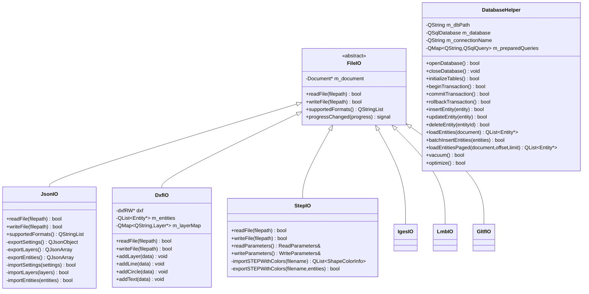

# 数据存储系统架构

## 概述

数据存储系统是 OCCTBIM 的数据持久化核心，负责处理所有数据的存储、检索、序列化和文件格式转换。该系统采用多层架构设计，支持 SQLite 数据库存储、JSON 序列化、多种 CAD 文件格式导入导出。

## 系统架构

## 核心组件

### 1. DatabaseHelper 数据库助手

DatabaseHelper 负责所有 SQLite 数据库操作，包括表管理、事务处理、批量操作等。

#### 主要功能
- 数据库连接管理
- 表结构初始化
- 实体数据的增删改查
- 批量操作优化
- 分页查询支持
- 事务管理

### 2. FileIO 文件IO基类

FileIO 是所有文件格式处理器的基类，定义了统一的文件读写接口。

#### 支持的文件格式
- **JsonIO**: JSON格式，完整的文档序列化
- **DxfIO**: DXF格式，基于libdxfrw库
- **StepIO**: STEP格式，基于OpenCASCADE
- **IgesIO**: IGES格式支持
- **LmbIO**: 自定义二进制格式
- **GltfIO**: glTF 3D格式支持

### 3. 数据库表结构

系统使用SQLite数据库存储业务数据：

- **entities**: 实体数据表
- **layers**: 图层信息表
- **text_styles**: 文字样式表
- **dim_styles**: 标注样式表
- **extend_data**: 扩展数据表
- **block_definitions**: 块定义表
- **model_settings**: 模型设置表

### 4. 序列化机制

所有数据对象都支持JSON序列化：
- Entity对象通过serialize/deserialize方法
- ExtendData通过统一的序列化接口
- 支持版本兼容和数据迁移

## 性能优化

### 1. 数据库优化
- 预编译查询缓存
- 批量操作支持
- 分页查询机制
- 索引优化
- 事务管理

### 2. 文件IO优化
- 异步读写支持
- 进度反馈机制
- 错误处理和恢复
- 内存使用优化

### 3. 数据管理
- 增量保存机制
- 延迟加载策略
- 数据压缩支持
- 缓存机制

## 扩展机制

### 1. 自定义文件格式
开发者可以继承FileIO基类实现自定义文件格式支持。

### 2. 数据库扩展
通过DatabaseHelper可以扩展新的数据表和操作。

### 3. 序列化扩展
支持自定义对象的序列化和反序列化。

数据存储系统为 OCCTBIM 提供了可靠的数据持久化能力，支持多种文件格式和高效的数据库操作。