# Action System Architecture

## Overview

The Action system implements the Command pattern to provide undo/redo functionality and action management in OCCTBIM. This system supports complex operations including file operations, editing commands, view manipulations, and BIM-specific actions. The architecture features a hierarchical command structure, macro commands, and transaction support for atomic operations.

## System Architecture

```mermaid
classDiagram
    class Action {
        <<abstract>>
        -QString m_name
        -QString m_description
        -QIcon m_icon
        -QKeySequence m_shortcut
        -bool m_isEnabled
        -bool m_isChecked
        -ActionGroup* m_group
        +name() QString
        +description() QString
        +icon() QIcon
        +shortcut() QKeySequence
        +isEnabled() bool
        +isChecked() bool
        +group() ActionGroup*
        +execute() void
        +undo() void
        +redo() void
        +canUndo() bool
        +canRedo() bool
        +setEnabled(enabled) void
        +setChecked(checked) void
        +setGroup(group) void
        +mergeWith(other) bool
    }

    class ActionManager {
        -QHash~QString,Action*~ m_actions
        -QStack~Action*~ m_undoStack
        -QStack~Action*~ m_redoStack
        -int m_maxStackSize
        -QHash~QString,ActionGroup*~ m_groups
        +registerAction(action) void
        +unregisterAction(name) void
        +getAction(name) Action*
        +getAllActions() QList~Action*~
        +executeAction(name) bool
        +undo() void
        +redo() void
        +canUndo() bool
        +canRedo() bool
        +clearHistory() void
        +createGroup(name) ActionGroup*
        +getGroup(name) ActionGroup*
        +getAllGroups() QList~ActionGroup*~
    }

    class ActionGroup {
        -QString m_name
        -QList~Action*~ m_actions
        -bool m_isExclusive
        -Action* m_checkedAction
        +name() QString
        +actions() QList~Action*~
        +isExclusive() bool
        +checkedAction() Action*
        +addAction(action) void
        +removeAction(action) void
        +setExclusive(exclusive) void
        +setCheckedAction(action) void
    }

    class MacroAction {
        -QList~Action*~ m_actions
        -bool m_isEmptyAllowed
        +actions() QList~Action*~
        +isEmptyAllowed() bool
        +addAction(action) void
        +removeAction(action) void
        +clear() void
        +execute() void
        +undo() void
        +redo() void
        +canUndo() bool
        +canRedo() bool
    }

    class TransactionAction {
        -QString m_transactionName
        -QList~Action*~ m_actions
        -bool m_isCommitted
        +transactionName() QString
        +actions() QList~Action*~
        +isCommitted() bool
        +begin() void
        +commit() void
        +rollback() void
        +addAction(action) void
        +execute() void
        +undo() void
        +redo() void
    }

    %% File Actions
    class NewFileAction {
        -QString m_template
        +setTemplate(template) void
        +template() QString
        +execute() void
        +undo() void
        +redo() void
    }

    class OpenFileAction {
        -QString m_filePath
        -FileFormat m_format
        +setFilePath(path) void
        +setFormat(format) void
        +filePath() QString
        +format() FileFormat
        +execute() void
        +undo() void
        +redo() void
    }

    class SaveFileAction {
        -QString m_filePath
        -FileFormat m_format
        -bool m_isSaveAs
        +setFilePath(path) void
        +setFormat(format) void
        +setSaveAs(saveAs) void
        +filePath() QString
        +format() FileFormat
        +isSaveAs() bool
        +execute() void
        +undo() void
        +redo() void
    }

    %% Edit Actions
    class UndoAction {
        -ActionManager* m_manager
        +setManager(manager) void
        +manager() ActionManager*
        +execute() void
        +updateState() void
    }

    class RedoAction {
        -ActionManager* m_manager
        +setManager(manager) void
        +manager() ActionManager*
        +execute() void
        +updateState() void
    }

    class CutAction {
        -SelectionSet m_selection
        -ClipboardManager* m_clipboard
        +setSelection(selection) void
        +setClipboard(clipboard) void
        +selection() SelectionSet
        +clipboard() ClipboardManager*
        +execute() void
        +undo() void
        +redo() void
    }

    class CopyAction {
        -SelectionSet m_selection
        -ClipboardManager* m_clipboard
        +setSelection(selection) void
        +setClipboard(clipboard) void
        +selection() SelectionSet
        +clipboard() ClipboardManager*
        +execute() void
        +undo() void
        +redo() void
    }

    class PasteAction {
        -ClipboardManager* m_clipboard
        -gp_Pnt m_insertionPoint
        +setClipboard(clipboard) void
        +setInsertionPoint(point) void
        +clipboard() ClipboardManager*
        +insertionPoint() gp_Pnt
        +execute() void
        +undo() void
        +redo() void
    }

    class DeleteAction {
        -SelectionSet m_selection
        +setSelection(selection) void
        +selection() SelectionSet
        +execute() void
        +undo() void
        +redo() void
    }

    %% View Actions
    class ZoomInAction {
        -Viewport* m_viewport
        -double m_factor
        +setViewport(viewport) void
        +setFactor(factor) void
        +viewport() Viewport*
        +factor() double
        +execute() void
        +undo() void
        +redo() void
    }

    class ZoomOutAction {
        -Viewport* m_viewport
        -double m_factor
        +setViewport(viewport) void
        +setFactor(factor) void
        +viewport() Viewport*
        +factor() double
        +execute() void
        +undo() void
        +redo() void
    }

    class ZoomExtentsAction {
        -Viewport* m_viewport
        -Document* m_document
        +setViewport(viewport) void
        +setDocument(document) void
        +viewport() Viewport*
        +document() Document*
        +execute() void
        +undo() void
        +redo() void
    }

    class PanAction {
        -Viewport* m_viewport
        -gp_Vec m_translation
        +setViewport(viewport) void
        +setTranslation(translation) void
        +viewport() Viewport*
        +translation() gp_Vec
        +execute() void
        +undo() void
        +redo() void
    }

    class RotateAction {
        -Viewport* m_viewport
        -gp_Quaternion m_rotation
        +setViewport(viewport) void
        +setRotation(rotation) void
        +viewport() Viewport*
        +rotation() gp_Quaternion
        +execute() void
        +undo() void
        +redo() void
    }

    %% BIM Actions
    class CreateWallAction {
        -WallType m_wallType
        -QList~gp_Pnt~ m_points
        -double m_height
        -double m_thickness
        +setWallType(type) void
        +setPoints(points) void
        +setHeight(height) void
        +setThickness(thickness) void
        +wallType() WallType
        +points() QList~gp_Pnt~
        +height() double
        +thickness() double
        +execute() void
        +undo() void
        +redo() void
    }

    class CreateDoorAction {
        -DoorType m_doorType
        -gp_Pnt m_position
        -double m_width
        -double m_height
        +setDoorType(type) void
        +setPosition(position) void
        +setWidth(width) void
        +setHeight(height) void
        +doorType() DoorType
        +position() gp_Pnt
        +width() double
        +height() double
        +execute() void
        +undo() void
        +redo() void
    }

    class CreateWindowAction {
        -WindowType m_windowType
        -gp_Pnt m_position
        -double m_width
        -double m_height
        +setWindowType(type) void
        +setPosition(position) void
        +setWidth(width) void
        +setHeight(height) void
        +windowType() WindowType
        +position() gp_Pnt
        +width() double
        +height() double
        +execute() void
        +undo() void
        +redo() void
    }

    %% Inheritance Relationships
    Action <|-- MacroAction
    Action <|-- TransactionAction
    Action <|-- NewFileAction
    Action <|-- OpenFileAction
    Action <|-- SaveFileAction
    Action <|-- UndoAction
    Action <|-- RedoAction
    Action <|-- CutAction
    Action <|-- CopyAction
    Action <|-- PasteAction
    Action <|-- DeleteAction
    Action <|-- ZoomInAction
    Action <|-- ZoomOutAction
    Action <|-- ZoomExtentsAction
    Action <|-- PanAction
    Action <|-- RotateAction
    Action <|-- CreateWallAction
    Action <|-- CreateDoorAction
    Action <|-- CreateWindowAction
```



## Core Components Detailed

### 1. Action Base Class

The Action class is the abstract base class for all actions in the system.

#### Core Properties
```cpp
class Action : public QObject {
    Q_OBJECT
    
protected:
    QString m_name;                         // Action name
    QString m_description;                  // Action description
    QIcon m_icon;                           // Action icon
    QKeySequence m_shortcut;               // Keyboard shortcut
    bool m_isEnabled;                       // Enabled state
    bool m_isChecked;                       // Checked state (for toggle actions)
    ActionGroup* m_group;                   // Action group
    
public:
    // Constructor
    Action(const QString &name, const QString &description, const QIcon &icon = QIcon());
    
    // Basic property access
    QString name() const;
    QString description() const;
    QIcon icon() const;
    QKeySequence shortcut() const;
    bool isEnabled() const;
    bool isChecked() const;
    ActionGroup* group() const;
    
    // State management
    virtual void setEnabled(bool enabled);
    virtual void setChecked(bool checked);
    virtual void setGroup(ActionGroup *group);
    
    // Command execution
    virtual void execute() = 0;
    virtual void undo() = 0;
    virtual void redo() = 0;
    virtual bool canUndo() const = 0;
    virtual bool canRedo() const = 0;
    
    // Action merging (for command compression)
    virtual bool mergeWith(const Action *other);
    
    // Serialization
    virtual QJsonObject toJson() const;
    virtual bool fromJson(const QJsonObject &json);
    
    // Validation
    virtual bool isValid() const;
    
protected:
    // Helper methods
    virtual void updateState();
    virtual void emitStateChanged();
    
signals:
    void enabledChanged(bool enabled);
    void checkedChanged(bool checked);
    void triggered();
};
```

### 2. ActionManager

ActionManager is responsible for managing the lifecycle of all actions and maintaining the undo/redo history.

#### Main Responsibilities
- **Action Registration**: Register and unregister actions
- **Command Execution**: Execute actions with undo/redo support
- **History Management**: Maintain undo and redo stacks
- **Group Management**: Organize actions into logical groups

#### Key Features
```cpp
class ActionManager : public QObject {
    Q_OBJECT
    
private:
    QHash<QString, Action*> m_actions;              // Registered actions
    QStack<Action*> m_undoStack;                    // Undo stack
    QStack<Action*> m_redoStack;                    // Redo stack
    int m_maxStackSize;                             // Maximum stack size
    QHash<QString, ActionGroup*> m_groups;          // Action groups
    
public:
    // Constructor
    ActionManager(QObject *parent = nullptr);
    
    // Action registration
    void registerAction(Action *action);
    void unregisterAction(const QString &name);
    Action* getAction(const QString &name) const;
    QList<Action*> getAllActions() const;
    
    // Command execution
    bool executeAction(const QString &name);
    void undo();
    void redo();
    bool canUndo() const;
    bool canRedo() const;
    void clearHistory();
    
    // History management
    int maxStackSize() const;
    void setMaxStackSize(int size);
    int undoStackSize() const;
    int redoStackSize() const;
    
    // Group management
    ActionGroup* createGroup(const QString &name);
    ActionGroup* getGroup(const QString &name) const;
    QList<ActionGroup*> getAllGroups() const;
    void addActionToGroup(const QString &actionName, const QString &groupName);
    
    // Macro actions
    MacroAction* createMacroAction(const QString &name);
    void executeMacroAction(MacroAction *macro);
    
    // Transaction support
    TransactionAction* beginTransaction(const QString &name);
    bool commitTransaction(TransactionAction *transaction);
    bool rollbackTransaction(TransactionAction *transaction);
    
    // State management
    void updateActionStates();
    
    // Signal-slot connections
    void connectActionSignals(Action *action);
    void disconnectActionSignals(Action *action);
    
    // Cleanup
    void clearAllActions();
};
```

### 3. ActionGroup

ActionGroup organizes related actions into logical groups, supporting exclusive behavior for toggle actions.

#### Group Features
```cpp
class ActionGroup : public QObject {
    Q_OBJECT
    
private:
    QString m_name;                         // Group name
    QList<Action*> m_actions;               // Group actions
    bool m_isExclusive;                     // Exclusive flag
    Action* m_checkedAction;               // Currently checked action
    
public:
    // Constructor
    ActionGroup(const QString &name, QObject *parent = nullptr);
    
    // Basic property access
    QString name() const;
    QList<Action*> actions() const;
    bool isExclusive() const;
    Action* checkedAction() const;
    
    // Action management
    void addAction(Action *action);
    void removeAction(Action *action);
    bool containsAction(Action *action) const;
    
    // Exclusive behavior
    void setExclusive(bool exclusive);
    void setCheckedAction(Action *action);
    
    // State management
    void updateActionStates();
    
    // Serialization
    QJsonObject toJson() const;
    bool fromJson(const QJsonObject &json);
    
    // Cleanup
    void clear();
    
protected slots:
    void onActionToggled(bool checked);
    
signals:
    void actionAdded(Action *action);
    void actionRemoved(Action *action);
    void checkedActionChanged(Action *action);
};
```

### 4. MacroAction

MacroAction combines multiple actions into a single compound action for batch operations.

#### Macro Features
```cpp
class MacroAction : public Action {
private:
    QList<Action*> m_actions;               // Contained actions
    bool m_isEmptyAllowed;                  // Empty macro flag
    
public:
    // Constructor
    MacroAction(const QString &name, const QString &description, const QIcon &icon = QIcon());
    
    // Action management
    QList<Action*> actions() const;
    bool isEmptyAllowed() const;
    void setEmptyAllowed(bool allowed);
    
    void addAction(Action *action);
    void removeAction(Action *action);
    void clear();
    
    // Command execution
    void execute() override;
    void undo() override;
    void redo() override;
    bool canUndo() const override;
    bool canRedo() const override;
    
    // Action merging
    bool mergeWith(const Action *other) override;
    
    // Serialization
    QJsonObject toJson() const override;
    bool fromJson(const QJsonObject &json) override;
    
    // Validation
    bool isValid() const override;
    
protected:
    // Helper methods
    void executeActions();
    void undoActions();
    void redoActions();
};
```

### 5. TransactionAction

TransactionAction provides transaction support for atomic operations.

#### Transaction Features
```cpp
class TransactionAction : public Action {
private:
    QString m_transactionName;              // Transaction name
    QList<Action*> m_actions;               // Transaction actions
    bool m_isCommitted;                     // Commit status
    
public:
    // Constructor
    TransactionAction(const QString &name, const QString &description);
    
    // Transaction management
    QString transactionName() const;
    QList<Action*> actions() const;
    bool isCommitted() const;
    
    void begin();
    bool commit();
    bool rollback();
    
    void addAction(Action *action);
    
    // Command execution
    void execute() override;
    void undo() override;
    void redo() override;
    bool canUndo() const override;
    bool canRedo() const override;
    
    // Action merging
    bool mergeWith(const Action *other) override;
    
    // Serialization
    QJsonObject toJson() const override;
    bool fromJson(const QJsonObject &json) override;
    
    // Validation
    bool isValid() const override;
    
protected:
    // Helper methods
    void executeTransaction();
    void undoTransaction();
    void redoTransaction();
};
```

## Action Types

### 1. File Actions

#### NewFileAction
Creates a new document with optional template.

```cpp
class NewFileAction : public Action {
private:
    QString m_template;                      // Document template
    
public:
    NewFileAction();
    
    // Template management
    void setTemplate(const QString &template);
    QString template() const;
    
    // Command execution
    void execute() override;
    void undo() override;
    void redo() override;
    bool canUndo() const override;
    bool canRedo() const override;
    
    // Serialization
    QJsonObject toJson() const override;
    bool fromJson(const QJsonObject &json) override;
    
protected:
    // Helper methods
    Document* createNewDocument() const;
    bool validateTemplate() const;
};
```

#### OpenFileAction
Opens an existing document from file.

```cpp
class OpenFileAction : public Action {
private:
    QString m_filePath;                     // File path
    FileFormat m_format;                    // File format
    
public:
    OpenFileAction();
    
    // File management
    void setFilePath(const QString &path);
    void setFormat(FileFormat format);
    QString filePath() const;
    FileFormat format() const;
    
    // Command execution
    void execute() override;
    void undo() override;
    void redo() override;
    bool canUndo() const override;
    bool canRedo() const override;
    
    // Validation
    bool isValid() const override;
    
protected:
    // Helper methods
    Document* loadDocument() const;
    bool validateFile() const;
};

// File format enumeration
enum class FileFormat {
    OCCTBIM,        // Native OCCTBIM format
    STEP,           // STEP format
    IGES,           // IGES format
    DXF,            // DXF format
    DWG,            // DWG format
    OBJ,            // OBJ format
    STL             // STL format
};
```

### 2. Edit Actions

#### UndoAction
Performs undo operation on the action manager.

```cpp
class UndoAction : public Action {
private:
    ActionManager* m_manager;               // Action manager
    
public:
    UndoAction();
    
    // Manager management
    void setManager(ActionManager *manager);
    ActionManager* manager() const;
    
    // Command execution
    void execute() override;
    void undo() override;
    void redo() override;
    bool canUndo() const override;
    bool canRedo() const override;
    
    // State management
    void updateState();
    
protected:
    // Helper methods
    void performUndo();
};
```

#### CutAction
Cuts selected entities to clipboard.

```cpp
class CutAction : public Action {
private:
    SelectionSet m_selection;               // Selected entities
    ClipboardManager* m_clipboard;          // Clipboard manager
    
public:
    CutAction();
    
    // Selection and clipboard management
    void setSelection(const SelectionSet &selection);
    void setClipboard(ClipboardManager *clipboard);
    SelectionSet selection() const;
    ClipboardManager* clipboard() const;
    
    // Command execution
    void execute() override;
    void undo() override;
    void redo() override;
    bool canUndo() const override;
    bool canRedo() const override;
    
    // Validation
    bool isValid() const override;
    
protected:
    // Helper methods
    void cutSelection();
    void restoreSelection();
};
```

### 3. View Actions

#### ZoomInAction
Zooms in the viewport by a specified factor.

```cpp
class ZoomInAction : public Action {
private:
    Viewport* m_viewport;                   // Target viewport
    double m_factor;                        // Zoom factor
    
public:
    ZoomInAction();
    
    // Viewport and factor management
    void setViewport(Viewport *viewport);
    void setFactor(double factor);
    Viewport* viewport() const;
    double factor() const;
    
    // Command execution
    void execute() override;
    void undo() override;
    void redo() override;
    bool canUndo() const override;
    bool canRedo() const override;
    
    // Validation
    bool isValid() const override;
    
protected:
    // Helper methods
    void performZoomIn();
    void performZoomOut();
};
```

#### PanAction
Pans the viewport by a specified translation.

```cpp
class PanAction : public Action {
private:
    Viewport* m_viewport;                   // Target viewport
    gp_Vec m_translation;                   // Pan translation
    
public:
    PanAction();
    
    // Viewport and translation management
    void setViewport(Viewport *viewport);
    void setTranslation(const gp_Vec &translation);
    Viewport* viewport() const;
    gp_Vec translation() const;
    
    // Command execution
    void execute() override;
    void undo() override;
    void redo() override;
    bool canUndo() const override;
    bool canRedo() const override;
    
    // Validation
    bool isValid() const override;
    
protected:
    // Helper methods
    void performPan();
    void performReversePan();
};
```

### 4. BIM Actions

#### CreateWallAction
Creates a wall entity with specified parameters.

```cpp
class CreateWallAction : public Action {
private:
    WallType m_wallType;                    // Wall type
    QList<gp_Pnt> m_points;                 // Wall points
    double m_height;                        // Wall height
    double m_thickness;                     // Wall thickness
    
public:
    CreateWallAction();
    
    // Wall properties
    void setWallType(WallType type);
    void setPoints(const QList<gp_Pnt> &points);
    void setHeight(double height);
    void setThickness(double thickness);
    
    WallType wallType() const;
    QList<gp_Pnt> points() const;
    double height() const;
    double thickness() const;
    
    // Command execution
    void execute() override;
    void undo() override;
    void redo() override;
    bool canUndo() const override;
    bool canRedo() const override;
    
    // Validation
    bool isValid() const override;
    
protected:
    // Helper methods
    WallEntity* createWall() const;
    void deleteWall(WallEntity *wall);
};

// Wall type enumeration
enum class WallType {
    Straight,          // Straight wall
    Curved,            // Curved wall
    Polygon            // Polygon wall
};
```

#### CreateDoorAction
Creates a door entity with specified parameters.

```cpp
class CreateDoorAction : public Action {
private:
    DoorType m_doorType;                    // Door type
    gp_Pnt m_position;                      // Door position
    double m_width;                         // Door width
    double m_height;                        // Door height
    
public:
    CreateDoorAction();
    
    // Door properties
    void setDoorType(DoorType type);
    void setPosition(const gp_Pnt &position);
    void setWidth(double width);
    void setHeight(double height);
    
    DoorType doorType() const;
    gp_Pnt position() const;
    double width() const;
    double height() const;
    
    // Command execution
    void execute() override;
    void undo() override;
    void redo() override;
    bool canUndo() const override;
    bool canRedo() const override;
    
    // Validation
    bool isValid() const override;
    
protected:
    // Helper methods
    DoorEntity* createDoor() const;
    void deleteDoor(DoorEntity *door);
};

// Door type enumeration
enum class DoorType {
    Single,            // Single door
    Double,            // Double door
    Sliding,           // Sliding door
    Folding            // Folding door
};
```

## Usage Examples

### 1. Basic Action Usage

```cpp
// Create action manager
ActionManager *actionManager = new ActionManager();

// Register actions
actionManager->registerAction(new NewFileAction());
actionManager->registerAction(new OpenFileAction());
actionManager->registerAction(new SaveFileAction());

// Execute new file action
if (actionManager->executeAction("NewFileAction")) {
    qDebug() << "New file created";
}

// Undo the action
actionManager->undo();
```

### 2. Custom Action Implementation

```cpp
class CustomAction : public Action {
public:
    CustomAction() : Action("CustomAction", "Custom operation") {}
    
    void execute() override {
        // Perform custom operation
        qDebug() << "Custom action executed";
        
        // Store state for undo
        m_previousState = getCurrentState();
    }
    
    void undo() override {
        // Restore previous state
        restoreState(m_previousState);
        qDebug() << "Custom action undone";
    }
    
    void redo() override {
        // Re-execute the action
        execute();
        qDebug() << "Custom action redone";
    }
    
    bool canUndo() const override { return true; }
    bool canRedo() const override { return true; }
    
private:
    QVariant m_previousState;
};
```

### 3. Macro Action Usage

```cpp
// Create macro action
MacroAction *macro = new MacroAction("ComplexOperation", "Complex multi-step operation");

// Add individual actions
macro->addAction(new CreateWallAction());
macro->addAction(new CreateDoorAction());
macro->addAction(new CreateWindowAction());

// Register and execute macro
actionManager->registerAction(macro);
actionManager->executeAction("ComplexOperation");

// The entire macro can be undone/redoed as a single unit
actionManager->undo();  // Undoes all three actions
```

### 4. Transaction Usage

```cpp
// Begin transaction
TransactionAction *transaction = actionManager->beginTransaction("BIMModelCreation");

// Add actions to transaction
transaction->addAction(new CreateWallAction());
transaction->addAction(new CreateDoorAction());
transaction->addAction(new CreateWindowAction());

// Commit transaction (all actions executed atomically)
if (actionManager->commitTransaction(transaction)) {
    qDebug() << "BIM model created successfully";
} else {
    // Rollback on failure
    actionManager->rollbackTransaction(transaction);
    qDebug() << "BIM model creation failed";
}
```

## Performance Optimization

### 1. Command Compression
- Action merging for similar operations
- Batch processing of related commands
- Lazy evaluation of undo/redo states

### 2. Memory Management
- Object pooling for frequently used actions
- Efficient data structures for action storage
- Smart pointers for action lifecycle management

### 3. History Optimization
- Configurable stack size limits
- Automatic cleanup of old history entries
- Efficient serialization for large action states

The Action system provides a comprehensive framework for command execution and undo/redo functionality in OCCTBIM, supporting a wide range of operations with advanced performance optimization features.