# BIM System Architecture

## Overview

The Building Information Modeling (BIM) system in OCCTBIM provides comprehensive support for architectural, structural, and MEP (Mechanical, Electrical, Plumbing) modeling. The system implements industry-standard BIM concepts including parametric components, intelligent objects, and building element relationships. Built on the core entity system, the BIM system extends functionality with specialized components for building design and analysis.

## System Architecture

```mermaid
classDiagram
    class BIMComponent {
        <<abstract>>
        -QString m_componentId
        -QString m_componentType
        -QString m_family
        -QString m_category
        -QHash~QString,QVariant~ m_parameters
        -QList~BIMPort~ m_ports
        -BIMSystem* m_system
        +componentId() QString
        +componentType() QString
        +family() QString
        +category() QString
        +parameters() QHash~QString,QVariant~
        +ports() QList~BIMPort~
        +system() BIMSystem*
        +setParameters(parameters) void
        +addPort(port) void
        +removePort(port) void
        +connectTo(other) bool
        +disconnectFrom(other) bool
        +validate() bool
        +updateGeometry() void
        +toIFC() QString
        +fromIFC(ifcData) bool
    }

    class BIMSystem {
        -QString m_systemName
        -QString m_systemType
        -QList~BIMComponent*~ m_components
        -QHash~BIMComponent*,BIMComponent*~ m_connections
        -QHash~QString,QVariant~ m_systemProperties
        +systemName() QString
        +systemType() QString
        +components() QList~BIMComponent*~
        +connections() QHash~BIMComponent*,BIMComponent*~
        +systemProperties() QHash~QString,QVariant~
        +addComponent(component) void
        +removeComponent(component) void
        +connectComponents(from,to) bool
        +disconnectComponents(from,to) bool
        +validateSystem() bool
        +calculateSystem() void
        +exportToIFC() QString
        +importFromIFC(ifcData) bool
    }

    class WallComponent {
        -WallType m_wallType
        -QList~gp_Pnt~ m_pathPoints
        -double m_height
        -double m_thickness
        -QString m_material
        -QList~Opening~ m_openings
        +wallType() WallType
        +pathPoints() QList~gp_Pnt~
        +height() double
        +thickness() double
        +material() QString
        +openings() QList~Opening~
        +setWallType(type) void
        +setPathPoints(points) void
        +setHeight(height) void
        +setThickness(thickness) void
        +setMaterial(material) void
        +addOpening(opening) void
        +removeOpening(opening) void
        +calculateVolume() double
        +calculateArea() double
    }

    class DoorComponent {
        -DoorType m_doorType
        -gp_Pnt m_position
        -double m_width
        -double m_height
        -double m_thickness
        -QString m_material
        -Opening* m_hostOpening
        +doorType() DoorType
        +position() gp_Pnt
        +width() double
        +height() double
        +thickness() double
        +material() QString
        +hostOpening() Opening*
        +setDoorType(type) void
        +setPosition(position) void
        +setWidth(width) void
        +setHeight(height) void
        +setThickness(thickness) void
        +setMaterial(material) void
        +setHostOpening(opening) void
        +calculateArea() double
        +getSwingDirection() SwingDirection
    }

    class WindowComponent {
        -WindowType m_windowType
        -gp_Pnt m_position
        -double m_width
        -double m_height
        -double m_thickness
        -QString m_frameMaterial
        -QString m_glazingMaterial
        -Opening* m_hostOpening
        +windowType() WindowType
        +position() gp_Pnt
        +width() double
        +height() double
        +thickness() double
        +frameMaterial() QString
        +glazingMaterial() QString
        +hostOpening() Opening*
        +setWindowType(type) void
        +setPosition(position) void
        +setWidth(width) void
        +setHeight(height) void
        +setThickness(thickness) void
        +setFrameMaterial(material) void
        +setGlazingMaterial(material) void
        +setHostOpening(opening) void
        +calculateArea() double
        +calculateUValue() double
    }

    class FloorComponent {
        -FloorType m_floorType
        -QList~gp_Pnt~ m_boundary
        -double m_thickness
        -QString m_material
        -QList~BIMComponent*~ m_embeddedComponents
        +floorType() FloorType
        +boundary() QList~gp_Pnt~
        +thickness() double
        +material() QString
        +embeddedComponents() QList~BIMComponent*~
        +setFloorType(type) void
        +setBoundary(boundary) void
        +setThickness(thickness) void
        +setMaterial(material) void
        +addEmbeddedComponent(component) void
        +removeEmbeddedComponent(component) void
        +calculateArea() double
        +calculateVolume() double
    }

    class RoofComponent {
        -RoofType m_roofType
        -QList~gp_Pnt~ m_boundary
        -double m_thickness
        -double m_slope
        -QString m_material
        +roofType() RoofType
        +boundary() QList~gp_Pnt~
        +thickness() double
        +slope() double
        +material() QString
        +setRoofType(type) void
        +setBoundary(boundary) void
        +setThickness(thickness) void
        +setSlope(slope) void
        +setMaterial(material) void
        +calculateArea() double
        +calculateVolume() double
        +getSlopeDirection() gp_Vec
    }

    class ColumnComponent {
        -ColumnType m_columnType
        -gp_Pnt m_basePoint
        -gp_Pnt m_topPoint
        -double m_width
        -double m_depth
        -QString m_material
        -QList~BIMComponent*~ m_connections
        +columnType() ColumnType
        +basePoint() gp_Pnt
        +topPoint() gp_Pnt
        +width() double
        +depth() double
        +material() QString
        +connections() QList~BIMComponent*~
        +setColumnType(type) void
        +setBasePoint(point) void
        +setTopPoint(point) void
        +setWidth(width) void
        +setDepth(depth) void
        +setMaterial(material) void
        +addConnection(component) void
        +removeConnection(component) void
        +calculateVolume() double
        +calculateLoadCapacity() double
    }

    class BeamComponent {
        -BeamType m_beamType
        -gp_Pnt m_startPoint
        -gp_Pnt m_endPoint
        -double m_width
        -double m_height
        -QString m_material
        -QList~BIMComponent*~ m_supports
        +beamType() BeamType
        +startPoint() gp_Pnt
        +endPoint() gp_Pnt
        +width() double
        +height() double
        +material() QString
        +supports() QList~BIMComponent*~
        +setBeamType(type) void
        +setStartPoint(point) void
        +setEndPoint(point) void
        +setWidth(width) void
        +setHeight(height) void
        +setMaterial(material) void
        +addSupport(component) void
        +removeSupport(component) void
        +calculateVolume() double
        +calculateMoment() double
    }

    class DuctComponent {
        -DuctType m_ductType
        -QList~gp_Pnt~ m_path
        -double m_diameter
        -double m_flowRate
        -QString m_material
        -QList~BIMPort~ m_ports
        +ductType() DuctType
        +path() QList~gp_Pnt~
        +diameter() double
        +flowRate() double
        +material() QString
        +ports() QList~BIMPort~
        +setDuctType(type) void
        +setPath(path) void
        +setDiameter(diameter) void
        +setFlowRate(flowRate) void
        +setMaterial(material) void
        +addPort(port) void
        +removePort(port) void
        +calculateFlowResistance() double
        +calculatePressureDrop() double
    }

    class PipeComponent {
        -PipeType m_pipeType
        -QList~gp_Pnt~ m_path
        -double m_diameter
        -double m_flowRate
        -QString m_material
        -QList~BIMPort~ m_ports
        +pipeType() PipeType
        +path() QList~gp_Pnt~
        +diameter() double
        +flowRate() double
        +material() QString
        +ports() QList~BIMPort~
        +setPipeType(type) void
        +setPath(path) void
        +setDiameter(diameter) void
        +setFlowRate(flowRate) void
        +setMaterial(material) void
        +addPort(port) void
        +removePort(port) void
        +calculateFlowVelocity() double
        +calculatePressureLoss() double
    }

    class HVACSystem {
        -QString m_systemName
        -QList~DuctComponent*~ m_ducts
        -QList~AirTerminal*~ m_terminals
        -QList~AHU*~ m_ahus
        -double m_totalAirflow
        -double m_systemPressure
        +systemName() QString
        +ducts() QList~DuctComponent*~
        +terminals() QList~AirTerminal*~
        +ahus() QList~AHU*~
        +totalAirflow() double
        +systemPressure() double
        +addDuct(duct) void
        +removeDuct(duct) void
        +addTerminal(terminal) void
        +removeTerminal(terminal) void
        +addAHU(ahu) void
        +removeAHU(ahu) void
        +calculateSystem() void
        +balanceSystem() void
        +exportToGBC() QString
    }

    class PlumbingSystem {
        -QString m_systemName
        -QList~PipeComponent*~ m_pipes
        -QList~Fixture*~ m_fixtures
        -QList~Pump*~ m_pumps
        -double m_totalFlowRate
        -double m_systemPressure
        +systemName() QString
        +pipes() QList~PipeComponent*~
        +fixtures() QList~Fixture*~
        +pumps() QList~Pump*~
        +totalFlowRate() double
        +systemPressure() double
        +addPipe(pipe) void
        +removePipe(pipe) void
        +addFixture(fixture) void
        +removeFixture(fixture) void
        +addPump(pump) void
        +removePump(pump) void
        +calculateSystem() void
        +balanceSystem() void
        +exportToGBC() QString
    }

    class ElectricalSystem {
        -QString m_systemName
        -QList~Circuit*~ m_circuits
        -QList~Panel*~ m_panels
        -QList~Outlet*~ m_outlets
        -double m_totalLoad
        -double m_systemVoltage
        +systemName() QString
        +circuits() QList~Circuit*~
        +panels() QList~Panel*~
        +outlets() QList~Outlet*~
        +totalLoad() double
        +systemVoltage() double
        +addCircuit(circuit) void
        +removeCircuit(circuit) void
        +addPanel(panel) void
        +removePanel(panel) void
        +addOutlet(outlet) void
        +removeOutlet(outlet) void
        +calculateSystem() void
        +balanceLoad() void
        +exportToGBC() QString
    }

    %% Inheritance Relationships
    BIMComponent <|-- WallComponent
    BIMComponent <|-- DoorComponent
    BIMComponent <|-- WindowComponent
    BIMComponent <|-- FloorComponent
    BIMComponent <|-- RoofComponent
    BIMComponent <|-- ColumnComponent
    BIMComponent <|-- BeamComponent
    BIMComponent <|-- DuctComponent
    BIMComponent <|-- PipeComponent
    
    %% Composition Relationships
    BIMSystem *-- BIMComponent
    HVACSystem *-- DuctComponent
    PlumbingSystem *-- PipeComponent
    ElectricalSystem *-- Circuit
```



## Core Components Detailed

### 1. BIMComponent Base Class

The BIMComponent class is the abstract base class for all BIM elements, providing common functionality for parametric modeling and intelligent object behavior.

#### Core Properties
```cpp
class BIMComponent : public Entity {
    Q_OBJECT
    
protected:
    QString m_componentId;                   // Unique component identifier
    QString m_componentType;                 // Component type (Wall, Door, etc.)
    QString m_family;                        // Component family
    QString m_category;                       // IFC category
    
    QHash<QString, QVariant> m_parameters;   // Parametric properties
    QList<BIMPort> m_ports;                  // Connection ports
    BIMSystem* m_system;                     // Parent system
    
public:
    // Constructor
    BIMComponent(const QString &type, const QString &family, QObject *parent = nullptr);
    
    // Basic property access
    QString componentId() const;
    QString componentType() const;
    QString family() const;
    QString category() const;
    
    // Parameter management
    QHash<QString, QVariant> parameters() const;
    void setParameters(const QHash<QString, QVariant> &parameters);
    QVariant parameter(const QString &name) const;
    void setParameter(const QString &name, const QVariant &value);
    
    // Port management
    QList<BIMPort> ports() const;
    void addPort(const BIMPort &port);
    void removePort(const BIMPort &port);
    BIMPort port(const QString &name) const;
    
    // System management
    BIMSystem* system() const;
    void setSystem(BIMSystem *system);
    
    // Connection management
    bool connectTo(BIMComponent *other);
    bool disconnectFrom(BIMComponent *other);
    QList<BIMComponent*> connectedComponents() const;
    
    // Validation and geometry
    virtual bool validate() const;
    virtual void updateGeometry();
    
    // IFC support
    virtual QString toIFC() const;
    virtual bool fromIFC(const QString &ifcData);
    
    // Serialization
    virtual QJsonObject toJson() const override;
    virtual bool fromJson(const QJsonObject &json) override;
    
    // Event handling
    virtual void onParameterChanged(const QString &name, const QVariant &value);
    virtual void onConnectionChanged(BIMComponent *other, bool connected);
    
protected:
    // Helper methods
    virtual void generateGeometry();
    virtual void updateParameters();
    virtual void validateConnections();
    
signals:
    void parameterChanged(const QString &name, const QVariant &value);
    void geometryUpdated();
    void connectionChanged(BIMComponent *other, bool connected);
};
```

### 2. BIMPort Structure

BIMPort defines connection points for BIM components.

#### Port Definition
```cpp
struct BIMPort {
    QString name;                           // Port name
    PortType type;                          // Port type
    gp_Pnt position;                       // Port position
    gp_Vec direction;                      // Port direction
    double diameter;                        // Port diameter (for MEP)
    PortConnection connectionType;          // Connection type
    
    // Constructor
    BIMPort(const QString &name = "", PortType type = PortType::Generic);
    
    // Validation
    bool isValid() const;
    
    // Connection management
    bool canConnectTo(const BIMPort &other) const;
    
    // Serialization
    QJsonObject toJson() const;
    bool fromJson(const QJsonObject &json);
};

// Port type enumeration
enum class PortType {
    Generic,           // Generic connection
    Structural,        // Structural connection
    Mechanical,        // Mechanical connection
    Electrical,        // Electrical connection
    Plumbing           // Plumbing connection
};

// Connection type enumeration
enum class PortConnection {
    Fixed,             // Fixed connection
    Flexible,          // Flexible connection
    Slip,              // Slip connection
    Weld,              // Welded connection
    Threaded           // Threaded connection
};
```

### 3. BIMSystem

BIMSystem manages collections of related BIM components and their relationships.

#### System Management
```cpp
class BIMSystem : public QObject {
    Q_OBJECT
    
private:
    QString m_systemName;                   // System name
    QString m_systemType;                    // System type
    QList<BIMComponent*> m_components;      // System components
    QHash<BIMComponent*, BIMComponent*> m_connections; // Component connections
    QHash<QString, QVariant> m_systemProperties; // System properties
    
public:
    // Constructor
    BIMSystem(const QString &name, const QString &type, QObject *parent = nullptr);
    
    // Basic properties
    QString systemName() const;
    QString systemType() const;
    QList<BIMComponent*> components() const;
    QHash<BIMComponent*, BIMComponent*> connections() const;
    QHash<QString, QVariant> systemProperties() const;
    
    // Component management
    void addComponent(BIMComponent *component);
    void removeComponent(BIMComponent *component);
    bool containsComponent(BIMComponent *component) const;
    
    // Connection management
    bool connectComponents(BIMComponent *from, BIMComponent *to);
    bool disconnectComponents(BIMComponent *from, BIMComponent *to);
    QList<BIMComponent*> getConnectedComponents(BIMComponent *component) const;
    
    // System validation
    virtual bool validateSystem() const;
    virtual void calculateSystem();
    
    // Property management
    void setSystemProperty(const QString &name, const QVariant &value);
    QVariant systemProperty(const QString &name) const;
    
    // IFC support
    virtual QString exportToIFC() const;
    virtual bool importFromIFC(const QString &ifcData);
    
    // Serialization
    virtual QJsonObject toJson() const;
    virtual bool fromJson(const QJsonObject &json);
    
    // Event handling
    virtual void onComponentAdded(BIMComponent *component);
    virtual void onComponentRemoved(BIMComponent *component);
    virtual void onConnectionChanged(BIMComponent *from, BIMComponent *to, bool connected);
    
protected:
    // Helper methods
    virtual void updateSystemProperties();
    virtual void validateConnections();
    virtual void calculateSystemMetrics();
    
signals:
    void componentAdded(BIMComponent *component);
    void componentRemoved(BIMComponent *component);
    void connectionChanged(BIMComponent *from, BIMComponent *to, bool connected);
    void systemCalculated();
};
```

## Specialized BIM Components

### 1. WallComponent

WallComponent implements parametric wall modeling with openings and material properties.

#### Wall Implementation
```cpp
class WallComponent : public BIMComponent {
private:
    WallType m_wallType;                    // Wall type
    QList<gp_Pnt> m_pathPoints;             // Wall path points
    double m_height;                        // Wall height
    double m_thickness;                     // Wall thickness
    QString m_material;                     // Wall material
    QList<Opening> m_openings;              // Wall openings
    
public:
    // Constructor
    WallComponent(const QString &family = "Basic Wall");
    
    // Wall properties
    WallType wallType() const;
    QList<gp_Pnt> pathPoints() const;
    double height() const;
    double thickness() const;
    QString material() const;
    QList<Opening> openings() const;
    
    // Property setters
    void setWallType(WallType type);
    void setPathPoints(const QList<gp_Pnt> &points);
    void setHeight(double height);
    void setThickness(double thickness);
    void setMaterial(const QString &material);
    
    // Opening management
    void addOpening(const Opening &opening);
    void removeOpening(const Opening &opening);
    Opening opening(const QString &name) const;
    
    // Calculations
    double calculateVolume() const;
    double calculateArea() const;
    double calculatePerimeter() const;
    
    // Geometry generation
    void updateGeometry() override;
    
    // Validation
    bool validate() const override;
    
    // IFC support
    QString toIFC() const override;
    bool fromIFC(const QString &ifcData) override;
    
protected:
    // Helper methods
    void generateWallGeometry();
    void generateOpeningGeometry();
    void updateWallParameters();
    
private:
    // Internal geometry generation
    TopoDS_Shape createWallSolid() const;
    TopoDS_Shape createOpeningSolid(const Opening &opening) const;
};

// Wall type enumeration
enum class WallType {
    Straight,          // Straight wall
    Curved,            // Curved wall
    Polygon,           // Polygon wall
    TiltUp,            // Tilt-up wall
    Masonry,           // Masonry wall
    Stud               // Stud wall
};

// Opening structure
struct Opening {
    QString name;                           // Opening name
    OpeningType type;                       // Opening type
    gp_Pnt position;                        // Opening position
    double width;                           // Opening width
    double height;                          // Opening height
    double depth;                           // Opening depth
    QString material;                       // Opening material
    
    // Constructor
    Opening(const QString &name = "", OpeningType type = OpeningType::Window);
    
    // Validation
    bool isValid() const;
    
    // Serialization
    QJsonObject toJson() const;
    bool fromJson(const QJsonObject &json);
};

// Opening type enumeration
enum class OpeningType {
    Window,           // Window opening
    Door,            // Door opening
    Vent,            // Ventilation opening
    Access           // Access opening
};
```

### 2. DoorComponent

DoorComponent implements parametric door modeling with swing directions and material properties.

#### Door Implementation
```cpp
class DoorComponent : public BIMComponent {
private:
    DoorType m_doorType;                    // Door type
    gp_Pnt m_position;                      // Door position
    double m_width;                         // Door width
    double m_height;                        // Door height
    double m_thickness;                     // Door thickness
    QString m_material;                     // Door material
    Opening* m_hostOpening;                 // Host opening
    
public:
    // Constructor
    DoorComponent(const QString &family = "Basic Door");
    
    // Door properties
    DoorType doorType() const;
    gp_Pnt position() const;
    double width() const;
    double height() const;
    double thickness() const;
    QString material() const;
    Opening* hostOpening() const;
    
    // Property setters
    void setDoorType(DoorType type);
    void setPosition(const gp_Pnt &position);
    void setWidth(double width);
    void setHeight(double height);
    void setThickness(double thickness);
    void setMaterial(const QString &material);
    void setHostOpening(Opening *opening);
    
    // Calculations
    double calculateArea() const;
    double calculateVolume() const;
    SwingDirection getSwingDirection() const;
    
    // Geometry generation
    void updateGeometry() override;
    
    // Validation
    bool validate() const override;
    
    // IFC support
    QString toIFC() const override;
    bool fromIFC(const QString &ifcData) override;
    
protected:
    // Helper methods
    void generateDoorGeometry();
    void generateFrameGeometry();
    void updateDoorParameters();
    
private:
    // Internal geometry generation
    TopoDS_Shape createDoorPanel() const;
    TopoDS_Shape createDoorFrame() const;
};

// Door type enumeration
enum class DoorType {
    Single,           // Single door
    Double,           // Double door
    Sliding,          // Sliding door
    Folding,          // Folding door
    Revolving,        // Revolving door
    Overhead          // Overhead door
};

// Swing direction enumeration
enum class SwingDirection {
    Inward,           // Inward swing
    Outward,          // Outward swing
    Left,             // Left swing
    Right,            // Right swing
    DoubleSwing       // Double swing
};
```

### 3. HVACSystem

HVACSystem implements heating, ventilation, and air conditioning system modeling.

#### HVAC System Implementation
```cpp
class HVACSystem : public BIMSystem {
private:
    QList<DuctComponent*> m_ducts;          // Duct components
    QList<AirTerminal*> m_terminals;         // Air terminals
    QList<AHU*> m_ahus;                     // Air handling units
    double m_totalAirflow;                  // Total system airflow
    double m_systemPressure;                 // System pressure
    
public:
    // Constructor
    HVACSystem(const QString &name, QObject *parent = nullptr);
    
    // System components
    QList<DuctComponent*> ducts() const;
    QList<AirTerminal*> terminals() const;
    QList<AHU*> ahus() const;
    
    // System properties
    double totalAirflow() const;
    double systemPressure() const;
    
    // Component management
    void addDuct(DuctComponent *duct);
    void removeDuct(DuctComponent *duct);
    void addTerminal(AirTerminal *terminal);
    void removeTerminal(AirTerminal *terminal);
    void addAHU(AHU *ahu);
    void removeAHU(AHU *ahu);
    
    // System calculations
    void calculateSystem() override;
    void balanceSystem();
    
    // Analysis
    double calculateTotalPressureDrop() const;
    double calculateSystemEfficiency() const;
    QHash<QString, double> calculateZoneAirflows() const;
    
    // Export support
    QString exportToGBC() const;
    
    // Validation
    bool validateSystem() const override;
    
protected:
    // Helper methods
    void calculateAirflowDistribution();
    void calculatePressureDistribution();
    void validateDuctSizing();
    
private:
    // Internal calculations
    void performCFDAnalysis();
    void optimizeDuctLayout();
};
```

## Usage Examples

### 1. Creating a Basic Wall

```cpp
// Create wall component
WallComponent *wall = new WallComponent("Exterior Wall");

// Set wall properties
QList<gp_Pnt> pathPoints = {
    gp_Pnt(0, 0, 0),
    gp_Pnt(10, 0, 0),
    gp_Pnt(10, 5, 0),
    gp_Pnt(0, 5, 0)
};

wall->setPathPoints(pathPoints);
wall->setHeight(3.0);
wall->setThickness(0.2);
wall->setMaterial("Concrete");

// Add door opening
Opening doorOpening("Main Entrance", OpeningType::Door);
doorOpening.position = gp_Pnt(5, 0, 0);
doorOpening.width = 1.0;
doorOpening.height = 2.1;

wall->addOpening(doorOpening);

// Validate and generate geometry
if (wall->validate()) {
    wall->updateGeometry();
    qDebug() << "Wall volume:" << wall->calculateVolume() << "m³";
}
```

### 2. Creating a Door in a Wall

```cpp
// Create door component
DoorComponent *door = new DoorComponent("Main Door");

door->setDoorType(DoorType::Single);
door->setPosition(gp_Pnt(5, 0, 0));
door->setWidth(1.0);
door->setHeight(2.1);
door->setThickness(0.05);
door->setMaterial("Wood");

// Connect door to wall opening
if (wall->openings().contains(doorOpening)) {
    door->setHostOpening(&doorOpening);
}

// Generate door geometry
door->updateGeometry();
qDebug() << "Door area:" << door->calculateArea() << "m²";
```

### 3. Creating an HVAC System

```cpp
// Create HVAC system
HVACSystem *hvacSystem = new HVACSystem("Office HVAC");

// Create duct components
DuctComponent *mainDuct = new DuctComponent("Main Supply Duct");
mainDuct->setPath({gp_Pnt(0, 0, 3), gp_Pnt(20, 0, 3)});
mainDuct->setDiameter(0.5);
mainDuct->setFlowRate(2.0);

DuctComponent *branchDuct = new DuctComponent("Branch Duct");
branchDuct->setPath({gp_Pnt(10, 0, 3), gp_Pnt(10, 5, 3)});
branchDuct->setDiameter(0.3);
branchDuct->setFlowRate(0.5);

// Create air terminal
AirTerminal *terminal = new AirTerminal("Office Diffuser");
terminal->setPosition(gp_Pnt(10, 5, 3));
terminal->setFlowRate(0.5);

// Add components to system
hvacSystem->addDuct(mainDuct);
hvacSystem->addDuct(branchDuct);
hvacSystem->addTerminal(terminal);

// Connect components
hvacSystem->connectComponents(mainDuct, branchDuct);
hvacSystem->connectComponents(branchDuct, terminal);

// Calculate system
hvacSystem->calculateSystem();
qDebug() << "Total airflow:" << hvacSystem->totalAirflow() << "m³/s";
```

### 4. IFC Export Example

```cpp
// Create building components
WallComponent *wall1 = new WallComponent("Exterior Wall 1");
WallComponent *wall2 = new WallComponent("Exterior Wall 2");
DoorComponent *door = new DoorComponent("Main Entrance");

// Set up building system
BIMSystem *building = new BIMSystem("Office Building", "Architectural");

building->addComponent(wall1);
building->addComponent(wall2);
building->addComponent(door);

// Export to IFC
QString ifcData = building->exportToIFC();

// Save to file
QFile file("building.ifc");
if (file.open(QIODevice::WriteOnly)) {
    QTextStream stream(&file);
    stream << ifcData;
    file.close();
    qDebug() << "IFC file exported successfully";
}
```

## Performance Optimization

### 1. Geometry Caching
- Cache generated geometry for frequently used components
- Implement level-of-detail rendering for complex models
- Use bounding volume hierarchies for efficient collision detection

### 2. Parameter Optimization
- Lazy evaluation of parametric calculations
- Batch processing of parameter updates
- Incremental geometry regeneration

### 3. System Analysis Optimization
- Parallel processing of system calculations
- Caching of analysis results
- Adaptive mesh refinement for CFD analysis

The BIM system provides a comprehensive framework for building information modeling with support for parametric components, intelligent systems, and industry-standard data exchange formats like IFC.