# Data Storage System Architecture

## Overview

The Data Storage System in OCCTBIM implements a multi-layered architecture for efficient management of CAD/BIM data, supporting both local file storage and database-backed persistence. The system provides robust data integrity, version control, and performance optimization for handling large-scale engineering models.

## System Architecture

```mermaid
classDiagram
    class DataStorageManager {
        -StorageType m_storageType
        -QHash~QString,DataStorage*~ m_storages
        -CacheManager* m_cacheManager
        -TransactionManager* m_transactionManager
        -BackupManager* m_backupManager
        +storageType() StorageType
        +storages() QHash~QString,DataStorage*~
        +cacheManager() CacheManager*
        +transactionManager() TransactionManager*
        +backupManager() BackupManager*
        +createStorage(name,type) DataStorage*
        +getStorage(name) DataStorage*
        +removeStorage(name) bool
        +migrateStorage(from,to,type) bool
        +optimizeStorage(name) void
        +backupStorage(name) bool
        +restoreStorage(name,backup) bool
    }

    class DataStorage {
        <<abstract>>
        -QString m_storageName
        -StorageType m_storageType
        -QString m_connectionString
        -bool m_isConnected
        -QHash~QString,QVariant~ m_metadata
        +storageName() QString
        +storageType() StorageType
        +connectionString() QString
        +isConnected() bool
        +metadata() QHash~QString,QVariant~
        +connect() bool
        +disconnect() bool
        +createSchema() bool
        +dropSchema() bool
        +saveEntity(entity) bool
        +loadEntity(id) Entity*
        +deleteEntity(id) bool
        +queryEntities(query) QList~Entity*~
        +beginTransaction() Transaction*
        +commitTransaction(transaction) bool
        +rollbackTransaction(transaction) bool
    }

    class FileStorage {
        -QString m_filePath
        -QFile* m_dataFile
        -QDataStream* m_dataStream
        -QHash~QString,qint64~ m_index
        -CompressionType m_compression
        +filePath() QString
        +dataFile() QFile*
        +dataStream() QDataStream*
        +index() QHash~QString,qint64~
        +compression() CompressionType
        +setFilePath(path) void
        +setCompression(compression) void
        +createIndex() void
        +rebuildIndex() void
        +defragment() void
        +calculateSize() qint64
        +calculateFragmentation() double
    }

    class DatabaseStorage {
        -QSqlDatabase m_database
        -QString m_databaseType
        -QString m_hostName
        -int m_port
        -QString m_userName
        -QString m_password
        -QString m_databaseName
        -ConnectionPool* m_connectionPool
        +database() QSqlDatabase
        +databaseType() QString
        +hostName() QString
        +port() int
        +userName() QString
        +password() QString
        +databaseName() QString
        +connectionPool() ConnectionPool*
        +setConnectionParameters(host,port,user,pass,db) void
        +createConnectionPool(size) bool
        +executeQuery(query) QSqlQuery
        +executePreparedQuery(query,params) QSqlQuery
        +createTables() bool
        +dropTables() bool
        +vacuum() void
        +analyze() void
    }

    class CacheManager {
        -QHash~QString,QVariant~ m_memoryCache
        -QHash~QString,QDateTime~ m_cacheTimestamps
        -qint64 m_maxMemorySize
        -QString m_diskCachePath
        -QHash~QString,QString~ m_diskCache
        +memoryCache() QHash~QString,QVariant~
        +cacheTimestamps() QHash~QString,QDateTime~
        +maxMemorySize() qint64
        +diskCachePath() QString
        +diskCache() QHash~QString,QString~
        +setMaxMemorySize(size) void
        +setDiskCachePath(path) void
        +put(key,value) void
        +get(key) QVariant
        +remove(key) void
        +clear() void
        +contains(key) bool
        +size() qint64
        +hitRate() double
        +optimize() void
        +persistToDisk() bool
        +loadFromDisk() bool
    }

    class TransactionManager {
        -QStack~Transaction*~ m_transactionStack
        -QHash~QString,Transaction*~ m_activeTransactions
        -bool m_autoCommit
        -int m_isolationLevel
        +transactionStack() QStack~Transaction*~
        +activeTransactions() QHash~QString,Transaction*~
        +autoCommit() bool
        +isolationLevel() int
        +setAutoCommit(autoCommit) void
        +setIsolationLevel(level) void
        +beginTransaction(name) Transaction*
        +commitTransaction(name) bool
        +rollbackTransaction(name) bool
        +getTransaction(name) Transaction*
        +getAllTransactions() QList~Transaction*~
        +hasActiveTransactions() bool
        +waitForCompletion(timeout) bool
    }

    class BackupManager {
        -QString m_backupPath
        -QHash~QString,BackupInfo~ m_backups
        -CompressionType m_compression
        -EncryptionType m_encryption
        +backupPath() QString
        +backups() QHash~QString,BackupInfo~
        +compression() CompressionType
        +encryption() EncryptionType
        +setBackupPath(path) void
        +setCompression(compression) void
        +setEncryption(encryption) void
        +createBackup(storage) bool
        +restoreBackup(backup,storage) bool
        +deleteBackup(backup) bool
        +listBackups() QList~BackupInfo~
        +verifyBackup(backup) bool
        +cleanupOldBackups(maxAge) void
    }

    class EntitySerializer {
        -SerializationFormat m_format
        -QHash~QString,Serializer*~ m_serializers
        -QHash~QString,Deserializer*~ m_deserializers
        +format() SerializationFormat
        +serializers() QHash~QString,Serializer*~
        +deserializers() QHash~QString,Deserializer*~
        +setFormat(format) void
        +registerSerializer(type,serializer) void
        +registerDeserializer(type,deserializer) void
        +serialize(entity) QByteArray
        +deserialize(data,type) Entity*
        +validateSerialization(data) bool
        +calculateSize(entity) qint64
        +optimizeSerialization(entity) QByteArray
    }

    class QueryEngine {
        -QueryLanguage m_language
        -QHash~QString,QueryParser*~ m_parsers
        -QHash~QString,QueryOptimizer*~ m_optimizers
        -QHash~QString,QueryExecutor*~ m_executors
        +language() QueryLanguage
        +parsers() QHash~QString,QueryParser*~
        +optimizers() QHash~QString,QueryOptimizer*~
        +executors() QHash~QString,QueryExecutor*~
        +setLanguage(language) void
        +registerParser(dialect,parser) void
        +registerOptimizer(dialect,optimizer) void
        +registerExecutor(dialect,executor) void
        +parseQuery(query) QueryAST*
        +optimizeQuery(ast) QueryAST*
        +executeQuery(ast,storage) QList~Entity*~
        +explainQuery(ast) QString
        +validateQuery(query) bool
    }

    class IndexManager {
        -QHash~QString,Index*~ m_indexes
        -IndexType m_defaultIndexType
        -bool m_autoIndex
        +indexes() QHash~QString,Index*~
        +defaultIndexType() IndexType
        +autoIndex() bool
        +setDefaultIndexType(type) void
        +setAutoIndex(autoIndex) void
        +createIndex(name,type,fields) Index*
        +dropIndex(name) bool
        +getIndex(name) Index*
        +rebuildIndex(name) bool
        +optimizeIndex(name) void
        +queryUsingIndex(query,index) QList~QString~
        +calculateIndexSize(name) qint64
        +getIndexStatistics(name) IndexStatistics
    }

    class ConnectionPool {
        -QList~QSqlDatabase~ m_connections
        -QQueue~QSqlDatabase~ m_availableConnections
        -QHash~QSqlDatabase,bool~ m_inUse
        -int m_maxConnections
        -int m_minConnections
        -int m_timeout
        +connections() QList~QSqlDatabase~
        +availableConnections() QQueue~QSqlDatabase~
        +inUse() QHash~QSqlDatabase,bool~
        +maxConnections() int
        +minConnections() int
        +timeout() int
        +setMaxConnections(max) void
        +setMinConnections(min) void
        +setTimeout(timeout) void
        +getConnection() QSqlDatabase
        +releaseConnection(connection) void
        +createConnections(count) bool
        +closeConnections() void
        +getPoolStatistics() PoolStatistics
        +waitForConnection(timeout) QSqlDatabase
    }

    %% Inheritance Relationships
    DataStorage <|-- FileStorage
    DataStorage <|-- DatabaseStorage
    
    %% Composition Relationships
    DataStorageManager *-- DataStorage
    DataStorageManager *-- CacheManager
    DataStorageManager *-- TransactionManager
    DataStorageManager *-- BackupManager
    DataStorageManager *-- EntitySerializer
    DataStorageManager *-- QueryEngine
    DataStorageManager *-- IndexManager
    DatabaseStorage *-- ConnectionPool
```



## Core Components Detailed

### 1. DataStorageManager

The DataStorageManager serves as the central coordinator for all storage operations, providing a unified interface for different storage backends.

#### Core Properties
```cpp
class DataStorageManager : public QObject {
    Q_OBJECT
    
private:
    StorageType m_storageType;              // Default storage type
    QHash<QString, DataStorage*> m_storages; // Registered storages
    
    // Manager components
    CacheManager* m_cacheManager;           // Cache management
    TransactionManager* m_transactionManager; // Transaction management
    BackupManager* m_backupManager;         // Backup management
    
public:
    // Constructor
    DataStorageManager(QObject *parent = nullptr);
    
    // Basic properties
    StorageType storageType() const;
    QHash<QString, DataStorage*> storages() const;
    
    // Manager accessors
    CacheManager* cacheManager() const;
    TransactionManager* transactionManager() const;
    BackupManager* backupManager() const;
    
    // Storage management
    DataStorage* createStorage(const QString &name, StorageType type);
    DataStorage* getStorage(const QString &name) const;
    bool removeStorage(const QString &name);
    
    // Storage operations
    bool migrateStorage(const QString &from, const QString &to, StorageType type);
    void optimizeStorage(const QString &name);
    
    // Backup operations
    bool backupStorage(const QString &name);
    bool restoreStorage(const QString &name, const QString &backup);
    
    // Utility methods
    qint64 calculateTotalSize() const;
    QHash<QString, StorageStatistics> getStorageStatistics() const;
    
    // Event handling
    void onStorageCreated(DataStorage *storage);
    void onStorageRemoved(DataStorage *storage);
    void onStorageError(const QString &message);
    
protected:
    // Helper methods
    void initializeManagers();
    void cleanupStorages();
    void validateStorageConfiguration() const;
    
signals:
    void storageCreated(DataStorage *storage);
    void storageRemoved(DataStorage *storage);
    void storageError(const QString &message);
    void storageOptimized(const QString &name);
};

// Storage type enumeration
enum class StorageType {
    FileStorage,        // File-based storage
    DatabaseStorage,    // Database storage
    MemoryStorage,      // In-memory storage
    NetworkStorage,     // Network storage
    CloudStorage        // Cloud storage
};
```

### 2. DataStorage (Abstract Base Class)

The DataStorage class defines the common interface for all storage implementations.

#### Abstract Interface
```cpp
class DataStorage : public QObject {
    Q_OBJECT
    
protected:
    QString m_storageName;                  // Storage name
    StorageType m_storageType;              // Storage type
    QString m_connectionString;             // Connection string
    bool m_isConnected;                     // Connection status
    QHash<QString, QVariant> m_metadata;    // Storage metadata
    
public:
    // Constructor
    DataStorage(const QString &name, StorageType type, QObject *parent = nullptr);
    
    // Basic properties
    QString storageName() const;
    StorageType storageType() const;
    QString connectionString() const;
    bool isConnected() const;
    QHash<QString, QVariant> metadata() const;
    
    // Connection management (abstract)
    virtual bool connect() = 0;
    virtual bool disconnect() = 0;
    
    // Schema management (abstract)
    virtual bool createSchema() = 0;
    virtual bool dropSchema() = 0;
    
    // Entity operations (abstract)
    virtual bool saveEntity(Entity *entity) = 0;
    virtual Entity* loadEntity(const QString &id) = 0;
    virtual bool deleteEntity(const QString &id) = 0;
    virtual QList<Entity*> queryEntities(const QString &query) = 0;
    
    // Transaction management (abstract)
    virtual Transaction* beginTransaction() = 0;
    virtual bool commitTransaction(Transaction *transaction) = 0;
    virtual bool rollbackTransaction(Transaction *transaction) = 0;
    
    // Utility methods
    virtual qint64 calculateSize() const = 0;
    virtual StorageStatistics getStatistics() const = 0;
    
    // Metadata management
    void setMetadata(const QString &key, const QVariant &value);
    QVariant getMetadata(const QString &key) const;
    bool hasMetadata(const QString &key) const;
    
    // Event handling
    virtual void onEntitySaved(Entity *entity);
    virtual void onEntityLoaded(Entity *entity);
    virtual void onEntityDeleted(const QString &id);
    
signals:
    void connected();
    void disconnected();
    void entitySaved(Entity *entity);
    void entityLoaded(Entity *entity);
    void entityDeleted(const QString &id);
    void errorOccurred(const QString &message);
};
```

### 3. FileStorage Implementation

FileStorage implements persistent storage using binary files with indexing and compression.

#### File Storage Features
```cpp
class FileStorage : public DataStorage {
private:
    QString m_filePath;                     // Storage file path
    QFile* m_dataFile;                      // Data file handle
    QDataStream* m_dataStream;              // Data stream
    QHash<QString, qint64> m_index;        // Entity index
    CompressionType m_compression;          // Compression type
    
public:
    // Constructor
    FileStorage(const QString &name, const QString &filePath, QObject *parent = nullptr);
    
    // File properties
    QString filePath() const;
    QFile* dataFile() const;
    QDataStream* dataStream() const;
    QHash<QString, qint64> index() const;
    CompressionType compression() const;
    
    // Configuration
    void setFilePath(const QString &path);
    void setCompression(CompressionType compression);
    
    // Index management
    void createIndex();
    void rebuildIndex();
    void defragment();
    
    // Size calculations
    qint64 calculateSize() const override;
    double calculateFragmentation() const;
    
    // DataStorage implementation
    bool connect() override;
    bool disconnect() override;
    bool createSchema() override;
    bool dropSchema() override;
    bool saveEntity(Entity *entity) override;
    Entity* loadEntity(const QString &id) override;
    bool deleteEntity(const QString &id) override;
    QList<Entity*> queryEntities(const QString &query) override;
    Transaction* beginTransaction() override;
    bool commitTransaction(Transaction *transaction) override;
    bool rollbackTransaction(Transaction *transaction) override;
    StorageStatistics getStatistics() const override;
    
protected:
    // Helper methods
    bool openFile();
    bool closeFile();
    qint64 writeEntityData(const QByteArray &data);
    QByteArray readEntityData(qint64 position);
    void updateIndex(const QString &id, qint64 position);
    
private:
    // Internal file operations
    bool writeToFile(const QByteArray &data);
    QByteArray readFromFile(qint64 position, qint64 size);
    bool compressData(const QByteArray &input, QByteArray &output);
    bool decompressData(const QByteArray &input, QByteArray &output);
};

// Compression type enumeration
enum class CompressionType {
    None,              // No compression
    Zlib,              // Zlib compression
    Gzip,              // Gzip compression
    LZ4,               // LZ4 compression
    Snappy             // Snappy compression
};
```

### 4. DatabaseStorage Implementation

DatabaseStorage implements storage using SQL databases with connection pooling and query optimization.

#### Database Storage Features
```cpp
class DatabaseStorage : public DataStorage {
private:
    QSqlDatabase m_database;               // Database connection
    QString m_databaseType;                 // Database type
    QString m_hostName;                    // Database host
    int m_port;                            // Database port
    QString m_userName;                    // Database user
    QString m_password;                    // Database password
    QString m_databaseName;                // Database name
    ConnectionPool* m_connectionPool;      // Connection pool
    
public:
    // Constructor
    DatabaseStorage(const QString &name, const QString &dbType, QObject *parent = nullptr);
    
    // Database properties
    QSqlDatabase database() const;
    QString databaseType() const;
    QString hostName() const;
    int port() const;
    QString userName() const;
    QString password() const;
    QString databaseName() const;
    ConnectionPool* connectionPool() const;
    
    // Connection configuration
    void setConnectionParameters(const QString &host, int port, 
                                const QString &user, const QString &password,
                                const QString &database);
    bool createConnectionPool(int size);
    
    // Query execution
    QSqlQuery executeQuery(const QString &query);
    QSqlQuery executePreparedQuery(const QString &query, const QVariantList &params);
    
    // Database maintenance
    void vacuum();
    void analyze();
    
    // DataStorage implementation
    bool connect() override;
    bool disconnect() override;
    bool createSchema() override;
    bool dropSchema() override;
    bool saveEntity(Entity *entity) override;
    Entity* loadEntity(const QString &id) override;
    bool deleteEntity(const QString &id) override;
    QList<Entity*> queryEntities(const QString &query) override;
    Transaction* beginTransaction() override;
    bool commitTransaction(Transaction *transaction) override;
    bool rollbackTransaction(Transaction *transaction) override;
    StorageStatistics getStatistics() const override;
    
protected:
    // Helper methods
    bool createEntityTable();
    bool createIndexTable();
    bool createMetadataTable();
    QSqlDatabase getDatabaseConnection();
    void releaseDatabaseConnection(QSqlDatabase connection);
    
private:
    // Internal database operations
    bool executeSql(const QString &sql);
    bool prepareDatabase();
    void setupDatabaseConstraints();
};
```

### 5. CacheManager

CacheManager implements multi-level caching for improved performance.

#### Cache Management
```cpp
class CacheManager : public QObject {
    Q_OBJECT
    
private:
    QHash<QString, QVariant> m_memoryCache;  // Memory cache
    QHash<QString, QDateTime> m_cacheTimestamps; // Cache timestamps
    qint64 m_maxMemorySize;                  // Maximum memory size
    
    QString m_diskCachePath;                 // Disk cache path
    QHash<QString, QString> m_diskCache;      // Disk cache index
    
public:
    // Constructor
    CacheManager(QObject *parent = nullptr);
    
    // Cache properties
    QHash<QString, QVariant> memoryCache() const;
    QHash<QString, QDateTime> cacheTimestamps() const;
    qint64 maxMemorySize() const;
    QString diskCachePath() const;
    QHash<QString, QString> diskCache() const;
    
    // Configuration
    void setMaxMemorySize(qint64 size);
    void setDiskCachePath(const QString &path);
    
    // Cache operations
    void put(const QString &key, const QVariant &value);
    QVariant get(const QString &key);
    void remove(const QString &key);
    void clear();
    bool contains(const QString &key) const;
    
    // Cache statistics
    qint64 size() const;
    double hitRate() const;
    
    // Cache optimization
    void optimize();
    bool persistToDisk();
    bool loadFromDisk();
    
    // Event handling
    void onCacheHit(const QString &key);
    void onCacheMiss(const QString &key);
    void onCacheEvicted(const QString &key);
    
protected:
    // Helper methods
    void evictIfNeeded();
    void cleanupExpiredEntries();
    QString generateDiskCacheKey(const QString &key) const;
    bool writeToDiskCache(const QString &key, const QVariant &value);
    QVariant readFromDiskCache(const QString &key);
    
private:
    // Internal cache management
    void updateAccessTime(const QString &key);
    void evictLeastRecentlyUsed();
    void compressMemoryCache();
    
signals:
    void cacheHit(const QString &key);
    void cacheMiss(const QString &key);
    void cacheEvicted(const QString &key);
    void cacheOptimized();
};
```

### 6. TransactionManager

TransactionManager provides ACID-compliant transaction management.

#### Transaction Management
```cpp
class TransactionManager : public QObject {
    Q_OBJECT
    
private:
    QStack<Transaction*> m_transactionStack; // Transaction stack
    QHash<QString, Transaction*> m_activeTransactions; // Active transactions
    bool m_autoCommit;                      // Auto-commit flag
    int m_isolationLevel;                   // Isolation level
    
public:
    // Constructor
    TransactionManager(QObject *parent = nullptr);
    
    // Transaction properties
    QStack<Transaction*> transactionStack() const;
    QHash<QString, Transaction*> activeTransactions() const;
    bool autoCommit() const;
    int isolationLevel() const;
    
    // Configuration
    void setAutoCommit(bool autoCommit);
    void setIsolationLevel(int level);
    
    // Transaction operations
    Transaction* beginTransaction(const QString &name);
    bool commitTransaction(const QString &name);
    bool rollbackTransaction(const QString &name);
    
    // Transaction management
    Transaction* getTransaction(const QString &name) const;
    QList<Transaction*> getAllTransactions() const;
    bool hasActiveTransactions() const;
    bool waitForCompletion(int timeout);
    
    // Utility methods
    void cleanupCompletedTransactions();
    QHash<QString, TransactionStatus> getTransactionStatus() const;
    
    // Event handling
    void onTransactionStarted(Transaction *transaction);
    void onTransactionCommitted(Transaction *transaction);
    void onTransactionRolledBack(Transaction *transaction);
    
protected:
    // Helper methods
    bool validateTransaction(Transaction *transaction) const;
    void addToActiveTransactions(Transaction *transaction);
    void removeFromActiveTransactions(Transaction *transaction);
    void checkForDeadlocks();
    
private:
    // Internal transaction handling
    void processTransactionQueue();
    void resolveConflicts(Transaction *transaction);
    void updateTransactionDependencies();
    
signals:
    void transactionStarted(Transaction *transaction);
    void transactionCommitted(Transaction *transaction);
    void transactionRolledBack(Transaction *transaction);
    void deadlockDetected(Transaction *transaction1, Transaction *transaction2);
};

// Transaction class
class Transaction : public QObject {
    Q_OBJECT
    
private:
    QString m_name;                         // Transaction name
    TransactionStatus m_status;             // Transaction status
    QDateTime m_startTime;                 // Start time
    QDateTime m_endTime;                   // End time
    QList<QString> m_affectedEntities;      // Affected entities
    QHash<QString, QVariant> m_changes;     // Changes made
    
public:
    // Constructor
    Transaction(const QString &name, QObject *parent = nullptr);
    
    // Transaction properties
    QString name() const;
    TransactionStatus status() const;
    QDateTime startTime() const;
    QDateTime endTime() const;
    QList<QString> affectedEntities() const;
    QHash<QString, QVariant> changes() const;
    
    // Status management
    void setStatus(TransactionStatus status);
    void addAffectedEntity(const QString &entityId);
    void recordChange(const QString &entityId, const QVariant &change);
    
    // Utility methods
    bool isActive() const;
    bool isCompleted() const;
    qint64 duration() const;
    
    // Event handling
    void onEntityModified(const QString &entityId);
    void onEntityDeleted(const QString &entityId);
    
protected:
    // Helper methods
    void updateTimestamps();
    void validateChanges();
    
signals:
    void statusChanged(TransactionStatus status);
    void entityAffected(const QString &entityId);
    void changeRecorded(const QString &entityId, const QVariant &change);
};

// Transaction status enumeration
enum class TransactionStatus {
    Active,           // Transaction is active
    Committed,        // Transaction committed
    RolledBack,       // Transaction rolled back
    Failed           // Transaction failed
};
```

## Usage Examples

### 1. Basic File Storage Usage

```cpp
// Create file storage
FileStorage *fileStorage = new FileStorage("ProjectData", "project.dat");

// Configure storage
fileStorage->setCompression(CompressionType::Zlib);

// Connect to storage
if (fileStorage->connect()) {
    qDebug() << "File storage connected successfully";
    
    // Create schema
    if (fileStorage->createSchema()) {
        qDebug() << "Schema created successfully";
    }
}

// Save entity
WallComponent *wall = new WallComponent("Exterior Wall");
if (fileStorage->saveEntity(wall)) {
    qDebug() << "Entity saved successfully";
}

// Load entity
Entity *loadedEntity = fileStorage->loadEntity(wall->componentId());
if (loadedEntity) {
    qDebug() << "Entity loaded successfully";
}
```

### 2. Database Storage Usage

```cpp
// Create database storage
DatabaseStorage *dbStorage = new DatabaseStorage("ProjectDB", "SQLite");

// Configure connection
dbStorage->setConnectionParameters("localhost", 5432, "user", "password", "occtbim_db");

// Connect to database
if (dbStorage->connect()) {
    qDebug() << "Database connected successfully";
    
    // Create connection pool
    if (dbStorage->createConnectionPool(10)) {
        qDebug() << "Connection pool created";
    }
}

// Execute query
QSqlQuery result = dbStorage->executeQuery("SELECT * FROM entities WHERE type = 'Wall'");
while (result.next()) {
    QString entityId = result.value("id").toString();
    qDebug() << "Found wall entity:" << entityId;
}
```

### 3. Transaction Management

```cpp
// Begin transaction
Transaction *transaction = dbStorage->beginTransaction("WallCreation");

// Perform operations within transaction
WallComponent *wall1 = new WallComponent("Wall1");
WallComponent *wall2 = new WallComponent("Wall2");

dbStorage->saveEntity(wall1);
dbStorage->saveEntity(wall2);

// Commit transaction
if (dbStorage->commitTransaction("WallCreation")) {
    qDebug() << "Transaction committed successfully";
} else {
    // Rollback on failure
    dbStorage->rollbackTransaction("WallCreation");
    qDebug() << "Transaction rolled back";
}
```

### 4. Cache Usage

```cpp
// Create cache manager
CacheManager *cacheManager = new CacheManager();

// Configure cache
cacheManager->setMaxMemorySize(100 * 1024 * 1024); // 100MB
cacheManager->setDiskCachePath("./cache");

// Put data in cache
WallComponent *wall = new WallComponent("CachedWall");
cacheManager->put(wall->componentId(), QVariant::fromValue(wall));

// Get data from cache
QVariant cachedData = cacheManager->get(wall->componentId());
if (!cachedData.isNull()) {
    WallComponent *cachedWall = cachedData.value<WallComponent*>();
    qDebug() << "Cache hit for wall:" << cachedWall->componentId();
}

// Persist cache to disk
if (cacheManager->persistToDisk()) {
    qDebug() << "Cache persisted to disk";
}
```

## Performance Optimization

### 1. Multi-level Caching
- Memory cache for frequently accessed data
- Disk cache for larger datasets
- Compression and serialization optimization

### 2. Database Optimization
- Connection pooling for efficient resource usage
- Query optimization and indexing
- Batch operations for bulk data

### 3. File Storage Optimization
- Index-based random access
- Compression for space efficiency
- Defragmentation for performance

### 4. Transaction Optimization
- Optimistic concurrency control
- Deadlock detection and resolution
- Transaction batching

The Data Storage System provides a robust foundation for managing CAD/BIM data with support for multiple storage backends, advanced caching, and transaction management.