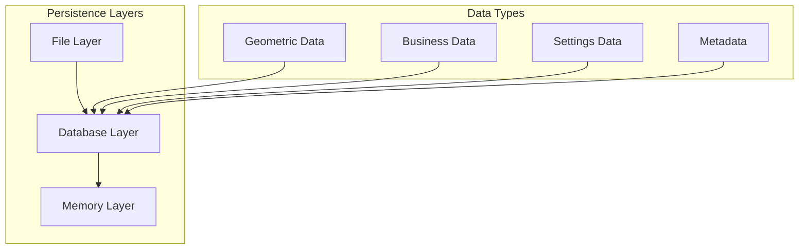
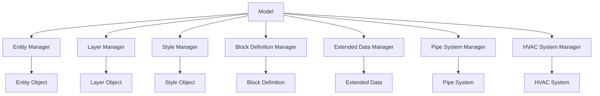
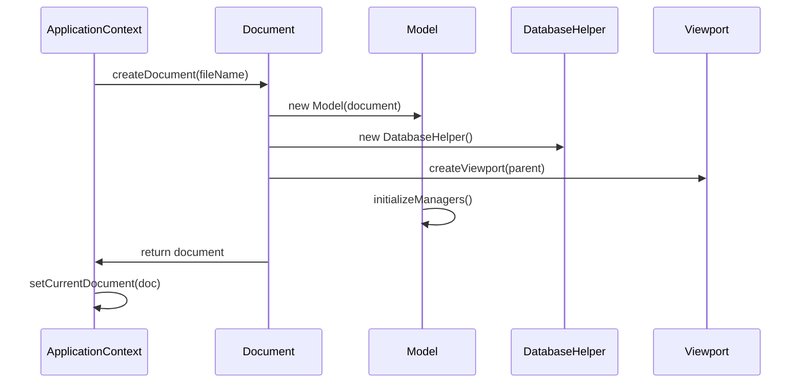
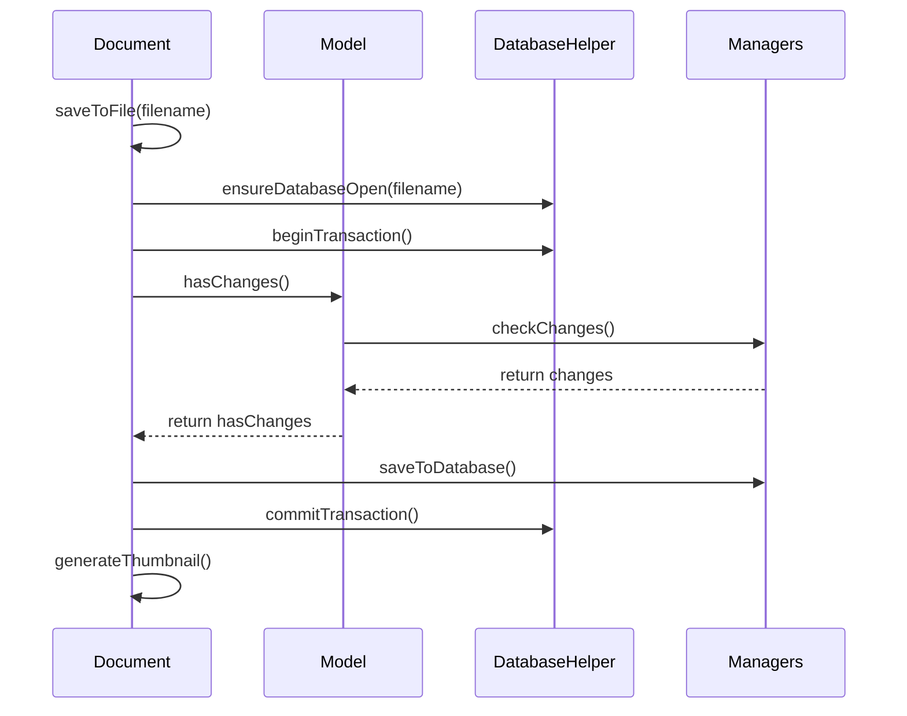
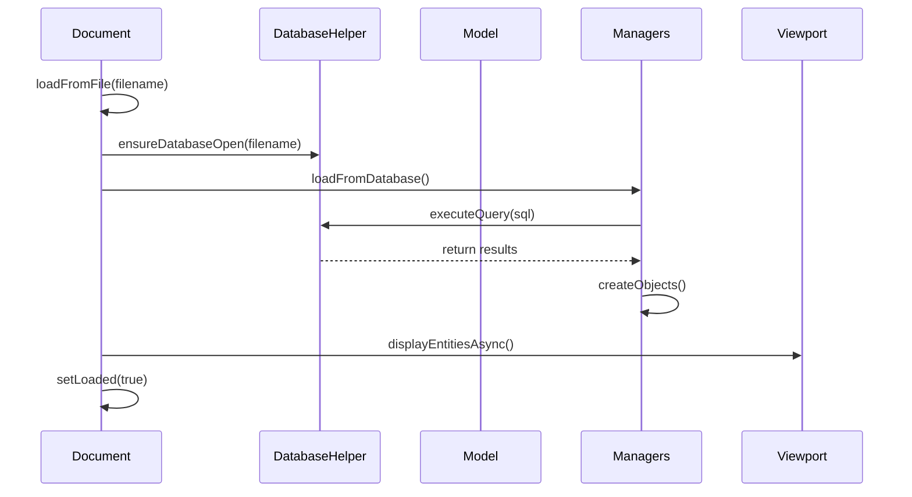

# Document System Architecture

## Overview

The Document system is the core module of OCCTBIM, responsible for document lifecycle management, data persistence, multi-document support, and other functions. The system adopts layered design, separating document management, data model, and application context, providing complete document operation capabilities.

## Core Architecture

```mermaid
classDiagram
    class ApplicationContext {
        -QList~Document*~ m_documents
        -Document* m_currentDocument
        -QMainWindow* m_mainWindow
        +createDocument(fileName) Document*
        +openDocument(fileName) bool
        +closeDocument(doc) void
        +setCurrentDocument(doc) void
        +currentDocument() Document*
        +currentViewport() Viewport*
        +log(message) void
        +addRecentFile(filePath) void
    }

    class Document {
        -QString m_id
        -QString m_fileName
        -Model* m_model
        -Viewport* m_viewport
        -CommandStack* m_commandStack
        -TransactionManager* m_transactionManager
        -DatabaseHelper* m_databaseHelper
        -bool m_isModified
        -bool m_isLoaded
        +saveToFile(filename) bool
        +loadFromFile(filename) bool
        +executeCommand(cmd) void
        +beginTransaction(name) void
        +commitTransaction() void
        +rollbackTransaction() void
        +generateThumbnail(filename) bool
    }

    class Model {
        -QString m_id
        -Document* m_document
        -EntityManager* m_entityManager
        -LayerManager* m_layerManager
        -StyleManager* m_styleManager
        -BlockDefinitionManager* m_blockDefinitionManager
        -ExtendDataManager* m_extendDataManager
        -PipeSystemManager* m_pipeSystemManager
        -HvacSystemManager* m_hvacSystemManager
        +hasChanges() bool
        +updateContext() void
        +saveViewport() void
    }

    class DatabaseHelper {
        -QSqlDatabase m_database
        -QString m_connectionName
        +openDatabase(filename) bool
        +closeDatabase() void
        +executeQuery(sql) QSqlQuery
        +beginTransaction() bool
        +commitTransaction() bool
        +rollbackTransaction() bool
    }

    class CommandStack {
        -QList~UndoCommand*~ m_commands
        -int m_currentIndex
        +push(command) void
        +undo() void
        +redo() void
        +clear() void
        +canUndo() bool
        +canRedo() bool
    }

    class TransactionManager {
        -QStack~Transaction*~ m_transactionStack
        -bool m_inTransaction
        +beginTransaction(name) void
        +commitTransaction() void
        +rollbackTransaction() void
        +isInTransaction() bool
    }
```



## Core Components Detailed

### 1. ApplicationContext Application Context

ApplicationContext is a global singleton responsible for document management and context maintenance throughout the application.

#### Main Responsibilities
- **Document Lifecycle Management**: Create, open, close documents
- **Current Document Management**: Maintain current active document state
- **Global Log Management**: Provide unified log recording interface
- **History Management**: Maintain recently opened file list

#### Key Features
```cpp
// Singleton pattern implementation
static ApplicationContext *instance();

// Document management
Document *createDocument(const QString &fileName);
bool openDocument(const QString &fileName);
void closeDocument(Document *doc);

// Log system - supports multiple syntaxes
LOG("Simple log message");
LOG_STREAM << "Stream log: " << value << " More content";
```

#### Log System Design
Provides two logging methods:
1. **Function call method**: `LOG("message")`
2. **Stream method**: `LOG_STREAM << "message" << variable`

### 2. Document Document Core

Document is the core class of the document system, encapsulating all functions of a single document.

#### Main Responsibilities
- **Document Data Management**: Manage all business data of the document
- **Persistence Operations**: Document save and load
- **Command Management**: Support for undo/redo functionality
- **Transaction Management**: Transactional guarantee of data operations
- **View Management**: Create and manage document views

#### Data Persistence Architecture


#### Save Strategy
- **Incremental Save**: Only save changed data to improve performance
- **Full Save**: Complete save of all data to ensure consistency
- **Auto Save**: Regular automatic save to prevent data loss
- **Thumbnail Generation**: Automatically generate document preview images

#### Transaction Management
```cpp
// Transaction operation example
document->beginTransaction("Create Entity");
try {
    // Execute multiple related operations
    entity1->create();
    entity2->modify();
    document->commitTransaction();
} catch (...) {
    document->rollbackTransaction();
}
```

### 3. Model Data Model

Model is the business data container of the document, managing all business-related data and logic.

#### Manager Architecture
Model adopts the manager pattern, managing different types of data separately:



#### Settings Management
Model provides flexible settings management mechanism:
```cpp
// Settings operations
model->setSetting("grid.visible", true);
model->setSetting("snap.enabled", true);
QVariant value = model->getSetting("grid.size", 10.0);

// Batch settings
QMap<QString, QVariant> settings;
settings["grid.visible"] = true;
settings["snap.enabled"] = true;
model->setSettings(settings);
```

### 4. DatabaseHelper Database Helper

DatabaseHelper encapsulates all database operations, providing unified data access interface.

#### Main Functions
- **Connection Management**: Database connection creation and management
- **Transaction Support**: Database-level transaction operations
- **Query Execution**: SQL query execution and result processing
- **Error Handling**: Error handling and recovery of database operations

#### Database Architecture
```sql
-- Main data table structures
CREATE TABLE entities (
    id TEXT PRIMARY KEY,
    type TEXT NOT NULL,
    layer_id TEXT,
    data BLOB,
    created_at TIMESTAMP,
    modified_at TIMESTAMP
);

CREATE TABLE layers (
    id TEXT PRIMARY KEY,
    name TEXT NOT NULL,
    color TEXT,
    line_type TEXT,
    visible BOOLEAN
);

CREATE TABLE styles (
    id TEXT PRIMARY KEY,
    name TEXT NOT NULL,
    type TEXT NOT NULL,
    properties TEXT
);

CREATE TABLE extend_data (
    entity_id TEXT,
    key TEXT,
    value TEXT,
    type TEXT,
    PRIMARY KEY (entity_id, key)
);
```

### 5. CommandStack Command Stack

CommandStack implements complete undo/redo functionality, supporting complex command combinations.

#### Command Pattern Implementation
```cpp
class UndoCommand {
public:
    virtual void execute() = 0;
    virtual void undo() = 0;
    virtual void redo() = 0;
    virtual QString description() const = 0;
};

// Usage example
auto cmd = new CreateEntityCommand(entity);
document->executeCommand(cmd);  // Automatically added to command stack
```

#### Composite Command Support
```cpp
class CompositeCommand : public UndoCommand {
private:
    QList<UndoCommand*> m_commands;
public:
    void addCommand(UndoCommand* cmd);
    void execute() override;
    void undo() override;
};
```

## Document Lifecycle

### 1. Document Creation Process


### 2. Document Save Process


### 3. Document Load Process


## Performance Optimization Strategies

### 1. Paged Loading
For large documents, adopt paged loading strategy:
```cpp
template <typename T>
QList<T *> Document::loadDataPaged(
    std::function<QList<T *>(Document *, int, int)> loadFunc,
    const QString &dataTypeName, 
    int pageSize = 1000) {
    
    QList<T *> allData;
    int offset = 0;
    
    while (true) {
        QList<T *> pageData = loadFunc(this, offset, pageSize);
        if (pageData.isEmpty()) break;
        
        allData.append(pageData);
        offset += pageSize;
    }
    
    return allData;
}
```

### 2. Asynchronous Display
Entity display adopts asynchronous mechanism to avoid UI blocking:
```cpp
void Document::displayEntitiesAsync() {
    QTimer::singleShot(0, [this]() {
        // Asynchronously display entities in event loop
        if (m_viewport) {
            m_viewport->displayAllEntities();
        }
    });
}
```

### 3. Database Optimization
- **Connection Pool**: Reuse database connections
- **Index Optimization**: Establish indexes for key fields
- **Batch Operations**: Reduce database interaction times
- **Space Cleanup**: Regularly clean up unused database space

### 4. Memory Management
- **Smart Pointers**: Automatic memory management
- **Object Cache**: Cache frequently accessed objects
- **Lazy Loading**: Load large data on demand

## Extension Mechanisms

### 1. Custom Manager
Can extend functionality by inheriting existing managers or creating new managers:
```cpp
class CustomManager : public QObject {
public:
    CustomManager(Model* model);
    void saveToDatabase();
    void loadFromDatabase();
};

// Register in Model
model->registerManager("custom", customManager);
```

### 2. Custom Settings
Add custom configuration through the settings system:
```cpp
// Register custom settings
model->setSetting("custom.feature.enabled", true);
model->setSetting("custom.feature.value", 42);

// Listen for settings changes
connect(model, &Model::settingsChanged, [this]() {
    updateCustomFeature();
});
```

### 3. Event Hooks
Provide event hooks at key operation points:
```cpp
// Hooks before and after document saving
connect(document, &Document::beforeSave, [](Document* doc) {
    // Custom processing before saving
});

connect(document, &Document::afterSave, [](Document* doc) {
    // Custom processing after saving
});
```

## Best Practices

### 1. Document Operations
- Always manage documents through ApplicationContext
- Use transactions to ensure data consistency
- Release document resources in a timely manner

### 2. Data Persistence
- Prefer incremental saves for performance
- Regularly perform full saves to ensure data integrity
- Set reasonable auto-save intervals

### 3. Memory Management
- Avoid circular references that cause memory leaks
- Clean up temporary objects promptly
- Use smart pointers to manage object lifecycle

### 4. Error Handling
- All database operations must have error handling
- Provide user-friendly error messages
- Record detailed error logs for debugging

The Document system provides a solid foundation for the entire OCCTBIM application. Its modular design and comprehensive extension mechanisms ensure system maintainability and extensibility.