# Entity System Architecture

## Overview

The Entity system is the core geometric object management system of OCCTBIM, responsible for the creation, management, rendering, and interaction of all geometric entities. The system adopts an object-oriented design, supporting various types including 2D/3D geometric objects, annotation objects, BREP entities, and feature entities, while providing complete attribute systems, grip editing, snap systems, and other functionalities.

## System Architecture

```mermaid
classDiagram
    class Entity {
        <<abstract>>
        -QString m_id
        -QString m_layerId
        -TopoDS_Shape m_shape
        -Handle~AIS_Shape~ m_aisObject
        -bool m_isShapeModified
        -bool m_isVisualModified
        +serialize(json) void
        +deserialize(json) void
        +properties() QMap~QString,EntityProperty~
        +updateProperties(properties) void
        +gripPoints() QList~GripPoint~
        +snapPoints() QList~SnapPoint~
        +transformBy(transform) void
        #updateShape() void
        #updateAISObject() void
    }

    class EntityManager {
        -QMap~QString,Entity*~ m_entities
        -QSet~QString~ m_addedItems
        -QSet~QString~ m_modifiedItems
        -QSet~QString~ m_deletedItems
        +addEntity(entity) void
        +removeEntity(entity) void
        +updateEntity(entity) void
        +findEntityById(id) Entity*
        +getEntitiesByLayer(layerId) QList~Entity*~
        +createEntity(type) Entity*
        +hasChanges() bool
    }

    class EntityRegistry {
        -QHash~QString,EntityCreator~ creators
        +registerEntity(creator,type) void
        +createEntity(type,document) Entity*
    }

    class TransformEntity {
        -gp_Trsf m_localTransform
        -gp_Pnt m_position
        -gp_Quaternion m_rotation
        -gp_Vec3f m_scale
        +setPosition(position) void
        +setRotation(rotation) void
        +setScale(scale) void
        +localTransform() gp_Trsf
        +worldTransform() gp_Trsf
    }

    %% 2D Entity Classes
    class LineEntity {
        -gp_Pnt m_startPoint
        -gp_Pnt m_endPoint
        -double m_length
        +setStartPoint(point) void
        +setEndPoint(point) void
        +length() double
    }

    class CircleEntity {
        -gp_Pnt m_center
        -double m_radius
        -gp_Dir m_normal
        +setCenter(center) void
        +setRadius(radius) void
        +setNormal(normal) void
    }

    class RectangleEntity {
        -gp_Pnt m_corner1
        -gp_Pnt m_corner2
        -double m_width
        -double m_height
        +setCorners(p1,p2) void
        +setDimensions(w,h) void
    }

    %% 3D Entity Classes
    class BoxEntity {
        -double m_length
        -double m_width
        -double m_height
        +setLength(length) void
        +setWidth(width) void
        +setHeight(height) void
    }

    class SphereEntity {
        -gp_Pnt m_center
        -double m_radius
        +setCenter(center) void
        +setRadius(radius) void
    }

    class CylinderEntity {
        -gp_Pnt m_baseCenter
        -gp_Dir m_axis
        -double m_radius
        -double m_height
        +setBaseCenter(center) void
        +setAxis(axis) void
        +setRadius(radius) void
        +setHeight(height) void
    }

    %% Annotation Entity Classes
    class AnnotationEntity {
        <<abstract>>
        -gp_Pnt m_position
        -double m_scale
        -double m_angle
        +setPosition(position) void
        +setScale(scale) void
        +setAngle(angle) void
    }

    class TextEntity {
        -QString m_text
        -QString m_textStyle
        -QString m_fontFamily
        -double m_height
        -TextAlignment m_alignment
        +setText(text) void
        +setTextStyle(style) void
        +setHeight(height) void
        +setAlignment(alignment) void
    }

    class LinearDimEntity {
        -gp_Pnt m_point1
        -gp_Pnt m_point2
        -gp_Pnt m_dimLinePoint
        -QString m_dimStyle
        +setPoints(p1,p2) void
        +setDimLinePoint(point) void
        +setDimStyle(style) void
    }

    %% Feature Entity Classes
    class FeatureEntityBase {
        <<abstract>>
        -bool m_featureEditingEnabled
        +isFeatureEntity() bool
        +featureTypeName() QString
        +supportsParametricEditing() bool
        +buildFeatureNodeData() FeatureNodeData*
    }

    class ExtrudeFeatureEntity {
        -TopoDS_Shape m_profile
        -gp_Vec m_direction
        -double m_distance
        +setProfile(shape) void
        +setDirection(direction) void
        +setDistance(distance) void
    }

    class RevolveFeatureEntity {
        -TopoDS_Shape m_profile
        -gp_Ax1 m_axis
        -double m_angle
        +setProfile(shape) void
        +setAxis(axis) void
        +setAngle(angle) void
    }

    %% BREP Entity Classes
    class BrepEntity {
        -TopoDS_Shape m_brepShape
        +setBrepShape(shape) void
        +brepShape() TopoDS_Shape
    }

    class EdgeEntity {
        -TopoDS_Edge m_edge
        +setEdge(edge) void
        +edge() TopoDS_Edge
    }

    class FaceEntity {
        -TopoDS_Face m_face
        +setFace(face) void
        +face() TopoDS_Face
    }

    %% Inheritance Relationships
    Entity <|-- TransformEntity
    TransformEntity <|-- LineEntity
    TransformEntity <|-- CircleEntity
    TransformEntity <|-- RectangleEntity
    TransformEntity <|-- BoxEntity
    TransformEntity <|-- SphereEntity
    TransformEntity <|-- CylinderEntity
    Entity <|-- AnnotationEntity
    AnnotationEntity <|-- TextEntity
    AnnotationEntity <|-- LinearDimEntity
    Entity <|-- FeatureEntityBase
    FeatureEntityBase <|-- ExtrudeFeatureEntity
    FeatureEntityBase <|-- RevolveFeatureEntity
    Entity <|-- BrepEntity
    BrepEntity <|-- EdgeEntity
    BrepEntity <|-- FaceEntity
```



## Core Components Detailed

### 1. Entity Base Class

The Entity class is the abstract base class for all geometric objects in the system.

#### Core Properties
```cpp
class Entity : public QObject {
    Q_OBJECT
    
protected:
    QString m_id;                    // Unique identifier
    QString m_layerId;              // Layer identifier
    TopoDS_Shape m_shape;           // Geometric shape
    Handle(AIS_Shape) m_aisObject;  // Visualization object
    bool m_isShapeModified;         // Shape modification flag
    bool m_isVisualModified;        // Visual modification flag
    
public:
    // Basic property access
    QString id() const;
    QString layerId() const;
    void setLayerId(const QString &layerId);
    
    // Serialization interface
    virtual void serialize(QJsonObject &json) const;
    virtual void deserialize(const QJsonObject &json);
    
    // Property system
    virtual QMap<QString, EntityProperty> properties() const;
    virtual void updateProperties(const QMap<QString, EntityProperty> &properties);
    
    // Interaction support
    virtual QList<GripPoint> gripPoints() const;
    virtual QList<SnapPoint> snapPoints() const;
    
    // Transformation
    virtual void transformBy(const gp_Trsf &transform);
    
protected:
    // Shape and visual updates
    virtual void updateShape();
    virtual void updateAISObject();
};
```

### 2. EntityManager

EntityManager is responsible for the lifecycle management of all entities in a document.

#### Main Responsibilities
- **Entity Lifecycle Management**: Add, remove, and update entities
- **Change Tracking**: Track modifications for undo/redo support
- **Query Operations**: Find entities by ID, layer, or other criteria
- **Batch Operations**: Support for bulk entity operations

#### Key Features
```cpp
class EntityManager : public QObject {
    Q_OBJECT
    
private:
    QMap<QString, Entity*> m_entities;        // Entity storage by ID
    QSet<QString> m_addedItems;              // Added entities
    QSet<QString> m_modifiedItems;          // Modified entities
    QSet<QString> m_deletedItems;            // Deleted entities
    
public:
    // Entity management
    void addEntity(Entity *entity, bool recordUndo = true);
    void removeEntity(Entity *entity, bool recordUndo = true);
    void updateEntity(Entity *entity, bool recordUndo = true);
    
    // Query operations
    Entity* findEntityById(const QString &id) const;
    QList<Entity*> getEntitiesByLayer(const QString &layerId) const;
    QList<Entity*> getAllEntities() const;
    
    // Factory method
    Entity* createEntity(const QString &type);
    
    // Change tracking
    bool hasChanges() const;
    void clearChangeTracking();
    
    // Batch operations
    void addEntities(const QList<Entity*> &entities, bool recordUndo = true);
    void removeEntities(const QList<Entity*> &entities, bool recordUndo = true);
};
```

### 3. EntityRegistry

EntityRegistry provides a registration mechanism for custom entity types.

#### Registration System
```cpp
class EntityRegistry {
public:
    using EntityCreator = Entity *(*)(Document *);
    
    static Entity *createEntity(const QString &type, Document *document);
    static void registerEntity(EntityCreator creator, const QString &type);
    
private:
    static QHash<QString, EntityCreator> &creators();
};

// Automatic registration macro
#define REGISTER_ENTITY(EntityClass, type) \\
    class EntityClass##Registrar { \\
    public: \\
        EntityClass##Registrar() { \\
            EntityRegistry::registerEntity(&EntityClass##Registrar::create, type); \\
        } \\
        static Entity *create(Document *document) { \\
            return new EntityClass(document); \\
        } \\
    }; \\
    static EntityClass##Registrar EntityClass##_registrar;
```

### 4. TransformEntity

TransformEntity provides transformation capabilities for geometric objects.

#### Transformation Features
```cpp
class TransformEntity : public Entity {
protected:
    gp_Trsf m_localTransform;      // Local transformation
    gp_Pnt m_position;             // Position
    gp_Quaternion m_rotation;      // Rotation
    gp_Vec3f m_scale;              // Scale
    
public:
    // Transformation setters
    void setPosition(const gp_Pnt &position);
    void setRotation(const gp_Quaternion &rotation);
    void setScale(const gp_Vec3f &scale);
    
    // Transformation getters
    gp_Pnt position() const;
    gp_Quaternion rotation() const;
    gp_Vec3f scale() const;
    
    // Transformation matrices
    gp_Trsf localTransform() const;
    gp_Trsf worldTransform() const;
    
    // Utility methods
    void translate(const gp_Vec &translation);
    void rotate(const gp_Ax1 &axis, double angle);
    void scaleUniform(double factor);
};
```

## Entity Types

### 1. 2D Geometric Entities

#### LineEntity
Represents a straight line segment between two points.

```cpp
class LineEntity : public TransformEntity {
private:
    gp_Pnt m_startPoint;
    gp_Pnt m_endPoint;
    double m_length;
    
public:
    // Point management
    void setStartPoint(const gp_Pnt &point);
    void setEndPoint(const gp_Pnt &point);
    gp_Pnt startPoint() const;
    gp_Pnt endPoint() const;
    
    // Geometric properties
    double length() const;
    gp_Vec direction() const;
    
    // Override methods
    void updateShape() override;
    QList<GripPoint> gripPoints() const override;
};
```

#### CircleEntity
Represents a circular geometric object.

```cpp
class CircleEntity : public TransformEntity {
private:
    gp_Pnt m_center;
    double m_radius;
    gp_Dir m_normal;
    
public:
    // Circle properties
    void setCenter(const gp_Pnt &center);
    void setRadius(double radius);
    void setNormal(const gp_Dir &normal);
    
    gp_Pnt center() const;
    double radius() const;
    gp_Dir normal() const;
    
    // Geometric calculations
    double circumference() const;
    double area() const;
    
    void updateShape() override;
};
```

### 2. 3D Solid Entities

#### BoxEntity
Represents a rectangular prism (box) in 3D space.

```cpp
class BoxEntity : public TransformEntity {
private:
    double m_length;
    double m_width;
    double m_height;
    
public:
    // Dimension setters
    void setLength(double length);
    void setWidth(double width);
    void setHeight(double height);
    
    // Dimension getters
    double length() const;
    double width() const;
    double height() const;
    
    // Geometric properties
    double volume() const;
    double surfaceArea() const;
    
    void updateShape() override;
};
```

#### SphereEntity
Represents a spherical geometric object.

```cpp
class SphereEntity : public TransformEntity {
private:
    gp_Pnt m_center;
    double m_radius;
    
public:
    // Sphere properties
    void setCenter(const gp_Pnt &center);
    void setRadius(double radius);
    
    gp_Pnt center() const;
    double radius() const;
    
    // Geometric calculations
    double volume() const;
    double surfaceArea() const;
    
    void updateShape() override;
};
```

### 3. Annotation Entities

#### TextEntity
Represents text annotation in the drawing.

```cpp
class TextEntity : public AnnotationEntity {
private:
    QString m_text;
    QString m_textStyle;
    QString m_fontFamily;
    double m_height;
    TextAlignment m_alignment;
    
public:
    // Text properties
    void setText(const QString &text);
    void setTextStyle(const QString &style);
    void setFontFamily(const QString &fontFamily);
    void setHeight(double height);
    void setAlignment(TextAlignment alignment);
    
    QString text() const;
    QString textStyle() const;
    QString fontFamily() const;
    double height() const;
    TextAlignment alignment() const;
    
    // Text measurement
    QSizeF textExtents() const;
    
    void updateShape() override;
};
```

#### LinearDimEntity
Represents linear dimension annotation.

```cpp
class LinearDimEntity : public AnnotationEntity {
private:
    gp_Pnt m_point1;
    gp_Pnt m_point2;
    gp_Pnt m_dimLinePoint;
    QString m_dimStyle;
    
public:
    // Dimension points
    void setPoints(const gp_Pnt &point1, const gp_Pnt &point2);
    void setDimLinePoint(const gp_Pnt &point);
    void setDimStyle(const QString &style);
    
    gp_Pnt point1() const;
    gp_Pnt point2() const;
    gp_Pnt dimLinePoint() const;
    QString dimStyle() const;
    
    // Dimension calculation
    double measuredDistance() const;
    
    void updateShape() override;
};
```

### 4. Feature Entities

#### ExtrudeFeatureEntity
Represents an extrusion feature for parametric modeling.

```cpp
class ExtrudeFeatureEntity : public FeatureEntityBase {
private:
    TopoDS_Shape m_profile;
    gp_Vec m_direction;
    double m_distance;
    
public:
    // Extrusion parameters
    void setProfile(const TopoDS_Shape &profile);
    void setDirection(const gp_Vec &direction);
    void setDistance(double distance);
    
    TopoDS_Shape profile() const;
    gp_Vec direction() const;
    double distance() const;
    
    // Feature operations
    bool validateProfile() const;
    void updateShape() override;
};
```

#### RevolveFeatureEntity
Represents a revolve feature for parametric modeling.

```cpp
class RevolveFeatureEntity : public FeatureEntityBase {
private:
    TopoDS_Shape m_profile;
    gp_Ax1 m_axis;
    double m_angle;
    
public:
    // Revolution parameters
    void setProfile(const TopoDS_Shape &profile);
    void setAxis(const gp_Ax1 &axis);
    void setAngle(double angle);
    
    TopoDS_Shape profile() const;
    gp_Ax1 axis() const;
    double angle() const;
    
    // Feature operations
    bool validateProfile() const;
    void updateShape() override;
};
```

## Interaction Support

### 1. Grip Points System

Grip points provide interactive editing handles for entities.

```cpp
struct GripPoint {
    gp_Pnt position;           // Grip position
    GripType type;             // Grip type (vertex, edge, face, etc.)
    int index;                 // Grip index
    bool isActive;             // Active state
    
    // Grip operations
    void moveTo(const gp_Pnt &newPosition);
    bool isValid() const;
};

enum class GripType {
    Vertex,        // Vertex grip
    Edge,          // Edge grip
    Face,          // Face grip
    Center,        // Center grip
    Rotation,      // Rotation grip
    Scale          // Scale grip
};
```

### 2. Snap Points System

Snap points provide precise positioning during entity creation and editing.

```cpp
struct SnapPoint {
    gp_Pnt position;           // Snap position
    SnapType type;             // Snap type
    double priority;           // Snap priority
    
    // Snap operations
    bool isValid() const;
    double distanceTo(const gp_Pnt &point) const;
};

enum class SnapType {
    Endpoint,       // Endpoint snap
    Midpoint,       // Midpoint snap
    Center,         // Center snap
    Intersection,   // Intersection snap
    Perpendicular, // Perpendicular snap
    Tangent         // Tangent snap
};
```

## Performance Optimization

### 1. Lazy Evaluation
- Shape updates are performed only when necessary
- Visual updates are batched for efficiency
- Property calculations are cached

### 2. Memory Management
- Smart pointers for entity ownership
- Object pooling for frequently created entities
- Efficient data structures for entity storage

### 3. Rendering Optimization
- Level-of-detail (LOD) rendering
- Frustum culling for large scenes
- Instance rendering for repeated entities

The Entity system provides a comprehensive framework for geometric object management in OCCTBIM, supporting a wide range of entity types with advanced interaction and performance optimization features.