# Extend Data System Architecture

## Overview

The Extend Data system provides a flexible mechanism for attaching custom data to entities in OCCTBIM. This system allows users to extend the standard entity properties with domain-specific information, supporting various data types including strings, numbers, booleans, arrays, and complex objects. The system features a hierarchical data structure, type safety, and efficient storage mechanisms.

## System Architecture

```mermaid
classDiagram
    class ExtendData {
        <<abstract>>
        -QString m_name
        -QVariant m_value
        -DataType m_type
        -QString m_description
        -bool m_isReadOnly
        +name() QString
        +value() QVariant
        +type() DataType
        +description() QString
        +isReadOnly() bool
        +setValue(value) void
        +serialize(json) void
        +deserialize(json) void
        +clone() ExtendData*
    }

    class ExtendDataManager {
        -QHash~QString,ExtendData*~ m_dataMap
        -QHash~QString,QList~ExtendData*~~ m_entityData
        -QHash~QString,QList~ExtendData*~~ m_layerData
        -QHash~QString,QList~ExtendData*~~ m_documentData
        +addData(entityId,data) void
        +removeData(entityId,name) void
        +getData(entityId,name) ExtendData*
        +getAllData(entityId) QList~ExtendData*~
        +hasData(entityId,name) bool
        +clearData(entityId) void
        +copyData(sourceId,targetId) void
    }

    class ExtendDataRegistry {
        -QHash~QString,ExtendDataCreator~ creators
        +registerData(creator,type) void
        +createData(type) ExtendData*
        +getRegisteredTypes() QList~QString~
    }

    class ExtendDataContainer {
        -QHash~QString,ExtendData*~ m_data
        -QString m_ownerId
        -ExtendDataManager* m_manager
        +addData(data) void
        +removeData(name) void
        +getData(name) ExtendData*
        +hasData(name) bool
        +clear() void
        +serialize(json) void
        +deserialize(json) void
    }

    %% Basic Data Types
    class StringData {
        -QString m_stringValue
        -int m_maxLength
        +setValue(value) void
        +value() QString
        +maxLength() int
        +setMaxLength(length) void
    }

    class NumberData {
        -double m_numberValue
        -double m_minValue
        -double m_maxValue
        -int m_precision
        +setValue(value) void
        +value() double
        +minValue() double
        +maxValue() double
        +precision() int
        +setRange(min,max) void
    }

    class BooleanData {
        -bool m_boolValue
        +setValue(value) void
        +value() bool
    }

    class DateTimeData {
        -QDateTime m_dateTimeValue
        -QString m_format
        +setValue(value) void
        +value() QDateTime
        +format() QString
        +setFormat(format) void
    }

    %% Complex Data Types
    class ArrayData {
        -QList~QVariant~ m_arrayValue
        -int m_maxSize
        -DataType m_elementType
        +setValue(value) void
        +value() QList~QVariant~
        +append(value) void
        +removeAt(index) void
        +size() int
        +maxSize() int
        +elementType() DataType
    }

    class ObjectData {
        -QJsonObject m_objectValue
        -QString m_schema
        +setValue(value) void
        +value() QJsonObject
        +setProperty(key,value) void
        +getProperty(key) QVariant
        +hasProperty(key) bool
        +schema() QString
        +setSchema(schema) void
    }

    class ReferenceData {
        -QString m_referenceId
        -ReferenceType m_referenceType
        +setValue(value) void
        +value() QString
        +referenceType() ReferenceType
        +setReferenceType(type) void
        +resolve() Entity*
    }

    %% Specialized Data Types
    class ColorData {
        -QColor m_colorValue
        -ColorSpace m_colorSpace
        +setValue(value) void
        +value() QColor
        +colorSpace() ColorSpace
        +setColorSpace(space) void
        +toHex() QString
        +toRgb() QColor
    }

    class GeometryData {
        -TopoDS_Shape m_geometryValue
        -double m_tolerance
        +setValue(value) void
        +value() TopoDS_Shape
        +tolerance() double
        +setTolerance(tolerance) void
        +boundingBox() Bnd_Box
    }

    class MaterialData {
        -QString m_materialName
        -double m_density
        -QColor m_color
        -double m_roughness
        +setValue(value) void
        +value() QString
        +density() double
        +color() QColor
        +roughness() double
        +setDensity(density) void
        +setColor(color) void
        +setRoughness(roughness) void
    }

    %% Inheritance Relationships
    ExtendData <|-- StringData
    ExtendData <|-- NumberData
    ExtendData <|-- BooleanData
    ExtendData <|-- DateTimeData
    ExtendData <|-- ArrayData
    ExtendData <|-- ObjectData
    ExtendData <|-- ReferenceData
    ExtendData <|-- ColorData
    ExtendData <|-- GeometryData
    ExtendData <|-- MaterialData
```



## Core Components Detailed

### 1. ExtendData Base Class

The ExtendData class is the abstract base class for all extend data types.

#### Core Properties
```cpp
class ExtendData : public QObject {
    Q_OBJECT
    
protected:
    QString m_name;              // Data name
    QVariant m_value;           // Data value
    DataType m_type;            // Data type
    QString m_description;      // Description
    bool m_isReadOnly;          // Read-only flag
    
public:
    // Constructor
    ExtendData(const QString &name, DataType type, const QString &description = "");
    
    // Basic property access
    QString name() const;
    QVariant value() const;
    DataType type() const;
    QString description() const;
    bool isReadOnly() const;
    
    // Value management
    virtual void setValue(const QVariant &value);
    virtual bool validateValue(const QVariant &value) const;
    
    // Serialization interface
    virtual void serialize(QJsonObject &json) const;
    virtual void deserialize(const QJsonObject &json);
    
    // Cloning
    virtual ExtendData* clone() const = 0;
    
    // Type information
    virtual QString typeName() const;
    
protected:
    // Validation hooks
    virtual bool validateString(const QString &value) const;
    virtual bool validateNumber(double value) const;
    virtual bool validateBoolean(bool value) const;
};

// Data type enumeration
enum class DataType {
    String,         // String data
    Number,         // Numeric data
    Boolean,        // Boolean data
    DateTime,       // Date/time data
    Array,          // Array data
    Object,         // Object data
    Reference,      // Entity reference
    Color,          // Color data
    Geometry,       // Geometric data
    Material        // Material data
};
```

### 2. ExtendDataManager

ExtendDataManager is responsible for managing extend data across entities, layers, and documents.

#### Main Responsibilities
- **Data Lifecycle Management**: Add, remove, and update extend data
- **Hierarchical Storage**: Support for entity, layer, and document-level data
- **Query Operations**: Find data by name, type, or other criteria
- **Batch Operations**: Support for bulk data operations

#### Key Features
```cpp
class ExtendDataManager : public QObject {
    Q_OBJECT
    
private:
    // Data storage by scope
    QHash<QString, ExtendData*> m_dataMap;                    // Global data map
    QHash<QString, QList<ExtendData*>> m_entityData;         // Entity-specific data
    QHash<QString, QList<ExtendData*>> m_layerData;          // Layer-specific data
    QHash<QString, QList<ExtendData*>> m_documentData;       // Document-specific data
    
public:
    // Entity data management
    void addData(const QString &entityId, ExtendData *data);
    void removeData(const QString &entityId, const QString &name);
    ExtendData* getData(const QString &entityId, const QString &name) const;
    QList<ExtendData*> getAllData(const QString &entityId) const;
    bool hasData(const QString &entityId, const QString &name) const;
    void clearData(const QString &entityId);
    
    // Layer data management
    void addLayerData(const QString &layerId, ExtendData *data);
    QList<ExtendData*> getLayerData(const QString &layerId) const;
    void clearLayerData(const QString &layerId);
    
    // Document data management
    void addDocumentData(ExtendData *data);
    QList<ExtendData*> getDocumentData() const;
    void clearDocumentData();
    
    // Data copying
    void copyData(const QString &sourceId, const QString &targetId);
    void copyLayerData(const QString &sourceLayerId, const QString &targetLayerId);
    
    // Query operations
    QList<QString> findEntitiesWithData(const QString &name) const;
    QList<QString> findEntitiesWithDataType(DataType type) const;
    
    // Serialization
    void serialize(QJsonObject &json) const;
    void deserialize(const QJsonObject &json);
    
    // Memory management
    void clearAllData();
};
```

### 3. ExtendDataRegistry

ExtendDataRegistry provides a registration mechanism for custom extend data types.

#### Registration System
```cpp
class ExtendDataRegistry {
public:
    using ExtendDataCreator = ExtendData *(*)();
    
    static ExtendData* createData(const QString &type);
    static void registerData(ExtendDataCreator creator, const QString &type);
    static QList<QString> getRegisteredTypes();
    
private:
    static QHash<QString, ExtendDataCreator> &creators();
};

// Automatic registration macro
#define REGISTER_EXTEND_DATA(DataClass, type) \\
    class DataClass##Registrar { \\
    public: \\
        DataClass##Registrar() { \\
            ExtendDataRegistry::registerData(&DataClass##Registrar::create, type); \\
        } \\
        static ExtendData *create() { \\
            return new DataClass(); \\
        } \\
    }; \\
    static DataClass##Registrar DataClass##_registrar;
```

### 4. ExtendDataContainer

ExtendDataContainer provides a convenient wrapper for managing extend data collections.

#### Container Features
```cpp
class ExtendDataContainer {
private:
    QHash<QString, ExtendData*> m_data;        // Data storage
    QString m_ownerId;                         // Owner identifier
    ExtendDataManager* m_manager;              // Manager reference
    
public:
    // Constructor
    ExtendDataContainer(const QString &ownerId, ExtendDataManager *manager);
    
    // Data management
    void addData(ExtendData *data);
    void removeData(const QString &name);
    ExtendData* getData(const QString &name) const;
    bool hasData(const QString &name) const;
    void clear();
    
    // Convenience methods
    QString getString(const QString &name, const QString &defaultValue = "") const;
    double getNumber(const QString &name, double defaultValue = 0.0) const;
    bool getBoolean(const QString &name, bool defaultValue = false) const;
    QDateTime getDateTime(const QString &name, const QDateTime &defaultValue = QDateTime()) const;
    
    void setString(const QString &name, const QString &value);
    void setNumber(const QString &name, double value);
    void setBoolean(const QString &name, bool value);
    void setDateTime(const QString &name, const QDateTime &value);
    
    // Serialization
    void serialize(QJsonObject &json) const;
    void deserialize(const QJsonObject &json);
    
    // Information
    int count() const;
    QList<QString> dataNames() const;
    bool isEmpty() const;
};
```

## Extend Data Types

### 1. Basic Data Types

#### StringData
Represents string-based extend data with length validation.

```cpp
class StringData : public ExtendData {
private:
    QString m_stringValue;
    int m_maxLength;
    
public:
    StringData(const QString &name, const QString &description = "");
    
    // Value management
    void setValue(const QVariant &value) override;
    QString value() const;
    
    // Length constraints
    int maxLength() const;
    void setMaxLength(int length);
    
    // Validation
    bool validateValue(const QVariant &value) const override;
    
    // Serialization
    void serialize(QJsonObject &json) const override;
    void deserialize(const QJsonObject &json) override;
    
    // Cloning
    ExtendData* clone() const override;
};
```

#### NumberData
Represents numeric extend data with range validation.

```cpp
class NumberData : public ExtendData {
private:
    double m_numberValue;
    double m_minValue;
    double m_maxValue;
    int m_precision;
    
public:
    NumberData(const QString &name, const QString &description = "");
    
    // Value management
    void setValue(const QVariant &value) override;
    double value() const;
    
    // Range constraints
    double minValue() const;
    double maxValue() const;
    int precision() const;
    void setRange(double min, double max);
    void setPrecision(int precision);
    
    // Validation
    bool validateValue(const QVariant &value) const override;
    
    // Serialization
    void serialize(QJsonObject &json) const override;
    void deserialize(const QJsonObject &json) override;
    
    // Cloning
    ExtendData* clone() const override;
};
```

### 2. Complex Data Types

#### ArrayData
Represents array-based extend data with type safety.

```cpp
class ArrayData : public ExtendData {
private:
    QList<QVariant> m_arrayValue;
    int m_maxSize;
    DataType m_elementType;
    
public:
    ArrayData(const QString &name, DataType elementType, const QString &description = "");
    
    // Value management
    void setValue(const QVariant &value) override;
    QList<QVariant> value() const;
    
    // Array operations
    void append(const QVariant &value);
    void removeAt(int index);
    int size() const;
    
    // Constraints
    int maxSize() const;
    DataType elementType() const;
    void setMaxSize(int size);
    
    // Validation
    bool validateValue(const QVariant &value) const override;
    bool validateElement(const QVariant &value) const;
    
    // Serialization
    void serialize(QJsonObject &json) const override;
    void deserialize(const QJsonObject &json) override;
    
    // Cloning
    ExtendData* clone() const override;
};
```

#### ObjectData
Represents complex object extend data with schema validation.

```cpp
class ObjectData : public ExtendData {
private:
    QJsonObject m_objectValue;
    QString m_schema;
    
public:
    ObjectData(const QString &name, const QString &description = "");
    
    // Value management
    void setValue(const QVariant &value) override;
    QJsonObject value() const;
    
    // Property operations
    void setProperty(const QString &key, const QVariant &value);
    QVariant getProperty(const QString &key) const;
    bool hasProperty(const QString &key) const;
    
    // Schema validation
    QString schema() const;
    void setSchema(const QString &schema);
    bool validateSchema() const;
    
    // Validation
    bool validateValue(const QVariant &value) const override;
    
    // Serialization
    void serialize(QJsonObject &json) const override;
    void deserialize(const QJsonObject &json) override;
    
    // Cloning
    ExtendData* clone() const override;
};
```

### 3. Specialized Data Types

#### ColorData
Represents color extend data with color space support.

```cpp
class ColorData : public ExtendData {
private:
    QColor m_colorValue;
    ColorSpace m_colorSpace;
    
public:
    ColorData(const QString &name, const QString &description = "");
    
    // Value management
    void setValue(const QVariant &value) override;
    QColor value() const;
    
    // Color operations
    ColorSpace colorSpace() const;
    void setColorSpace(ColorSpace space);
    QString toHex() const;
    QColor toRgb() const;
    
    // Validation
    bool validateValue(const QVariant &value) const override;
    
    // Serialization
    void serialize(QJsonObject &json) const override;
    void deserialize(const QJsonObject &json) override;
    
    // Cloning
    ExtendData* clone() const override;
};

// Color space enumeration
enum class ColorSpace {
    RGB,        // RGB color space
    HSV,        // HSV color space
    CMYK,       // CMYK color space
    HSL         // HSL color space
};
```

#### MaterialData
Represents material extend data for 3D rendering.

```cpp
class MaterialData : public ExtendData {
private:
    QString m_materialName;
    double m_density;
    QColor m_color;
    double m_roughness;
    
public:
    MaterialData(const QString &name, const QString &description = "");
    
    // Value management
    void setValue(const QVariant &value) override;
    QString value() const;
    
    // Material properties
    double density() const;
    QColor color() const;
    double roughness() const;
    void setDensity(double density);
    void setColor(const QColor &color);
    void setRoughness(double roughness);
    
    // Validation
    bool validateValue(const QVariant &value) const override;
    
    // Serialization
    void serialize(QJsonObject &json) const override;
    void deserialize(const QJsonObject &json) override;
    
    // Cloning
    ExtendData* clone() const override;
};
```

## Usage Examples

### 1. Basic Data Attachment

```cpp
// Create extend data manager
ExtendDataManager *manager = new ExtendDataManager();

// Add string data to entity
StringData *nameData = new StringData("EntityName", "Name of the entity");
nameData->setValue("Wall-001");
manager->addData(entityId, nameData);

// Add numeric data
NumberData *heightData = new NumberData("Height", "Height of the entity");
heightData->setRange(0.0, 100.0);
heightData->setValue(3.0);
manager->addData(entityId, heightData);

// Retrieve data
ExtendData *data = manager->getData(entityId, "EntityName");
if (data && data->type() == DataType::String) {
    QString name = data->value().toString();
    qDebug() << "Entity name:" << name;
}
```

### 2. Complex Data Structures

```cpp
// Create object data with schema
ObjectData *bimData = new ObjectData("BIMProperties", "BIM-specific properties");
bimData->setSchema("{\"type\":\"object\",\"properties\":{\"category\":{\"type\":\"string\"},\"material\":{\"type\":\"string\"}}}");

// Set properties
bimData->setProperty("category", "Structural");
bimData->setProperty("material", "Concrete");
manager->addData(entityId, bimData);

// Create array data
ArrayData *tagsData = new ArrayData("Tags", DataType::String, "Entity tags");
tagsData->append("structural");
tagsData->append("concrete");
tagsData->append("wall");
manager->addData(entityId, tagsData);
```

### 3. Layer and Document Data

```cpp
// Add data to layer
ColorData *layerColor = new ColorData("LayerColor", "Default color for layer");
layerColor->setValue(QColor(255, 0, 0));
manager->addLayerData(layerId, layerColor);

// Add data to document
ObjectData *projectInfo = new ObjectData("ProjectInfo", "Project information");
projectInfo->setProperty("name", "Office Building");
projectInfo->setProperty("version", "1.0.0");
manager->addDocumentData(projectInfo);
```

## Performance Optimization

### 1. Memory Management
- Lazy loading of extend data
- Object pooling for frequently used data types
- Efficient data structure for quick lookups

### 2. Serialization Optimization
- Binary serialization for large data sets
- Compression for repetitive data
- Incremental serialization for large documents

### 3. Query Optimization
- Indexing for frequently queried data
- Caching for repeated queries
- Batch operations for bulk data management

The Extend Data system provides a powerful and flexible mechanism for extending entity properties in OCCTBIM, supporting a wide range of data types with advanced validation and performance optimization features.