# Extension Mechanism Architecture

## Overview

The Extension Mechanism in OCCTBIM provides a powerful plugin-based architecture that enables developers to extend the system's functionality without modifying the core codebase. This modular design supports dynamic loading of extensions for entities, tools, actions, and UI components.

## System Architecture

```mermaid
classDiagram
    class ExtensionManager {
        -QHash~QString,Extension*~ m_extensions
        -QHash~QString,ExtensionLoader*~ m_loaders
        -QHash~QString,ExtensionRegistry*~ m_registries
        -ExtensionContext* m_context
        -bool m_autoLoad
        +extensions() QHash~QString,Extension*~
        +loaders() QHash~QString,ExtensionLoader*~
        +registries() QHash~QString,ExtensionRegistry*~
        +context() ExtensionContext*
        +autoLoad() bool
        +setAutoLoad(autoLoad) void
        +loadExtension(path) Extension*
        +unloadExtension(id) bool
        +getExtension(id) Extension*
        +getAllExtensions() QList~Extension*~
        +registerLoader(type,loader) void
        +registerRegistry(type,registry) void
        +scanDirectory(path) QList~Extension*~
        +validateExtension(extension) bool
        +resolveDependencies(extension) bool
    }

    class Extension {
        <<abstract>>
        -QString m_extensionId
        -QString m_extensionName
        -QString m_version
        -QString m_description
        -QString m_author
        -QString m_license
        -QList~QString~ m_dependencies
        -ExtensionType m_type
        -ExtensionStatus m_status
        -QHash~QString,QVariant~ m_metadata
        +extensionId() QString
        +extensionName() QString
        +version() QString
        +description() QString
        +author() QString
        +license() QString
        +dependencies() QList~QString~
        +type() ExtensionType
        +status() ExtensionStatus
        +metadata() QHash~QString,QVariant~
        +initialize() bool
        +shutdown() bool
        +getComponent(type) QObject*
        +getAllComponents() QHash~QString,QObject*~
        +validate() bool
        +getDependencyGraph() QHash~QString,QList~QString~~
    }

    class ExtensionLoader {
        <<abstract>>
        -QString m_loaderType
        -QHash~QString,Extension*~ m_loadedExtensions
        -QStringList m_supportedFormats
        +loaderType() QString
        +loadedExtensions() QHash~QString,Extension*~
        +supportedFormats() QStringList
        +canLoad(path) bool
        +load(path) Extension*
        +unload(extension) bool
        +getLoadError() QString
        +validateFormat(path) bool
        +extractMetadata(path) QHash~QString,QVariant~
    }

    class ExtensionRegistry {
        <<abstract>>
        -QString m_registryType
        -QHash~QString,QObject*~ m_registeredComponents
        -QHash~QString,QList~QString~~ m_componentCategories
        +registryType() QString
        +registeredComponents() QHash~QString,QObject*~
        +componentCategories() QHash~QString,QList~QString~~
        +registerComponent(id,component,category) bool
        +unregisterComponent(id) bool
        +getComponent(id) QObject*
        +getComponentsByCategory(category) QList~QObject*~
        +getAllCategories() QStringList
        +validateComponent(component) bool
        +resolveComponentDependencies() bool
    }

    class ExtensionContext {
        -QHash~QString,QVariant~ m_contextData
        -QHash~QString,QObject*~ m_services
        -QHash~QString,QList~QString~~ m_serviceDependencies
        +contextData() QHash~QString,QVariant~
        +services() QHash~QString,QObject*~
        +serviceDependencies() QHash~QString,QList~QString~~
        +setContextData(key,value) void
        +getContextData(key) QVariant
        +registerService(name,service) bool
        +unregisterService(name) bool
        +getService(name) QObject*
        +resolveServiceDependencies() bool
        +validateService(service) bool
        +getServiceGraph() QHash~QString,QList~QString~~
    }

    class EntityExtension {
        -QHash~QString,EntityFactory*~ m_entityFactories
        -QHash~QString,EntitySerializer*~ m_entitySerializers
        -QHash~QString,EntityValidator*~ m_entityValidators
        +entityFactories() QHash~QString,EntityFactory*~
        +entitySerializers() QHash~QString,EntitySerializer*~
        +entityValidators() QHash~QString,EntityValidator*~
        +registerEntityFactory(type,factory) bool
        +registerEntitySerializer(type,serializer) bool
        +registerEntityValidator(type,validator) bool
        +createEntity(type,properties) Entity*
        +serializeEntity(entity) QByteArray
        +deserializeEntity(data,type) Entity*
        +validateEntity(entity) bool
        +getSupportedEntityTypes() QStringList
    }

    class ToolExtension {
        -QHash~QString,ToolFactory*~ m_toolFactories
        -QHash~QString,ToolConfigurator*~ m_toolConfigurators
        -QHash~QString,ToolValidator*~ m_toolValidators
        +toolFactories() QHash~QString,ToolFactory*~
        +toolConfigurators() QHash~QString,ToolConfigurator*~
        +toolValidators() QHash~QString,ToolValidator*~
        +registerToolFactory(type,factory) bool
        +registerToolConfigurator(type,configurator) bool
        +registerToolValidator(type,validator) bool
        +createTool(type,properties) Tool*
        +configureTool(tool,configuration) bool
        +validateTool(tool) bool
        +getSupportedToolTypes() QStringList
    }

    class ActionExtension {
        -QHash~QString,ActionFactory*~ m_actionFactories
        -QHash~QString,ActionHandler*~ m_actionHandlers
        -QHash~QString,ActionValidator*~ m_actionValidators
        +actionFactories() QHash~QString,ActionFactory*~
        +actionHandlers() QHash~QString,ActionHandler*~
        +actionValidators() QHash~QString,ActionValidator*~
        +registerActionFactory(type,factory) bool
        +registerActionHandler(type,handler) bool
        +registerActionValidator(type,validator) bool
        +createAction(type,properties) Action*
        +handleAction(action,context) bool
        +validateAction(action) bool
        +getSupportedActionTypes() QStringList
    }

    class UIExtension {
        -QHash~QString,WidgetFactory*~ m_widgetFactories
        -QHash~QString,StyleProvider*~ m_styleProviders
        -QHash~QString,ThemeProvider*~ m_themeProviders
        +widgetFactories() QHash~QString,WidgetFactory*~
        +styleProviders() QHash~QString,StyleProvider*~
        +themeProviders() QHash~QString,ThemeProvider*~
        +registerWidgetFactory(type,factory) bool
        +registerStyleProvider(type,provider) bool
        +registerThemeProvider(type,provider) bool
        +createWidget(type,properties) QWidget*
        +applyStyle(widget,style) bool
        +applyTheme(widget,theme) bool
        +getSupportedWidgetTypes() QStringList
    }

    class PluginExtension {
        -QString m_pluginPath
        -QPluginLoader* m_pluginLoader
        -QHash~QString,QObject*~ m_pluginInstances
        +pluginPath() QString
        +pluginLoader() QPluginLoader*
        +pluginInstances() QHash~QString,QObject*~
        +loadPlugin(path) bool
        +unloadPlugin() bool
        +getPluginInstance(name) QObject*
        +getAllPluginInstances() QHash~QString,QObject*~
        +validatePlugin() bool
        +getPluginMetadata() QHash~QString,QVariant~
    }

    class ScriptExtension {
        -QString m_scriptEngine
        -QHash~QString,QScriptEngine*~ m_scriptEngines
        -QHash~QString,QScriptValue~ m_scriptFunctions
        +scriptEngine() QString
        +scriptEngines() QHash~QString,QScriptEngine*~
        +scriptFunctions() QHash~QString,QScriptValue~
        +setScriptEngine(engine) void
        +registerScriptFunction(name,function) bool
        +executeScript(script) QScriptValue
        +evaluateExpression(expression) QScriptValue
        +getScriptVariables() QHash~QString,QScriptValue~
        +validateScript(script) bool
    }

    class ExtensionValidator {
        -QHash~QString,ValidationRule*~ m_validationRules
        -QHash~QString,ValidationResult*~ m_validationResults
        +validationRules() QHash~QString,ValidationRule*~
        +validationResults() QHash~QString,ValidationResult*~
        +registerValidationRule(type,rule) bool
        +validateExtension(extension) ValidationResult*
        +validateComponent(component) ValidationResult*
        +getValidationReport() QString
        +clearValidationResults() void
    }

    %% Inheritance Relationships
    Extension <|-- EntityExtension
    Extension <|-- ToolExtension
    Extension <|-- ActionExtension
    Extension <|-- UIExtension
    Extension <|-- PluginExtension
    Extension <|-- ScriptExtension
    
    %% Composition Relationships
    ExtensionManager *-- Extension
    ExtensionManager *-- ExtensionLoader
    ExtensionManager *-- ExtensionRegistry
    ExtensionManager *-- ExtensionContext
    ExtensionManager *-- ExtensionValidator
```



## Core Components Detailed

### 1. ExtensionManager

The ExtensionManager serves as the central coordinator for all extension operations, providing a unified interface for loading, managing, and interacting with extensions.

#### Core Properties
```cpp
class ExtensionManager : public QObject {
    Q_OBJECT
    
private:
    QHash<QString, Extension*> m_extensions;        // Loaded extensions
    QHash<QString, ExtensionLoader*> m_loaders;     // Extension loaders
    QHash<QString, ExtensionRegistry*> m_registries; // Extension registries
    ExtensionContext* m_context;                    // Extension context
    bool m_autoLoad;                                // Auto-load flag
    
public:
    // Constructor
    ExtensionManager(QObject *parent = nullptr);
    
    // Basic properties
    QHash<QString, Extension*> extensions() const;
    QHash<QString, ExtensionLoader*> loaders() const;
    QHash<QString, ExtensionRegistry*> registries() const;
    ExtensionContext* context() const;
    bool autoLoad() const;
    
    // Configuration
    void setAutoLoad(bool autoLoad);
    
    // Extension management
    Extension* loadExtension(const QString &path);
    bool unloadExtension(const QString &id);
    Extension* getExtension(const QString &id) const;
    QList<Extension*> getAllExtensions() const;
    
    // Loader and registry registration
    void registerLoader(const QString &type, ExtensionLoader *loader);
    void registerRegistry(const QString &type, ExtensionRegistry *registry);
    
    // Directory scanning
    QList<Extension*> scanDirectory(const QString &path);
    
    // Validation and dependency resolution
    bool validateExtension(Extension *extension);
    bool resolveDependencies(Extension *extension);
    
    // Utility methods
    QHash<QString, ExtensionInfo> getExtensionInfo() const;
    QList<QString> getExtensionDependencies(const QString &id) const;
    
    // Event handling
    void onExtensionLoaded(Extension *extension);
    void onExtensionUnloaded(Extension *extension);
    void onExtensionError(const QString &message);
    
protected:
    // Helper methods
    void initializeContext();
    void registerDefaultLoaders();
    void registerDefaultRegistries();
    void validateExtensionConfiguration() const;
    
signals:
    void extensionLoaded(Extension *extension);
    void extensionUnloaded(Extension *extension);
    void extensionError(const QString &message);
    void dependencyResolved(Extension *extension);
};

// Extension type enumeration
enum class ExtensionType {
    EntityExtension,    // Entity-related extensions
    ToolExtension,      // Tool-related extensions
    ActionExtension,    // Action-related extensions
    UIExtension,        // UI-related extensions
    PluginExtension,    // Plugin extensions
    ScriptExtension,    // Script extensions
    CustomExtension     // Custom extensions
};

// Extension status enumeration
enum class ExtensionStatus {
    NotLoaded,          // Extension not loaded
    Loading,           // Extension loading
    Loaded,            // Extension loaded
    Initializing,      // Extension initializing
    Ready,             // Extension ready
    Error,             // Extension error
    Unloading          // Extension unloading
};
```

### 2. Extension (Abstract Base Class)

The Extension class defines the common interface for all extension implementations.

#### Abstract Interface
```cpp
class Extension : public QObject {
    Q_OBJECT
    
protected:
    QString m_extensionId;                   // Extension identifier
    QString m_extensionName;                 // Extension name
    QString m_version;                       // Extension version
    QString m_description;                    // Extension description
    QString m_author;                        // Extension author
    QString m_license;                       // Extension license
    QList<QString> m_dependencies;           // Extension dependencies
    ExtensionType m_type;                    // Extension type
    ExtensionStatus m_status;                // Extension status
    QHash<QString, QVariant> m_metadata;     // Extension metadata
    
public:
    // Constructor
    Extension(const QString &id, ExtensionType type, QObject *parent = nullptr);
    
    // Basic properties
    QString extensionId() const;
    QString extensionName() const;
    QString version() const;
    QString description() const;
    QString author() const;
    QString license() const;
    QList<QString> dependencies() const;
    ExtensionType type() const;
    ExtensionStatus status() const;
    QHash<QString, QVariant> metadata() const;
    
    // Lifecycle management (abstract)
    virtual bool initialize() = 0;
    virtual bool shutdown() = 0;
    
    // Component management (abstract)
    virtual QObject* getComponent(const QString &type) = 0;
    virtual QHash<QString, QObject*> getAllComponents() = 0;
    
    // Validation (abstract)
    virtual bool validate() = 0;
    
    // Dependency management
    virtual QHash<QString, QList<QString>> getDependencyGraph() = 0;
    
    // Metadata management
    void setMetadata(const QString &key, const QVariant &value);
    QVariant getMetadata(const QString &key) const;
    bool hasMetadata(const QString &key) const;
    
    // Status management
    void setStatus(ExtensionStatus status);
    
    // Event handling
    virtual void onInitialized();
    virtual void onShutdown();
    virtual void onError(const QString &message);
    
signals:
    void initialized();
    void shutdown();
    void errorOccurred(const QString &message);
    void statusChanged(ExtensionStatus status);
};
```

### 3. EntityExtension Implementation

EntityExtension provides functionality for extending the entity system with custom entity types.

#### Entity Extension Features
```cpp
class EntityExtension : public Extension {
private:
    QHash<QString, EntityFactory*> m_entityFactories;    // Entity factories
    QHash<QString, EntitySerializer*> m_entitySerializers; // Entity serializers
    QHash<QString, EntityValidator*> m_entityValidators; // Entity validators
    
public:
    // Constructor
    EntityExtension(const QString &id, QObject *parent = nullptr);
    
    // Factory properties
    QHash<QString, EntityFactory*> entityFactories() const;
    QHash<QString, EntitySerializer*> entitySerializers() const;
    QHash<QString, EntityValidator*> entityValidators() const;
    
    // Factory registration
    bool registerEntityFactory(const QString &type, EntityFactory *factory);
    bool registerEntitySerializer(const QString &type, EntitySerializer *serializer);
    bool registerEntityValidator(const QString &type, EntityValidator *validator);
    
    // Entity operations
    Entity* createEntity(const QString &type, const QHash<QString, QVariant> &properties);
    QByteArray serializeEntity(Entity *entity);
    Entity* deserializeEntity(const QByteArray &data, const QString &type);
    bool validateEntity(Entity *entity);
    
    // Supported types
    QStringList getSupportedEntityTypes() const;
    
    // Extension implementation
    bool initialize() override;
    bool shutdown() override;
    QObject* getComponent(const QString &type) override;
    QHash<QString, QObject*> getAllComponents() override;
    bool validate() override;
    QHash<QString, QList<QString>> getDependencyGraph() override;
    
protected:
    // Helper methods
    void registerDefaultFactories();
    void registerDefaultSerializers();
    void registerDefaultValidators();
    bool validateEntityType(const QString &type) const;
    
private:
    // Internal entity management
    EntityFactory* getFactoryForType(const QString &type) const;
    EntitySerializer* getSerializerForType(const QString &type) const;
    EntityValidator* getValidatorForType(const QString &type) const;
};

// Entity factory interface
class EntityFactory : public QObject {
    Q_OBJECT
    
public:
    virtual Entity* createEntity(const QHash<QString, QVariant> &properties) = 0;
    virtual QStringList getSupportedProperties() const = 0;
    virtual bool validateProperties(const QHash<QString, QVariant> &properties) const = 0;
    
    // Factory metadata
    virtual QString getEntityType() const = 0;
    virtual QString getEntityDescription() const = 0;
    virtual QHash<QString, QVariant> getDefaultProperties() const = 0;
};
```

### 4. ToolExtension Implementation

ToolExtension provides functionality for extending the tool system with custom tools.

#### Tool Extension Features
```cpp
class ToolExtension : public Extension {
private:
    QHash<QString, ToolFactory*> m_toolFactories;        // Tool factories
    QHash<QString, ToolConfigurator*> m_toolConfigurators; // Tool configurators
    QHash<QString, ToolValidator*> m_toolValidators;     // Tool validators
    
public:
    // Constructor
    ToolExtension(const QString &id, QObject *parent = nullptr);
    
    // Factory properties
    QHash<QString, ToolFactory*> toolFactories() const;
    QHash<QString, ToolConfigurator*> toolConfigurators() const;
    QHash<QString, ToolValidator*> toolValidators() const;
    
    // Factory registration
    bool registerToolFactory(const QString &type, ToolFactory *factory);
    bool registerToolConfigurator(const QString &type, ToolConfigurator *configurator);
    bool registerToolValidator(const QString &type, ToolValidator *validator);
    
    // Tool operations
    Tool* createTool(const QString &type, const QHash<QString, QVariant> &properties);
    bool configureTool(Tool *tool, const QHash<QString, QVariant> &configuration);
    bool validateTool(Tool *tool);
    
    // Supported types
    QStringList getSupportedToolTypes() const;
    
    // Extension implementation
    bool initialize() override;
    bool shutdown() override;
    QObject* getComponent(const QString &type) override;
    QHash<QString, QObject*> getAllComponents() override;
    bool validate() override;
    QHash<QString, QList<QString>> getDependencyGraph() override;
    
protected:
    // Helper methods
    void registerDefaultFactories();
    void registerDefaultConfigurators();
    void registerDefaultValidators();
    bool validateToolType(const QString &type) const;
    
private:
    // Internal tool management
    ToolFactory* getFactoryForType(const QString &type) const;
    ToolConfigurator* getConfiguratorForType(const QString &type) const;
    ToolValidator* getValidatorForType(const QString &type) const;
};

// Tool factory interface
class ToolFactory : public QObject {
    Q_OBJECT
    
public:
    virtual Tool* createTool(const QHash<QString, QVariant> &properties) = 0;
    virtual QStringList getSupportedProperties() const = 0;
    virtual bool validateProperties(const QHash<QString, QVariant> &properties) const = 0;
    
    // Factory metadata
    virtual QString getToolType() const = 0;
    virtual QString getToolDescription() const = 0;
    virtual QHash<QString, QVariant> getDefaultProperties() const = 0;
    virtual QString getToolCategory() const = 0;
};
```

### 5. ExtensionLoader

ExtensionLoader provides the infrastructure for loading different types of extensions.

#### Extension Loading
```cpp
class ExtensionLoader : public QObject {
    Q_OBJECT
    
protected:
    QString m_loaderType;                           // Loader type
    QHash<QString, Extension*> m_loadedExtensions;   // Loaded extensions
    QStringList m_supportedFormats;                // Supported formats
    
public:
    // Constructor
    ExtensionLoader(const QString &type, QObject *parent = nullptr);
    
    // Loader properties
    QString loaderType() const;
    QHash<QString, Extension*> loadedExtensions() const;
    QStringList supportedFormats() const;
    
    // Loading operations (abstract)
    virtual bool canLoad(const QString &path) = 0;
    virtual Extension* load(const QString &path) = 0;
    virtual bool unload(Extension *extension) = 0;
    
    // Error handling
    virtual QString getLoadError() const = 0;
    
    // Format validation
    virtual bool validateFormat(const QString &path) = 0;
    virtual QHash<QString, QVariant> extractMetadata(const QString &path) = 0;
    
    // Utility methods
    virtual QList<Extension*> getLoadedExtensions() const;
    virtual bool isExtensionLoaded(const QString &id) const;
    
    // Event handling
    virtual void onExtensionLoaded(Extension *extension);
    virtual void onExtensionUnloaded(Extension *extension);
    virtual void onLoadError(const QString &message);
    
protected:
    // Helper methods
    void addLoadedExtension(Extension *extension);
    void removeLoadedExtension(Extension *extension);
    void validateLoaderConfiguration() const;
    
signals:
    void extensionLoaded(Extension *extension);
    void extensionUnloaded(Extension *extension);
    void loadError(const QString &message);
};

// Plugin loader implementation
class PluginLoader : public ExtensionLoader {
private:
    QHash<QString, QPluginLoader*> m_pluginLoaders; // Plugin loaders
    
public:
    // Constructor
    PluginLoader(QObject *parent = nullptr);
    
    // ExtensionLoader implementation
    bool canLoad(const QString &path) override;
    Extension* load(const QString &path) override;
    bool unload(Extension *extension) override;
    QString getLoadError() const override;
    bool validateFormat(const QString &path) override;
    QHash<QString, QVariant> extractMetadata(const QString &path) override;
    
protected:
    // Helper methods
    QPluginLoader* createPluginLoader(const QString &path);
    void destroyPluginLoader(QPluginLoader *loader);
    Extension* createExtensionFromPlugin(QPluginLoader *loader);
    
private:
    // Internal plugin management
    bool validatePluginInterface(QPluginLoader *loader);
    QHash<QString, QVariant> extractPluginMetadata(QPluginLoader *loader);
};
```

### 6. ExtensionRegistry

ExtensionRegistry provides a centralized registry for extension components.

#### Component Registration
```cpp
class ExtensionRegistry : public QObject {
    Q_OBJECT
    
protected:
    QString m_registryType;                           // Registry type
    QHash<QString, QObject*> m_registeredComponents;   // Registered components
    QHash<QString, QList<QString>> m_componentCategories; // Component categories
    
public:
    // Constructor
    ExtensionRegistry(const QString &type, QObject *parent = nullptr);
    
    // Registry properties
    QString registryType() const;
    QHash<QString, QObject*> registeredComponents() const;
    QHash<QString, QList<QString>> componentCategories() const;
    
    // Component registration
    bool registerComponent(const QString &id, QObject *component, const QString &category = "");
    bool unregisterComponent(const QString &id);
    QObject* getComponent(const QString &id) const;
    
    // Category management
    QList<QObject*> getComponentsByCategory(const QString &category) const;
    QStringList getAllCategories() const;
    
    // Validation
    bool validateComponent(QObject *component) const;
    bool resolveComponentDependencies() const;
    
    // Utility methods
    QList<QString> getAllComponentIds() const;
    QHash<QString, ComponentInfo> getComponentInfo() const;
    
    // Event handling
    void onComponentRegistered(const QString &id, QObject *component);
    void onComponentUnregistered(const QString &id);
    void onRegistryError(const QString &message);
    
protected:
    // Helper methods
    void addComponentToCategory(const QString &id, const QString &category);
    void removeComponentFromCategory(const QString &id, const QString &category);
    void validateRegistryConfiguration() const;
    
signals:
    void componentRegistered(const QString &id, QObject *component);
    void componentUnregistered(const QString &id);
    void registryError(const QString &message);
};

// Entity registry implementation
class EntityRegistry : public ExtensionRegistry {
public:
    // Constructor
    EntityRegistry(QObject *parent = nullptr);
    
    // Entity-specific methods
    bool registerEntityFactory(const QString &id, EntityFactory *factory);
    EntityFactory* getEntityFactory(const QString &id) const;
    QList<EntityFactory*> getEntityFactoriesByCategory(const QString &category) const;
    
    // ExtensionRegistry implementation
    bool validateComponent(QObject *component) const override;
    bool resolveComponentDependencies() const override;
    
protected:
    // Helper methods
    bool validateEntityFactory(EntityFactory *factory) const;
    QHash<QString, QList<QString>> getEntityDependencies() const;
};
```

## Usage Examples

### 1. Basic Extension Loading

```cpp
// Create extension manager
ExtensionManager *extensionManager = new ExtensionManager();

// Configure auto-loading
extensionManager->setAutoLoad(true);

// Scan directory for extensions
QList<Extension*> extensions = extensionManager->scanDirectory("./extensions");

// Load specific extension
Extension *entityExtension = extensionManager->loadExtension("./extensions/entity-extension.plugin");

if (entityExtension && entityExtension->initialize()) {
    qDebug() << "Entity extension loaded and initialized successfully";
    
    // Get entity factory from extension
    EntityFactory *wallFactory = qobject_cast<EntityFactory*>(entityExtension->getComponent("WallFactory"));
    if (wallFactory) {
        // Create wall entity
        QHash<QString, QVariant> properties;
        properties["length"] = 5000.0;
        properties["height"] = 3000.0;
        properties["thickness"] = 200.0;
        
        Entity *wall = wallFactory->createEntity(properties);
        qDebug() << "Wall entity created:" << wall->entityId();
    }
}
```

### 2. Custom Entity Extension

```cpp
// Custom wall entity factory
class CustomWallFactory : public EntityFactory {
public:
    Entity* createEntity(const QHash<QString, QVariant> &properties) override {
        CustomWall *wall = new CustomWall();
        wall->setProperties(properties);
        return wall;
    }
    
    QStringList getSupportedProperties() const override {
        return {"length", "height", "thickness", "material", "color"};
    }
    
    bool validateProperties(const QHash<QString, QVariant> &properties) const override {
        return properties.contains("length") && properties.contains("height");
    }
    
    QString getEntityType() const override { return "CustomWall"; }
    QString getEntityDescription() const override { return "Custom wall entity with advanced properties"; }
    
    QHash<QString, QVariant> getDefaultProperties() const override {
        QHash<QString, QVariant> defaults;
        defaults["length"] = 4000.0;
        defaults["height"] = 3000.0;
        defaults["thickness"] = 200.0;
        defaults["material"] = "Concrete";
        defaults["color"] = QColor("gray");
        return defaults;
    }
};

// Custom entity extension
class CustomEntityExtension : public EntityExtension {
public:
    CustomEntityExtension(const QString &id, QObject *parent = nullptr) 
        : EntityExtension(id, parent) {}
    
    bool initialize() override {
        // Register custom factories
        CustomWallFactory *wallFactory = new CustomWallFactory();
        registerEntityFactory("CustomWall", wallFactory);
        
        qDebug() << "Custom entity extension initialized";
        return true;
    }
    
    bool shutdown() override {
        qDebug() << "Custom entity extension shutdown";
        return true;
    }
};
```

### 3. Tool Extension with Configuration

```cpp
// Custom measurement tool
class MeasurementToolFactory : public ToolFactory {
public:
    Tool* createTool(const QHash<QString, QVariant> &properties) override {
        MeasurementTool *tool = new MeasurementTool();
        tool->configure(properties);
        return tool;
    }
    
    QStringList getSupportedProperties() const override {
        return {"precision", "units", "autoSnap", "showLabels"};
    }
    
    bool validateProperties(const QHash<QString, QVariant> &properties) const override {
        return properties.contains("precision");
    }
    
    QString getToolType() const override { return "MeasurementTool"; }
    QString getToolDescription() const override { return "Advanced measurement tool for CAD models"; }
    QString getToolCategory() const override { return "Analysis"; }
};

// Tool extension with configuration
class AnalysisToolExtension : public ToolExtension {
public:
    AnalysisToolExtension(const QString &id, QObject *parent = nullptr) 
        : ToolExtension(id, parent) {}
    
    bool initialize() override {
        // Register analysis tools
        MeasurementToolFactory *measurementFactory = new MeasurementToolFactory();
        registerToolFactory("MeasurementTool", measurementFactory);
        
        qDebug() << "Analysis tool extension initialized";
        return true;
    }
};
```

### 4. Plugin Extension with Dynamic Loading

```cpp
// Plugin extension interface
class IPluginExtension : public QObject {
    Q_OBJECT
    
public:
    virtual QString getPluginName() const = 0;
    virtual QString getPluginVersion() const = 0;
    virtual bool initializePlugin() = 0;
    virtual void shutdownPlugin() = 0;
};

// Concrete plugin implementation
class AdvancedBIMPlugin : public QObject, public IPluginExtension {
    Q_OBJECT
    Q_INTERFACES(IPluginExtension)
    
public:
    QString getPluginName() const override { return "Advanced BIM Plugin"; }
    QString getPluginVersion() const override { return "1.0.0"; }
    
    bool initializePlugin() override {
        // Initialize plugin components
        qDebug() << "Advanced BIM Plugin initialized";
        return true;
    }
    
    void shutdownPlugin() override {
        qDebug() << "Advanced BIM Plugin shutdown";
    }
};
```

### 5. Extension Dependency Management

```cpp
// Extension with dependencies
class DependentExtension : public Extension {
public:
    DependentExtension(const QString &id, QObject *parent = nullptr) 
        : Extension(id, ExtensionType::CustomExtension, parent) {
        
        // Define dependencies
        m_dependencies << "entity-extension" << "tool-extension";
    }
    
    bool initialize() override {
        // Check if dependencies are available
        ExtensionManager *manager = ExtensionManager::instance();
        
        for (const QString &dependency : m_dependencies) {
            Extension *depExtension = manager->getExtension(dependency);
            if (!depExtension || depExtension->status() != ExtensionStatus::Ready) {
                qWarning() << "Dependency not available:" << dependency;
                return false;
            }
        }
        
        qDebug() << "Dependent extension initialized";
        return true;
    }
    
    bool shutdown() override {
        qDebug() << "Dependent extension shutdown";
        return true;
    }
    
    QObject* getComponent(const QString &type) override {
        // Return components based on type
        return nullptr;
    }
    
    QHash<QString, QObject*> getAllComponents() override {
        return QHash<QString, QObject*>();
    }
    
    bool validate() override {
        return true;
    }
    
    QHash<QString, QList<QString>> getDependencyGraph() override {
        QHash<QString, QList<QString>> graph;
        graph[m_extensionId] = m_dependencies;
        return graph;
    }
};

## Extension Registration Mechanism

### 1. Automatic Registration

Extensions can be automatically registered using Qt's plugin system:

```cpp
// Extension plugin interface
class ExtensionPlugin {
public:
    virtual Extension* createExtension() = 0;
    virtual QString getExtensionType() = 0;
};

// Plugin registration macro
#define REGISTER_EXTENSION_PLUGIN(PluginClass) \
    Q_PLUGIN_METADATA(IID "com.occtbim.ExtensionPlugin" FILE "metadata.json") \
    Q_INTERFACES(ExtensionPlugin)

// Concrete plugin implementation
class WallExtensionPlugin : public QObject, public ExtensionPlugin {
    Q_OBJECT
    REGISTER_EXTENSION_PLUGIN(WallExtensionPlugin)
    
public:
    Extension* createExtension() override {
        return new EntityExtension("wall-extension");
    }
    
    QString getExtensionType() override {
        return "EntityExtension";
    }
};
```

### 2. Manual Registration

Extensions can also be registered manually:

```cpp
// Manual extension registration
void registerCustomExtensions() {
    ExtensionManager *manager = ExtensionManager::instance();
    
    // Create and register custom extensions
    CustomEntityExtension *entityExt = new CustomEntityExtension("custom-entities");
    AnalysisToolExtension *toolExt = new AnalysisToolExtension("analysis-tools");
    
    // Load extensions
    manager->loadExtension(entityExt);
    manager->loadExtension(toolExt);
    
    // Initialize extensions
    if (entityExt->initialize() && toolExt->initialize()) {
        qDebug() << "Custom extensions registered and initialized";
    }
}
```

### 3. Configuration-Based Registration

Extensions can be registered based on configuration files:

```json
// extensions.json
{
    "extensions": [
        {
            "id": "wall-extension",
            "type": "EntityExtension",
            "path": "./plugins/wall-extension.dll",
            "autoLoad": true,
            "dependencies": ["core-entities"]
        },
        {
            "id": "measurement-tools",
            "type": "ToolExtension", 
            "path": "./plugins/measurement-tools.dll",
            "autoLoad": true,
            "dependencies": ["core-tools"]
        }
    ]
}
```

```cpp
// Configuration-based registration
void registerExtensionsFromConfig(const QString &configPath) {
    QFile configFile(configPath);
    if (!configFile.open(QIODevice::ReadOnly)) {
        qWarning() << "Cannot open extension config file:" << configPath;
        return;
    }
    
    QJsonDocument configDoc = QJsonDocument::fromJson(configFile.readAll());
    QJsonArray extensions = configDoc.object()["extensions"].toArray();
    
    ExtensionManager *manager = ExtensionManager::instance();
    
    for (const QJsonValue &extensionValue : extensions) {
        QJsonObject extensionObj = extensionValue.toObject();
        
        QString id = extensionObj["id"].toString();
        QString path = extensionObj["path"].toString();
        bool autoLoad = extensionObj["autoLoad"].toBool();
        
        if (autoLoad) {
            Extension *extension = manager->loadExtension(path);
            if (extension) {
                qDebug() << "Extension loaded:" << id;
            }
        }
    }
}
```

## Performance Optimization

### 1. Lazy Loading
- Extensions are loaded on-demand
- Components are instantiated when first accessed
- Reduces startup time and memory usage

### 2. Dependency Caching
- Dependency graphs are cached for fast resolution
- Extension metadata is pre-loaded for validation
- Component registration is optimized

### 3. Parallel Initialization
- Independent extensions can initialize in parallel
- Dependency-based initialization ordering
- Error recovery and rollback mechanisms

### 4. Memory Management
- Smart pointers for extension lifecycle management
- Component pooling for frequently used objects
- Garbage collection for unused extensions

The Extension Mechanism provides a flexible and scalable architecture for extending OCCTBIM's functionality while maintaining system stability and performance.