# OCCTBIM Feature List

## Overview

OCCTBIM is a comprehensive CAD/BIM software platform that provides a wide range of features for 2D/3D modeling, BIM data management, and engineering design. This document outlines the complete feature set organized by functional modules.

## System Architecture Overview

```mermaid
graph TB
    A[OCCTBIM Platform] --> B[Core Architecture Layer]
    A --> C[2D/3D Modeling Layer]
    A --> D[BIM Module Layer]
    A --> E[Extension Layer]
    
    B --> B1[Document System]
    B --> B2[Entity System]
    B --> B3[Tool System]
    B --> B4[Action System]
    B --> B5[UI System]
    B --> B6[Data Storage]
    B --> B7[Extension Mechanism]
    
    C --> C1[2D Drafting]
    C --> C2[3D Modeling]
    C --> C3[Parametric Design]
    C --> C4[Assembly Modeling]
    C --> C5[Surface Modeling]
    C --> C6[Direct Modeling]
    
    D --> D1[Architectural BIM]
    D --> D2[Structural BIM]
    D --> D3[MEP BIM]
    D --> D4[Construction BIM]
    D --> D5[Facility Management]
    
    E --> E1[Plugin System]
    E --> E2[Scripting Engine]
    E --> E3[Custom Tools]
    E --> E4[Third-party Integration]
```

## Core Architecture Features

### 1. Document System
- **Multi-document Interface (MDI)**: Support for multiple documents simultaneously
- **Document Templates**: Pre-configured document templates for different project types
- **Version Control**: Built-in version management and revision tracking
- **Document Properties**: Comprehensive metadata management for documents
- **Auto-save and Recovery**: Automatic saving and crash recovery mechanisms
- **Document Locking**: Collaborative editing with document locking
- **Import/Export Formats**: Support for DWG, DXF, IFC, STEP, IGES, OBJ, STL formats

### 2. Entity System
- **Entity Hierarchy**: Structured entity system with inheritance support
- **2D Entities**: Points, lines, circles, arcs, polygons, text, dimensions
- **3D Entities**: Solids, surfaces, meshes, curves, points, coordinate systems
- **Parametric Entities**: Dimension-driven entities with constraints
- **Reference Entities**: External references and block definitions
- **Annotation Entities**: Dimensions, leaders, text annotations, hatches
- **Custom Entities**: User-defined entity types through extension mechanism

### 3. Tool System
- **Interactive Tools**: Real-time interactive modeling tools
- **Construction Tools**: Geometric construction and modification tools
- **Measurement Tools**: Distance, angle, area, volume measurement
- **Analysis Tools**: Interference checking, clearance analysis
- **Selection Tools**: Advanced selection methods (window, crossing, fence)
- **Transformation Tools**: Move, rotate, scale, mirror, array operations
- **Editing Tools**: Trim, extend, fillet, chamfer, offset operations

### 4. Action System
- **Command Pattern**: Unified command interface for all operations
- **Undo/Redo**: Unlimited undo/redo operations with transaction support
- **Macro Recording**: Action recording and playback capabilities
- **Custom Actions**: User-defined action sequences
- **Keyboard Shortcuts**: Configurable keyboard shortcuts for all actions
- **Toolbar Actions**: Context-sensitive toolbar actions
- **Menu Actions**: Hierarchical menu system with action grouping

### 5. UI System
- **Ribbon Interface**: Modern ribbon-based user interface
- **Dockable Panels**: Configurable dockable tool panels
- **Property Editor**: Dynamic property editing for selected entities
- **Layer Manager**: Comprehensive layer management system
- **Viewport System**: Multiple viewport support with different perspectives
- **Status Bar**: Real-time status information and coordinate display
- **Customizable UI**: Fully customizable interface layout

### 6. Data Storage System
- **Multi-format Support**: Native file format with compression
- **Database Integration**: SQLite and PostgreSQL database support
- **Cloud Storage**: Integration with cloud storage providers
- **Data Encryption**: Secure data encryption for sensitive projects
- **Backup System**: Automated backup and recovery system
- **Data Migration**: Tools for data migration between versions
- **Performance Optimization**: Optimized data access and caching

### 7. Extension Mechanism
- **Plugin Architecture**: Dynamic plugin loading and management
- **Scripting Support**: Python and JavaScript scripting capabilities
- **API Access**: Comprehensive API for third-party integration
- **Custom Components**: User-defined tools, entities, and actions
- **Extension Marketplace**: Online extension repository
- **Version Compatibility**: Extension version management
- **Security Sandbox**: Secure execution environment for extensions

## 2D/3D Modeling Features

### 1. 2D Drafting
- **Precision Drawing**: Snap to grid, endpoints, midpoints, intersections
- **Geometric Constraints**: Parallel, perpendicular, tangent, concentric constraints
- **Dimensioning**: Linear, angular, radial, diameter dimensions
- **Hatching and Filling**: Pattern fills and gradient fills
- **Text and Annotation**: Multi-line text, leaders, tables
- **Layer Management**: Layer properties and organization
- **Block References**: Reusable block definitions and instances

### 2. 3D Modeling
- **Solid Modeling**: Boolean operations, extrusion, revolution, lofting
- **Surface Modeling**: NURBS surfaces, ruled surfaces, swept surfaces
- **Mesh Modeling**: Polygon mesh creation and editing
- **Parametric Modeling**: Feature-based parametric design
- **Direct Modeling**: Push-pull direct modeling techniques
- **Assembly Modeling**: Multi-part assembly with constraints
- **Freeform Modeling**: Sculpting and freeform surface creation

### 3. Visualization and Rendering
- **Real-time Rendering**: Hardware-accelerated real-time rendering
- **Material System**: Physically-based materials and textures
- **Lighting System**: Multiple light sources and global illumination
- **Camera System**: Perspective and orthographic camera views
- **Animation System**: Keyframe animation and camera paths
- **VR/AR Support**: Virtual and augmented reality visualization
- **Export to Images**: High-quality image export in various formats

## BIM Module Features

### 1. Architectural BIM
- **Wall System**: Parametric wall creation with materials
- **Door/Window System**: Smart door and window components
- **Floor/Ceiling System**: Multi-layer floor and ceiling systems
- **Roof System**: Complex roof geometry and framing
- **Stair System**: Parametric stair design with railings
- **Furniture System**: Library of architectural components
- **Space Planning**: Area calculation and space management

### 2. Structural BIM
- **Beam/Column System**: Structural framing members
- **Foundation System**: Footings, slabs, and foundation walls
- **Reinforcement**: Rebar detailing and scheduling
- **Connection Design**: Structural connection design
- **Load Analysis**: Structural load calculation and analysis
- **Steel Detailing**: Steel member detailing and fabrication
- **Concrete Design**: Concrete member design and formwork

### 3. MEP BIM (Mechanical, Electrical, Plumbing)
- **Duct System**: HVAC ductwork design and sizing
- **Pipe System**: Plumbing and piping system design
- **Electrical System**: Circuit design and panel scheduling
- **Equipment Layout**: Mechanical equipment placement
- **System Coordination**: Clash detection and resolution
- **Energy Analysis**: Building energy performance analysis
- **Code Compliance**: Building code checking and validation

### 4. Construction BIM
- **4D Scheduling**: Time-based construction sequencing
- **Quantity Takeoff**: Automated quantity calculation
- **Construction Documentation**: Sheet creation and management
- **Phasing Management**: Construction phase planning
- **Site Planning**: Site layout and equipment planning
- **Safety Planning**: Safety analysis and planning
- **Cost Estimation**: Integrated cost estimation

### 5. Facility Management
- **Asset Management**: Equipment and component tracking
- **Maintenance Scheduling**: Preventive maintenance planning
- **Space Management**: Room and space utilization
- **Warranty Tracking**: Product warranty management
- **Energy Management**: Energy consumption monitoring
- **Renovation Planning**: Renovation and retrofit planning
- **Document Management**: As-built documentation

## Advanced Features

### 1. Parametric and Generative Design
- **Parametric Constraints**: Dimension and geometric constraints
- **Design Tables**: Excel-based parameter tables
- **Generative Algorithms**: Algorithmic design capabilities
- **Optimization Tools**: Design optimization and analysis
- **Custom Parameters**: User-defined parameters and formulas
- **Design Variations**: Multiple design alternatives
- **Configuration Management**: Design configuration management

### 2. Analysis and Simulation
- **Finite Element Analysis (FEA)**: Structural analysis capabilities
- **Computational Fluid Dynamics (CFD)**: Fluid flow analysis
- **Thermal Analysis**: Heat transfer and thermal performance
- **Lighting Analysis**: Daylighting and artificial lighting analysis
- **Acoustic Analysis**: Sound propagation and acoustic performance
- **Sustainability Analysis**: Environmental impact assessment
- **Performance Simulation**: Building performance simulation

### 3. Collaboration and Data Exchange
- **Real-time Collaboration**: Multi-user simultaneous editing
- **Version Control**: Team-based version management
- **Comment System**: Annotation and mark-up system
- **Approval Workflow**: Document review and approval workflow
- **IFC Support**: Industry Foundation Classes compatibility
- **BIM Collaboration Format (BCF)**: Issue tracking and resolution
- **Cloud Collaboration**: Web-based collaboration platform

### 4. Customization and Automation
- **Custom UI Components**: User interface customization
- **Workflow Automation**: Automated design workflows
- **Report Generation**: Custom report templates
- **Data Extraction**: Automated data extraction tools
- **Integration APIs**: REST API and web services
- **Database Connectivity**: Direct database connectivity
- **Custom Calculations**: User-defined calculation scripts

## Technical Specifications

### 1. System Requirements
- **Operating Systems**: Windows 10/11, Linux, macOS
- **Graphics Cards**: OpenGL 4.0 compatible graphics card
- **Memory**: 8GB RAM minimum, 16GB recommended
- **Storage**: 10GB free disk space
- **Display**: 1920x1080 resolution minimum
- **Networking**: Internet connection for cloud features

### 2. Supported File Formats
- **2D Formats**: DWG, DXF, PDF, SVG, EPS
- **3D Formats**: STEP, IGES, OBJ, STL, 3DS, FBX
- **BIM Formats**: IFC 2x3, IFC4, RVT, SKP
- **Image Formats**: PNG, JPG, TIFF, BMP
- **Point Cloud**: LAS, LAZ, E57
- **GIS Formats**: SHP, KML, GPX

### 3. Programming Interfaces
- **C++ API**: Native C++ programming interface
- **Python API**: Python scripting and automation
- **JavaScript API**: Web-based scripting interface
- **.NET API**: .NET framework integration
- **REST API**: Web service API for cloud integration
- **Database API**: Direct database access APIs

## Feature Roadmap

### 1. Short-term (Next 6 Months)
- Enhanced real-time collaboration features
- Improved mobile application support
- Advanced AI-assisted design tools
- Expanded BIM analysis capabilities
- Enhanced cloud integration features

### 2. Medium-term (6-12 Months)
- Virtual reality design environment
- Advanced generative design algorithms
- Integrated construction management
- Enhanced sustainability analysis
- Expanded international standards support

### 3. Long-term (12+ Months)
- Artificial intelligence design assistant
- Blockchain-based project management
- Quantum computing integration
- Advanced robotics integration
- Smart city planning tools

This comprehensive feature set makes OCCTBIM a powerful and flexible platform for CAD/BIM professionals across various industries and applications.