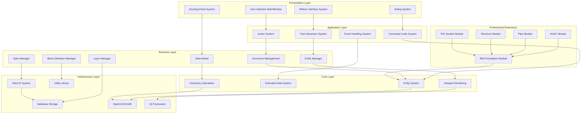

# OCCTBIM System Architecture Overview

## Overview

OCCTBIM is a professional CAD/BIM modeling system based on the OpenCASCADE technology stack, featuring a layered architecture design that supports 2D drawing, 3D modeling, and BIM professional modeling functions. The system adopts modular design with excellent extensibility and maintainability.

## System Architecture Layers

## Core Module Overview

### 1. Core System Modules

#### Document System
- **Responsibility**: Document lifecycle management, multi-document support
- **Core Classes**: `Document`, `ApplicationContext`
- **Functions**: Document creation, opening, saving, closing, document state management

#### Entity System
- **Responsibility**: Creation, management, and rendering of geometric objects
- **Core Classes**: `Entity`, `EntityManager`, `EntityRegistry`
- **Functions**: 2D/3D entities, annotation entities, BREP entity management

#### Model Data Model
- **Responsibility**: Business data model management
- **Core Classes**: `Model`, `LayerManager`, `StyleManager`, `BlockDefinitionManager`
- **Functions**: Layer, style, block definition and other business object management

#### Tool System
- **Responsibility**: User interaction tool management
- **Core Classes**: `Tool`, `ToolManager`, `ToolFactory`
- **Functions**: Drawing tools, editing tools, measurement tools and other interaction logic

### 2. Extension System Modules

#### Action System
- **Responsibility**: Configuration management of user operations
- **Core Classes**: `Action`, `ActionManager`, `ActionFactory`
- **Functions**: Unified management of menu, toolbar, shortcut and other user operations

#### ExtendData Extended Data System
- **Responsibility**: Entity custom attribute extension
- **Core Classes**: `ExtendData`, `ExtendDataManager`, `ExtendProperty`
- **Functions**: Adding custom attributes and data to entities

#### Command System
- **Responsibility**: Undo/redo management of operations
- **Core Classes**: `CommandStack`, `UndoCommand`, `TransactionManager`
- **Functions**: Command execution, undo, redo, transaction management

### 3. Professional Extension Modules

#### BIM Foundation Module
- **Responsibility**: Basic BIM modeling functions
- **Core Classes**: `ComponentBase`, `Port`, `PortManager`
- **Functions**: BIM component base class, connection port management

#### Professional Modeling Modules
- **HVAC**: HVAC system modeling
- **Pipe**: Pipeline system modeling
- **Structure**: Structural system modeling
- **PID**: Process flow diagram symbols

## Technical Architecture Features

### 1. Layered Architecture
- **Clear responsibility separation**: Each layer has clear responsibility boundaries
- **Unidirectional dependencies**: Upper layers depend on lower layers, avoiding circular dependencies
- **Interface abstraction**: Decoupling between layers through interfaces

### 2. Modular Design
- **Functional modularity**: Divided by functional domains
- **Pluggable architecture**: Support for dynamic loading and unloading of modules
- **Extension mechanism**: Provide multiple extension points to support customized development

### 3. Design Pattern Applications
- **Factory Pattern**: Creation management of Entity, Tool, Action
- **Registry Pattern**: EntityRegistry, ToolFactory, etc.
- **Command Pattern**: Undo/redo system
- **Observer Pattern**: Event notification mechanism
- **Strategy Pattern**: Processing strategies for different entity types

### 4. Data Management
- **Separated storage**: Geometric data separated from business data
- **Incremental updates**: Support for incremental saving and loading of data
- **Transaction support**: Ensure consistency of data operations

## Key Technology Selection

### Geometric Kernel
- **OpenCASCADE 7.9.x**: Provides powerful geometric modeling and calculation capabilities
- **AIS System**: Application Interactive Services, supports 3D visualization and interaction

### User Interface
- **Qt 5.14.x**: Cross-platform GUI framework
- **Modern Ribbon interface**
- **OpenGL**: 3D graphics rendering

### Data Storage
- **SQLite**: Lightweight database for storing business data
- **JSON**: Configuration and extended data serialization
- **Binary format**: Efficient storage of geometric data

### Build System
- **CMake**: Cross-platform build system
- **Unity Build**: Improve compilation performance
- **Modular compilation**: Support for incremental compilation

## Extension Mechanisms

### 1. Entity Extension
Register custom entity types through `EntityRegistry` to support new geometric object types.

### 2. Tool Extension
Register custom interaction tools through `ToolFactory` to extend user interaction functions.

### 3. Action Extension
Register custom actions through `ActionFactory` to extend menu and toolbar functions.

### 4. Data Extension
Add custom attributes and business data to entities through the `ExtendData` system.

### 5. Professional Module Extension
Develop professional modeling modules through the BIM foundation framework, such as HVAC, pipeline, etc.

## Performance Optimization Strategies

### 1. Rendering Optimization
- **LOD mechanism**: Adjust display precision based on view distance
- **Frustum culling**: Only render objects in visible areas
- **Batch rendering**: Reduce the number of rendering calls

### 2. Memory Management
- **Object pool**: Reuse frequently created objects
- **Lazy loading**: Load large data on demand
- **Smart pointers**: Automatic memory management

### 3. Data Access Optimization
- **Index optimization**: Establish indexes for key fields
- **Cache mechanism**: Cache hot data
- **Incremental updates**: Only update changed data

## Quality Assurance

### 1. Code Quality
- **Coding standards**: Unified code style and naming conventions
- **Static analysis**: Use tools for code quality checks
- **Code review**: Peer review of critical code

### 2. Testing Strategy
- **Unit testing**: Testing of core algorithms and business logic
- **Integration testing**: Testing of interfaces between modules
- **Performance testing**: Performance verification of critical paths

### 3. Documentation Management
- **Architecture documentation**: System design and architecture descriptions
- **API documentation**: Interface usage instructions
- **User manual**: Function usage guide

This architecture design ensures the system's extensibility, maintainability, and high performance, providing a solid technical foundation for CAD/BIM applications.