# Tool System Architecture

## Overview

The Tool system is the core interaction framework of OCCTBIM, providing a comprehensive set of tools for 2D drawing, 3D modeling, editing operations, and BIM-specific workflows. The system adopts a plugin-based architecture with a unified command pattern, supporting tool chaining, undo/redo operations, and context-sensitive behavior.

## System Architecture

```mermaid
classDiagram
    class Tool {
        <<abstract>>
        -QString m_name
        -QString m_description
        -QIcon m_icon
        -ToolState m_state
        -QList~ToolParameter~ m_parameters
        -QList~ToolStep~ m_steps
        -int m_currentStep
        +name() QString
        +description() QString
        +icon() QIcon
        +state() ToolState
        +parameters() QList~ToolParameter~
        +steps() QList~ToolStep~
        +currentStep() int
        +activate() void
        +deactivate() void
        +execute() void
        +cancel() void
        +onMouseMove(event) void
        +onMousePress(event) void
        +onMouseRelease(event) void
        +onKeyPress(event) void
        +onKeyRelease(event) void
        +updatePreview() void
        +validate() bool
    }

    class ToolManager {
        -QHash~QString,Tool*~ m_tools
        -QList~Tool*~ m_activeTools
        -Tool* m_currentTool
        -QStack~ToolCommand~ m_commandHistory
        -int m_maxHistorySize
        +registerTool(tool) void
        +unregisterTool(name) void
        +getTool(name) Tool*
        +getAllTools() QList~Tool*~
        +activateTool(name) bool
        +deactivateTool(name) bool
        +deactivateAllTools() void
        +executeCommand(command) void
        +undo() void
        +redo() void
        +canUndo() bool
        +canRedo() bool
        +clearHistory() void
    }

    class ToolRegistry {
        -QHash~QString,ToolCreator~ creators
        +registerTool(creator,name) void
        +createTool(name) Tool*
        +getRegisteredTools() QList~QString~
    }

    class ToolContext {
        -Document* m_document
        -Viewport* m_viewport
        -SelectionSet m_selection
        -QPoint m_mousePosition
        -QPoint m_lastMousePosition
        -bool m_isSnapEnabled
        -SnapMode m_snapMode
        +document() Document*
        +viewport() Viewport*
        +selection() SelectionSet
        +mousePosition() QPoint
        +lastMousePosition() QPoint
        +isSnapEnabled() bool
        +snapMode() SnapMode
        +setDocument(document) void
        +setViewport(viewport) void
        +setSelection(selection) void
        +setMousePosition(position) void
        +setSnapEnabled(enabled) void
        +setSnapMode(mode) void
    }

    %% 2D Drawing Tools
    class LineTool {
        -gp_Pnt m_startPoint
        -gp_Pnt m_endPoint
        -bool m_isDrawing
        +onMousePress(event) void
        +onMouseMove(event) void
        +onMouseRelease(event) void
        +updatePreview() void
        +validate() bool
    }

    class CircleTool {
        -gp_Pnt m_center
        -double m_radius
        -CircleCreationMode m_mode
        +onMousePress(event) void
        +onMouseMove(event) void
        +onMouseRelease(event) void
        +setMode(mode) void
        +updatePreview() void
    }

    class RectangleTool {
        -gp_Pnt m_corner1
        -gp_Pnt m_corner2
        -RectangleCreationMode m_mode
        +onMousePress(event) void
        +onMouseMove(event) void
        +onMouseRelease(event) void
        +setMode(mode) void
        +updatePreview() void
    }

    %% 3D Modeling Tools
    class ExtrudeTool {
        -TopoDS_Shape m_profile
        -gp_Vec m_direction
        -double m_distance
        -ExtrudeMode m_mode
        +onMousePress(event) void
        +onMouseMove(event) void
        +onMouseRelease(event) void
        +setProfile(shape) void
        +setMode(mode) void
        +updatePreview() void
    }

    class RevolveTool {
        -TopoDS_Shape m_profile
        -gp_Ax1 m_axis
        -double m_angle
        -RevolveMode m_mode
        +onMousePress(event) void
        +onMouseMove(event) void
        +onMouseRelease(event) void
        +setProfile(shape) void
        +setMode(mode) void
        +updatePreview() void
    }

    class BooleanTool {
        -TopoDS_Shape m_shape1
        -TopoDS_Shape m_shape2
        -BooleanOperation m_operation
        +onMousePress(event) void
        +onMouseMove(event) void
        +onMouseRelease(event) void
        +setOperation(operation) void
        +updatePreview() void
    }

    %% Editing Tools
    class MoveTool {
        -gp_Vec m_translation
        -QList~Entity*~ m_selectedEntities
        -bool m_isMoving
        +onMousePress(event) void
        +onMouseMove(event) void
        +onMouseRelease(event) void
        +updatePreview() void
        +validate() bool
    }

    class RotateTool {
        -gp_Ax1 m_rotationAxis
        -double m_rotationAngle
        -QList~Entity*~ m_selectedEntities
        -bool m_isRotating
        +onMousePress(event) void
        +onMouseMove(event) void
        +onMouseRelease(event) void
        +setRotationAxis(axis) void
        +updatePreview() void
    }

    class ScaleTool {
        -gp_Pnt m_basePoint
        -double m_scaleFactor
        -QList~Entity*~ m_selectedEntities
        -bool m_isScaling
        +onMousePress(event) void
        +onMouseMove(event) void
        +onMouseRelease(event) void
        +setBasePoint(point) void
        +updatePreview() void
    }

    %% BIM Tools
    class WallTool {
        -WallType m_wallType
        -double m_wallHeight
        -double m_wallThickness
        -QList~gp_Pnt~ m_wallPoints
        +onMousePress(event) void
        +onMouseMove(event) void
        +onMouseRelease(event) void
        +setWallType(type) void
        +setWallHeight(height) void
        +setWallThickness(thickness) void
        +updatePreview() void
    }

    class DoorTool {
        -DoorType m_doorType
        -double m_doorWidth
        -double m_doorHeight
        -gp_Pnt m_insertionPoint
        +onMousePress(event) void
        +onMouseMove(event) void
        +onMouseRelease(event) void
        +setDoorType(type) void
        +setDoorWidth(width) void
        +setDoorHeight(height) void
        +updatePreview() void
    }

    class WindowTool {
        -WindowType m_windowType
        -double m_windowWidth
        -double m_windowHeight
        -gp_Pnt m_insertionPoint
        +onMousePress(event) void
        +onMouseMove(event) void
        +onMouseRelease(event) void
        +setWindowType(type) void
        +setWindowWidth(width) void
        +setWindowHeight(height) void
        +updatePreview() void
    }

    %% Measurement Tools
    class DistanceTool {
        -gp_Pnt m_point1
        -gp_Pnt m_point2
        -double m_distance
        +onMousePress(event) void
        +onMouseMove(event) void
        +onMouseRelease(event) void
        +updatePreview() void
        +getDistance() double
    }

    class AngleTool {
        -gp_Pnt m_vertex
        -gp_Pnt m_point1
        -gp_Pnt m_point2
        -double m_angle
        +onMousePress(event) void
        +onMouseMove(event) void
        +onMouseRelease(event) void
        +updatePreview() void
        +getAngle() double
    }

    %% Inheritance Relationships
    Tool <|-- LineTool
    Tool <|-- CircleTool
    Tool <|-- RectangleTool
    Tool <|-- ExtrudeTool
    Tool <|-- RevolveTool
    Tool <|-- BooleanTool
    Tool <|-- MoveTool
    Tool <|-- RotateTool
    Tool <|-- ScaleTool
    Tool <|-- WallTool
    Tool <|-- DoorTool
    Tool <|-- WindowTool
    Tool <|-- DistanceTool
    Tool <|-- AngleTool
```



## Core Components Detailed

### 1. Tool Base Class

The Tool class is the abstract base class for all tools in the system.

#### Core Properties
```cpp
class Tool : public QObject {
    Q_OBJECT
    
protected:
    QString m_name;                         // Tool name
    QString m_description;                  // Tool description
    QIcon m_icon;                           // Tool icon
    ToolState m_state;                      // Current tool state
    QList<ToolParameter> m_parameters;      // Tool parameters
    QList<ToolStep> m_steps;                // Tool execution steps
    int m_currentStep;                      // Current step index
    
public:
    // Constructor
    Tool(const QString &name, const QString &description, const QIcon &icon = QIcon());
    
    // Basic property access
    QString name() const;
    QString description() const;
    QIcon icon() const;
    ToolState state() const;
    QList<ToolParameter> parameters() const;
    QList<ToolStep> steps() const;
    int currentStep() const;
    
    // Lifecycle management
    virtual void activate();
    virtual void deactivate();
    virtual void execute();
    virtual void cancel();
    
    // Event handling
    virtual void onMouseMove(const QMouseEvent *event);
    virtual void onMousePress(const QMouseEvent *event);
    virtual void onMouseRelease(const QMouseEvent *event);
    virtual void onKeyPress(const QKeyEvent *event);
    virtual void onKeyRelease(const QKeyEvent *event);
    
    // Preview and validation
    virtual void updatePreview();
    virtual bool validate() const;
    
    // Parameter management
    virtual void addParameter(const ToolParameter &parameter);
    virtual void removeParameter(const QString &name);
    virtual ToolParameter getParameter(const QString &name) const;
    
    // Step management
    virtual void addStep(const ToolStep &step);
    virtual void nextStep();
    virtual void previousStep();
    
protected:
    // State management
    virtual void setState(ToolState state);
    virtual void setCurrentStep(int step);
    
    // Helper methods
    virtual ToolContext* getContext() const;
    virtual Document* getDocument() const;
    virtual Viewport* getViewport() const;
};

// Tool state enumeration
enum class ToolState {
    Inactive,       // Tool is inactive
    Active,         // Tool is active
    Executing,      // Tool is executing
    Completed,      // Tool execution completed
    Cancelled,      // Tool execution cancelled
    Error           // Tool execution error
};
```

### 2. ToolManager

ToolManager is responsible for managing the lifecycle of all tools in the system.

#### Main Responsibilities
- **Tool Registration**: Register and unregister tools
- **Tool Activation**: Activate and deactivate tools
- **Command History**: Manage undo/redo operations
- **Context Management**: Provide tool context information

#### Key Features
```cpp
class ToolManager : public QObject {
    Q_OBJECT
    
private:
    QHash<QString, Tool*> m_tools;              // Registered tools
    QList<Tool*> m_activeTools;                 // Active tools
    Tool* m_currentTool;                        // Current tool
    QStack<ToolCommand> m_commandHistory;       // Command history
    int m_maxHistorySize;                       // Maximum history size
    
public:
    // Constructor
    ToolManager(QObject *parent = nullptr);
    
    // Tool registration
    void registerTool(Tool *tool);
    void unregisterTool(const QString &name);
    Tool* getTool(const QString &name) const;
    QList<Tool*> getAllTools() const;
    
    // Tool activation
    bool activateTool(const QString &name);
    bool deactivateTool(const QString &name);
    void deactivateAllTools();
    
    // Current tool management
    Tool* currentTool() const;
    void setCurrentTool(Tool *tool);
    
    // Command execution
    void executeCommand(const ToolCommand &command);
    void undo();
    void redo();
    bool canUndo() const;
    bool canRedo() const;
    void clearHistory();
    
    // History management
    int maxHistorySize() const;
    void setMaxHistorySize(int size);
    int historySize() const;
    
    // Active tools management
    QList<Tool*> activeTools() const;
    bool isToolActive(const QString &name) const;
    
    // Context management
    ToolContext* context() const;
    void setContext(ToolContext *context);
    
    // Signal-slot connections
    void connectToolSignals(Tool *tool);
    void disconnectToolSignals(Tool *tool);
};
```

### 3. ToolRegistry

ToolRegistry provides a registration mechanism for custom tools.

#### Registration System
```cpp
class ToolRegistry {
public:
    using ToolCreator = Tool *(*)();
    
    static Tool* createTool(const QString &name);
    static void registerTool(ToolCreator creator, const QString &name);
    static QList<QString> getRegisteredTools();
    
private:
    static QHash<QString, ToolCreator> &creators();
};

// Automatic registration macro
#define REGISTER_TOOL(ToolClass, name) \\
    class ToolClass##Registrar { \\
    public: \\
        ToolClass##Registrar() { \\
            ToolRegistry::registerTool(&ToolClass##Registrar::create, name); \\
        } \\
        static Tool *create() { \\
            return new ToolClass(); \\
        } \\
    }; \\
    static ToolClass##Registrar ToolClass##_registrar;
```

### 4. ToolContext

ToolContext provides contextual information for tool execution.

#### Context Features
```cpp
class ToolContext {
private:
    Document* m_document;                      // Current document
    Viewport* m_viewport;                       // Current viewport
    SelectionSet m_selection;                   // Current selection
    QPoint m_mousePosition;                     // Mouse position
    QPoint m_lastMousePosition;                 // Last mouse position
    bool m_isSnapEnabled;                       // Snap enabled flag
    SnapMode m_snapMode;                        // Snap mode
    
public:
    // Constructor
    ToolContext(Document *document = nullptr, Viewport *viewport = nullptr);
    
    // Property access
    Document* document() const;
    Viewport* viewport() const;
    SelectionSet selection() const;
    QPoint mousePosition() const;
    QPoint lastMousePosition() const;
    bool isSnapEnabled() const;
    SnapMode snapMode() const;
    
    // Property setters
    void setDocument(Document *document);
    void setViewport(Viewport *viewport);
    void setSelection(const SelectionSet &selection);
    void setMousePosition(const QPoint &position);
    void setSnapEnabled(bool enabled);
    void setSnapMode(SnapMode mode);
    
    // Helper methods
    gp_Pnt worldMousePosition() const;
    gp_Pnt lastWorldMousePosition() const;
    QList<Entity*> selectedEntities() const;
    int selectedEntityCount() const;
    bool hasSelection() const;
    
    // Snap calculations
    gp_Pnt calculateSnapPoint(const gp_Pnt &point) const;
    QList<SnapPoint> getSnapPoints() const;
};

// Snap mode enumeration
enum class SnapMode {
    None,               // No snapping
    Endpoint,           // Endpoint snapping
    Midpoint,           // Midpoint snapping
    Center,             // Center snapping
    Intersection,       // Intersection snapping
    Perpendicular,      // Perpendicular snapping
    Tangent,            // Tangent snapping
    Nearest            // Nearest point snapping
};
```

## Tool Types

### 1. 2D Drawing Tools

#### LineTool
Creates line entities between specified points.

```cpp
class LineTool : public Tool {
private:
    gp_Pnt m_startPoint;
    gp_Pnt m_endPoint;
    bool m_isDrawing;
    
public:
    LineTool();
    
    // Event handling
    void onMousePress(const QMouseEvent *event) override;
    void onMouseMove(const QMouseEvent *event) override;
    void onMouseRelease(const QMouseEvent *event) override;
    
    // Preview and validation
    void updatePreview() override;
    bool validate() const override;
    
    // Tool-specific methods
    void setStartPoint(const gp_Pnt &point);
    void setEndPoint(const gp_Pnt &point);
    gp_Pnt startPoint() const;
    gp_Pnt endPoint() const;
    
    // Line creation
    LineEntity* createLine() const;
    
protected:
    // Helper methods
    void resetTool();
    void completeLine();
};
```

#### CircleTool
Creates circle entities using various creation methods.

```cpp
class CircleTool : public Tool {
private:
    gp_Pnt m_center;
    double m_radius;
    CircleCreationMode m_mode;
    
public:
    CircleTool();
    
    // Event handling
    void onMousePress(const QMouseEvent *event) override;
    void onMouseMove(const QMouseEvent *event) override;
    void onMouseRelease(const QMouseEvent *event) override;
    
    // Mode management
    void setMode(CircleCreationMode mode);
    CircleCreationMode mode() const;
    
    // Preview and validation
    void updatePreview() override;
    
    // Circle creation
    CircleEntity* createCircle() const;
    
protected:
    // Creation methods
    void createByCenterRadius();
    void createByDiameter();
    void createByThreePoints();
};

// Circle creation mode enumeration
enum class CircleCreationMode {
    CenterRadius,       // Center point and radius
    Diameter,           // Two points defining diameter
    ThreePoints          // Three points on circumference
};
```

### 2. 3D Modeling Tools

#### ExtrudeTool
Extrudes 2D profiles to create 3D solids.

```cpp
class ExtrudeTool : public Tool {
private:
    TopoDS_Shape m_profile;
    gp_Vec m_direction;
    double m_distance;
    ExtrudeMode m_mode;
    
public:
    ExtrudeTool();
    
    // Event handling
    void onMousePress(const QMouseEvent *event) override;
    void onMouseMove(const QMouseEvent *event) override;
    void onMouseRelease(const QMouseEvent *event) override;
    
    // Profile and mode management
    void setProfile(const TopoDS_Shape &profile);
    void setMode(ExtrudeMode mode);
    
    // Preview and validation
    void updatePreview() override;
    
    // Extrusion creation
    ExtrudeFeatureEntity* createExtrusion() const;
    
protected:
    // Extrusion methods
    void extrudeByDistance();
    void extrudeToPoint();
    void extrudeToFace();
};

// Extrude mode enumeration
enum class ExtrudeMode {
    Distance,           // Extrude by distance
    ToPoint,            // Extrude to point
    ToFace              // Extrude to face
};
```

#### BooleanTool
Performs boolean operations on 3D solids.

```cpp
class BooleanTool : public Tool {
private:
    TopoDS_Shape m_shape1;
    TopoDS_Shape m_shape2;
    BooleanOperation m_operation;
    
public:
    BooleanTool();
    
    // Event handling
    void onMousePress(const QMouseEvent *event) override;
    void onMouseMove(const QMouseEvent *event) override;
    void onMouseRelease(const QMouseEvent *event) override;
    
    // Operation management
    void setOperation(BooleanOperation operation);
    BooleanOperation operation() const;
    
    // Preview and validation
    void updatePreview() override;
    
    // Boolean operation
    TopoDS_Shape performBoolean() const;
    
protected:
    // Boolean operations
    TopoDS_Shape performUnion() const;
    TopoDS_Shape performDifference() const;
    TopoDS_Shape performIntersection() const;
};

// Boolean operation enumeration
enum class BooleanOperation {
    Union,              // Union operation
    Difference,         // Difference operation
    Intersection        // Intersection operation
};
```

### 3. BIM Tools

#### WallTool
Creates wall entities for architectural modeling.

```cpp
class WallTool : public Tool {
private:
    WallType m_wallType;
    double m_wallHeight;
    double m_wallThickness;
    QList<gp_Pnt> m_wallPoints;
    
public:
    WallTool();
    
    // Event handling
    void onMousePress(const QMouseEvent *event) override;
    void onMouseMove(const QMouseEvent *event) override;
    void onMouseRelease(const QMouseEvent *event) override;
    
    // Wall properties
    void setWallType(WallType type);
    void setWallHeight(double height);
    void setWallThickness(double thickness);
    
    WallType wallType() const;
    double wallHeight() const;
    double wallThickness() const;
    
    // Preview and validation
    void updatePreview() override;
    
    // Wall creation
    WallEntity* createWall() const;
    
protected:
    // Wall creation methods
    void createStraightWall();
    void createCurvedWall();
    void createPolygonWall();
};

// Wall type enumeration
enum class WallType {
    Straight,          // Straight wall
    Curved,            // Curved wall
    Polygon            // Polygon wall
};
```

#### DoorTool
Creates door entities for architectural modeling.

```cpp
class DoorTool : public Tool {
private:
    DoorType m_doorType;
    double m_doorWidth;
    double m_doorHeight;
    gp_Pnt m_insertionPoint;
    
public:
    DoorTool();
    
    // Event handling
    void onMousePress(const QMouseEvent *event) override;
    void onMouseMove(const QMouseEvent *event) override;
    void onMouseRelease(const QMouseEvent *event) override;
    
    // Door properties
    void setDoorType(DoorType type);
    void setDoorWidth(double width);
    void setDoorHeight(double height);
    
    DoorType doorType() const;
    double doorWidth() const;
    double doorHeight() const;
    
    // Preview and validation
    void updatePreview() override;
    
    // Door creation
    DoorEntity* createDoor() const;
    
protected:
    // Door placement
    void placeDoorOnWall();
    void validatePlacement() const;
};

// Door type enumeration
enum class DoorType {
    Single,            // Single door
    Double,            // Double door
    Sliding,           // Sliding door
    Folding            // Folding door
};
```

## Tool Parameters and Steps

### 1. ToolParameter

ToolParameter defines configurable parameters for tools.

```cpp
struct ToolParameter {
    QString name;                   // Parameter name
    QVariant value;                 // Parameter value
    QVariant defaultValue;         // Default value
    ParameterType type;             // Parameter type
    QString description;            // Parameter description
    QVariantList options;           // Available options (for enum types)
    bool isRequired;                // Required flag
    
    // Validation
    bool isValid() const;
    bool validateValue(const QVariant &value) const;
    
    // Serialization
    QJsonObject toJson() const;
    static ToolParameter fromJson(const QJsonObject &json);
};

// Parameter type enumeration
enum class ParameterType {
    String,         // String parameter
    Number,         // Numeric parameter
    Boolean,        // Boolean parameter
    Enum,           // Enumeration parameter
    Point,          // Point parameter
    Vector,         // Vector parameter
    Color           // Color parameter
};
```

### 2. ToolStep

ToolStep defines individual steps in multi-step tools.

```cpp
struct ToolStep {
    QString name;                   // Step name
    QString description;            // Step description
    StepType type;                  // Step type
    QList<ToolParameter> parameters; // Step parameters
    
    // Validation
    bool isValid() const;
    bool validateParameters(const QVariantMap &values) const;
    
    // Execution
    virtual bool execute(ToolContext *context) = 0;
    
    // Serialization
    QJsonObject toJson() const;
    static ToolStep fromJson(const QJsonObject &json);
};

// Step type enumeration
enum class StepType {
    Input,          // User input step
    Calculation,    // Calculation step
    Creation,       // Entity creation step
    Modification,   // Entity modification step
    Selection       // Entity selection step
};
```

## Usage Examples

### 1. Basic Tool Usage

```cpp
// Create tool manager
ToolManager *toolManager = new ToolManager();

// Register tools
toolManager->registerTool(new LineTool());
toolManager->registerTool(new CircleTool());
toolManager->registerTool(new MoveTool());

// Activate line tool
if (toolManager->activateTool("LineTool")) {
    qDebug() << "Line tool activated";
}

// Tool execution will be handled through mouse events
```

### 2. Custom Tool Implementation

```cpp
class CustomTool : public Tool {
public:
    CustomTool() : Tool("CustomTool", "Custom drawing tool") {
        // Add parameters
        addParameter(ToolParameter{"LineWidth", 1.0, 1.0, ParameterType::Number, "Line width", {}, true});
        addParameter(ToolParameter{"LineColor", QColor(Qt::black), QColor(Qt::black), ParameterType::Color, "Line color", {}, false});
        
        // Add steps
        addStep(ToolStep{"SelectStartPoint", "Select start point", StepType::Input, {}});
        addStep(ToolStep{"SelectEndPoint", "Select end point", StepType::Input, {}});
    }
    
    void onMousePress(const QMouseEvent *event) override {
        if (currentStep() == 0) {
            // First step: select start point
            gp_Pnt startPoint = getContext()->worldMousePosition();
            // Store start point and move to next step
            nextStep();
        } else if (currentStep() == 1) {
            // Second step: select end point
            gp_Pnt endPoint = getContext()->worldMousePosition();
            // Create line and complete tool
            completeTool();
        }
    }
    
    void updatePreview() override {
        // Update preview based on current state
    }
};
```

### 3. BIM Workflow Example

```cpp
// BIM wall creation workflow
void createBIMWall() {
    ToolManager *toolManager = getToolManager();
    
    // Activate wall tool
    if (toolManager->activateTool("WallTool")) {
        WallTool *wallTool = dynamic_cast<WallTool*>(toolManager->currentTool());
        
        // Configure wall properties
        wallTool->setWallType(WallType::Straight);
        wallTool->setWallHeight(3.0);
        wallTool->setWallThickness(0.2);
        
        // Tool execution will handle wall creation through user interaction
    }
}
```

## Performance Optimization

### 1. Event Handling Optimization
- Event filtering to reduce unnecessary processing
- Batch processing of similar events
- Lazy evaluation of tool previews

### 2. Memory Management
- Object pooling for frequently used tools
- Efficient data structures for tool parameters
- Smart pointers for tool lifecycle management

### 3. Rendering Optimization
- Level-of-detail rendering for complex tools
- Frustum culling for tool previews
- Instance rendering for repeated tool operations

The Tool system provides a comprehensive framework for interactive operations in OCCTBIM, supporting a wide range of tools for 2D drawing, 3D modeling, editing operations, and BIM-specific workflows with advanced performance optimization features.