# User Interface System Architecture

## Overview

The User Interface (UI) system in OCCTBIM is built on the Qt framework, providing a modern, extensible, and cross-platform interface for CAD/BIM applications. The architecture follows the Model-View-Controller (MVC) pattern with a modular design that supports docking panels, customizable toolbars, and advanced visualization components.

## System Architecture

```mermaid
classDiagram
    class MainWindow {
        -QMenuBar* m_menuBar
        -QToolBar* m_mainToolBar
        -QStatusBar* m_statusBar
        -CentralWidget* m_centralWidget
        -QDockWidget* m_propertyDock
        -QDockWidget* m_layerDock
        -QDockWidget* m_commandDock
        -QDockWidget* m_navigatorDock
        -QTabWidget* m_documentTabs
        -ThemeManager* m_themeManager
        -LanguageManager* m_languageManager
        +menuBar() QMenuBar*
        +mainToolBar() QToolBar*
        +statusBar() QStatusBar*
        +centralWidget() CentralWidget*
        +propertyDock() QDockWidget*
        +layerDock() QDockWidget*
        +commandDock() QDockWidget*
        +navigatorDock() QDockWidget*
        +documentTabs() QTabWidget*
        +themeManager() ThemeManager*
        +languageManager() LanguageManager*
        +createMenuBar() void
        +createToolBars() void
        +createStatusBar() void
        +createDockWidgets() void
        +setupConnections() void
        +applyTheme(theme) void
        +applyLanguage(language) void
        +saveLayout() void
        +restoreLayout() void
    }

    class CentralWidget {
        -QStackedWidget* m_stackedWidget
        -ViewportWidget* m_viewportWidget
        -WelcomeWidget* m_welcomeWidget
        -HelpWidget* m_helpWidget
        +stackedWidget() QStackedWidget*
        +viewportWidget() ViewportWidget*
        +welcomeWidget() WelcomeWidget*
        +helpWidget() HelpWidget*
        +showViewport() void
        +showWelcome() void
        +showHelp() void
        +currentWidget() QWidget*
        +setCurrentWidget(widget) void
    }

    class ViewportWidget {
        -QOpenGLWidget* m_glWidget
        -Viewport* m_viewport
        -ViewportController* m_controller
        -ViewportRenderer* m_renderer
        +glWidget() QOpenGLWidget*
        +viewport() Viewport*
        +controller() ViewportController*
        +renderer() ViewportRenderer*
        +initializeGL() void
        +resizeGL(w,h) void
        +paintGL() void
        +updateView() void
        +fitToView() void
        +zoomIn() void
        +zoomOut() void
        +pan(dx,dy) void
        +rotate(angle) void
    }

    class DockWidgetBase {
        <<abstract>>
        -QDockWidget* m_dockWidget
        -QWidget* m_contentWidget
        -QString m_title
        -bool m_isVisible
        +dockWidget() QDockWidget*
        +contentWidget() QWidget*
        +title() QString
        +isVisible() bool
        +show() void
        +hide() void
        +toggleVisibility() void
        +createContent() void
        +updateContent() void
        +saveState() QByteArray
        +restoreState(state) void
    }

    class PropertyDock {
        -PropertyTreeWidget* m_propertyTree
        -PropertyEditor* m_propertyEditor
        -QHash~QString,QVariant~ m_properties
        +propertyTree() PropertyTreeWidget*
        +propertyEditor() PropertyEditor*
        +properties() QHash~QString,QVariant~
        +setProperties(properties) void
        +updatePropertyTree() void
        +onPropertyChanged(name,value) void
        +saveProperties() void
        +loadProperties() void
    }

    class LayerDock {
        -LayerTreeWidget* m_layerTree
        -LayerManager* m_layerManager
        -QList~Layer*~ m_layers
        +layerTree() LayerTreeWidget*
        +layerManager() LayerManager*
        +layers() QList~Layer*~
        +setLayers(layers) void
        +updateLayerTree() void
        +onLayerSelected(layer) void
        +onLayerVisibilityChanged(layer,visible) void
        +createNewLayer() void
        +deleteLayer(layer) void
    }

    class CommandDock {
        -CommandHistoryWidget* m_historyWidget
        -CommandPalette* m_commandPalette
        -ActionManager* m_actionManager
        +historyWidget() CommandHistoryWidget*
        +commandPalette() CommandPalette*
        +actionManager() ActionManager*
        +setActionManager(manager) void
        +updateCommandHistory() void
        +showCommandPalette() void
        +executeCommand(command) void
        +onCommandExecuted(action) void
        +onCommandUndone(action) void
    }

    class NavigatorDock {
        -ModelTreeWidget* m_modelTree
        -SelectionBrowser* m_selectionBrowser
        -Document* m_document
        +modelTree() ModelTreeWidget*
        +selectionBrowser() SelectionBrowser*
        +document() Document*
        +setDocument(document) void
        +updateModelTree() void
        +onSelectionChanged(selection) void
        +onEntityAdded(entity) void
        +onEntityRemoved(entity) void
        +expandToEntity(entity) void
    }

    class ThemeManager {
        -QString m_currentTheme
        -QHash~QString,Theme~ m_themes
        -QPalette m_applicationPalette
        +currentTheme() QString
        +themes() QHash~QString,Theme~
        +applicationPalette() QPalette
        +loadThemes() void
        +applyTheme(name) void
        +createCustomTheme(name,colors) void
        +saveTheme(name) void
        +deleteTheme(name) void
        +updateApplicationPalette() void
    }

    class LanguageManager {
        -QString m_currentLanguage
        -QHash~QString,QLocale~ m_languages
        -QTranslator* m_translator
        +currentLanguage() QString
        +languages() QHash~QString,QLocale~
        +translator() QTranslator*
        +loadLanguages() void
        +applyLanguage(name) void
        +translate(text) QString
        +installTranslator() void
        +removeTranslator() void
    }

    class MenuBar {
        -QMenu* m_fileMenu
        -QMenu* m_editMenu
        -QMenu* m_viewMenu
        -QMenu* m_toolsMenu
        -QMenu* m_bimMenu
        -QMenu* m_helpMenu
        +fileMenu() QMenu*
        +editMenu() QMenu*
        +viewMenu() QMenu*
        +toolsMenu() QMenu*
        +bimMenu() QMenu*
        +helpMenu() QMenu*
        +createFileMenu() void
        +createEditMenu() void
        +createViewMenu() void
        +createToolsMenu() void
        +createBIMMenu() void
        +createHelpMenu() void
        +updateMenuStates() void
    }

    class ToolBarManager {
        -QList~QToolBar*~ m_toolBars
        -QHash~QString,QAction*~ m_actions
        +toolBars() QList~QToolBar*~
        +actions() QHash~QString,QAction*~
        +createMainToolBar() QToolBar*
        +createDrawingToolBar() QToolBar*
        +createEditingToolBar() QToolBar*
        +createViewToolBar() QToolBar*
        +createBIMToolBar() QToolBar*
        +addActionToToolBar(action,toolbar) void
        +removeActionFromToolBar(action,toolbar) void
        +customizeToolBar(toolbar) void
        +saveToolBarLayout() void
        +restoreToolBarLayout() void
    }

    class StatusBar {
        -QLabel* m_coordinatesLabel
        -QLabel* m_selectionLabel
        -QLabel* m_layerLabel
        -QLabel* m_snapLabel
        -QProgressBar* m_progressBar
        +coordinatesLabel() QLabel*
        +selectionLabel() QLabel*
        +layerLabel() QLabel*
        +snapLabel() QLabel*
        +progressBar() QProgressBar*
        +updateCoordinates(x,y,z) void
        +updateSelection(count) void
        +updateLayer(name) void
        +updateSnapStatus(enabled) void
        +showProgress(message,value) void
        +hideProgress() void
    }

    %% Inheritance Relationships
    DockWidgetBase <|-- PropertyDock
    DockWidgetBase <|-- LayerDock
    DockWidgetBase <|-- CommandDock
    DockWidgetBase <|-- NavigatorDock
    
    %% Composition Relationships
    MainWindow *-- CentralWidget
    MainWindow *-- MenuBar
    MainWindow *-- ToolBarManager
    MainWindow *-- StatusBar
    MainWindow *-- ThemeManager
    MainWindow *-- LanguageManager
    MainWindow *-- PropertyDock
    MainWindow *-- LayerDock
    MainWindow *-- CommandDock
    MainWindow *-- NavigatorDock
    
    CentralWidget *-- ViewportWidget
    ViewportWidget *-- Viewport
    ViewportWidget *-- ViewportController
    ViewportWidget *-- ViewportRenderer
```



## Core Components Detailed

### 1. MainWindow

The MainWindow class serves as the central container for the entire application UI.

#### Core Properties
```cpp
class MainWindow : public QMainWindow {
    Q_OBJECT
    
private:
    // UI Components
    QMenuBar* m_menuBar;                    // Application menu bar
    QToolBar* m_mainToolBar;                // Main toolbar
    QStatusBar* m_statusBar;                 // Status bar
    CentralWidget* m_centralWidget;          // Central widget
    
    // Dock widgets
    QDockWidget* m_propertyDock;            // Properties dock
    QDockWidget* m_layerDock;               // Layers dock
    QDockWidget* m_commandDock;             // Commands dock
    QDockWidget* m_navigatorDock;           // Navigator dock
    
    // Document management
    QTabWidget* m_documentTabs;             // Document tabs
    
    // Managers
    ThemeManager* m_themeManager;           // Theme manager
    LanguageManager* m_languageManager;     // Language manager
    
public:
    // Constructor
    MainWindow(QWidget *parent = nullptr);
    
    // Component accessors
    QMenuBar* menuBar() const;
    QToolBar* mainToolBar() const;
    QStatusBar* statusBar() const;
    CentralWidget* centralWidget() const;
    
    // Dock widget accessors
    QDockWidget* propertyDock() const;
    QDockWidget* layerDock() const;
    QDockWidget* commandDock() const;
    QDockWidget* navigatorDock() const;
    
    // Manager accessors
    ThemeManager* themeManager() const;
    LanguageManager* languageManager() const;
    
    // UI initialization
    void createMenuBar();
    void createToolBars();
    void createStatusBar();
    void createDockWidgets();
    void setupConnections();
    
    // Theme and language management
    void applyTheme(const QString &theme);
    void applyLanguage(const QString &language);
    
    // Layout management
    void saveLayout();
    void restoreLayout();
    
    // Document management
    void addDocumentTab(Document *document);
    void removeDocumentTab(Document *document);
    void setCurrentDocument(Document *document);
    Document* currentDocument() const;
    
    // Event handling
    void closeEvent(QCloseEvent *event) override;
    void keyPressEvent(QKeyEvent *event) override;
    
protected slots:
    void onDocumentChanged(Document *document);
    void onThemeChanged(const QString &theme);
    void onLanguageChanged(const QString &language);
    
signals:
    void documentTabAdded(Document *document);
    void documentTabRemoved(Document *document);
    void currentDocumentChanged(Document *document);
};
```

### 2. CentralWidget

CentralWidget manages the main content area with stacked widgets for different views.

#### Core Features
```cpp
class CentralWidget : public QWidget {
    Q_OBJECT
    
private:
    QStackedWidget* m_stackedWidget;        // Stacked widget for different views
    ViewportWidget* m_viewportWidget;       // 3D viewport widget
    WelcomeWidget* m_welcomeWidget;         // Welcome screen widget
    HelpWidget* m_helpWidget;               // Help widget
    
public:
    // Constructor
    CentralWidget(QWidget *parent = nullptr);
    
    // Widget accessors
    QStackedWidget* stackedWidget() const;
    ViewportWidget* viewportWidget() const;
    WelcomeWidget* welcomeWidget() const;
    HelpWidget* helpWidget() const;
    
    // View management
    void showViewport();
    void showWelcome();
    void showHelp();
    
    QWidget* currentWidget() const;
    void setCurrentWidget(QWidget *widget);
    
    // Viewport management
    void setViewportDocument(Document *document);
    void updateViewport();
    void fitToView();
    
    // Event handling
    void resizeEvent(QResizeEvent *event) override;
    
protected slots:
    void onDocumentOpened(Document *document);
    void onDocumentClosed(Document *document);
    void onHelpRequested();
    
signals:
    void viewportShown();
    void welcomeShown();
    void helpShown();
};
```

### 3. ViewportWidget

ViewportWidget provides OpenGL-based 3D visualization with interactive controls.

#### Viewport Features
```cpp
class ViewportWidget : public QOpenGLWidget {
    Q_OBJECT
    
private:
    Viewport* m_viewport;                   // Viewport data
    ViewportController* m_controller;      // Viewport controller
    ViewportRenderer* m_renderer;           // Viewport renderer
    
public:
    // Constructor
    ViewportWidget(QWidget *parent = nullptr);
    
    // Component accessors
    Viewport* viewport() const;
    ViewportController* controller() const;
    ViewportRenderer* renderer() const;
    
    // OpenGL overrides
    void initializeGL() override;
    void resizeGL(int w, int h) override;
    void paintGL() override;
    
    // Viewport operations
    void updateView();
    void fitToView();
    void zoomIn();
    void zoomOut();
    void pan(double dx, double dy);
    void rotate(double angle);
    
    // Selection and interaction
    void setSelectionMode(SelectionMode mode);
    SelectionMode selectionMode() const;
    
    // Rendering options
    void setRenderingMode(RenderingMode mode);
    RenderingMode renderingMode() const;
    
    // Event handling
    void mousePressEvent(QMouseEvent *event) override;
    void mouseMoveEvent(QMouseEvent *event) override;
    void mouseReleaseEvent(QMouseEvent *event) override;
    void wheelEvent(QWheelEvent *event) override;
    void keyPressEvent(QKeyEvent *event) override;
    
protected slots:
    void onViewportChanged();
    void onSelectionChanged();
    
signals:
    void viewportUpdated();
    void selectionChanged(const SelectionSet &selection);
    void mouseMoved(const gp_Pnt &worldPos);
};

// Viewport controller for interaction
class ViewportController : public QObject {
    Q_OBJECT
    
private:
    Viewport* m_viewport;                   // Controlled viewport
    InteractionMode m_mode;                  // Current interaction mode
    
public:
    ViewportController(Viewport *viewport, QObject *parent = nullptr);
    
    // Interaction modes
    void setInteractionMode(InteractionMode mode);
    InteractionMode interactionMode() const;
    
    // Mouse event handling
    void handleMousePress(QMouseEvent *event);
    void handleMouseMove(QMouseEvent *event);
    void handleMouseRelease(QMouseEvent *event);
    void handleWheelEvent(QWheelEvent *event);
    
    // Keyboard event handling
    void handleKeyPress(QKeyEvent *event);
    void handleKeyRelease(QKeyEvent *event);
    
    // Coordinate conversion
    gp_Pnt screenToWorld(const QPoint &screenPos) const;
    QPoint worldToScreen(const gp_Pnt &worldPos) const;
    
protected slots:
    void onViewportChanged();
    
signals:
    void interactionStarted();
    void interactionFinished();
};
```

### 4. Dock Widget System

#### DockWidgetBase (Abstract Base Class)
```cpp
class DockWidgetBase : public QObject {
    Q_OBJECT
    
protected:
    QDockWidget* m_dockWidget;              // Qt dock widget
    QWidget* m_contentWidget;               // Content widget
    QString m_title;                        // Dock title
    bool m_isVisible;                       // Visibility state
    
public:
    DockWidgetBase(const QString &title, QWidget *parent = nullptr);
    
    // Basic properties
    QDockWidget* dockWidget() const;
    QWidget* contentWidget() const;
    QString title() const;
    bool isVisible() const;
    
    // Visibility control
    void show();
    void hide();
    void toggleVisibility();
    
    // Content management (abstract)
    virtual void createContent() = 0;
    virtual void updateContent() = 0;
    
    // State management
    virtual QByteArray saveState() const;
    virtual void restoreState(const QByteArray &state);
    
    // Event handling
    virtual void onShowEvent();
    virtual void onHideEvent();
    
protected slots:
    void onDockLocationChanged(Qt::DockWidgetArea area);
    void onDockFeaturesChanged(QDockWidget::DockWidgetFeatures features);
    
signals:
    void visibilityChanged(bool visible);
    void contentUpdated();
};
```

#### PropertyDock Implementation
```cpp
class PropertyDock : public DockWidgetBase {
    Q_OBJECT
    
private:
    PropertyTreeWidget* m_propertyTree;      // Property tree widget
    PropertyEditor* m_propertyEditor;        // Property editor
    QHash<QString, QVariant> m_properties;   // Current properties
    
public:
    PropertyDock(QWidget *parent = nullptr);
    
    // Component accessors
    PropertyTreeWidget* propertyTree() const;
    PropertyEditor* propertyEditor() const;
    QHash<QString, QVariant> properties() const;
    
    // Property management
    void setProperties(const QHash<QString, QVariant> &properties);
    void updatePropertyTree();
    
    // Property editing
    void onPropertyChanged(const QString &name, const QVariant &value);
    
    // State management
    void saveProperties();
    void loadProperties();
    
    // Content management
    void createContent() override;
    void updateContent() override;
    
protected slots:
    void onSelectionChanged(const SelectionSet &selection);
    void onEntityPropertyChanged(Entity *entity, const QString &property);
    
signals:
    void propertyValueChanged(const QString &name, const QVariant &value);
};
```

### 5. ThemeManager

ThemeManager handles application theming and styling.

#### Theme Management
```cpp
class ThemeManager : public QObject {
    Q_OBJECT
    
private:
    QString m_currentTheme;                  // Current theme name
    QHash<QString, Theme> m_themes;          // Available themes
    QPalette m_applicationPalette;           // Application palette
    
public:
    ThemeManager(QObject *parent = nullptr);
    
    // Theme properties
    QString currentTheme() const;
    QHash<QString, Theme> themes() const;
    QPalette applicationPalette() const;
    
    // Theme management
    void loadThemes();
    void applyTheme(const QString &name);
    
    // Custom theme creation
    void createCustomTheme(const QString &name, const QHash<QString, QColor> &colors);
    void saveTheme(const QString &name);
    void deleteTheme(const QString &name);
    
    // Palette management
    void updateApplicationPalette();
    
    // Style sheet generation
    QString generateStyleSheet(const Theme &theme) const;
    
protected slots:
    void onSystemThemeChanged();
    
signals:
    void themeChanged(const QString &theme);
    void paletteChanged(const QPalette &palette);
};

// Theme data structure
struct Theme {
    QString name;                           // Theme name
    QColor primaryColor;                    // Primary color
    QColor secondaryColor;                 // Secondary color
    QColor backgroundColor;                 // Background color
    QColor textColor;                       // Text color
    QColor accentColor;                     // Accent color
    QColor borderColor;                    // Border color
    QColor highlightColor;                  // Highlight color
    QColor disabledColor;                   // Disabled color
    
    // Font settings
    QString fontFamily;                     // Font family
    int fontSize;                          // Font size
    
    // Additional styling
    int borderRadius;                      // Border radius
    int padding;                           // Padding
    int margin;                            // Margin
    
    // Constructor
    Theme(const QString &name = "Default");
    
    // Validation
    bool isValid() const;
    
    // Serialization
    QJsonObject toJson() const;
    bool fromJson(const QJsonObject &json);
};
```

### 6. LanguageManager

LanguageManager handles internationalization and localization.

#### Language Management
```cpp
class LanguageManager : public QObject {
    Q_OBJECT
    
private:
    QString m_currentLanguage;              // Current language
    QHash<QString, QLocale> m_languages;     // Available languages
    QTranslator* m_translator;              // Qt translator
    
public:
    LanguageManager(QObject *parent = nullptr);
    
    // Language properties
    QString currentLanguage() const;
    QHash<QString, QLocale> languages() const;
    QTranslator* translator() const;
    
    // Language management
    void loadLanguages();
    void applyLanguage(const QString &name);
    
    // Translation services
    QString translate(const QString &text) const;
    QString translate(const char *context, const QString &text) const;
    
    // Translator management
    void installTranslator();
    void removeTranslator();
    
    // Resource management
    void loadTranslationFiles();
    QString findTranslationFile(const QString &language) const;
    
protected slots:
    void onSystemLanguageChanged();
    
signals:
    void languageChanged(const QString &language);
};
```

## UI Components

### 1. Menu System

#### File Menu
```cpp
class FileMenu : public QMenu {
    Q_OBJECT
    
public:
    FileMenu(QWidget *parent = nullptr);
    
    // Menu actions
    QAction* newAction() const;
    QAction* openAction() const;
    QAction* saveAction() const;
    QAction* saveAsAction() const;
    QAction* closeAction() const;
    QAction* exitAction() const;
    
    // Recent files
    void updateRecentFiles();
    void addRecentFile(const QString &filePath);
    
protected slots:
    void onNewFile();
    void onOpenFile();
    void onSaveFile();
    void onSaveAsFile();
    void onCloseFile();
    void onExit();
    void onRecentFileTriggered();
    
signals:
    void newFileRequested();
    void openFileRequested();
    void saveFileRequested();
    void saveAsFileRequested();
    void closeFileRequested();
    void exitRequested();
};
```

### 2. Toolbar System

#### Main Toolbar
```cpp
class MainToolbar : public QToolBar {
    Q_OBJECT
    
public:
    MainToolbar(QWidget *parent = nullptr);
    
    // Toolbar actions
    QAction* newAction() const;
    QAction* openAction() const;
    QAction* saveAction() const;
    QAction* undoAction() const;
    QAction* redoAction() const;
    QAction* printAction() const;
    
    // Customization
    void setCustomizable(bool customizable);
    void saveCustomization();
    void restoreCustomization();
    
    // Style management
    void setToolButtonStyle(Qt::ToolButtonStyle style);
    Qt::ToolButtonStyle toolButtonStyle() const;
    
protected slots:
    void onActionTriggered(QAction *action);
    void onCustomizationChanged();
    
signals:
    void actionTriggered(QAction *action);
    void customizationChanged();
};
```

### 3. Status Bar Components

#### Status Bar Implementation
```cpp
class StatusBar : public QStatusBar {
    Q_OBJECT
    
private:
    // Status labels
    QLabel* m_coordinatesLabel;             // Coordinate display
    QLabel* m_selectionLabel;               // Selection count
    QLabel* m_layerLabel;                   // Current layer
    QLabel* m_snapLabel;                    // Snap status
    
    // Progress bar
    QProgressBar* m_progressBar;            // Progress indicator
    
public:
    StatusBar(QWidget *parent = nullptr);
    
    // Label accessors
    QLabel* coordinatesLabel() const;
    QLabel* selectionLabel() const;
    QLabel* layerLabel() const;
    QLabel* snapLabel() const;
    QProgressBar* progressBar() const;
    
    // Status updates
    void updateCoordinates(double x, double y, double z);
    void updateSelection(int count);
    void updateLayer(const QString &name);
    void updateSnapStatus(bool enabled);
    
    // Progress management
    void showProgress(const QString &message, int value);
    void hideProgress();
    void setProgressValue(int value);
    void setProgressMessage(const QString &message);
    
    // Temporary messages
    void showMessage(const QString &message, int timeout = 0);
    void clearMessage();
    
protected slots:
    void onCoordinatesChanged(const gp_Pnt &point);
    void onSelectionChanged(const SelectionSet &selection);
    void onLayerChanged(Layer *layer);
    void onSnapChanged(bool enabled);
    
signals:
    void progressStarted();
    void progressFinished();
};
```

## Usage Examples

### 1. Main Window Setup

```cpp
// Create main window
MainWindow *mainWindow = new MainWindow();

// Apply theme
mainWindow->applyTheme("Dark");

// Apply language
mainWindow->applyLanguage("zh_CN");

// Show the window
mainWindow->showMaximized();

// Setup initial layout
mainWindow->createMenuBar();
mainWindow->createToolBars();
mainWindow->createDockWidgets();
mainWindow->setupConnections();
```

### 2. Custom Dock Widget

```cpp
class CustomDock : public DockWidgetBase {
public:
    CustomDock() : DockWidgetBase("Custom Dock") {}
    
    void createContent() override {
        // Create content widget
        m_contentWidget = new QWidget();
        
        // Setup layout
        QVBoxLayout *layout = new QVBoxLayout(m_contentWidget);
        
        // Add custom components
        QLabel *label = new QLabel("Custom Dock Content");
        QPushButton *button = new QPushButton("Custom Action");
        
        layout->addWidget(label);
        layout->addWidget(button);
        
        // Setup connections
        connect(button, &QPushButton::clicked, this, &CustomDock::onButtonClicked);
        
        // Set content to dock
        m_dockWidget->setWidget(m_contentWidget);
    }
    
    void updateContent() override {
        // Update dock content
        qDebug() << "Custom dock content updated";
    }
    
private slots:
    void onButtonClicked() {
        qDebug() << "Custom button clicked";
    }
};

// Usage
CustomDock *customDock = new CustomDock();
mainWindow->addDockWidget(Qt::RightDockWidgetArea, customDock->dockWidget());
```

### 3. Theme Application

```cpp
// Create theme manager
ThemeManager *themeManager = new ThemeManager();

// Load available themes
themeManager->loadThemes();

// Apply dark theme
Theme darkTheme("Dark");
darkTheme.primaryColor = QColor(33, 37, 43);
darkTheme.secondaryColor = QColor(52, 58, 64);
darkTheme.backgroundColor = QColor(23, 24, 29);
darkTheme.textColor = QColor(248, 249, 250);

themeManager->createCustomTheme("Dark", {
    {"primary", darkTheme.primaryColor},
    {"secondary", darkTheme.secondaryColor},
    {"background", darkTheme.backgroundColor},
    {"text", darkTheme.textColor}
});

themeManager->applyTheme("Dark");
```

### 4. Language Switching

```cpp
// Create language manager
LanguageManager *languageManager = new LanguageManager();

// Load available languages
languageManager->loadLanguages();

// Switch to Chinese
languageManager->applyLanguage("zh_CN");

// Translate text dynamically
QString translated = languageManager->translate("File");
qDebug() << "Translated 'File':" << translated;
```

## Performance Optimization

### 1. UI Responsiveness
- Asynchronous loading of heavy UI components
- Lazy initialization of dock widgets
- Efficient event handling and propagation

### 2. Memory Management
- Object pooling for frequently created UI elements
- Smart pointers for component lifecycle management
- Efficient data structures for UI state storage

### 3. Rendering Optimization
- OpenGL context sharing for multiple viewports
- Texture and geometry caching
- Level-of-detail rendering for complex scenes

The UI system provides a comprehensive framework for building modern, responsive, and extensible CAD/BIM applications with advanced theming, internationalization, and customization capabilities.