# OCCTBIM 功能架构图

## 系统功能架构总览

```mermaid
graph TB
    subgraph "OCCTBIM 核心系统"
        Core[OCCTBIM 核心系统]
    end
    
    subgraph "基础架构层"
        Document[文档管理系统]
        Entity[实体管理系统]
        Tool[工具系统]
        Action[动作系统]
        UI[用户界面系统]
        Storage[数据存储系统]
    end
    
    subgraph "2D 绘图功能"
        Draw2D[2D 绘图工具]
        BasicShapes[基本图形]
        ComplexShapes[复合图形]
        Annotation[注释标注]
        
        BasicShapes --> Point[点]
        BasicShapes --> Line[直线]
        BasicShapes --> Circle[圆]
        BasicShapes --> Arc[圆弧]
        BasicShapes --> Ellipse[椭圆]
        
        ComplexShapes --> Rectangle[矩形]
        ComplexShapes --> Polygon[多边形]
        ComplexShapes --> Polyline[多段线]
        ComplexShapes --> Spline[样条曲线]
        
        Annotation --> Text[文字]
        Annotation --> LinearDim[线性标注]
        Annotation --> AngleDim[角度标注]
        Annotation --> RadialDim[半径标注]
    end
    
    subgraph "3D 建模功能"
        Model3D[3D 建模工具]
        BasicSolids[基本立体]
        AdvancedModeling[高级建模]
        EditingTools[编辑工具]
        
        BasicSolids --> Box[立方体]
        BasicSolids --> Cylinder[圆柱体]
        BasicSolids --> Sphere[球体]
        BasicSolids --> Cone[圆锥体]
        BasicSolids --> Torus[圆环体]
        
        AdvancedModeling --> Extrude[拉伸]
        AdvancedModeling --> Revolve[旋转]
        AdvancedModeling --> Loft[放样]
        AdvancedModeling --> Sweep[扫掠]
        
        EditingTools --> Fillet[圆角]
        EditingTools --> Chamfer[倒角]
        EditingTools --> Boolean[布尔运算]
    end
    
    subgraph "BIM 专业模块"
        BIM[BIM 建筑信息建模]
        HVAC[暖通空调]
        Pipe[管道系统]
        Structure[结构建模]
        PID[工艺流程图]
        
        HVAC --> HVACEquip[暖通设备]
        HVAC --> AirDuct[风管系统]
        HVAC --> WaterPipe[水管系统]
        
        Pipe --> PipeModel[管道建模]
        Pipe --> Fittings[管件库]
        Pipe --> PipeSystem[管道系统]
        
        Structure --> Steel[钢结构]
        Structure --> SteelLib[型钢库]
        Structure --> Concrete[混凝土结构]
        
        PID --> Symbols[符号定义]
        PID --> SymbolLib[符号库]
        PID --> Process[流程绘制]
    end
    
    subgraph "系统管理功能"
        Management[系统管理]
        LayerMgmt[图层管理]
        BlockMgmt[块管理]
        StyleMgmt[样式管理]
        ViewMgmt[视图管理]
        
        LayerMgmt --> LayerControl[图层控制]
        LayerMgmt --> LayerProps[图层属性]
        LayerMgmt --> LayerState[图层状态]
        
        BlockMgmt --> BlockDef[块定义]
        BlockMgmt --> BlockRef[块引用]
        BlockMgmt --> BlockEdit[块编辑]
        
        StyleMgmt --> TextStyle[文字样式]
        StyleMgmt --> DimStyle[标注样式]
        StyleMgmt --> LineType[线型管理]
        
        ViewMgmt --> View3D[3D视图]
        ViewMgmt --> View2D[2D视图]
        ViewMgmt --> ViewLayout[视图布局]
    end
    
    subgraph "扩展机制"
        Extension[扩展系统]
        EntityExt[实体扩展]
        ToolExt[工具扩展]
        CommandExt[命令扩展]
        DataExt[数据扩展]
        
        EntityExt --> CustomEntity[自定义实体]
        EntityExt --> EntityRegistry[实体注册表]
        
        ToolExt --> CustomTool[自定义工具]
        ToolExt --> ToolFactory[工具工厂]
        
        CommandExt --> CustomCommand[自定义命令]
        CommandExt --> CommandSystem[命令系统]
        
        DataExt --> ExtendData[扩展数据]
        DataExt --> PropertySystem[属性系统]
    end
    
    %% 连接关系
    Core --> Document
    Core --> Entity
    Core --> Tool
    Core --> Action
    Core --> UI
    Core --> Storage
    
    Document --> Draw2D
    Document --> Model3D
    Document --> BIM
    Document --> Management
    
    Entity --> BasicShapes
    Entity --> ComplexShapes
    Entity --> BasicSolids
    Entity --> Annotation
    
    Tool --> Draw2D
    Tool --> Model3D
    Tool --> EditingTools
    
    Extension --> EntityExt
    Extension --> ToolExt
    Extension --> CommandExt
    Extension --> DataExt
    
    %% 样式定义
    classDef coreSystem fill:#e1f5fe,stroke:#01579b,stroke-width:3px
    classDef baseLayer fill:#f3e5f5,stroke:#4a148c,stroke-width:2px
    classDef feature2D fill:#e8f5e8,stroke:#1b5e20,stroke-width:2px
    classDef feature3D fill:#fff3e0,stroke:#e65100,stroke-width:2px
    classDef bimModule fill:#fce4ec,stroke:#880e4f,stroke-width:2px
    classDef management fill:#f1f8e9,stroke:#33691e,stroke-width:2px
    classDef extension fill:#fff8e1,stroke:#f57f17,stroke-width:2px
    
    class Core coreSystem
    class Document,Entity,Tool,Action,UI,Storage baseLayer
    class Draw2D,BasicShapes,ComplexShapes,Annotation,Point,Line,Circle,Arc,Ellipse,Rectangle,Polygon,Polyline,Spline,Text,LinearDim,AngleDim,RadialDim feature2D
    class Model3D,BasicSolids,AdvancedModeling,EditingTools,Box,Cylinder,Sphere,Cone,Torus,Extrude,Revolve,Loft,Sweep,Fillet,Chamfer,Boolean feature3D
    class BIM,HVAC,Pipe,Structure,PID,HVACEquip,AirDuct,WaterPipe,PipeModel,Fittings,PipeSystem,Steel,SteelLib,Concrete,Symbols,SymbolLib,Process bimModule
    class Management,LayerMgmt,BlockMgmt,StyleMgmt,ViewMgmt,LayerControl,LayerProps,LayerState,BlockDef,BlockRef,BlockEdit,TextStyle,DimStyle,LineType,View3D,View2D,ViewLayout management
    class Extension,EntityExt,ToolExt,CommandExt,DataExt,CustomEntity,EntityRegistry,CustomTool,ToolFactory,CustomCommand,CommandSystem,ExtendData,PropertySystem extension
```

## 功能模块详细列表

### 🏗️ 基础架构层

#### 文档管理系统
- 多文档支持
- 文档生命周期管理
- 自动保存机制
- 文件格式兼容
- 增量更新机制

#### 实体管理系统
- 实体创建和销毁
- 实体属性管理
- 实体变换操作
- 实体序列化
- 实体注册机制

#### 工具系统
- 工具生命周期管理
- 工具状态机
- 工具参数配置
- 工具扩展机制
- 工具注册表

#### 动作系统
- 命令执行框架
- 撤销/重做机制
- 事务管理
- 批量操作支持
- 动作历史记录

#### 用户界面系统
- 主窗口框架
- 停靠面板管理
- 工具栏和菜单
- 状态栏和进度条
- 对话框系统

#### 数据存储系统
- SQLite 数据库
- JSON 序列化
- 文件 I/O 操作
- 数据压缩
- 备份和恢复

### 📐 2D 绘图功能

#### 基本图形工具
- **点工具**: 单点、多点、等分点、测量点
- **直线工具**: 两点直线、角度直线、平行线、垂直线
- **圆形工具**: 圆心半径圆、三点圆、两点圆、相切圆
- **圆弧工具**: 三点圆弧、起始角度圆弧、相切圆弧
- **椭圆工具**: 中心椭圆、轴端点椭圆、椭圆弧

#### 复合图形工具
- **矩形工具**: 对角点矩形、中心矩形、圆角矩形
- **多边形工具**: 正多边形、不规则多边形、星形多边形
- **多段线工具**: 连续多段线、闭合多段线、样条多段线
- **样条曲线**: 控制点样条、拟合点样条、NURBS曲线

#### 注释标注工具
- **文字工具**: 单行文字、多行文字、文字编辑
- **表格工具**: 表格创建、单元格编辑、表格样式
- **线性标注**: 水平标注、垂直标注、对齐标注
- **角度标注**: 三点角度、两线角度、圆弧角度
- **径向标注**: 半径标注、直径标注、圆心标记
- **引出线**: 单线引出、多线引出、引出线编辑

### 🧊 3D 建模功能

#### 基本立体工具
- **立方体**: 对角点立方体、中心立方体、尺寸立方体
- **圆柱体**: 轴线圆柱、底面圆柱、椭圆柱
- **球体**: 中心半径球、直径球、三点球
- **圆锥体**: 底面圆锥、截锥、椭圆锥
- **圆环体**: 主次半径环、轴线环、椭圆环

#### 高级建模工具
- **拉伸工具**: 直线拉伸、锥形拉伸、路径拉伸
- **旋转工具**: 轴线旋转、角度旋转、螺旋旋转
- **放样工具**: 多截面放样、导向线放样、网格放样
- **扫掠工具**: 路径扫掠、螺旋扫掠、变截面扫掠
- **网格工具**: 三角网格、四边形网格、细分网格

#### 3D 编辑工具
- **圆角工具**: 边圆角、面圆角、变半径圆角
- **倒角工具**: 等距倒角、角度倒角、三点倒角
- **布尔运算**: 并集、差集、交集、分割
- **变换工具**: 移动、旋转、缩放、镜像、阵列
- **修改工具**: 拉伸面、偏移面、删除面、缝合

### 🏗️ BIM 专业模块

#### HVAC 暖通空调
- **设备建模**
  - 空调机组建模
  - 风机设备建模
  - 热交换器建模
  - 冷却塔建模
- **风管系统**
  - 风管路由设计
  - 风管连接管理
  - 风管尺寸计算
  - 风管保温设置
- **水管系统**
  - 冷热水管设计
  - 管道保温设置
  - 阀门配件管理
  - 水力计算

#### 管道系统
- **管道建模**
  - 直管段建模
  - 弯管建模
  - 变径管建模
  - 分支管建模
- **管件库管理**
  - 标准管件库
  - 弯头三通管件
  - 法兰接头管件
  - 阀门控制件
- **管道系统**
  - 管道分类管理
  - 管道材质设置
  - 管道规格管理
  - 管道连接验证

#### 结构建模
- **钢结构建模**
  - 钢梁建模工具
  - 钢柱建模工具
  - 钢板建模工具
  - 连接节点建模
- **型钢库管理**
  - 标准型钢库
  - 工字钢截面
  - 槽钢截面
  - 角钢截面
  - 自定义截面
- **混凝土结构**
  - 混凝土梁建模
  - 混凝土柱建模
  - 混凝土板建模
  - 钢筋配置

#### PID 工艺流程图
- **符号定义**
  - 设备符号定义
  - 管道符号定义
  - 仪表符号定义
  - 阀门符号定义
- **符号库管理**
  - 标准符号库
  - 自定义符号库
  - 符号分类管理
  - 符号版本控制
- **流程绘制**
  - 流程线绘制
  - 符号放置
  - 连接关系管理
  - 流程验证

### ⚙️ 系统管理功能

#### 图层管理
- **图层控制**
  - 图层创建删除
  - 图层显示隐藏
  - 图层锁定解锁
  - 图层冻结解冻
- **图层属性**
  - 图层颜色设置
  - 图层线型设置
  - 图层线宽设置
  - 图层透明度设置
- **图层状态**
  - 图层状态保存
  - 图层状态恢复
  - 图层状态管理
  - 图层过滤器

#### 块管理
- **块定义**
  - 块创建工具
  - 块编辑工具
  - 块属性定义
  - 块参数设置
- **块引用**
  - 块插入工具
  - 块缩放旋转
  - 块阵列复制
  - 块替换更新
- **块编辑**
  - 就地编辑
  - 块编辑器
  - 属性编辑
  - 参数修改

#### 样式管理
- **文字样式**
  - 字体设置
  - 字高设置
  - 字宽比例
  - 倾斜角度
  - 文字效果
- **标注样式**
  - 标注线设置
  - 标注文字设置
  - 箭头样式设置
  - 标注精度设置
  - 标注单位设置
- **线型管理**
  - 标准线型库
  - 自定义线型
  - 线型比例
  - 线型加载

#### 视图管理
- **3D 视图**
  - 透视投影
  - 正交投影
  - 视点控制
  - 渲染模式
  - 光照设置
- **2D 视图**
  - 平面视图
  - 剖面视图
  - 详图视图
  - 布局视图
- **视图布局**
  - 多视口布局
  - 视口同步
  - 视图导航
  - 视图保存

### 🔌 扩展机制

#### 实体扩展
- **自定义实体**
  - 实体基类继承
  - 几何形状定义
  - 属性系统集成
  - 序列化支持
- **实体注册表**
  - 实体类型注册
  - 工厂模式创建
  - 动态加载机制
  - 版本兼容性

#### 工具扩展
- **自定义工具**
  - 工具基类继承
  - 交互逻辑实现
  - 状态机管理
  - 参数配置
- **工具工厂**
  - 工具注册机制
  - 工具创建管理
  - 工具生命周期
  - 工具分类组织

#### 命令扩展
- **自定义命令**
  - 命令接口实现
  - 执行逻辑定义
  - 撤销重做支持
  - 参数验证
- **命令系统**
  - 命令注册表
  - 命令调度器
  - 命令历史管理
  - 批处理支持

#### 数据扩展
- **扩展数据**
  - 自定义属性
  - 数据类型支持
  - 序列化机制
  - 版本兼容
- **属性系统**
  - 属性编辑器
  - 属性验证
  - 属性分组
  - 属性绑定

## 技术架构支撑

### 几何内核
- **OpenCASCADE 7.9.x**
  - BREP 几何表示
  - 几何算法库
  - 拓扑操作
  - 布尔运算

### 图形渲染
- **OpenGL + AIS**
  - 硬件加速渲染
  - 交互式显示
  - 选择机制
  - 视觉效果

### 用户界面
- **Qt 5.14.x + SARibbon**
  - 跨平台界面
  - 现代化 Ribbon 界面
  - 停靠面板系统
  - 主题样式支持

### 数据存储
- **SQLite + JSON**
  - 嵌入式数据库
  - 结构化数据存储
  - 文档序列化
  - 增量更新机制

这个功能架构图展示了 OCCTBIM 系统的完整功能体系，从基础架构到专业应用，从核心功能到扩展机制，为用户和开发者提供了清晰的功能导航和技术参考。