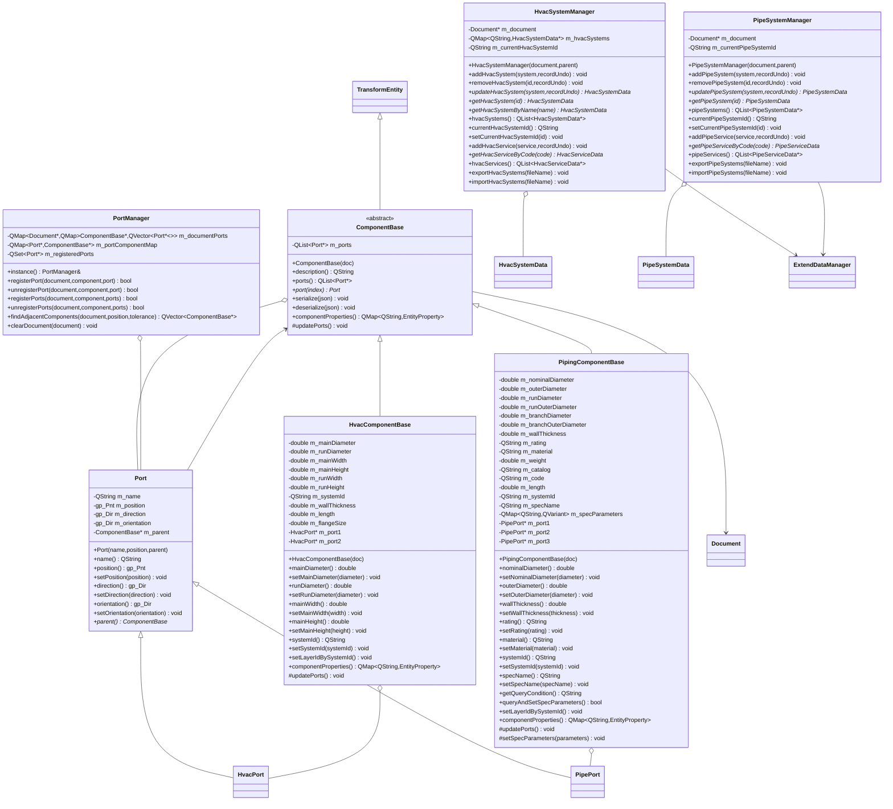

# BIM 专业模块系统架构

## 概述

BIM 专业模块系统是 OCCTBIM 的核心扩展系统，为建筑信息建模提供专业化的构件建模、系统管理和工程设计能力。该系统采用模块化架构设计，包含 HVAC（暖通空调）、管道系统、结构系统、PID（工艺流程图）等专业模块，支持构件库管理、系统连接、智能路由等高级功能。

## 系统架构



## 核心组件详解

### 1. ComponentBase 构件基类

ComponentBase 是所有 BIM 构件的基类，提供了构件的基本功能和端口管理能力。

#### 基类设计
```cpp
class ComponentBase : public TransformEntity {
protected:
    QList<Port *> m_ports;          // 端口列表
    
public:
    ComponentBase(Document *doc);
    
    // 基本信息
    QString description();
    
    // 端口管理
    QList<Port *> ports();
    Port *port(int index);
    
    // 序列化支持
    virtual void serialize(QJsonObject &json) const override;
    virtual void deserialize(const QJsonObject &json) override;
    
    // 属性系统
    virtual QMap<QString, EntityProperty> properties() const override;
    virtual QMap<QString, EntityProperty> componentProperties() const;
    
    // BREP捕捉支持
    virtual bool supportBrepSnap() const override { return false; }
    
protected:
    // 端口更新（子类实现）
    virtual void updatePorts() = 0;
};
```

### 2. Port 端口系统

Port 系统提供了构件之间的连接能力，支持几何定位、方向控制和连接验证。

#### 端口设计
```cpp
class Port : public QObject {
protected:
    QString m_name;             // 端口名称
    gp_Pnt m_position;          // 端口位置
    gp_Dir m_direction;         // 端口方向
    gp_Dir m_orientation;       // 端口朝向
    ComponentBase *m_parent;    // 父构件
    
public:
    Port(QString name, gp_Pnt position, ComponentBase *parent);
    
    // 基本属性
    QString name() const;
    ComponentBase *parent() const;
    
    // 几何属性
    gp_Pnt position() const;
    void setPosition(gp_Pnt position);
    gp_Dir direction() const;
    void setDirection(gp_Dir direction);
    gp_Dir orientation() const;
    void setOrientation(gp_Dir orientation);
};
```

### 3. HVAC 暖通空调模块

HVAC 模块提供了完整的暖通空调系统建模能力，包括风管、设备、系统管理等功能。

#### HvacComponentBase 暖通构件基类
```cpp
class HvacComponentBase : public ComponentBase {
protected:
    // 风管尺寸
    double m_mainDiameter;      // 主管直径
    double m_runDiameter;       // 支管直径
    double m_mainWidth;         // 主管宽度
    double m_mainHeight;        // 主管高度
    double m_runWidth;          // 支管宽度
    double m_runHeight;         // 支管高度
    
    // 系统属性
    QString m_systemId;         // 系统ID
    double m_wallThickness;     // 壁厚
    double m_length;            // 长度
    double m_flangeSize;        // 法兰尺寸
    
    // 端口
    HvacPort *m_port1;
    HvacPort *m_port2;
    
public:
    HvacComponentBase(Document *doc);
    
    // 尺寸管理
    double mainDiameter() const;
    void setMainDiameter(double diameter);
    double runDiameter() const;
    void setRunDiameter(double diameter);
    
    // 矩形风管尺寸
    double mainWidth() const;
    void setMainWidth(double width);
    double mainHeight() const;
    void setMainHeight(double height);
    
    // 系统管理
    QString systemId() const;
    void setSystemId(const QString &systemId);
    void setLayerIdBySystemId();
    
    // 属性系统
    virtual QMap<QString, EntityProperty> componentProperties() const override;
    
protected:
    // 端口更新
    virtual void updatePorts() override;
    
    // 端口形状添加
    TopoDS_Shape addPortShape(const TopoDS_Shape &shape);
};
```

### 4. 管道系统模块

管道系统模块提供了完整的管道建模能力，包括管道、管件、系统管理和规格库支持。

#### PipingComponentBase 管道构件基类
```cpp
class PipingComponentBase : public ComponentBase {
protected:
    // 基本尺寸
    double m_nominalDiameter;       // 公称直径
    double m_outerDiameter;         // 外径
    double m_wallThickness;         // 壁厚
    
    // 管道尺寸
    double m_runDiameter;           // 直管直径
    double m_runOuterDiameter;      // 直管外径
    double m_branchDiameter;        // 支管直径
    double m_branchOuterDiameter;   // 支管外径
    
    // 材料属性
    QString m_rating;               // 压力等级
    QString m_material;             // 材质
    double m_weight;                // 重量
    QString m_catalog;              // 标准
    QString m_code;                 // 型号
    
    // 系统属性
    QString m_systemId;             // 系统ID
    QString m_specName;             // 规格名称
    QMap<QString, QVariant> m_specParameters;  // 规格参数
    
    // 端口
    PipePort *m_port1;
    PipePort *m_port2;
    PipePort *m_port3;
    
public:
    PipingComponentBase(Document *doc);
    
    // 尺寸管理
    double nominalDiameter() const;
    void setNominalDiameter(double diameter);
    double outerDiameter() const;
    void setOuterDiameter(double diameter);
    double wallThickness() const;
    void setWallThickness(double thickness);
    
    // 材料管理
    QString rating() const;
    void setRating(const QString &rating);
    QString material() const;
    void setMaterial(const QString &material);
    
    // 系统管理
    QString systemId() const;
    void setSystemId(const QString &systemId);
    QString specName() const;
    void setSpecName(const QString &specName);
    void setLayerIdBySystemId();
    
    // 规格查询
    virtual QString getQueryCondition() const;
    bool queryAndSetSpecParameters();
    
    // 属性系统
    virtual QMap<QString, EntityProperty> componentProperties() const override;
    
protected:
    // 端口更新
    virtual void updatePorts() override;
    
    // 规格参数设置
    virtual void setSpecParameters(const QMap<QString, QVariant> &parameters);
    
    // 端口形状添加
    TopoDS_Shape addPortShape(const TopoDS_Shape &shape);
};
```

## 系统管理器

### 1. HvacSystemManager 暖通系统管理器

```cpp
class HvacSystemManager : public QObject {
private:
    Document *m_document;
    QMap<QString, HvacSystemData *> m_hvacSystems;
    QString m_currentHvacSystemId;
    
public:
    HvacSystemManager(Document *document, QObject *parent);
    
    // 系统管理
    void addHvacSystem(HvacSystemData *system, bool recordUndo = true);
    void removeHvacSystem(const QString &id, bool recordUndo = true);
    HvacSystemData *updateHvacSystem(HvacSystemData *system, bool recordUndo = true);
    
    // 批量操作
    void addHvacSystems(const QList<HvacSystemData *> &systems, bool recordUndo = true);
    void removeHvacSystems(const QStringList &ids, bool recordUndo = true);
    void updateHvacSystems(const QList<HvacSystemData *> &systems, bool recordUndo = true);
    
    // 查询操作
    HvacSystemData *getHvacSystem(const QString &id) const;
    HvacSystemData *getHvacSystemByName(const QString &name) const;
    QList<HvacSystemData *> hvacSystems() const;
    
    // 当前系统
    QString currentHvacSystemId() const;
    void setCurrentHvacSystemId(const QString &id);
    
    // 服务管理
    void addHvacService(HvacServiceData *service, bool recordUndo = true);
    HvacServiceData *getHvacServiceByCode(const QString &code) const;
    QList<HvacServiceData *> hvacServices() const;
    
    // 导入导出
    void exportHvacSystems(const QString &fileName);
    void importHvacSystems(const QString &fileName);
    
signals:
    void hvacSystemsAdded(const QList<HvacSystemData *> &systems);
    void hvacSystemsRemoved(const QList<HvacSystemData *> &systems);
    void hvacSystemsChanged(const QList<HvacSystemData *> &systems);
    void currentHvacSystemChanged(const QString &id);
    void modelChanged();
};
```

### 2. PipeSystemManager 管道系统管理器

```cpp
class PipeSystemManager : public QObject {
private:
    Document *m_document;
    QString m_currentPipeSystemId;
    
public:
    PipeSystemManager(Document *document, QObject *parent);
    
    // 系统管理
    void addPipeSystem(PipeSystemData *system, bool recordUndo = true);
    void removePipeSystem(const QString &id, bool recordUndo = true);
    PipeSystemData *updatePipeSystem(PipeSystemData *system, bool recordUndo = true);
    
    // 批量操作
    void addPipeSystems(const QList<PipeSystemData *> &systems, bool recordUndo = true);
    void removePipeSystems(const QStringList &ids, bool recordUndo = true);
    void updatePipeSystems(const QList<PipeSystemData *> &systems, bool recordUndo = true);
    
    // 查询操作
    PipeSystemData *getPipeSystem(const QString &id) const;
    QList<PipeSystemData *> pipeSystems() const;
    QString currentPipeSystemId() const;
    void setCurrentPipeSystemId(const QString &id);
    
    // 服务管理
    void addPipeService(PipeServiceData *service, bool recordUndo = true);
    PipeServiceData *getPipeServiceByCode(const QString &code) const;
    QList<PipeServiceData *> pipeServices() const;
    
    // 导入导出
    void exportPipeSystems(const QString &fileName);
    void importPipeSystems(const QString &fileName);
    
signals:
    void pipeSystemsAdded(const QList<PipeSystemData *> &systems);
    void pipeSystemsRemoved(const QList<PipeSystemData *> &systems);
    void pipeSystemsChanged(const QList<PipeSystemData *> &systems);
    void currentPipeSystemChanged(const QString &id);
    void modelChanged();
};
```

## 扩展机制

### 1. 自定义构件类型

```cpp
// 定义自定义构件
class CustomPipeComponent : public PipingComponentBase {
    Q_OBJECT
    
public:
    CustomPipeComponent(Document *doc) : PipingComponentBase(doc) {
        m_entityType = "CustomPipe";
        m_displayName = "自定义管道";
    }
    
    // 实现自定义几何
    void updateShape() override {
        // 创建自定义几何形状
        TopoDS_Shape customShape = createCustomShape();
        m_shape = customShape;
    }
    
    // 实现自定义端口
    void updatePorts() override {
        // 创建自定义端口配置
        if (!m_port1) {
            m_port1 = new PipePort("inlet", gp_Pnt(0, 0, 0), this);
        }
        if (!m_port2) {
            m_port2 = new PipePort("outlet", gp_Pnt(m_length, 0, 0), this);
        }
    }
    
private:
    TopoDS_Shape createCustomShape();
};

// 注册自定义构件
REGISTER_ENTITY(CustomPipeComponent, "CustomPipe")
```

### 2. 自定义系统类型

```cpp
// 定义自定义系统数据
class CustomSystemData : public ExtendData {
private:
    QString m_customProperty1;
    double m_customProperty2;
    
public:
    CustomSystemData(Document *document) : ExtendData(document) {
        setDataType("CustomSystemData");
    }
    
    // 自定义属性
    QString customProperty1() const { return m_customProperty1; }
    void setCustomProperty1(const QString &value) { m_customProperty1 = value; }
    
    double customProperty2() const { return m_customProperty2; }
    void setCustomProperty2(double value) { m_customProperty2 = value; }
    
    // 序列化支持
    void serialize(QJsonObject &json) const override {
        ExtendData::serialize(json);
        json["customProperty1"] = m_customProperty1;
        json["customProperty2"] = m_customProperty2;
    }
    
    void deserialize(const QJsonObject &json) override {
        ExtendData::deserialize(json);
        m_customProperty1 = json["customProperty1"].toString();
        m_customProperty2 = json["customProperty2"].toDouble();
    }
};

// 注册自定义系统数据
REGISTER_EXTEND_DATA(CustomSystemData, "CustomSystemData")
```

## 最佳实践

### 1. 构件设计

- **端口定义**: 明确定义构件的连接端口
- **参数化**: 支持参数化建模和尺寸驱动
- **规格集成**: 与标准规格库集成
- **性能优化**: 合理使用LOD和简化几何

### 2. 系统管理

- **批量操作**: 优先使用批量操作接口
- **事务管理**: 使用事务确保数据一致性
- **信号优化**: 合理使用信号避免频繁更新
- **内存管理**: 及时清理不需要的对象

### 3. 扩展开发

- **遵循模式**: 遵循现有的架构模式
- **接口一致**: 保持接口的一致性
- **文档完善**: 提供完整的扩展文档
- **测试覆盖**: 确保扩展功能的稳定性

BIM 系统为 OCCTBIM 提供了强大的专业建模能力，其模块化设计和完善的扩展机制确保了系统在各个工程领域的适用性和可扩展性。