# Action 动作系统架构

## 概述

Action 动作系统是 OCCTBIM 的命令管理核心，负责处理所有用户操作的配置化管理和执行。该系统采用命令模式设计，将用户界面操作（菜单、工具栏、快捷键等）与具体的业务逻辑解耦，提供了统一的命令执行、历史记录、错误处理等功能。

## 系统架构

```mermaid
classDiagram
    class Action {
        <<abstract>>
        -QString m_name
        +id() QString
        +name() QString
        +setName(name) void
        +isSupport2D() bool
        +execute(params) void
        +cleanup() void
        +validate() bool
        #currentDocument() Document*
        #currentViewport() Viewport*
    }

    class ActionManager {
        -QMap~QString,Action*~ m_actionsById
        -Action* m_currentAction
        -QStringList m_actionHistory
        +instance() ActionManager*
        +registerAllActions() void
        +registerAction(action) void
        +getAction(id) Action*
        +executeAction(id) bool
        +executeLastAction() void
        +cancelCurrentAction() void
        +findActionById(id) Action*
        +currentAction() Action*
        +hasActiveCommand() bool
    }

    class ActionFactory {
        -QList~ActionFactoryFunc~ m_factories
        +instance() ActionFactory*
        +registerFactory(func) void
        +createAllActions() QList~Action*~
    }

    class ActionRegistrer {
        +ActionRegistrer(factoryFunc)
    }

    %% 文件操作Actions
    class NewAction {
        +id() QString
        +execute(params) void
        +cleanup() void
    }

    class OpenAction {
        +id() QString
        +execute(params) void
        +cleanup() void
    }

    class SaveAction {
        +id() QString
        +execute(params) void
        +cleanup() void
    }

    class SaveAsAction {
        +id() QString
        +execute(params) void
        +cleanup() void
    }

    class ExitAction {
        +id() QString
        +execute(params) void
        +cleanup() void
    }

    %% 编辑操作Actions
    class UndoAction {
        +id() QString
        +execute(params) void
        +cleanup() void
    }

    class RedoAction {
        +id() QString
        +execute(params) void
        +cleanup() void
    }

    class DeleteAction {
        +id() QString
        +execute(params) void
        +cleanup() void
    }

    class SelectAllAction {
        +id() QString
        +execute(params) void
        +cleanup() void
    }

    class GroupAction {
        -QString m_groupName
        +id() QString
        +execute(params) void
        +cleanup() void
    }

    class UngroupAction {
        +id() QString
        +execute(params) void
        +cleanup() void
    }

    %% 视图操作Actions
    class ViewFrontAction {
        +id() QString
        +execute(params) void
        +cleanup() void
    }

    class ViewTopAction {
        +id() QString
        +execute(params) void
        +cleanup() void
    }

    class ViewSEAction {
        +id() QString
        +execute(params) void
        +cleanup() void
    }

    class ViewWireframeAction {
        +id() QString
        +execute(params) void
        +cleanup() void
    }

    class ViewShadedAction {
        +id() QString
        +execute(params) void
        +cleanup() void
    }

    class HideSelectedAction {
        +id() QString
        +execute(params) void
        +cleanup() void
    }

    class ShowAllAction {
        +id() QString
        +execute(params) void
        +cleanup() void
    }

    %% 工具操作Actions
    class ToolAction {
        -QString m_toolId
        +ToolAction(toolId)
        +id() QString
        +execute(params) void
        +cleanup() void
    }

    %% 导入导出Actions
    class ImportAction {
        +id() QString
        +execute(params) void
        +cleanup() void
    }

    class ExportAction {
        +id() QString
        +execute(params) void
        +cleanup() void
    }

    %% 设置Actions
    class SettingAction {
        +id() QString
        +execute(params) void
        +cleanup() void
    }

    %% 样式Actions
    class StyleAction {
        +id() QString
        +execute(params) void
        +cleanup() void
    }

    %% 特殊Actions
    class EditFeatureAction {
        +id() QString
        +execute(params) void
        +cleanup() void
    }

    class EditPropertyAction {
        +id() QString
        +execute(params) void
        +cleanup() void
    }

    class ComponentAction {
        +id() QString
        +execute(params) void
        +cleanup() void
    }

    %% 继承关系
    Action <|-- NewAction
    Action <|-- OpenAction
    Action <|-- SaveAction
    Action <|-- SaveAsAction
    Action <|-- ExitAction
    Action <|-- UndoAction
    Action <|-- RedoAction
    Action <|-- DeleteAction
    Action <|-- SelectAllAction
    Action <|-- GroupAction
    Action <|-- UngroupAction
    Action <|-- ViewFrontAction
    Action <|-- ViewTopAction
    Action <|-- ViewSEAction
    Action <|-- ViewWireframeAction
    Action <|-- ViewShadedAction
    Action <|-- HideSelectedAction
    Action <|-- ShowAllAction
    Action <|-- ToolAction
    Action <|-- ImportAction
    Action <|-- ExportAction
    Action <|-- SettingAction
    Action <|-- StyleAction
    Action <|-- EditFeatureAction
    Action <|-- EditPropertyAction
    Action <|-- ComponentAction

    %% 关联关系
    ActionManager o-- Action
    ActionFactory ..> Action : creates
    ActionRegistrer --> ActionFactory : registers
    Action --> Document : uses
    Action --> Viewport : uses

    %% 工厂函数类型
    class ActionFactoryFunc {
        <<typedef>>
        std::function~Action*()~
    }
    
    ActionFactory --> ActionFactoryFunc : uses
    ActionRegistrer --> ActionFactoryFunc : uses
```



## 核心组件详解

### 1. Action 基类

Action 是所有动作的基类，定义了动作的基本接口和行为模式。

#### 核心接口
```cpp
class Action : public QObject {
public:
    // 基本属性
    virtual QString id() const = 0;         // 动作唯一标识符
    QString name() const;                   // 动作显示名称
    void setName(const QString &name);      // 设置显示名称
    
    // 2D支持检查
    virtual bool isSupport2D() const { return false; }
    
    // 核心执行接口
    virtual void execute(const QString &params) = 0;  // 执行动作
    virtual void cleanup() = 0;                       // 清理资源
    
    // 验证接口
    bool validate() const;                  // 验证动作是否可执行
    
protected:
    // 上下文访问
    Document *currentDocument() const;      // 获取当前文档
    Viewport *currentViewport() const;      // 获取当前视图
    
    QString m_name;                         // 动作名称
};
```

#### 设计原则
- **单一职责**: 每个 Action 只负责一种特定操作
- **无状态**: Action 本身不保存状态，通过参数传递数据
- **可重用**: 同一个 Action 实例可以多次执行
- **上下文感知**: 能够访问当前文档和视图上下文

### 2. ActionManager 动作管理器

ActionManager 是动作系统的核心管理器，负责动作的注册、执行、历史记录等功能。

#### 单例模式
```cpp
class ActionManager : public QObject {
public:
    static ActionManager *instance();
    
private:
    ActionManager();
    static ActionManager *s_instance;
};
```

#### 动作管理
```cpp
// 动作注册
void registerAllActions();              // 注册所有动作
void registerAction(Action *action);    // 注册单个动作

// 动作获取
Action *getAction(const QString &id) const;        // 按ID获取动作
Action *findActionById(const QString &id) const;   // 查找动作
QStringList getAllActionIds() const;                // 获取所有动作ID
```

#### 动作执行
```cpp
// 执行动作
bool executeAction(const QString &id);  // 按ID执行动作
void executeLastAction();               // 执行上次动作
void cancelCurrentAction();             // 取消当前动作

// 状态查询
Action *currentAction() const;          // 获取当前动作
bool hasActiveCommand() const;          // 是否有活动命令
```

#### 历史记录
```cpp
private:
    QStringList m_actionHistory;            // 动作历史记录
    static const int MAX_HISTORY_SIZE = 20; // 最大历史记录数
    
    void addToHistory(const QString &actionId);     // 添加到历史
    void cleanupCurrentAction();                    // 清理当前动作
```

#### 信号机制
```cpp
signals:
    void actionRegistered(Action *action);          // 动作注册信号
    void actionStarted(Action *action);             // 动作开始信号
    void actionFinished(Action *action);            // 动作完成信号
    void commandError(const QString &command, 
                     const QString &error);         // 命令错误信号
```

### 3. ActionFactory 动作工厂

ActionFactory 实现了动作的注册和创建机制。

#### 工厂接口
```cpp
class ActionFactory {
public:
    static ActionFactory *instance();
    
    // 注册工厂函数
    void registerFactory(ActionFactoryFunc func);
    
    // 创建所有动作
    QList<Action *> createAllActions();
    
private:
    QList<ActionFactoryFunc> m_factories;   // 工厂函数列表
};
```

#### 工厂函数类型
```cpp
// 动作工厂函数类型定义
using ActionFactoryFunc = std::function<Action *()>;
```

#### 自动注册机制
```cpp
// 动作注册器
class ActionRegistrer {
public:
    explicit ActionRegistrer(ActionFactoryFunc factoryFunc);
};

// 自动注册宏
#define REGISTER_ACTION(ActionClass) \
    static ActionRegistrer g_registrar_##ActionClass([]() { \
        return new ActionClass(); \
    });

// 使用示例
REGISTER_ACTION(NewAction)
REGISTER_ACTION(OpenAction)
REGISTER_ACTION(SaveAction)
```

## 动作类型体系

### 1. 文件操作动作

#### 基本文件操作
- **NewAction**: 新建文档动作
- **OpenAction**: 打开文档动作
- **SaveAction**: 保存文档动作
- **SaveAllAction**: 保存所有文档动作
- **SaveAsAction**: 另存为动作
- **CleanAction**: 清理动作
- **ExitAction**: 退出应用动作

#### 实现示例
```cpp
class NewAction : public Action {
public:
    QString id() const override { return "File.New"; }
    bool isSupport2D() const override { return true; }
    
    void execute(const QString &params) override {
        // 创建新文档
        ApplicationContext::instance()->createDocument("");
    }
    
    void cleanup() override {
        // 无需清理
    }
};

class SaveAction : public Action {
public:
    QString id() const override { return "File.Save"; }
    bool isSupport2D() const override { return true; }
    
    void execute(const QString &params) override {
        Document *doc = currentDocument();
        if (doc) {
            if (doc->fileName().isEmpty()) {
                // 如果没有文件名，执行另存为
                ActionManager::instance()->executeAction("File.SaveAs");
            } else {
                // 保存到现有文件
                doc->saveToFile(doc->fileName());
            }
        }
    }
    
    void cleanup() override {}
};
```

### 2. 编辑操作动作

#### 撤销重做操作
- **UndoAction**: 撤销动作
- **RedoAction**: 重做动作

#### 选择操作
- **SelectAllAction**: 全选动作
- **SelectInvertAction**: 反选动作

#### 删除操作
- **DeleteAction**: 删除选中对象动作

#### 分组操作
- **GroupAction**: 分组动作
- **UngroupAction**: 取消分组动作

#### 其他编辑操作
- **RegenAction**: 重新生成动作
- **FindEntityAction**: 查找实体动作
- **ExtendDictAction**: 扩展字典动作
- **ResetAction**: 重置动作

#### 实现示例
```cpp
class UndoAction : public Action {
public:
    QString id() const override { return "Edit.Undo"; }
    bool isSupport2D() const override { return true; }
    
    void execute(const QString &params) override {
        Document *doc = currentDocument();
        if (doc && doc->undoStack()->canUndo()) {
            doc->undoStack()->undo();
        }
    }
    
    void cleanup() override {}
};

class DeleteAction : public Action {
public:
    QString id() const override { return "Edit.Delete"; }
    bool isSupport2D() const override { return true; }
    
    void execute(const QString &params) override {
        Viewport *viewport = currentViewport();
        if (viewport) {
            QList<Entity*> selectedEntities = viewport->getSelectedEntities();
            if (!selectedEntities.isEmpty()) {
                Document *doc = currentDocument();
                doc->model()->entityManager()->removeEntities(selectedEntities);
            }
        }
    }
    
    void cleanup() override {}
};
```

### 3. 视图操作动作

#### 标准视图
- **ViewFrontAction**: 前视图动作
- **ViewBackAction**: 后视图动作
- **ViewLeftAction**: 左视图动作
- **ViewRightAction**: 右视图动作
- **ViewTopAction**: 俯视图动作
- **ViewBottomAction**: 仰视图动作

#### 等轴测视图
- **ViewSEAction**: 东南等轴测视图动作
- **ViewSWAction**: 西南等轴测视图动作
- **ViewNWAction**: 西北等轴测视图动作
- **ViewNEAction**: 东北等轴测视图动作

#### 显示模式
- **ViewWireframeAction**: 线框显示动作
- **ViewShadedAction**: 着色显示动作

#### 可见性控制
- **HideSelectedAction**: 隐藏选中对象动作
- **IsolateSelectedAction**: 隔离选中对象动作
- **ShowAllAction**: 显示所有对象动作

#### 界面控制
- **ResetDocksAction**: 重置停靠面板动作

#### 实现示例
```cpp
class ViewTopAction : public Action {
public:
    QString id() const override { return "View.Top"; }
    
    void execute(const QString &params) override {
        Viewport *viewport = currentViewport();
        if (viewport) {
            viewport->setStandardView(Viewport::TopView);
        }
    }
    
    void cleanup() override {}
};

class HideSelectedAction : public Action {
public:
    QString id() const override { return "View.HideSelected"; }
    bool isSupport2D() const override { return true; }
    
    void execute(const QString &params) override {
        Viewport *viewport = currentViewport();
        if (viewport) {
            QList<Entity*> selectedEntities = viewport->getSelectedEntities();
            for (Entity* entity : selectedEntities) {
                viewport->hideEntity(entity);
            }
            viewport->clearSelection();
        }
    }
    
    void cleanup() override {}
};
```

### 4. 工具操作动作

#### ToolAction 通用工具动作
ToolAction 是一个通用的工具激活动作，可以激活任意工具：

```cpp
class ToolAction : public Action {
private:
    QString m_toolId;   // 工具ID
    
public:
    explicit ToolAction(const QString &toolId) : m_toolId(toolId) {}
    
    QString id() const override { 
        return QString("Tool.%1").arg(m_toolId); 
    }
    
    bool isSupport2D() const override { return true; }
    
    void execute(const QString &params) override {
        ToolManager::instance()->activateTool(m_toolId, params);
    }
    
    void cleanup() override {
        // 工具管理器负责清理
    }
};
```

#### 工具动作的创建
```cpp
// 为每个工具创建对应的动作
void ActionManager::registerToolActions() {
    QStringList toolIds = ToolFactory::instance()->registeredTools();
    for (const QString &toolId : toolIds) {
        ToolAction *action = new ToolAction(toolId);
        action->setName(getToolDisplayName(toolId));
        registerAction(action);
    }
}
```

### 5. 导入导出动作

#### 导入动作
- **ImportAction**: 通用导入动作，支持多种格式

#### 导出动作
- **ExportAction**: 通用导出动作，支持多种格式

#### 实现示例
```cpp
class ImportAction : public Action {
public:
    QString id() const override { return "File.Import"; }
    bool isSupport2D() const override { return true; }
    
    void execute(const QString &params) override {
        QString fileName = QFileDialog::getOpenFileName(
            nullptr, 
            "导入文件",
            "",
            "支持的格式 (*.step *.stp *.iges *.igs *.dxf);;所有文件 (*.*)"
        );
        
        if (!fileName.isEmpty()) {
            Document *doc = currentDocument();
            if (doc) {
                // 根据文件扩展名选择合适的导入器
                FileIO::importFile(doc, fileName);
            }
        }
    }
    
    void cleanup() override {}
};
```

### 6. 设置和样式动作

#### 设置动作
- **SettingAction**: 打开设置对话框动作

#### 样式动作
- **StyleAction**: 样式管理动作
- **TextAlignAction**: 文字对齐动作

### 7. 特殊功能动作

#### 特征编辑
- **EditFeatureAction**: 编辑特征动作

#### 属性编辑
- **EditPropertyAction**: 编辑属性动作

#### 构件操作
- **ComponentAction**: 构件操作动作

#### BREP操作
- **BrepAction**: BREP操作动作

#### 视图操作
- **ViewSubShapeAction**: 查看子形状动作
- **HLRAction**: 隐藏线移除动作
- **ClipAction**: 剪切动作

## 参数化执行

### 1. 参数传递机制

Action 的 execute 方法接受字符串参数，支持多种参数格式：

#### JSON 参数
```cpp
void SomeAction::execute(const QString &params) {
    if (!params.isEmpty()) {
        QJsonDocument doc = QJsonDocument::fromJson(params.toUtf8());
        QJsonObject obj = doc.object();
        
        QString param1 = obj["param1"].toString();
        double param2 = obj["param2"].toDouble();
        bool param3 = obj["param3"].toBool();
        
        // 使用参数执行操作
    }
}

// 调用示例
QString params = R"({"param1": "value1", "param2": 42.5, "param3": true})";
actionManager->executeAction("SomeAction", params);
```

#### 简单参数
```cpp
void ToolAction::execute(const QString &params) {
    // params 直接作为工具参数传递
    ToolManager::instance()->activateTool(m_toolId, params);
}

// 调用示例
actionManager->executeAction("Tool.LineTool", "continuous");
```

### 2. 条件执行

Action 可以根据当前状态决定是否执行：

```cpp
bool Action::validate() const {
    Document *doc = currentDocument();
    if (!doc) {
        return false;  // 没有当前文档
    }
    
    // 检查2D支持
    if (isSupport2D() && !doc->is2DMode()) {
        return false;  // 不支持当前模式
    }
    
    return true;
}

bool ActionManager::executeAction(const QString &id) {
    Action *action = getAction(id);
    if (!action) {
        emit commandError(id, "动作不存在");
        return false;
    }
    
    if (!action->validate()) {
        emit commandError(id, "动作无法执行");
        return false;
    }
    
    try {
        m_currentAction = action;
        emit actionStarted(action);
        
        action->execute("");
        
        emit actionFinished(action);
        addToHistory(id);
        
        return true;
    } catch (const std::exception &e) {
        emit commandError(id, QString::fromStdString(e.what()));
        return false;
    } finally {
        action->cleanup();
        m_currentAction = nullptr;
    }
}
```

## 与UI系统的集成

### 1. 菜单集成

Action 系统与菜单系统无缝集成：

```cpp
// 创建菜单项
QAction *menuAction = new QAction("新建", this);
menuAction->setShortcut(QKeySequence::New);
connect(menuAction, &QAction::triggered, [this]() {
    ActionManager::instance()->executeAction("File.New");
});
```

### 2. 工具栏集成

```cpp
// 创建工具栏按钮
QToolButton *toolButton = new QToolButton();
toolButton->setText("直线");
toolButton->setIcon(QIcon(":/icons/line.png"));
connect(toolButton, &QToolButton::clicked, [this]() {
    ActionManager::instance()->executeAction("Tool.LineTool");
});
```

### 3. 快捷键集成

```cpp
// 注册快捷键
QShortcut *shortcut = new QShortcut(QKeySequence("Ctrl+N"), mainWindow);
connect(shortcut, &QShortcut::activated, [this]() {
    ActionManager::instance()->executeAction("File.New");
});
```

### 4. Ribbon界面集成

```cpp
// 在Ribbon中添加动作
void RibbonManager::setupFileTab() {
    QRibbonTab *fileTab = ribbon->addTab("文件");
    QRibbonGroup *fileGroup = fileTab->addGroup("文件操作");
    
    // 添加新建按钮
    QRibbonButton *newButton = fileGroup->addButton("新建");
    newButton->setIcon(QIcon(":/icons/new.png"));
    connect(newButton, &QRibbonButton::clicked, [this]() {
        ActionManager::instance()->executeAction("File.New");
    });
    
    // 添加打开按钮
    QRibbonButton *openButton = fileGroup->addButton("打开");
    openButton->setIcon(QIcon(":/icons/open.png"));
    connect(openButton, &QRibbonButton::clicked, [this]() {
        ActionManager::instance()->executeAction("File.Open");
    });
}
```

## 扩展机制

### 1. 自定义动作开发

创建自定义动作的步骤：

```cpp
// 1. 继承 Action 基类
class CustomAction : public Action {
    Q_OBJECT
    
public:
    QString id() const override { 
        return "Custom.MyAction"; 
    }
    
    bool isSupport2D() const override { 
        return true; 
    }
    
    void execute(const QString &params) override {
        // 实现自定义逻辑
        Document *doc = currentDocument();
        if (doc) {
            // 执行自定义操作
            performCustomOperation(doc, params);
        }
    }
    
    void cleanup() override {
        // 清理资源
    }
    
private:
    void performCustomOperation(Document *doc, const QString &params);
};

// 2. 注册自定义动作
REGISTER_ACTION(CustomAction)
```

### 2. 动作组合

可以创建复合动作，组合多个基础动作：

```cpp
class CompositeAction : public Action {
private:
    QStringList m_actionIds;
    
public:
    CompositeAction(const QStringList &actionIds) 
        : m_actionIds(actionIds) {}
    
    QString id() const override { 
        return "Composite." + m_actionIds.join("_"); 
    }
    
    void execute(const QString &params) override {
        ActionManager *manager = ActionManager::instance();
        for (const QString &actionId : m_actionIds) {
            if (!manager->executeAction(actionId)) {
                // 如果任何一个动作失败，停止执行
                break;
            }
        }
    }
    
    void cleanup() override {}
};

// 使用示例：创建"保存并导出"复合动作
CompositeAction *saveAndExport = new CompositeAction({
    "File.Save", 
    "File.Export"
});
```

### 3. 条件动作

可以创建根据条件执行不同逻辑的动作：

```cpp
class ConditionalAction : public Action {
private:
    QString m_condition;
    QString m_trueActionId;
    QString m_falseActionId;
    
public:
    ConditionalAction(const QString &condition, 
                     const QString &trueAction,
                     const QString &falseAction)
        : m_condition(condition)
        , m_trueActionId(trueAction)
        , m_falseActionId(falseAction) {}
    
    void execute(const QString &params) override {
        bool conditionResult = evaluateCondition(m_condition);
        QString actionId = conditionResult ? m_trueActionId : m_falseActionId;
        
        ActionManager::instance()->executeAction(actionId);
    }
    
private:
    bool evaluateCondition(const QString &condition);
};
```

## 性能优化

### 1. 延迟创建

Action 实例采用延迟创建策略：

```cpp
void ActionManager::registerAllActions() {
    // 不立即创建所有Action实例，而是注册工厂函数
    ActionFactory *factory = ActionFactory::instance();
    
    // 在需要时才创建实例
    QList<Action*> actions = factory->createAllActions();
    for (Action *action : actions) {
        registerAction(action);
    }
}
```

### 2. 缓存机制

```cpp
class ActionManager {
private:
    QMap<QString, Action*> m_actionCache;  // 动作缓存
    
public:
    Action *getAction(const QString &id) const {
        // 先从缓存查找
        if (m_actionCache.contains(id)) {
            return m_actionCache[id];
        }
        
        // 缓存中没有，创建新实例
        Action *action = ActionFactory::instance()->createAction(id);
        if (action) {
            m_actionCache[id] = action;
        }
        
        return action;
    }
};
```

### 3. 异步执行

对于耗时的动作，支持异步执行：

```cpp
class AsyncAction : public Action {
public:
    void execute(const QString &params) override {
        // 在后台线程执行耗时操作
        QFuture<void> future = QtConcurrent::run([this, params]() {
            performLongRunningOperation(params);
        });
        
        // 监控执行结果
        QFutureWatcher<void> *watcher = new QFutureWatcher<void>(this);
        connect(watcher, &QFutureWatcher<void>::finished, [this, watcher]() {
            emit operationCompleted();
            watcher->deleteLater();
        });
        watcher->setFuture(future);
    }
    
signals:
    void operationCompleted();
    
private:
    void performLongRunningOperation(const QString &params);
};
```

## 最佳实践

### 1. 动作设计

- **职责单一**: 每个动作只负责一种操作
- **无副作用**: 动作执行不应产生意外的副作用
- **可重复**: 同一动作可以多次执行
- **参数化**: 通过参数支持不同的执行模式

### 2. 错误处理

- **输入验证**: 验证参数的有效性
- **异常处理**: 妥善处理执行过程中的异常
- **用户反馈**: 提供清晰的错误信息
- **状态恢复**: 失败时恢复到执行前的状态

### 3. 性能考虑

- **延迟加载**: 按需创建动作实例
- **缓存策略**: 缓存频繁使用的动作
- **异步执行**: 耗时操作使用异步执行
- **资源管理**: 及时清理不需要的资源

### 4. 扩展开发

- **遵循接口**: 严格遵循 Action 接口规范
- **注册机制**: 使用自动注册机制
- **文档完善**: 提供完整的动作使用文档
- **测试覆盖**: 确保动作的正确性和稳定性

Action 系统为 OCCTBIM 提供了统一而灵活的命令管理能力，其配置化的设计和完善的扩展机制确保了系统的可维护性和可扩展性。