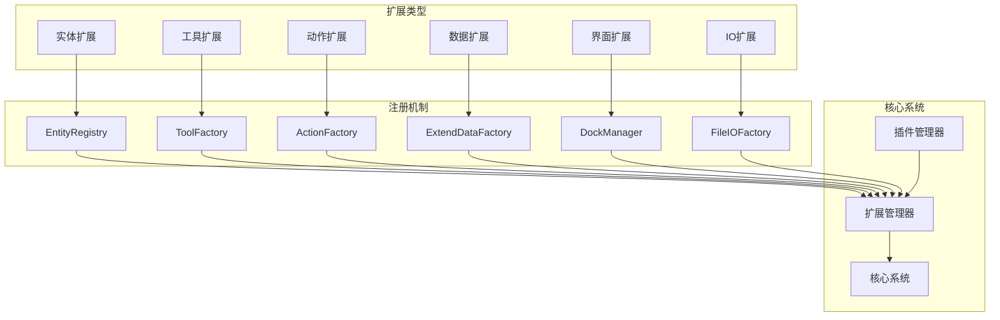

# 扩展机制设计架构

## 概述

扩展机制是 OCCTBIM 的核心设计理念，为系统提供了强大的可扩展性和可定制性。该系统采用插件化架构设计，支持实体扩展、工具扩展、动作扩展、数据扩展等多种扩展方式，使开发者能够轻松地为系统添加新功能而无需修改核心代码。

## 扩展机制总览



## 1. 实体扩展机制

### EntityRegistry 实体注册表

实体扩展通过 EntityRegistry 实现，支持动态注册新的实体类型。

```cpp
class EntityRegistry {
public:
    using EntityCreator = Entity *(*)(Document *);
    
    static Entity *createEntity(QString type, Document *document);
    static void registerEntity(EntityCreator creator, QString type);
    
private:
    static QHash<QString, EntityCreator> &creators();
};

// 自动注册宏
#define REGISTER_ENTITY(EntityClass, type) \
    class EntityClass##Registrar { \
    public: \
        EntityClass##Registrar() { \
            EntityRegistry::registerEntity(&EntityClass##Registrar::create, type); \
        } \
        static Entity *create(Document *document) { \
            return new EntityClass(document); \
        } \
    }; \
    static EntityClass##Registrar EntityClass##_registrar;
```

### 自定义实体示例

```cpp
// 定义自定义实体
class CustomEntity : public TransformEntity {
    Q_OBJECT
    
public:
    CustomEntity(Document *doc) : TransformEntity(doc) {
        m_entityType = "Custom";
        m_displayName = "自定义实体";
    }
    
    // 实现必要的虚函数
    void updateShape() override;
    void serialize(QJsonObject &json) const override;
    void deserialize(const QJsonObject &json) override;
    QMap<QString, EntityProperty> properties() const override;
};

// 注册实体
REGISTER_ENTITY(CustomEntity, "Custom")
```

## 2. 工具扩展机制

### ToolFactory 工具工厂

工具扩展通过 ToolFactory 实现，支持动态注册新的交互工具。

```cpp
class ToolFactory : public QObject {
public:
    using ToolCreator = std::function<Tool *()>;
    
    static ToolFactory *instance();
    void registerCreator(const QString &toolId, ToolCreator creator);
    Tool *createTool(const QString &toolId);
    
private:
    QMap<QString, ToolCreator> m_creators;
};

// 自动注册宏
#define REGISTER_TOOL(ToolClass) \
    static bool registered_##ToolClass = []() { \
        ToolFactory::instance()->registerCreator(#ToolClass, []() { \
            return new ToolClass(); \
        }); \
        return true; \
    }();
```

### 自定义工具示例

```cpp
// 定义自定义工具
class CustomTool : public Tool {
    Q_OBJECT
    
public:
    CustomTool() : Tool("CustomTool") {}
    
    bool activate(const QString &params = "") override;
    void deactivate() override;
    void onLeftMousePress(gp_Pnt worldPos) override;
    void onMouseMove(gp_Pnt worldPos) override;
};

// 注册工具
REGISTER_TOOL(CustomTool)
```

## 3. 动作扩展机制

### ActionFactory 动作工厂

动作扩展通过 ActionFactory 实现，支持动态注册新的用户操作。

```cpp
class ActionFactory {
public:
    using ActionFactoryFunc = std::function<Action *()>;
    
    static ActionFactory *instance();
    void registerFactory(ActionFactoryFunc func);
    QList<Action *> createAllActions();
    
private:
    QList<ActionFactoryFunc> m_factories;
};

// 自动注册宏
#define REGISTER_ACTION(ActionClass) \
    static ActionRegistrer g_registrar_##ActionClass([]() { \
        return new ActionClass(); \
    });
```

## 4. 数据扩展机制

### ExtendData 扩展数据系统

数据扩展通过 ExtendData 系统实现，支持为实体添加自定义属性。

```cpp
// 自定义扩展数据
class CustomExtendData : public ExtendData {
    Q_OBJECT
    
public:
    CustomExtendData(Document *document) : ExtendData(document) {
        setDataType("CustomExtendData");
    }
    
    // 自定义属性
    QString customProperty() const { return m_customProperty; }
    void setCustomProperty(const QString &value) { m_customProperty = value; }
    
private:
    QString m_customProperty;
};

// 注册扩展数据
REGISTER_EXTEND_DATA(CustomExtendData, "CustomExtendData")
```

## 最佳实践

### 1. 扩展开发

- **遵循接口**: 严格遵循扩展接口规范
- **注册机制**: 使用自动注册机制简化扩展
- **依赖管理**: 明确声明扩展的依赖关系
- **版本兼容**: 考虑扩展的版本兼容性

### 2. 插件设计

- **模块化**: 保持插件的独立性和模块化
- **配置管理**: 提供插件配置和设置界面
- **错误处理**: 完善的错误处理和异常恢复
- **文档完善**: 提供详细的插件开发文档

扩展机制为 OCCTBIM 提供了强大的可扩展性，使系统能够适应各种不同的应用场景和用户需求。