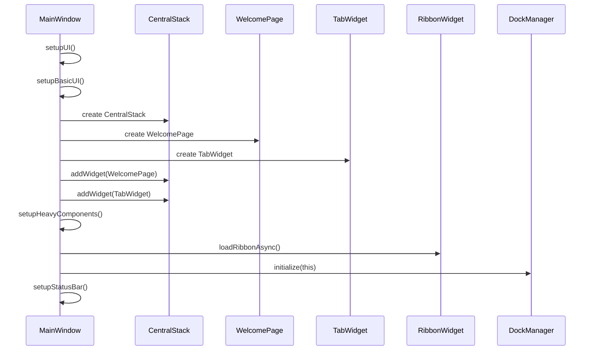

# UI 用户界面系统架构

## 概述

UI 用户界面系统是 OCCTBIM 的前端展示层，负责提供现代化、用户友好的图形界面。该系统采用分层架构设计，基于 Qt 框架构建，包含主窗口、停靠面板、对话框、编辑器等多种界面组件，支持 Ribbon 界面、响应式布局、主题切换等现代化界面特性。

## 系统架构

```mermaid
classDiagram
    class MainWindow {
        -QStackedWidget* m_centralStack
        -WelcomePage* m_welcomePage
        -QTabWidget* m_tabWidget
        -QRibbonWidget* m_ribbonWidget
        -QRibbonHelper* m_ribbonHelper
        -QLabel* m_coordinateLabel
        -QLabel* m_memoryLabel
        +setupUI() void
        +setupBasicUI() void
        +setupHeavyComponents() void
        +loadRibbonAsync() void
        +onDocumentCreated(doc) void
        +onDocumentClosed(doc) void
        +onCurrentDocumentChanged(doc) void
        +updateCoordinateDisplay(point) void
        +switchCentralView(showTabs) void
    }

    class DockManager {
        -QMainWindow* m_mainWindow
        -QMap~QString,BaseDock*~ m_instances
        -QMap~QString,function~ m_creators
        +instance() DockManager*
        +initialize(mainWindow) void
        +registerDock(id,creator) void
        +getDock(id) BaseDock*
        +openDock(id) BaseDock*
        +closeDock(id) void
        +toggleDock(id) void
        +updateDocument(doc) void
        +saveOpenDockStates() void
        +restoreOpenDockStates() void
        +resetDockStates() void
    }

    class BaseDock {
        <<abstract>>
        -Document* m_document
        -QString m_dockId
        -QString m_stateKey
        +BaseDock(dockId,title,parent)
        +setDocument(doc) void
        +document() Document*
        +dockId() QString
        +defaultArea() Qt::DockWidgetArea
        +saveState() void
        +restoreState() void
        #onDocumentChanged() void
    }

    class DocumentTab {
        -Document* m_document
        -Viewport* m_viewport
        -QWidget* m_toolbarContainer
        -LayerComboBox* m_layerCombo
        -TextStyleComboBox* m_textStyleCombo
        -DimStyleComboBox* m_dimStyleCombo
        -QLineEdit* m_lengthInput
        -QLineEdit* m_angleInput
        -QList~ToolbarGroup~ m_toolbarGroups
        +DocumentTab(doc,parent)
        +document() Document*
        +viewport() Viewport*
        +setupUI() void
        +setupToolbars() void
        +onLayerChanged(value) void
        +onTextStyleChanged(value) void
        +updateCoordinateDisplay(point) void
    }

    class WelcomePage {
        -QVBoxLayout* m_layout
        -QPushButton* m_newButton
        -QPushButton* m_openButton
        -QListWidget* m_recentList
        +WelcomePage(parent)
        +setupUI() void
        +updateRecentFiles() void
        +onNewRequested() signal
        +onOpenRequested() signal
        +onOpenRecent(filePath) signal
    }

    %% 停靠面板类
    class PropertyDock {
        -PropertyEditor* m_propertyEditor
        -QLabel* m_selectionInfoLabel
        +PropertyDock(parent)
        +updatePropertyEditor(entity) void
        +updateSelectionInfo(entities) void
        #onDocumentChanged() void
    }

    class LayerDock {
        -LayerManagerWidget* m_layerManager
        +LayerDock(parent)
        #onDocumentChanged() void
    }

    class ModelDock {
        -EntityTreeWidget* m_entityTreeWidget
        -QMenu* m_contextMenu
        -QTimer* m_updateTimer
        -bool m_syncingSelection
        +ModelDock(parent)
        +handleContextMenu(pos) void
        +syncViewportSelection(entities) void
        +onEntityTreeSelectionChanged(entities) void
        +onEntitiesAdded(entities) void
        +onEntitiesRemoved(entities) void
        +onEntitiesChanged(entities) void
    }

    class LogDock {
        -QTextEdit* m_logTextEdit
        -QToolButton* m_clearButton
        +LogDock(parent)
        +appendLog(message) void
        +clearLog() void
        #onDocumentChanged() void
    }

    class ComponentDock {
        -QTreeWidget* m_componentTree
        -QLineEdit* m_searchEdit
        +ComponentDock(parent)
        +updateComponents() void
        +filterComponents(text) void
        #onDocumentChanged() void
    }

    %% 基础UI组件
    class BaseDialog {
        <<abstract>>
        -QString m_title
        -QDialogButtonBox* m_buttonBox
        +BaseDialog(parent)
        +setTitle(title) void
        +addButton(text,role) QPushButton*
        #setupUI() void
        #validate() bool
    }

    class PropertyEditor {
        -QTreeWidget* m_propertyTree
        -PropertyEditorFactory* m_editorFactory
        -QMap~QString,IPropertyEditor*~ m_editors
        +PropertyEditor(parent)
        +setEntity(entity) void
        +updateProperties(properties) void
        +createEditor(property) IPropertyEditor*
        +onPropertyChanged(name,value) void
    }

    class LayerManagerWidget {
        -QTreeWidget* m_layerTree
        -QToolBar* m_toolbar
        -LayerManager* m_layerManager
        +LayerManagerWidget(parent)
        +setLayerManager(manager) void
        +updateLayers() void
        +onLayerAdded(layer) void
        +onLayerRemoved(layer) void
        +onLayerChanged(layer) void
    }

    %% 基础控件
    class BaseComboBox {
        <<abstract>>
        -QStandardItemModel* m_model
        -QString m_currentValue
        +BaseComboBox(parent)
        +setValue(value) void
        +value() QVariant
        +addItem(text,value) void
        +clear() void
        #populateItems() void
        #onCurrentChanged(value) void
    }

    class LayerComboBox {
        -LayerManager* m_layerManager
        +LayerComboBox(parent)
        +setLayerManager(manager) void
        #populateItems() void
    }

    class TextStyleComboBox {
        -StyleManager* m_styleManager
        +TextStyleComboBox(parent)
        +setStyleManager(manager) void
        #populateItems() void
    }

    class ColorButton {
        -QColor m_color
        -bool m_showColorDialog
        +ColorButton(parent)
        +setColor(color) void
        +color() QColor
        +paintEvent(event) void
        +mousePressEvent(event) void
        +colorChanged(color) signal
    }

    class PropertyEditorFactory {
        -QMap~QString,PropertyEditorCreator~ m_creators
        +instance() PropertyEditorFactory*
        +registerEditor(type,creator) void
        +createEditor(property,parent) IPropertyEditor*
        +getAvailableEditors() QStringList
    }

    %% 特殊UI组件
    class EntityTreeWidget {
        -QTreeWidget* m_treeWidget
        -EntityDisplayManager* m_displayManager
        -QMap~QString,QTreeWidgetItem*~ m_entityItems
        +EntityTreeWidget(parent)
        +setDocument(doc) void
        +updateEntityTree() void
        +addEntity(entity) void
        +removeEntity(entity) void
        +updateEntity(entity) void
        +getSelectedEntities() QList~Entity*~
        +setSelectedEntities(entities) void
    }

    class FeatureEditorWidget {
        -QTreeWidget* m_featureTree
        -PropertyEditor* m_propertyEditor
        -QSplitter* m_splitter
        +FeatureEditorWidget(parent)
        +setFeatureEntity(entity) void
        +updateFeatureTree() void
        +onFeatureSelected(feature) void
        +onPropertyChanged(name,value) void
    }

    %% 继承关系
    QMainWindow <|-- MainWindow
    QDockWidget <|-- BaseDock
    QWidget <|-- DocumentTab
    QWidget <|-- WelcomePage
    QDialog <|-- BaseDialog
    QWidget <|-- PropertyEditor
    QWidget <|-- LayerManagerWidget
    QComboBox <|-- BaseComboBox
    QWidget <|-- EntityTreeWidget
    QWidget <|-- FeatureEditorWidget

    BaseDock <|-- PropertyDock
    BaseDock <|-- LayerDock
    BaseDock <|-- ModelDock
    BaseDock <|-- LogDock
    BaseDock <|-- ComponentDock

    BaseComboBox <|-- LayerComboBox
    BaseComboBox <|-- TextStyleComboBox

    %% 组合关系
    MainWindow o-- DocumentTab
    MainWindow o-- WelcomePage
    MainWindow o-- DockManager
    DocumentTab o-- Viewport
    DocumentTab o-- LayerComboBox
    DocumentTab o-- TextStyleComboBox
    PropertyDock o-- PropertyEditor
    LayerDock o-- LayerManagerWidget
    ModelDock o-- EntityTreeWidget
    DockManager o-- BaseDock
    PropertyEditor o-- PropertyEditorFactory

    %% 依赖关系
    DocumentTab --> Document
    BaseDock --> Document
    PropertyEditor --> Entity
    LayerManagerWidget --> LayerManager
    EntityTreeWidget --> EntityDisplayManager
```



## 核心组件详解

### 1. MainWindow 主窗口

MainWindow 是应用程序的主窗口，负责整体界面布局和组件协调。

#### 核心架构
```cpp
class MainWindow : public QMainWindow {
private:
    // 中心区域
    QStackedWidget *m_centralStack;     // 中心堆栈容器
    WelcomePage *m_welcomePage;         // 欢迎页面
    QTabWidget *m_tabWidget;            // 文档标签页
    
    // Ribbon界面
    QRibbonWidget *m_ribbonWidget;      // Ribbon控件
    QRibbonHelper *m_ribbonHelper;      // Ribbon助手
    
    // 状态栏
    QLabel *m_coordinateLabel;          // 坐标显示
    QLabel *m_memoryLabel;              // 内存使用显示
    QTimer *m_memoryTimer;              // 内存监控定时器
    
public:
    // 界面初始化
    void setupUI();                     // 设置界面
    void setupBasicUI();                // 设置基础界面
    void setupHeavyComponents();        // 设置重型组件
    void loadRibbonAsync();             // 异步加载Ribbon
    
    // 文档管理
    void onDocumentCreated(Document *doc);
    void onDocumentClosed(Document *doc);
    void onCurrentDocumentChanged(Document *doc);
    
    // 界面更新
    void updateCoordinateDisplay(const gp_Pnt &point);
    void switchCentralView(bool showTabs);
};
```

#### 界面初始化流程


#### 响应式布局
MainWindow 支持响应式布局，根据窗口大小自动调整界面：
```cpp
void MainWindow::resizeEvent(QResizeEvent *event) {
    QMainWindow::resizeEvent(event);
    
    // 根据窗口大小调整Ribbon显示模式
    if (m_ribbonWidget) {
        if (width() < 1200) {
            m_ribbonWidget->setCompactMode(true);
        } else {
            m_ribbonWidget->setCompactMode(false);
        }
    }
    
    // 调整停靠面板布局
    adjustDockLayout();
}
```

### 2. DockManager 停靠面板管理器

DockManager 负责所有停靠面板的生命周期管理和状态维护。

#### 管理器架构
```cpp
class DockManager : public QObject {
private:
    QMainWindow *m_mainWindow;                              // 主窗口引用
    QMap<QString, std::function<BaseDock *()>> m_creators;  // 创建器映射
    QMap<QString, BaseDock *> m_instances;                  // 实例映射
    
public:
    // 单例模式
    static DockManager *instance();
    
    // 初始化和注册
    void initialize(QMainWindow *mainWindow);
    void registerDock(const QString &id, std::function<BaseDock *()> creator);
    
    // 停靠面板管理
    BaseDock *getDock(const QString &id);
    BaseDock *openDock(const QString &id);
    void closeDock(const QString &id);
    void toggleDock(const QString &id);
    
    // 状态管理
    void saveOpenDockStates();
    void restoreOpenDockStates();
    void resetDockStates();
    
    // 文档更新
    void updateDocument(Document *doc);
};
```

#### 自动注册机制
```cpp
// 停靠面板自动注册宏
#define REGISTER_DOCK(DockClass, DockId) \
    namespace { \
        static struct DockClass##Registrar { \
            DockClass##Registrar() { \
                DockManager::instance()->registerDock(DockId, []() { \
                    return new DockClass(DockManager::instance()->mainWindow()); \
                }); \
            } \
        } s_##DockClass##Registrar; \
    }

// 使用示例
REGISTER_DOCK(PropertyDock, "PropertyDock")
REGISTER_DOCK(LayerDock, "LayerDock")
REGISTER_DOCK(ModelDock, "ModelDock")
```

#### 智能布局
DockManager 提供智能的停靠面板布局功能：
```cpp
void DockManager::addDockWithStacking(BaseDock *dock, Qt::DockWidgetArea area) {
    // 查找同区域的现有停靠面板
    QList<QDockWidget*> existingDocks = m_mainWindow->findChildren<QDockWidget*>();
    QDockWidget *targetDock = nullptr;
    
    for (QDockWidget *existingDock : existingDocks) {
        if (m_mainWindow->dockWidgetArea(existingDock) == area) {
            targetDock = existingDock;
            break;
        }
    }
    
    if (targetDock) {
        // 与现有停靠面板叠加
        m_mainWindow->tabifyDockWidget(targetDock, dock);
    } else {
        // 添加到指定区域
        m_mainWindow->addDockWidget(area, dock);
    }
}
```

### 3. BaseDock 停靠面板基类

BaseDock 是所有停靠面板的基类，提供统一的接口和行为。

#### 基类设计
```cpp
class BaseDock : public QDockWidget {
protected:
    Document *m_document;       // 当前文档
    QString m_dockId;           // 停靠面板ID
    QString m_stateKey;         // 状态保存键
    
public:
    BaseDock(const QString &dockId, const QString &title, QMainWindow *parent);
    
    // 文档管理
    virtual void setDocument(Document *doc);
    Document *document() const;
    
    // 状态管理
    void saveState();
    void restoreState();
    
    // 布局配置
    virtual Qt::DockWidgetArea defaultArea() const;
    
protected:
    // 子类必须实现的文档变更处理
    virtual void onDocumentChanged() = 0;
    
    // 关闭事件处理
    virtual void closeEvent(QCloseEvent *event) override;
};
```

#### 状态持久化
```cpp
void BaseDock::saveState() {
    QSettings settings;
    settings.beginGroup("Docks");
    settings.beginGroup(m_dockId);
    
    // 保存可见性状态
    settings.setValue("visible", isVisible());
    
    // 保存几何信息
    settings.setValue("geometry", saveGeometry());
    
    // 保存浮动状态
    settings.setValue("floating", isFloating());
    
    settings.endGroup();
    settings.endGroup();
}

void BaseDock::restoreState() {
    QSettings settings;
    settings.beginGroup("Docks");
    settings.beginGroup(m_dockId);
    
    // 恢复可见性
    bool visible = settings.value("visible", false).toBool();
    setVisible(visible);
    
    // 恢复几何信息
    QByteArray geometry = settings.value("geometry").toByteArray();
    if (!geometry.isEmpty()) {
        restoreGeometry(geometry);
    }
    
    // 恢复浮动状态
    bool floating = settings.value("floating", false).toBool();
    setFloating(floating);
    
    settings.endGroup();
    settings.endGroup();
}
```

### 4. DocumentTab 文档标签页

DocumentTab 是每个文档的主要工作区域，包含视口和工具栏。

#### 标签页架构
```cpp
class DocumentTab : public QWidget {
private:
    Document *m_document;               // 关联文档
    Viewport *m_viewport;               // 3D视口
    
    // 工具栏容器
    QWidget *m_toolbarContainer;        // 工具栏容器
    QHBoxLayout *m_toolbarLayout;       // 工具栏布局
    
    // 样式控件
    LayerComboBox *m_layerCombo;        // 图层选择
    TextStyleComboBox *m_textStyleCombo; // 文字样式选择
    DimStyleComboBox *m_dimStyleCombo;   // 标注样式选择
    
    // 精确绘图控件
    QLineEdit *m_lengthInput;           // 长度输入
    QLineEdit *m_angleInput;            // 角度输入
    QToolButton *m_lengthLockBtn;       // 长度锁定
    QToolButton *m_angleLockBtn;        // 角度锁定
    
    // 响应式工具栏组
    struct ToolbarGroup {
        QList<QWidget*> widgets;        // 组内控件
        QString name;                   // 组名称
        int priority;                   // 优先级
        bool visible;                   // 可见性
    };
    QList<ToolbarGroup> m_toolbarGroups;
    
public:
    DocumentTab(Document *doc, QWidget *parent);
    
    // 访问器
    Document *document() const;
    Viewport *viewport() const;
    
private:
    // 界面设置
    void setupUI();
    void setupToolbars();
    void createViewToolbar();
    void createMainToolbar();
    
    // 事件处理
    void onLayerChanged(const QVariant &value);
    void onTextStyleChanged(const QVariant &value);
    void updateCoordinateDisplay(const gp_Pnt &point);
};
```

#### 响应式工具栏
DocumentTab 实现了响应式工具栏，根据可用空间自动隐藏低优先级的控件：
```cpp
void DocumentTab::resizeEvent(QResizeEvent *event) {
    QWidget::resizeEvent(event);
    
    int availableWidth = m_toolbarContainer->width();
    int usedWidth = 0;
    
    // 按优先级排序工具栏组
    std::sort(m_toolbarGroups.begin(), m_toolbarGroups.end(), 
              [](const ToolbarGroup &a, const ToolbarGroup &b) {
                  return a.priority > b.priority;  // 高优先级在前
              });
    
    // 逐个显示工具栏组，直到空间不足
    for (auto &group : m_toolbarGroups) {
        int groupWidth = calculateGroupWidth(group);
        
        if (usedWidth + groupWidth <= availableWidth) {
            showToolbarGroup(group, true);
            usedWidth += groupWidth;
        } else {
            showToolbarGroup(group, false);
        }
    }
}
```

### 5. 停靠面板类型

#### PropertyDock 属性面板
```cpp
class PropertyDock : public BaseDock {
private:
    PropertyEditor *m_propertyEditor;   // 属性编辑器
    QLabel *m_selectionInfoLabel;       // 选择信息标签
    
public:
    PropertyDock(QMainWindow *parent);
    
protected:
    void onDocumentChanged() override {
        if (m_document) {
            // 连接选择变更信号
            connect(m_document->viewport(), &Viewport::selectionChanged,
                    this, &PropertyDock::updatePropertyEditor);
        }
    }
    
private:
    void updatePropertyEditor(Entity *entity) {
        if (entity) {
            m_propertyEditor->setEntity(entity);
            m_selectionInfoLabel->setText(QString("已选择: %1").arg(entity->displayName()));
        } else {
            m_propertyEditor->clear();
            m_selectionInfoLabel->setText("未选择对象");
        }
    }
};
```

#### ModelDock 模型面板
```cpp
class ModelDock : public BaseDock {
private:
    EntityTreeWidget *m_entityTreeWidget;   // 实体树控件
    QMenu *m_contextMenu;                   // 右键菜单
    QTimer *m_updateTimer;                  // 更新定时器
    bool m_syncingSelection;                // 同步选择标志
    
public:
    ModelDock(QMainWindow *parent);
    
protected:
    void onDocumentChanged() override {
        if (m_document) {
            m_entityTreeWidget->setDocument(m_document);
            
            // 连接实体管理器信号
            EntityManager *entityMgr = m_document->model()->entityManager();
            connect(entityMgr, &EntityManager::entitiesAdded,
                    this, &ModelDock::onEntitiesAdded);
            connect(entityMgr, &EntityManager::entitiesRemoved,
                    this, &ModelDock::onEntitiesRemoved);
            connect(entityMgr, &EntityManager::entitiesChanged,
                    this, &ModelDock::onEntitiesChanged);
        }
    }
    
private:
    void syncViewportSelection(const QList<Entity *> &selectedEntities) {
        if (!m_syncingSelection) {
            m_syncingSelection = true;
            m_entityTreeWidget->setSelectedEntities(selectedEntities);
            m_syncingSelection = false;
        }
    }
};
```

#### LayerDock 图层面板
```cpp
class LayerDock : public BaseDock {
private:
    LayerManagerWidget *m_layerManager;     // 图层管理器控件
    
public:
    LayerDock(QMainWindow *parent);
    
    Qt::DockWidgetArea defaultArea() const override {
        return Qt::NoDockWidgetArea;  // 默认不停靠，浮动显示
    }
    
protected:
    void onDocumentChanged() override {
        if (m_document) {
            LayerManager *layerMgr = m_document->model()->layerManager();
            m_layerManager->setLayerManager(layerMgr);
        } else {
            m_layerManager->setLayerManager(nullptr);
        }
    }
};
```

### 6. 基础UI组件

#### BaseComboBox 基础下拉框
```cpp
class BaseComboBox : public QComboBox {
protected:
    QStandardItemModel *m_model;        // 数据模型
    QString m_currentValue;             // 当前值
    
public:
    BaseComboBox(QWidget *parent);
    
    // 值管理
    void setValue(const QVariant &value);
    QVariant value() const;
    
    // 项目管理
    void addItem(const QString &text, const QVariant &value);
    void clear();
    
protected:
    // 子类实现的填充方法
    virtual void populateItems() = 0;
    
    // 值变更处理
    virtual void onCurrentChanged(const QVariant &value);
    
private slots:
    void onCurrentIndexChanged(int index);
};
```

#### PropertyEditor 属性编辑器
```cpp
class PropertyEditor : public QWidget {
private:
    QTreeWidget *m_propertyTree;                        // 属性树
    PropertyEditorFactory *m_editorFactory;             // 编辑器工厂
    QMap<QString, IPropertyEditor*> m_editors;          // 编辑器映射
    Entity *m_currentEntity;                            // 当前实体
    
public:
    PropertyEditor(QWidget *parent);
    
    // 实体管理
    void setEntity(Entity *entity);
    void clear();
    
    // 属性更新
    void updateProperties(const QMap<QString, EntityProperty> &properties);
    
private:
    // 编辑器创建
    IPropertyEditor *createEditor(const EntityProperty &property);
    
    // 属性变更处理
    void onPropertyChanged(const QString &name, const QVariant &value);
    
    // 界面更新
    void rebuildPropertyTree();
    void updatePropertyItem(QTreeWidgetItem *item, const EntityProperty &property);
};
```

#### PropertyEditorFactory 属性编辑器工厂
```cpp
class PropertyEditorFactory {
public:
    using PropertyEditorCreator = std::function<IPropertyEditor*(const EntityProperty&, QWidget*)>;
    
private:
    QMap<QString, PropertyEditorCreator> m_creators;    // 创建器映射
    
public:
    static PropertyEditorFactory *instance();
    
    // 注册编辑器
    void registerEditor(const QString &type, PropertyEditorCreator creator);
    
    // 创建编辑器
    IPropertyEditor *createEditor(const EntityProperty &property, QWidget *parent);
    
    // 获取可用编辑器
    QStringList getAvailableEditors() const;
};

// 编辑器注册宏
#define REGISTER_PROPERTY_EDITOR(EditorClass, PropertyType) \
    static bool registered_##EditorClass = []() { \
        PropertyEditorFactory::instance()->registerEditor(PropertyType, \
            [](const EntityProperty &prop, QWidget *parent) -> IPropertyEditor* { \
                return new EditorClass(prop, parent); \
            }); \
        return true; \
    }();
```

## 界面主题系统

### 1. 主题管理器

```cpp
class ThemeManager : public QObject {
public:
    enum Theme {
        LightTheme,     // 浅色主题
        DarkTheme,      // 深色主题
        AutoTheme       // 自动主题（跟随系统）
    };
    
private:
    Theme m_currentTheme;
    QMap<Theme, QString> m_styleSheets;
    
public:
    static ThemeManager *instance();
    
    // 主题管理
    void setTheme(Theme theme);
    Theme currentTheme() const;
    
    // 样式表管理
    void loadStyleSheet(Theme theme, const QString &filePath);
    QString getStyleSheet(Theme theme) const;
    
    // 颜色管理
    QColor getThemeColor(const QString &colorName) const;
    void setThemeColor(const QString &colorName, const QColor &color);
    
signals:
    void themeChanged(Theme theme);
};
```

### 2. 主题应用

```cpp
void MainWindow::applyTheme(ThemeManager::Theme theme) {
    ThemeManager *themeMgr = ThemeManager::instance();
    
    // 应用样式表
    QString styleSheet = themeMgr->getStyleSheet(theme);
    setStyleSheet(styleSheet);
    
    // 更新图标
    updateIcons(theme);
    
    // 更新Ribbon主题
    if (m_ribbonWidget) {
        m_ribbonWidget->setTheme(theme == ThemeManager::DarkTheme ? 
                                QRibbonTheme::Dark : QRibbonTheme::Light);
    }
    
    // 通知所有停靠面板更新主题
    DockManager::instance()->updateTheme(theme);
}
```

## 国际化支持

### 1. 多语言管理

```cpp
class LanguageManager : public QObject {
public:
    enum Language {
        Chinese,        // 中文
        English,        // 英文
        Japanese,       // 日文
        Korean          // 韩文
    };
    
private:
    Language m_currentLanguage;
    QMap<Language, QTranslator*> m_translators;
    
public:
    static LanguageManager *instance();
    
    // 语言管理
    void setLanguage(Language language);
    Language currentLanguage() const;
    
    // 翻译器管理
    void loadTranslator(Language language, const QString &filePath);
    QString translate(const QString &context, const QString &text) const;
    
signals:
    void languageChanged(Language language);
};
```

### 2. 动态翻译

```cpp
class TranslatableWidget : public QWidget {
protected:
    virtual void retranslateUI() = 0;
    
    void changeEvent(QEvent *event) override {
        if (event->type() == QEvent::LanguageChange) {
            retranslateUI();
        }
        QWidget::changeEvent(event);
    }
};

// 使用示例
class PropertyDock : public BaseDock, public TranslatableWidget {
protected:
    void retranslateUI() override {
        setWindowTitle(tr("属性"));
        m_selectionInfoLabel->setText(tr("未选择对象"));
        // 更新其他UI文本
    }
};
```

## 响应式设计

### 1. 自适应布局

```cpp
class ResponsiveLayout : public QHBoxLayout {
private:
    struct LayoutItem {
        QWidget *widget;
        int priority;           // 优先级
        int minWidth;          // 最小宽度
        bool visible;          // 当前可见性
    };
    
    QList<LayoutItem> m_items;
    int m_availableWidth;
    
public:
    ResponsiveLayout(QWidget *parent);
    
    // 添加响应式项目
    void addResponsiveItem(QWidget *widget, int priority, int minWidth = 0);
    
    // 更新布局
    void updateLayout(int availableWidth);
    
protected:
    void resizeEvent(QResizeEvent *event) override;
    
private:
    void calculateVisibility();
    void applyVisibility();
};
```

### 2. 断点系统

```cpp
class BreakpointManager : public QObject {
public:
    enum Breakpoint {
        XSmall = 480,       // 超小屏幕
        Small = 768,        // 小屏幕
        Medium = 1024,      // 中等屏幕
        Large = 1440,       // 大屏幕
        XLarge = 1920       // 超大屏幕
    };
    
private:
    Breakpoint m_currentBreakpoint;
    
public:
    static BreakpointManager *instance();
    
    // 断点管理
    Breakpoint getCurrentBreakpoint(int width) const;
    void updateBreakpoint(int width);
    
    // 响应式查询
    bool isXSmall() const;
    bool isSmall() const;
    bool isMedium() const;
    bool isLarge() const;
    bool isXLarge() const;
    
signals:
    void breakpointChanged(Breakpoint breakpoint);
};
```

## 性能优化

### 1. 延迟加载

```cpp
class LazyLoadManager : public QObject {
private:
    QMap<QString, std::function<QWidget*()>> m_creators;
    QMap<QString, QWidget*> m_instances;
    
public:
    static LazyLoadManager *instance();
    
    // 注册延迟加载组件
    void registerComponent(const QString &id, std::function<QWidget*()> creator);
    
    // 获取组件（延迟创建）
    QWidget *getComponent(const QString &id);
    
    // 预加载组件
    void preloadComponent(const QString &id);
    
    // 卸载组件
    void unloadComponent(const QString &id);
};
```

### 2. 虚拟化列表

```cpp
class VirtualizedListWidget : public QAbstractScrollArea {
private:
    QList<QVariant> m_data;             // 数据列表
    int m_itemHeight;                   // 项目高度
    int m_visibleStart;                 // 可见起始索引
    int m_visibleEnd;                   // 可见结束索引
    QMap<int, QWidget*> m_visibleItems; // 可见项目缓存
    
public:
    VirtualizedListWidget(QWidget *parent);
    
    // 数据管理
    void setData(const QList<QVariant> &data);
    void addItem(const QVariant &item);
    void removeItem(int index);
    
    // 项目创建
    virtual QWidget *createItem(const QVariant &data, int index) = 0;
    virtual void updateItem(QWidget *widget, const QVariant &data, int index) = 0;
    
protected:
    void paintEvent(QPaintEvent *event) override;
    void resizeEvent(QResizeEvent *event) override;
    void scrollContentsBy(int dx, int dy) override;
    
private:
    void updateVisibleRange();
    void updateVisibleItems();
};
```

## 最佳实践

### 1. 界面设计

- **一致性**: 保持界面元素的一致性
- **可访问性**: 支持键盘导航和屏幕阅读器
- **响应式**: 适应不同屏幕尺寸和分辨率
- **性能**: 优化界面渲染和交互性能

### 2. 组件开发

- **模块化**: 创建可重用的UI组件
- **可配置**: 提供丰富的配置选项
- **可扩展**: 支持自定义和扩展
- **可测试**: 便于单元测试和集成测试

### 3. 状态管理

- **持久化**: 保存和恢复界面状态
- **同步**: 保持界面与数据的同步
- **验证**: 验证用户输入的有效性
- **反馈**: 提供及时的用户反馈

### 4. 性能优化

- **延迟加载**: 按需加载界面组件
- **虚拟化**: 处理大量数据的显示
- **缓存**: 缓存频繁访问的界面元素
- **异步**: 使用异步操作避免界面阻塞

UI 系统为 OCCTBIM 提供了现代化、用户友好的图形界面，其模块化设计和完善的扩展机制确保了系统的可维护性和可扩展性。