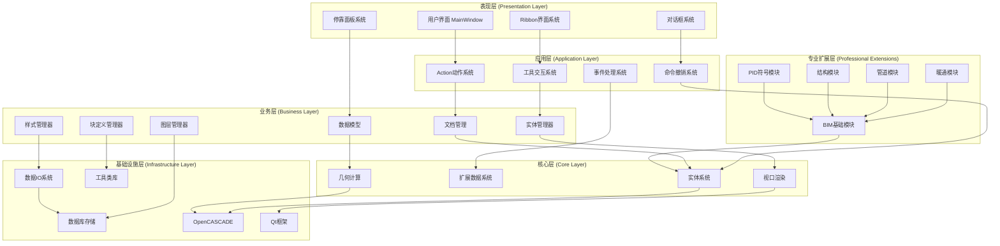

# OCCTBIM 系统整体架构

## 概述

OCCTBIM 是一个基于 OpenCASCADE 技术栈的专业 CAD/BIM 建模系统，采用分层架构设计，支持 2D 绘图、3D 建模、BIM 专业建模等功能。系统采用模块化设计，具有良好的可扩展性和可维护性。

## 系统架构层次

## 核心模块概述

### 1. 核心系统模块

#### Document 文档系统
- **职责**: 文档生命周期管理、多文档支持
- **核心类**: `Document`, `ApplicationContext`
- **功能**: 文档创建、打开、保存、关闭，文档状态管理

#### Entity 实体系统  
- **职责**: 几何对象的创建、管理和渲染
- **核心类**: `Entity`, `EntityManager`, `EntityRegistry`
- **功能**: 2D/3D实体、注释实体、BREP实体管理

#### Model 数据模型
- **职责**: 业务数据模型管理
- **核心类**: `Model`, `LayerManager`, `StyleManager`, `BlockDefinitionManager`
- **功能**: 图层、样式、块定义等业务对象管理

#### Tool 工具系统
- **职责**: 用户交互工具管理
- **核心类**: `Tool`, `ToolManager`, `ToolFactory`
- **功能**: 绘图工具、编辑工具、测量工具等交互逻辑

### 2. 扩展系统模块

#### Action 动作系统
- **职责**: 用户操作的配置化管理
- **核心类**: `Action`, `ActionManager`, `ActionFactory`
- **功能**: 菜单、工具栏、快捷键等用户操作的统一管理

#### ExtendData 扩展数据系统
- **职责**: 实体自定义属性扩展
- **核心类**: `ExtendData`, `ExtendDataManager`, `ExtendProperty`
- **功能**: 为实体添加自定义属性和数据

#### Command 命令系统
- **职责**: 操作的撤销重做管理
- **核心类**: `CommandStack`, `UndoCommand`, `TransactionManager`
- **功能**: 命令执行、撤销、重做、事务管理

### 3. 专业扩展模块

#### BIM 基础模块
- **职责**: BIM建模基础功能
- **核心类**: `ComponentBase`, `Port`, `PortManager`
- **功能**: BIM构件基类、连接端口管理

#### 专业建模模块
- **HVAC**: 暖通空调系统建模
- **Pipe**: 管道系统建模  
- **Structure**: 结构系统建模
- **PID**: 工艺流程图符号

## 技术架构特点

### 1. 分层架构
- **清晰的职责分离**: 每层有明确的职责边界
- **单向依赖**: 上层依赖下层，避免循环依赖
- **接口抽象**: 通过接口实现层间解耦

### 2. 模块化设计
- **功能模块化**: 按功能领域划分模块
- **可插拔架构**: 支持模块的动态加载和卸载
- **扩展机制**: 提供多种扩展点支持定制开发

### 3. 设计模式应用
- **工厂模式**: Entity、Tool、Action的创建管理
- **注册表模式**: EntityRegistry、ToolFactory等
- **命令模式**: 撤销重做系统
- **观察者模式**: 事件通知机制
- **策略模式**: 不同类型实体的处理策略

### 4. 数据管理
- **分离存储**: 几何数据与业务数据分离
- **增量更新**: 支持数据的增量保存和加载
- **事务支持**: 保证数据操作的一致性

## 关键技术选型

### 几何内核
- **OpenCASCADE 7.9.x**: 提供强大的几何建模和计算能力
- **AIS系统**: 应用交互服务，支持3D可视化和交互

### 用户界面
- **Qt 5.14.x**: 跨平台GUI框架
- **SARibbon**: 现代化Ribbon界面
- **OpenGL**: 3D图形渲染

### 数据存储
- **SQLite**: 轻量级数据库，存储业务数据
- **JSON**: 配置和扩展数据序列化
- **二进制格式**: 几何数据的高效存储

### 构建系统
- **CMake**: 跨平台构建系统
- **Unity Build**: 提升编译性能
- **模块化编译**: 支持增量编译

## 扩展机制

### 1. 实体扩展
通过 `EntityRegistry` 注册自定义实体类型，支持新的几何对象类型。

### 2. 工具扩展  
通过 `ToolFactory` 注册自定义交互工具，扩展用户交互功能。

### 3. 动作扩展
通过 `ActionFactory` 注册自定义动作，扩展菜单和工具栏功能。

### 4. 数据扩展
通过 `ExtendData` 系统为实体添加自定义属性和业务数据。

### 5. 专业模块扩展
通过BIM基础框架开发专业建模模块，如HVAC、管道等。

## 性能优化策略

### 1. 渲染优化
- **LOD机制**: 根据视图距离调整显示精度
- **视锥裁剪**: 只渲染可见区域的对象
- **批量渲染**: 减少渲染调用次数

### 2. 内存管理
- **对象池**: 重用频繁创建的对象
- **延迟加载**: 按需加载大型数据
- **智能指针**: 自动内存管理

### 3. 数据访问优化
- **索引优化**: 数据库查询优化
- **缓存机制**: 热点数据缓存
- **增量更新**: 只更新变化的数据

## 质量保证

### 1. 代码质量
- **编码规范**: 统一的代码风格和命名规范
- **静态分析**: 使用工具进行代码质量检查
- **代码审查**: 关键代码的同行评审

### 2. 测试策略
- **单元测试**: 核心算法和业务逻辑测试
- **集成测试**: 模块间接口测试
- **性能测试**: 关键路径的性能验证

### 3. 文档管理
- **架构文档**: 系统设计和架构说明
- **API文档**: 接口使用说明
- **用户手册**: 功能使用指南

这个架构设计确保了系统的可扩展性、可维护性和高性能，为CAD/BIM应用提供了坚实的技术基础。